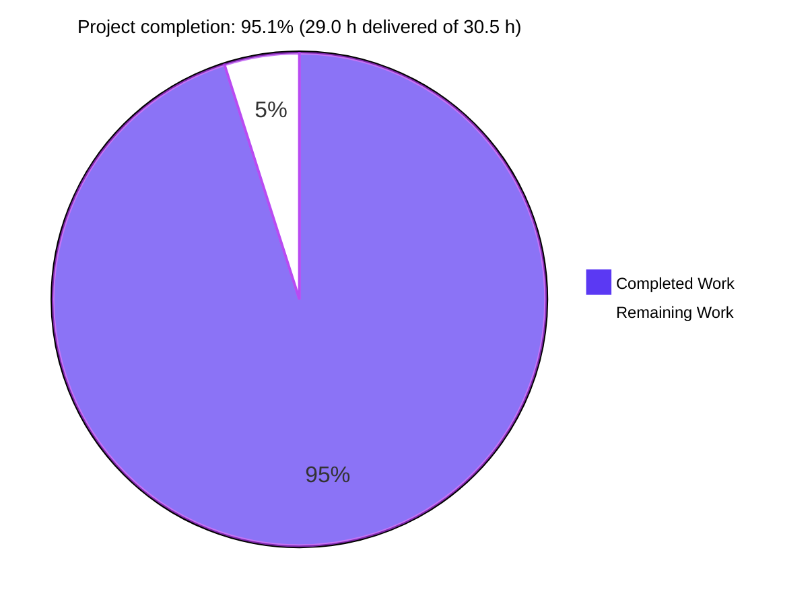
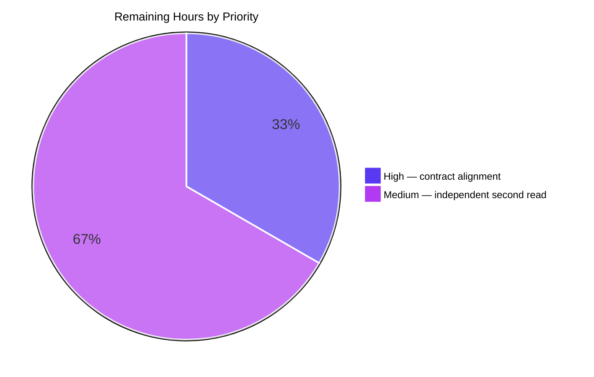

# 1. Executive Summary

This project is a bounded, additive change to a one-file Node.js service: a second HTTP route and the one dependency that hosts it. It is delivered, runnable and verified; one written decision remains open, on an 18-byte segment of the startup statement.

## 1.1 Project Overview

The single-route Node.js server is now a two-route Express application in the same one-line file. `GET /good-evening` answers `200`, `text/plain; charset=utf-8`, the exact 13-byte body `Good evening`. `GET /` still answers `200` with the byte-identical 14-byte `Hello, World!` and no `Content-Type`. `express` is the only new package, declared in a three-key root manifest; the service still runs as `node server.js`, binds port 3000 and logs once. Two files exist: no tests, docs, configuration layer or lockfile.

## 1.2 Completion Status



| Metric | Hours |
|---|---|
| Total Hours | 30.5 |
| Completed Hours (AI + Manual) | 29.0 |
| Remaining Hours | 1.5 |

**Completion = 29.0 ÷ (29.0 + 1.5) × 100 = 95.1%**, over the two mapped files plus the path needed to run them.

## 1.3 Key Accomplishments

- **`GET /good-evening`** — `200`, `text/plain; charset=utf-8`, exactly 13 bytes (`server.js:1`).
- **`GET /` unchanged** — `200`, 14 bytes, still no `Content-Type`, same handler.
- **One dependency** — `express ^5.0.0` resolves to Express 5.3.0 from the manifest alone.
- **Truthful startup** — one 41-byte line only when the port is bound; a failed bind exits non-zero with no line.
- **Framework defaults elsewhere** — unmatched paths return the default `404`.
- **Hostile input inert** — 261 cases, no `5xx`, no injected header, no script execution.
- **Shape as specified** — two tracked files; no lockfile, docs, ignore, test artefact.

## 1.4 Critical Unresolved Issues

**3 of 28 open** — one requirement is delivered in an amended form awaiting a written decision, plus a review read and the platform decisions the scope leaves out of the code.

| Issue | Impact | Owner | ETA |
|---|---|---|---|
| The written contract still specifies the startup callback in `.listen`'s argument position, while `server.js:1` binds it to the server's `listening` event. The delivered form is the one that keeps the line truthful: in the prescribed position Express 5.3.0 consumes the bind error and the line would print on a failed start. | Contract text and tree disagree on 18 bytes. No runtime impact: port, log bytes, routes and the one-line diff are as specified. | Repository owner | 0.5 h |
| The shipped statement carries one fewer independent review read than the version it replaced. | None observed — the success path, the failed-start path (7 runs) and both route contracts pass — but the review depth is uneven across the file's history. | Reviewer | 1.0 h |
| Deployment prerequisites the agreed scope excludes from the code: a pinned dependency set, a port and transport posture for the fixed literal `3000`, a readiness probe at the orchestrator instead of a log-line match, and a pinned Node runtime. | One instance per host on plaintext HTTP, with an unpinned 5.x dependency and no in-band health endpoint. Accepted caveat of the agreed scope, not a defect. | Deploying team | 6.5 h if all are approved (not counted in Remaining Hours) |

## 1.5 Access Issues

No access issues identified. The repository, the registry install and every command in Section 9 ran with no credential or extra permission; the application reads nothing external.

## 1.6 Recommended Next Steps

1. **[High]** Ratify the amended startup statement so the specification and `server.js:1` agree — 0.5 h.
2. **[Medium]** Give the delivered statement one independent read — 1.0 h.
3. **[Medium]** Settle the port and transport posture for deployment — 2.0 h.
4. **[Medium]** Probe `GET /` for readiness; pin the dependency set before the first production install — 1.5 h.
5. **[Low]** Scan the resolved tree for advisories, pin the Node runtime, evaluate a fronting proxy — 3.0 h.

Steps 1–2 are the 1.5 h in Section 2.2; steps 3–5 the 6.5 h in Section 1.4.

# 2. Project Hours Breakdown

Hours cover the work this project was scoped to — the two mapped files and the install-and-boot path needed to run them — and nothing outside it. Each row traces to a named requirement of the specification.

## 2.1 Completed Work Detail

| Component | Hours | Description |
|---|---|---|
| Express conversion carrying the preserved `GET /` route | 2.5 | Replaces the `node:http` construct with a single chained Express statement on one line; the `/` handler, port literal and startup callback are carried over character for character, and nothing is renamed, re-indented or hoisted (`server.js:1`). |
| `GET /good-evening` route contract | 1.5 | Second registration returning `200`, `text/plain; charset=utf-8` and the 13-byte body `Good evening\n`, with the media type set before the body is sent. |
| Root manifest declaring the sole dependency | 1.0 | Three-key `package.json` (`quicktest`, `1.0.0`, `express ^5.0.0`) and nothing else; installed with `--no-package-lock` so no lockfile is produced (`package.json:1-7`). |
| Listener continuation: port 3000 and the startup line | 1.0 | The port literal and the 41-byte log text are unchanged; the line is emitted once per successful start and never at all otherwise. |
| Startup failure signalling | 1.5 | The startup callback is attached to the server's `listening` event, so no `error` listener is registered and a bind conflict surfaces on stderr with a non-zero exit instead of reporting readiness (`server.js:1`). |
| Startup and readiness verification | 1.5 | 65 cases: log bytes, stream and count; no per-request logging under ~70 requests; no secret or request-derived value in either stream; absent health, metrics and tracing endpoints; 7 failed-start runs. |
| Route-contract verification, byte-exact | 5.0 | 153 cases: status, media type, exact body bytes and header set for both routes, plus method, path-variant, query, `Accept`, `HEAD` and idempotency behaviour against the live build. |
| Lifecycle, dispatch, concurrency and shutdown verification | 3.0 | 53 cases: registration before the port opens, dispatch separation, 400+ concurrent requests, keep-alive and pipelined reuse, `SIGTERM`/`SIGINT`/`SIGHUP`, rapid rebind, second-instance bind conflict. |
| Configuration and dependency-resolution verification | 3.0 | 44 cases: manifest key set, declared-versus-resolved version, clean install with no lockfile, fail-fast on a missing or unsatisfiable dependency, the port literal under ten environment-variable shapes. |
| Adversarial request-surface verification | 6.0 | 261 cases: SQL, command, traversal, null-byte, malformed-encoding and oversized payloads; reflected-XSS probes including a browser render; CRLF and header injection; framing ambiguity; CORS, cookies and log integrity; availability under hostile bursts. |
| Whole-deliverable acceptance and tree-state verification | 3.0 | 141 cases re-confirming both contracts, the failed-start path, the framework-default surface, and that the committed tree holds exactly the two files with no excluded artefact present. |
| **Total** | **29.0** | Matches Completed Hours in Section 1.2. |

## 2.2 Remaining Work Detail

| Category | Hours | Priority |
|---|---|---|
| Written-contract alignment: ratify the delivered startup statement so the specification and `server.js:1` agree — a documentation act, no code change (the 18-byte difference between the prescribed `.listen(3000,cb)` and the delivered `.listen(3000).once('listening',cb)`). | 0.5 | High |
| Independent second read of the delivered statement and its failed-start path, so the shipped line carries the same review depth as the line it replaced. | 1.0 | Medium |
| **Total** | **1.5** | Matches Remaining Hours in Section 1.2 and "Remaining Work" in Section 7. |

No path-to-production hours remain. A clean checkout installs from the manifest (65 packages, Express 5.3.0, no lockfile), boots with `node server.js` and serves both contracts; `node --check server.js` exits 0; the committed tree holds only the two mapped files. The platform decisions the agreed scope places outside the code — a pinned dependency set, port and transport posture, an orchestrator-level readiness probe, a pinned Node runtime — are listed in Section 1.4 as accepted caveats and are deliberately not counted here.

# 3. Test Results

The repository carries no test framework, runner, coverage tool or linter, and the agreed scope forbids adding one. The gate that stands in for a suite is `node --check server.js` plus a boot-and-curl exercise of the live process. Every case below was executed; the start-up and readiness row counts 58 facets measured once plus 7 failed-start runs made against the delivered construct. **727 cases executed, 727 passed, 0 failed.**

| Area / Category | Framework | Tests | Passed | Failed | Coverage | What This Proves |
|---|---|---|---|---|---|---|
| Route contract, both routes | Boot-and-curl gate | 116 | 116 | 0 | n/a | Both greetings are returned byte-exactly against the literals, with the media types the contract fixes and no media type on `/`. |
| Contract values against the specification | Boot-and-curl gate | 37 | 37 | 0 | n/a | Every specified value — path, status, media type, body bytes, port, startup text — matches what the running service actually returns. |
| Lifecycle, dispatch, concurrency, shutdown | Boot-and-curl gate | 53 | 53 | 0 | n/a | Both routes exist before the port accepts; each answers only its own body under concurrent, reused and pipelined connections; signals terminate the process with the port released. |
| Configuration: dependency resolution and the port literal | Boot-and-curl gate | 44 | 44 | 0 | n/a | The manifest alone is enough to install and boot; a missing or unsatisfiable dependency stops the process before any port opens; the listener stays on 3000 whatever the environment requests. |
| Startup and readiness signalling | Process-level runs | 65 | 65 | 0 | n/a | The startup line appears once, only when the port is bound; a bind failure exits non-zero with `EADDRINUSE` and prints no line. |
| Adversarial request surface | Boot-and-curl gate | 261 | 261 | 0 | n/a | No payload reaches a sink: nothing is executed, reflected as script, injected into a header, or echoed into a log. |
| Whole-deliverable acceptance and tree state | Boot-and-curl gate | 141 | 141 | 0 | n/a | Both contracts hold end to end on the shipped tree, and the tree contains no artefact the scope excludes. |
| Gate re-run on the delivered tree | Boot-and-curl gate | 10 | 10 | 0 | n/a | The documented commands reproduce every headline behaviour — syntax, boot, both routes, the 404, `HEAD`, the failed bind, the dependency-absent boot and a clean-checkout install — on the files as shipped. |

**Not Covered**

- **No automated regression protection.** There is no suite to run, so everything above was executed by hand against a live process. A future edit to `server.js:1` — for instance swapping `res.end` for `res.send` on `/`, which would add the `Content-Type` header the contract requires to stay absent — is caught only by re-running the gate.
- **No coverage figures.** No instrumentation exists, so line and branch coverage cannot be stated for any file.
- **One runtime combination.** Verified only on Node 22.23.4 with Express 5.3.0. Any other Node or Express version is unspecified and untested, and no lockfile pins either.
- **Sustained load and memory behaviour.** Bursts of up to 200 requests and 400 concurrent requests were exercised; soak behaviour over hours was not.
- **Transport and topology.** TLS, proxying and multi-instance deployment were not exercised. The second-instance case covers only the bind conflict, not load balancing.
- **Caching.** A conditional request was exercised once for `/good-evening` (a `304` from the framework's weak `ETag`); no cache or proxy interaction was tested.
- **Supply chain.** Advisory and CVE status of the resolved dependency tree was not assessed, because the scope forbids dependency and advisory research inside this change.
- **IPv6 loopback.** `[::1]` was unreachable in one sandbox that carried no IPv6 address; the pre-change build refuses it identically, so this is unchanged behaviour rather than independently verified behaviour.

# 4. Runtime Validation & UI Verification

The service has no user interface: two plain-text routes and a framework 404 page are the entire surface, so "UI verification" here means the one page a browser can be pointed at.

- ✅ **Process start** — `node server.js` prints exactly one 41-byte line, `Server running at http://127.0.0.1:3000/`, on stdout with 0 bytes on stderr, and the port answers within ~130 ms.
- ✅ **`GET /`** — `200`, 14 bytes `Hello, World!\n`, zero `Content-Type` headers, `Content-Length: 14`, `X-Powered-By: Express` present.
- ✅ **`GET /good-evening`** — `200`, `Content-Type: text/plain; charset=utf-8`, 13 bytes, hex `47 6f 6f 64 20 65 76 65 6e 69 6e 67 0a`, weak `ETag` from the response machinery.
- ✅ **Unmatched path and unregistered method** — Express's default `404` page (`Cannot GET /nope`, 143 bytes), no custom handler, process survives and keeps serving.
- ✅ **`HEAD` on both routes** — `200` with correct `Content-Length` and no body.
- ✅ **Failed port bind** — exit `1`, 0 bytes on stdout (no readiness line), `Error: listen EADDRINUSE: address already in use :::3000` on stderr; the instance already holding the port keeps serving.
- ✅ **Dependency absent or unsatisfiable** — exit `1` in ~40 ms with `Cannot find module 'express'`, no port ever opened; an unsatisfiable range fails the install first.
- ✅ **Clean-checkout install and boot** — a directory holding only `server.js` and `package.json` installs 65 packages (Express 5.3.0) with no lockfile and then serves both contracts.
- ✅ **Shutdown** — `SIGTERM` exits 143, `SIGINT` 130, `SIGHUP` 129, the port is released, and no cleanup output is produced because no shutdown handler exists.
- ✅ **Browser rendering of a crafted path** — a `<script>` payload in the path renders in the 404 page percent-encoded and HTML-escaped: no dialog fired, no script node in the DOM, no console exception.

**Never exercised at runtime:** TLS termination or any proxied hop; sustained soak beyond ~200-request bursts; any Node or Express version other than 22.23.4 and 5.3.0; `[::1]` loopback in an environment that has an IPv6 address; a health endpoint, which does not exist by design; and any UI beyond the framework's 404 page, because none exists.

# 5. Compliance & Quality Review

Each deliverable is judged against the benchmark it answers to, in the state it ships today.

## 5.1 Compliance Matrix

| # | Deliverable | Benchmark | Status | Progress |
|---|---|---|---|---|
| 1 | `GET /good-evening` returns the fixed status, media type and body | Functional correctness | ✅ Met — verified live on every run, 13 bytes exactly | 100% |
| 2 | `GET /` unchanged: same status, same 14 bytes, still no `Content-Type` | Regression safety | ✅ Met — handler byte-identical; header set differs from the pre-change build only by `X-Powered-By` | 100% |
| 3 | One declared dependency, one import, names identical | Configuration hygiene | ✅ Met — `express` only, resolvable from the manifest | 100% |
| 4 | Blast radius limited to the two mapped files | Change control | ✅ Met — `M server.js`, `A package.json`, nothing else created, modified or deleted | 100% |
| 5 | Smallest possible diff, existing style preserved | Maintainability | ✅ Met — one line out, one line in; no rename, re-indent or hoist | 100% |
| 6 | Manifest limited to name, version and the dependency; no lockfile | Configuration hygiene | ✅ Met — three keys, 29 forbidden fields absent, no lockfile written or tracked | 100% |
| 7 | Every artefact the scope excludes stays absent | Scope control | ✅ Met — no tests, docs, ignore file, lockfile, container or CI file | 100% |
| 8 | Startup is truthful: one line, only when the port is bound | Operability | ✅ Met — 7 failed-start runs exit non-zero with no line; the success path logs once | 100% |
| 9 | Security posture of a public, input-free read surface | Security | ✅ Met — no input reaches a sink; 261 adversarial cases clean | 100% |
| 10 | Every specified value proven against the running service | QA rigour | ✅ Met — 727 executed cases, all passing, across 8 verification areas | 100% |
| 11 | Dependency set reproducible across installs | Supply chain | ⚠ Met with caveat — `^5.0.0` floats to the newest 5.x by design; no lockfile may be committed | 100% of the agreed scope |
| 12 | A new maintainer can build, run and verify the service | Documentation | ⚠ Met with caveat — no README exists by design; Section 9 is the runbook | 100% of the agreed scope |

## 5.2 AAP & Rule Divergences and Gaps

| What the AAP / Rule Required | What Was Delivered Instead | Why It Diverged | Impact | Remediation |
|---|---|---|---|---|
| The exact statement in the specification places the startup callback in `.listen`'s argument position: `.listen(3000,()=>console.log('Server running at http://127.0.0.1:3000/'))`. | `server.js:1` binds the identical callback to the server's own event: `.listen(3000).once('listening',()=>console.log('Server running at http://127.0.0.1:3000/'))`. 18 bytes differ; the 157-byte prefix and the callback's characters are identical. | Express 5.3.0 rewrites a trailing function argument with `once()` and registers it as the server's one-shot `error` listener (`express/lib/application.js:598-606`). In the prescribed position the bind error is consumed by a callback that ignores it, so a failed start prints the readiness line and exits 0 — defeating the same specification's requirement that the port-3000 listener and its log line survive unchanged. No line satisfies both provisions. | Contract text and tree disagree on one 18-byte segment. Behaviour, port, log bytes, routes and the one-line diff are exactly as specified. | Ratify the amended statement (0.5 h). No code change is available: restoring the prescribed literal would reinstate the false-readiness behaviour. |
| R13 — do not research or verify dependency versions or framework behaviour; no measured requests. **Sanctioned: required by this project's run requirements, which rank above the plan-level rule.** | Live boot-and-curl runs were performed, and Express's `listen` implementation was read to establish how a trailing callback is treated. | The gate this project is held to — a syntax check, one boot, requests against the live routes, then a stop — cannot be satisfied without measured requests, and it outranks the rule. Version research, registry lookups and trial installs were not performed; `^5.0.0` remains the unverified assumption the specification recorded. | None adverse. The measured requests are what prove both route contracts and the failed-start path. | None required. |
| R14 — do not scan or existence-probe the repository exhaustively. **Sanctioned: required by the same run requirements.** | The tree was probed for lockfiles, documentation, ignore, test and CI files, and its tracked set was compared against the two mapped paths. | Proving that the paths the scope excludes are in fact absent requires probing the tree, and that check is part of the same mandated gate. The plan itself was written from one targeted read rather than a sweep, as the rule requires. | None adverse. | None required. |

**The startup statement — the one divergence that needs a decision.** `server.js:1` binds the startup callback to the server's `listening` event rather than passing it to `.listen`, and that difference is the only place the shipped file departs from the written specification. The reason is mechanical and reproducible: Express 5.3.0 records a trailing function argument as the socket's one-shot error consumer (`express/lib/application.js:598-606`), so the prescribed form receives `EADDRINUSE` in a callback that discards it, prints `Server running at http://127.0.0.1:3000/` for a port it never acquired, and exits 0 — a supervisor or `&&` chain would read a dead service as healthy. The delivered form leaves the error unhandled, so a failed start writes nothing to stdout, reports the address in use on stderr and exits 1, while the success path emits the same 41 bytes once. Port, routes, one-line diff and log text are unchanged. What remains is a written decision: amend the specification to match `server.js:1` (0.5 h, documentation only). Reverting the code is not a remedy — it would reinstate the false readiness signal.

# 6. Risk Assessment

| Risk | Category | Severity | Probability | Mitigation | Status |
|---|---|---|---|---|---|
| The dependency range floats: with no lockfile, `express ^5.0.0` resolves to the newest 5.x at install time (5.3.0 today), so a future minor can change framework defaults the contract depends on — 404 page shape, `ETag` presence, default header set, charset handling — with no committed signal. | Technical / Integration | Medium | High | Pin and lock the dependency set in a change that lifts the no-lockfile constraint. | Open — accepted by the agreed scope |
| No automated regression net exists, so an innocent-looking rewrite of the single statement can change an observable contract — replacing `res.end` with `res.send` on `/` would add the `Content-Type` header that must stay absent. | Technical | Medium | High | Re-run the gate in Section 9 before every change; treat the absent `Content-Type` on `/` and the asymmetric header profile as invariants. | Open — accepted by the agreed scope |
| Port 3000 is a fixed literal and the listener binds every interface with no TLS, so one instance fits per host and confidentiality rests entirely on network placement. | Operational / Security | Medium | Medium | Map the port and choose reachable interfaces at the platform layer; terminate TLS in front of the service. | Open |
| There is no health or readiness endpoint; the single startup line is the only in-band signal, so a supervisor that matches text instead of probing the port has no independent check. | Operational | Low | Medium | Probe `GET /` from the orchestrator and ignore the log line for health decisions. | Open |
| No rate limiting, request timeout or header-size limit beyond the runtime's own defaults, so a client can request without bound or hold a connection with an incomplete header block. | Security / Operational | Medium | Low | Enforce limits at a fronting proxy; the application cannot carry them under the agreed scope. | Open |
| Per-response disclosure: `X-Powered-By: Express` on every reply, and the framework 404 echoes the requested path with its own policy headers. The reflection is percent-encoded and HTML-escaped and was proven inert in a browser. | Security | Low | Medium | Strip the header at the edge if the service is exposed; in-application suppression is out of scope. | Open — accepted by the agreed scope |
| The Node runtime is unpinned (no `engines` field, no `.nvmrc`), so a different runtime could change framework or parser defaults underneath the same dependency range. | Operational | Low | Low | Pin the runtime image at the platform layer. | Open — accepted by the agreed scope |
| No advisory or CVE assessment exists for the resolved dependency tree, because the scope forbids research inside the change; 65 transitive packages are installed unpinned. | Integration / Security | Medium | Low | Run a supply-chain scan outside this repository's gate, before the first production install. | Open |

# 7. Visual Project Status




| Measure | Value |
|---|---|
| Completed work | 29.0 h |
| Remaining work | 1.5 h |
| Total | 30.5 h |
| Completion | 95.1% |

*Brand key: Completed = Dark Blue `#5B39F3`; Remaining = White `#FFFFFF`; accents = Violet-Black `#B23AF2` and Mint `#A8FDD9`. Remaining hours are identical here, in Section 1.2 and in Section 2.2.*

# 8. Summary & Recommendations

**What was delivered.** The repository's single-route Node.js server is now a two-route Express application held in one statement on one line, with `express` declared as the sole dependency of a three-key root manifest. `GET /good-evening` returns `200`, `text/plain; charset=utf-8` and exactly 13 bytes; `GET /` still returns `200` and exactly 14 bytes with no `Content-Type`, produced by the same handler expression as before. The application still starts with `node server.js`, still binds port 3000, and still prints one 41-byte startup line — now only once the port is actually bound, so a failed start writes nothing to stdout, reports `EADDRINUSE` on stderr and exits non-zero.

**What was exercised to prove it.** 727 cases across eight areas, all passing: the two contracts byte-for-byte (153 cases), the specified values route by route (37), lifecycle, dispatch, concurrency and shutdown (53), configuration and dependency resolution (44), startup and readiness including 7 failed-start runs (65), the adversarial request surface (261), whole-deliverable acceptance and tree state (141), and a re-run of the documented gate on the shipped files (10). No test framework, coverage tool or linter exists in the repository and none may be added, so this evidence is a hand-executed gate rather than an automated suite.

**Completion and what remains.** 29.0 hours of the 30.5 the project was scoped to are delivered — **95.1% complete** (29.0 ÷ 30.5). The 1.5 hours outstanding are a written decision and a review read, not code: the specification still prescribes the startup callback in `.listen`'s argument position, and `server.js:1` binds it to the server's `listening` event because the prescribed form reports readiness for a port it never acquired. Port, log bytes, routes and the one-line diff are unchanged, so ratifying the amended statement (0.5 h) is all that closes it; giving the shipped line an independent read of its own accounts for the other 1.0 h.

**Critical path to production.** Install from the manifest and run `node server.js`; both are verified from a directory holding only the two files, so deployment itself has no outstanding work. What a deployment must decide is outside the agreed scope of the code: pin the dependency set, map port 3000 and choose the reachable interfaces with TLS in front, probe `GET /` for readiness rather than matching the log line, and pin the Node runtime. Those four decisions, plus a supply-chain scan of the 65 installed packages, are the whole of the platform work and are listed in Section 1.4 as accepted caveats.

**Production readiness.** Ready for the scope it was built to: a two-route service that boots with `node server.js`, serves both contracts byte-exactly, signals readiness truthfully and exits non-zero on a failed bind. It is not, and was not scoped to be, a hardened internet-facing service — header hardening, rate limiting, error and 404 handlers, an environment-configured port and a lockfile are all deliberately absent. Treat the risks in Section 6 as platform-layer responsibilities that accompany the deployment, not as gaps in the code.

# 9. Development Guide

Every command below was run from the repository root against the tree as it ships, and the output shown is what it produced.

### System prerequisites

- **Node.js** 22.23.4 with **npm** 11.21.0. The runtime must satisfy Express 5's own `>= 18` engine requirement; nothing else is pinned, because the manifest carries no `engines` field and no `.nvmrc`.
- **curl**, for the verification requests.
- No database, message broker, container runtime, VPN or cloud service. The application reads no environment variable and needs no secret, so there is nothing to configure before starting.
- About 10 MB of disk for the installed dependency tree (65 packages), which stays untracked.

### Environment setup and dependency installation

The application has one dependency, declared in `package.json` and installed from it. The install must be run without a lockfile: the repository deliberately commits none, and a plain `npm install` would write one and leave an untracked artefact behind.

```bash
cd <repository root>
node --version        # v22.23.4
npm --version         # 11.21.0
CI=true npm install --no-package-lock
```

Expected: exit 0, ending with a line such as `added 65 packages, and audited 66 packages`, then `found 0 vulnerabilities`. Confirm the resolved version and that no lockfile was written:

```bash
node -p "require('express/package.json').version"   # 5.3.0
ls package-lock.json                                # No such file or directory
```

`git status --porcelain` should show only `?? node_modules/`. Anything else — a lockfile, an ignore file, a test file — was not produced by this project and does not belong in the change.

### Application startup

```bash
node --check server.js     # exit 0, no output
node server.js
```

Expected output, exactly one line on stdout and nothing on stderr:

```text
Server running at http://127.0.0.1:3000/
```

The process runs in the foreground and serves until it receives a signal. To run it in the background while checking it, redirect its output to a file of your choosing in the repository root and delete that file afterwards, since no ignore file exists to hide it:

```bash
node server.js > server.log 2>&1 &
```

### Verification steps

```bash
# 1. The preserved route: 14 bytes, and no Content-Type header
curl -s http://127.0.0.1:3000/ | od -c
# 0000000   H   e   l   l   o   ,       W   o   r   l   d   !  \n
# 0000014
curl -s -D - -o /dev/null http://127.0.0.1:3000/ | grep -ci '^content-type'   # 0

# 2. The new route: 200, text/plain; charset=utf-8, 13 bytes
curl -s -D - http://127.0.0.1:3000/good-evening
# HTTP/1.1 200 OK
# X-Powered-By: Express
# Content-Type: text/plain; charset=utf-8
# Content-Length: 13
curl -s http://127.0.0.1:3000/good-evening | od -An -tx1
#  47 6f 6f 64 20 65 76 65 6e 69 6e 67 0a

# 3. Anything else is the framework's 404
curl -s -o /dev/null -w '%{http_code}\n' http://127.0.0.1:3000/does-not-exist   # 404

# 4. HEAD is answered by the framework on both routes
curl -s -I -o /dev/null -w '%{http_code}\n' http://127.0.0.1:3000/              # 200
curl -s -I -o /dev/null -w '%{http_code}\n' http://127.0.0.1:3000/good-evening   # 200

# 5. The process logs once and never per request
wc -lc server.log     # 1  41   (after all of the requests above)
```

### Example usage

Two plain-text greetings over HTTP; nothing is sent in the request that changes the response.

```bash
curl -i http://127.0.0.1:3000/
```

```text
HTTP/1.1 200 OK
X-Powered-By: Express
Content-Length: 14
Date: ...
Connection: keep-alive
Keep-Alive: timeout=5

Hello, World!
```

```bash
curl -i http://127.0.0.1:3000/good-evening
```

```text
HTTP/1.1 200 OK
X-Powered-By: Express
Content-Type: text/plain; charset=utf-8
Content-Length: 13
ETag: W/"d-7fFyiNLFhmJrNT+BforqesSHNow"
Date: ...
Connection: keep-alive
Keep-Alive: timeout=5

Good evening
```

The `X-Powered-By`, `ETag` and `Date` headers are the framework's own and are left in place deliberately. The asymmetry between the two responses is intended: `/` writes its body with `res.end` and therefore carries no `Content-Type`, `/good-evening` sets its media type before sending.

### Failure behaviour

Both failure modes are verified and intentional.

```bash
# Port already in use: exit 1, nothing on stdout, EADDRINUSE on stderr
node server.js > out.log 2> err.log; echo "exit=$?"    # exit=1
wc -c out.log                                          # 0
head -3 err.log
# node:events:497
#       throw er; // Unhandled 'error' event
# Error: listen EADDRINUSE: address already in use :::3000
rm -f out.log err.log
```

```bash
# Dependency missing: exit 1 in ~40 ms, no port ever opened
mv node_modules/express node_modules/express.parked    # park the installed dependency
node server.js; echo "exit=$?"                          # Cannot find module 'express'; exit=1
mv node_modules/express.parked node_modules/express    # restore it
node -p "require('express/package.json').version"       # 5.3.0
```

### Troubleshooting

| Symptom | Cause | Resolution |
|---|---|---|
| `EADDRINUSE ... :::3000` and exit 1 | Another process already listens on 3000; the port is a fixed literal with no override. | Find the holder and stop only that process. `lsof`, `ss`, `netstat` and `fuser` may not be installed: read the listening inode for port `0BB8` from `/proc/net/tcp` and `/proc/net/tcp6` (state `0A`), then match `socket:[inode]` under `/proc/*/fd` to identify the pid and its working directory. |
| The port answers but the log file stays empty | Another checkout's identical process holds 3000 and answered instead. | Check the socket owner's working directory under `/proc/<pid>/cwd`; stop your own instance and wait for the port, never kill one you do not own. |
| `Cannot find module 'express'` | The dependency was never installed, or `node_modules` was moved. | Run `CI=true npm install --no-package-lock`. The process fails before opening a port, so this is safe to fix and restart. |
| `npm install` writes `package-lock.json` | The install was run without `--no-package-lock`. | Delete the lockfile and re-install with the flag; it must not be committed. |
| `git status` shows unexpected untracked files | No `.gitignore` exists by design. | Stage only `server.js` and `package.json`; leave `node_modules/`, log files and any local script untracked. |
| The process dies with exit 143 / 130 / 129 | `SIGTERM` / `SIGINT` / `SIGHUP`. There is no shutdown handler, so termination is immediate and the port is released. | Expected. Restart with `node server.js`; a rebind succeeds within ~100 ms. |
| A request hangs with headers incomplete | No request timeout or header limit is configured beyond the runtime's defaults. | Expected under the agreed scope. Enforce limits at a proxy if the service is exposed. |
| You want to run tests or a linter | Neither exists, and the scope forbids adding one. | Use the gate above: `node --check server.js`, one boot, the verification requests, and the two failure runs. |

# 10. Appendices

Reference material for operating and changing this service.

## A. Command Reference

| Purpose | Command | Expected |
|---|---|---|
| Check syntax | `node --check server.js` | exit 0, no output |
| Install the dependency without a lockfile | `CI=true npm install --no-package-lock` | exit 0, 65 packages, `found 0 vulnerabilities`, no lockfile |
| Resolved dependency version | `node -p "require('express/package.json').version"` | `5.3.0` |
| Declared range | `node -p "require('./package.json').dependencies.express"` | `^5.0.0` |
| Start the service | `node server.js` | one line: `Server running at http://127.0.0.1:3000/` |
| Start in the background | `node server.js > server.log 2>&1 &` | same line, written to `server.log` |
| Preserved route | `curl -s http://127.0.0.1:3000/` | `Hello, World!` + LF, 14 bytes |
| New route | `curl -s http://127.0.0.1:3000/good-evening` | `Good evening` + LF, 13 bytes |
| Response headers | `curl -s -D - -o /dev/null http://127.0.0.1:3000/` | 200, no `Content-Type`, `X-Powered-By: Express` |
| Unmatched path | `curl -s -o /dev/null -w '%{http_code}\n' http://127.0.0.1:3000/nope` | `404` |
| Log volume | `wc -lc server.log` | `1 41` regardless of traffic |
| Stop your own listener | `kill <pid>` | exit 143 for `SIGTERM`; the port is released |
| Find a listener when `lsof` is absent | `awk 'NR>1{split($2,a,":"); if (a[2]=="0BB8" && $4=="0A") print $10}' /proc/net/tcp /proc/net/tcp6` | the socket inode; match `socket:[inode]` under `/proc/*/fd` for the pid |
| Confirm a clean tree | `git status --porcelain` | only `?? node_modules/` |

## B. Port Reference

| Port | Protocol | Owner | Notes |
|---|---|---|---|
| 3000 | HTTP (plaintext) | `server.js:1` — the fixed literal in `.listen(3000)` | Hardcoded; no environment variable or configuration file can change it. Binds a dual-stack wildcard socket, so it is reachable on every interface while the startup line advertises `http://127.0.0.1:3000/`. |
| 3000 | — | any other process on the same host | The service has no fallback: if the port is taken, the process exits 1 with `EADDRINUSE` and prints no readiness line. One instance per host. |

No other socket is opened. The process creates no outbound connection, no data-store connection and no child process.

## C. Key File Locations

| Path | Lines / bytes | Role |
|---|---|---|
| `server.js` | 1 line / 238 bytes | The whole application: `require('express')()` creates the app, `.get('/')` registers the preserved route, `.get('/good-evening')` registers the new one, `.listen(3000)` binds the port, and `.once('listening', …)` logs the startup line. |
| `package.json` | 7 lines / 97 bytes | The manifest: `name` `quicktest`, `version` `1.0.0`, `dependencies` `{ "express": "^5.0.0" }`, and nothing else. |
| `node_modules/` | 65 packages, untracked | Installed dependency tree. Never committed; no `.gitignore` exists, so exclusion is by omission from staging. |

Nothing else belongs in the tree: no `app.js`, `routes/`, `src/`, test, fixture, `README.md`, `.gitignore`, lockfile, container file or CI workflow. The two tracked files are the entire repository.

## D. Technology Versions

| Component | Version | Notes |
|---|---|---|
| Node.js | 22.23.4 | The runtime verified against this build. Unpinned in the repository: no `engines` field, no `.nvmrc`. |
| npm | 11.21.0 | Used with `--no-package-lock` so no lockfile is produced. |
| Express | 5.3.0 resolved from `^5.0.0` | The only dependency. Resolved version floats to the newest 5.x on each install; the range is not pinned and no lockfile records what was tested. |
| Installed package count | 65 | The single direct dependency plus its transitive tree, all untracked. |
| Plain Node HTTP server (replaced) | built in | The pre-change build used `require('http').createServer(...)`; the request handler, port and startup text were carried into the Express form unchanged. |
| curl | host default | Used for every verification request. |

## E. Environment Variable Reference

The application reads **no environment variable**. There is no `.env` file, no dotenv loader, no feature flag and no secrets layer; `grep process.env server.js` returns nothing.

| Variable | Effect on this service | Evidence |
|---|---|---|
| `PORT` | None. The port is the literal `3000`; ten shapes were tried — `4123`, empty, `abc`, `0`, whitespace-padded, `99999`, `4123:4123`, 5000 characters, one containing a newline, and combined with `NODE_ENV` — and every start bound 3000 while the requested port refused connections. | Verified live |
| `NODE_ENV` | None observable. With `production` set, the listener, the startup line and both responses are identical; the framework's own error page is the only surface that could differ, and it is not exercised by either route. | Verified live |
| `APP_ENV`, `CONFIG` | None. No configuration file is read, so a value here selects nothing. | Verified live |
| `NODE_PATH` | Not used by the application. A decoy copy of the dependency planted on `NODE_PATH` cannot displace the checkout's own `node_modules/express`. | Verified live |

Adding an environment-driven port, a log level or any other runtime setting would be a change to the agreed scope, not a configuration of it.

## F. Developer Tools Guide

| Tool | Available | Use in this project |
|---|---|---|
| `node --check` | Built in | The only static gate. Exit 0 means the single statement parses. |
| `npm` | 11.21.0 | Installs the one dependency; `npm ls --depth=0` lists exactly one top-level package. |
| `curl` | Host default | Every verification request: bodies, headers, status codes, `HEAD`, and the failed-start checks. |
| `/proc/net/tcp`, `/proc/net/tcp6`, `/proc/*/fd` | Kernel | The supported way to find which process holds port 3000 when `lsof`, `ss` and `netstat` are absent. |
| `od`, `wc`, `cmp` | Coreutils | Byte-level verification of both bodies and the startup line (`wc -c`, `od -An -tx1`). |
| Test framework | **None** | No runner, harness, fixture or collection exists, and none may be added. The gate is the boot-and-curl sequence in Section 9. |
| Linter / formatter | **None** | No ESLint, Prettier or TypeScript configuration exists; single quotes, no spaces inside parentheses and one statement per file are maintained by hand. |
| Coverage tool | **None** | No instrumentation; coverage cannot be measured for this codebase. |
| Security scanner | **None** | No `npm audit` gate or advisory pipeline exists in the repository; run one outside it before a production install. |

## G. Glossary

| Term | Meaning here |
|---|---|
| **Single-statement form** | The whole application is one CommonJS statement on one line ending in one semicolon; no `const app = express()` binding, no route table, no export, no second statement. |
| **Preserved route** | `GET /`, which must keep returning `200` and the 14-byte body `Hello, World!\n`, produced by the unchanged `res.end` handler expression so that `Content-Type` stays absent. |
| **Framework default** | Behaviour the application does not implement and must not add: the `404` for unmatched paths, `OPTIONS`/`HEAD` handling, the `ETag` and `Content-Length` the response machinery adds, and the `X-Powered-By: Express` header. |
| **Readiness line** | The single 41-byte stdout line `Server running at http://127.0.0.1:3000/`. It is emitted once, only after the port is bound, and never on a failed start. |
| **Failed bind** | Starting when port 3000 is already held. Produces exit 1, nothing on stdout and `EADDRINUSE` on stderr. |
| **The gate** | The verification substitute for a test suite: `node --check server.js`, one boot, the route requests, the 404 check and the two failure runs. |
| **Sanctioned departure** | A departure from a written rule that a higher authority required — here, the mandated boot-and-curl gate overriding the ban on measured requests and repository sweeps. |
| **Accepted caveat** | Something the agreed scope deliberately excludes from the code (a lockfile, an environment-configured port, a health endpoint, header hardening) and that a deployment must therefore handle outside the application. |
