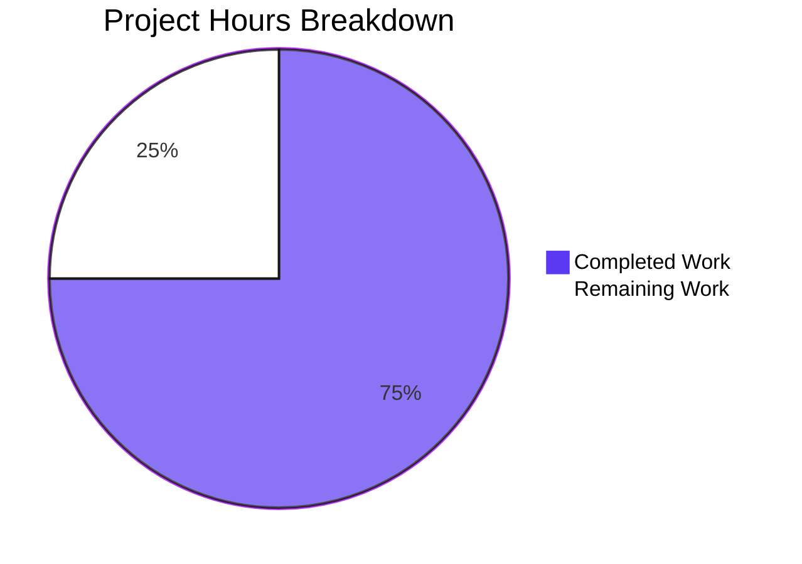
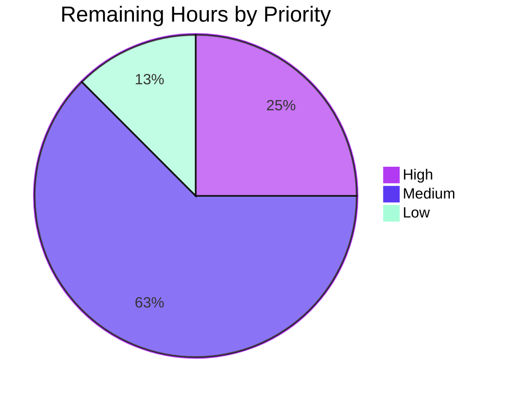

# 1. Executive Summary

## 1.1 Project Overview

The QuickTest server is a single-file Node.js HTTP service. This work adds one endpoint — `GET /good-evening`, answering `200` with `Content-Type: text/plain` and the 12-byte body `Good evening` — to a server that previously answered every request with the same 14-byte `Hello, World!` response. The route is served by the existing listener on port 3000; no framework, manifest, dependency or configuration was added, and every other request keeps its previous response byte for byte. The change is two files: `server.js` (12 lines) and `test/good-evening.test.js` (184 lines, four cases).

## 1.2 Completion Status



**75% complete** — 48 hours delivered of 64 total, with 16 hours remaining. 48 ÷ (48 + 16) × 100 = 75.0%. Completed work is Dark Blue (#5B39F3); remaining work is White (#FFFFFF).

| Metric | Hours |
|---|---|
| Total Hours | 64 |
| Completed Hours (AI + Manual) | 48 |
| Remaining Hours | 16 |

## 1.3 Key Accomplishments

- `GET /good-evening` answers `200` with `Content-Type: text/plain`, `Content-Length: 12` and the exact 12-byte body `Good evening` (`server.js:1-10`).
- Only the exact path changes response, and every method sent to it receives the new response, `HEAD` included (`server.js:7`).
- Every other request — any path, any method — is byte-identical to the previous behaviour: `200`, no `Content-Type`, `Content-Length: 14`, body `Hello, World!` (`server.js:11`).
- Start-up prints exactly one stdout line and nothing on stderr, and shutdown releases port 3000 (`server.js:12`).
- A four-case `node:test` suite runs from the repository root with no install step: 4 tests, 4 passed, 0 failed, 168 assertions.

## 1.4 Critical Unresolved Issues

All seven objectives restated for this work are delivered and verified. Three items remain open for the owner, none of them a shortfall in the delivered behaviour.

| Issue | Impact | Owner | ETA |
|---|---|---|---|
| Harness failure-path branches that no committed test reaches (3 branches) | Diagnostics for a port conflict, an unspawnable child and a server that never replies are unproven by the suite; a later edit could break them unnoticed | Development | Next maintenance window (2 h) |
| Fixed literal port with no configuration surface (1 constraint) | One instance per host; parallel test or CI runs fail to bind with `EADDRINUSE` | Development / Operations | Before first deployment (4 h) |
| No CI gate, packaging or deployment definition (3 artefacts) | The gate is run by hand and each deployment is assembled manually | Development / Operations | Before production (8 h) |

## 1.5 Access Issues

No access issues identified. The service reads no environment variable, needs no credential and calls no external service; its only host resource, TCP port 3000, was available for every verification run.

## 1.6 Recommended Next Steps

1. **[High]** Make the listen port and bind address configurable (default 3000) and have the suite derive the port it tests — 4 hours.
2. **[Medium]** Add a CI gate that runs the syntax check and the four-case suite on every push — 3 hours.
3. **[Medium]** Add a deployment definition (service wrapper or container image with a readiness probe) — 5 hours.
4. **[Medium]** Add tests for the harness's failure paths: port occupied, unspawnable child, server that never replies — 2 hours.
5. **[Low]** Write the operational runbook — 2 hours.

# 2. Project Hours Breakdown

## 2.1 Completed Work Detail

| Component | Hours | Description |
|---|---|---|
| `/good-evening` route and handler in `server.js` | 6 | The exact-equality branch at the head of the one request handler, and the named `goodEvening(req,res)` handler that sets the header and writes the 12-byte body (`server.js:1-10`) |
| Response framing and header API settled against the runtime | 3 | `res.setHeader` with a single `res.end` chosen over `writeHead` after measuring both, so the new response keeps `Content-Length` framing instead of chunked (`server.js:2-3`) |
| Preservation of every other response | 5 | The previous body write, the port binding and the readiness line carried over character for character, with the pre-change response inventory captured and re-asserted (`server.js:11-12`) |
| Contract and regression suite: four cases | 10 | Four `node:test` cases executing 168 assertions per run, comparing status, headers and bodies as bytes rather than as text (`test/good-evening.test.js:121-184`) |
| Harness lifecycle | 7 | Spawn of the server through the resolved path, a bounded readiness handshake, a failure diagnostic that carries the child's stderr, and a guarded teardown that leaves port 3000 free (`test/good-evening.test.js:27-119`) |
| Method and routing coverage of the new route | 4 | Assertions that every method on the exact path receives the new response while `/good-evening/` and `/good-evening?x=1` stay on the preserved response (`test/good-evening.test.js:138-179`) |
| Live acceptance and regression verification | 6 | The twelve acceptance commands reproduced against a running server, plus the status, size, header and byte-level regression sweep |
| Robustness, security and browser verification | 7 | Malformed, oversized, concurrent and hostile input; disclosure, credential and reflection checks; a real-browser pass over all five URLs |
| **Total** | **48** | |

## 2.2 Remaining Work Detail

| Category | Hours | Priority |
|---|---|---|
| Tests for the harness's own failure-path branches | 2 | Medium |
| Configurable listen port and bind address | 4 | High |
| Continuous-integration gate running the syntax check and the suite | 3 | Medium |
| Deployment definition (service wrapper or container image with a readiness probe) | 5 | Medium |
| Operational runbook | 2 | Low |
| **Total** | **16** | |

Completed hours (48) + remaining hours (16) = 64 total project hours, and 48 ÷ 64 = 75.0% complete. Every remaining hour is path-to-production work that the plan places outside its scope: no delivered behaviour is outstanding, and none of the 16 hours is rework of code already written.

# 3. Test Results

All figures below are from runs executed against this branch on Node.js v22.23.3: four test cases, four passed, zero failed, exit status 0 in every invocation. The four cases execute 168 assertions per run (case 1: 5, case 2: 4, case 3: 30 path-and-method combinations × 4 plus 4 `HEAD` assertions, case 4: 35).

| Area / Category | Framework | Tests | Passed | Failed | Coverage | What This Proves |
|---|---|---|---|---|---|---|
| New endpoint contract (case 1, `test/good-evening.test.js:121`) | Node.js built-in test runner (`node:test`) | 1 | 1 | 0 | suite 94.57% line / 92.59% branch | The exact path answers `200` with `Content-Type: text/plain`, `Content-Length: 12` and the 12-byte body `Good evening`, so a trailing newline or a missing header fails the case |
| Preserved response for the named path (case 2, `:130`) | `node:test` | 1 | 1 | 0 | — | `/hello-world` still answers `200` with no `Content-Type`, `Content-Length: 14` and the previous 14-byte body |
| Preservation across paths and methods (case 3, `:138`) | `node:test` | 1 | 1 | 0 | — | 30 path-and-method combinations plus `HEAD` stay byte-identical to the previous behaviour, so no second request can be silently claimed |
| One process serving both endpoints, every method on the exact path (case 4, `:158`) | `node:test` | 1 | 1 | 0 | — | A single started server serves the new contract and the preserved response, and `POST`, `PUT`, `DELETE`, `PATCH`, `OPTIONS` and `HEAD` on the exact path all receive the new one |
| Package gate and focused run — the four cases in both documented invocations | `node --test` from the repository root, and `node --test --test-concurrency=1 test/good-evening.test.js` | 4 | 4 | 0 | — | The suite is discovered and passes with no manifest, no install step and no runner configuration, unserialized and serialized, in about 181 ms and 174 ms |
| Build gate | `node --check` on both tracked files | 2 files | 2 | 0 | — | Both files parse cleanly; this project has no manifest, dependency or build step, so the syntax check is its build |
| Coverage measurement (informational — no threshold exists in this project) | `node --test --experimental-test-coverage` | 4 | 4 | 0 | `test/good-evening.test.js` 94.57% line / 92.59% branch / 82.61% funcs | The suite's own branches are largely exercised; `server.js` carries no instrumented figure because the suite runs it as a separate process |

**Not Covered**

- Three harness branches are reached only when the environment fails, so no normal run enters them: the teardown short-circuit (`test/good-evening.test.js:29`), the 5-second per-request bound (`:105-107`) and the pre-readiness rejection (`:82-85`). Before release a human should confirm them by holding port 3000, by pointing the spawn at an unspawnable target and by pointing it at a server that accepts connections and never replies.
- `HEAD` on the exact path is asserted (`:175-179`) but not specified by the plan, so its framing is a runtime property rather than a requirement.
- Protocol variants asserted nowhere: HTTP/1.0 framing, absolute-form and asterisk-form request targets, `CONNECT` and unknown method tokens. Each is runtime behaviour identical on both surfaces and unchanged by this work.
- Concurrency and stability are exercised by live sweeps of up to 50 parallel requests, but no committed test covers them.
- Start-up output counts: no test asserts "exactly one stdout line and nothing on stderr"; the readiness synchronisation implies it, timing out if the line never appears.

# 4. Runtime Validation & UI Verification

The service has no user interface: both responses are bare plain text, so the browser was used as an independent HTTP client and the only visual surface is how a rendered page shows those bytes.

- ✅ **Start-up** — `node server.js` printed exactly one line, `Server running at http://127.0.0.1:3000/` (41 bytes including the line feed), nothing on stderr, with the listener owned by the process launched, on every start observed.
- ✅ **New endpoint** — `GET /good-evening` returned `200`, `Content-Type: text/plain`, `Content-Length: 12` and the 12-byte body `Good evening` (md5 `0A28B30E5D84D83D385B6B9AFD5661AE`, last byte `0x67`, no trailing newline).
- ✅ **Methods on the exact path** — `POST`, `PUT`, `DELETE`, `PATCH` and `OPTIONS` each returned the same 12-byte `text/plain` response, and `HEAD` returned `200` with `text/plain`, no `Content-Length` and an empty body.
- ✅ **Preserved responses** — `/hello-world`, `/`, `/good-evening/` and `/good-evening?x=1` each returned `200` with no `Content-Type`, `Content-Length: 14` and the 14-byte body `Hello, World!` (md5 `BEA8252FF4E80F41719EA13CDF007273`).
- ✅ **Exact-match routing** — `/GOOD-EVENING`, `/good-evening%20`, `//good-evening`, `/good%2Devening` and `/good-evening/x` all stayed on the preserved response rather than the new one.
- ✅ **Browser flow** — five navigations in headless Chrome at 1280×800: `/good-evening` rendered a single line of plain text with 12 encoded and decoded body bytes and no trailing newline; the preserved URLs rendered `Hello, World!`; the trailing-slash and query-string URLs did not redirect (redirect count 0).
- ✅ **Console and network** — zero console messages of any severity and zero failed requests across the browser session; the only additional request was the browser's own favicon fetch, which the catch-all answered with the preserved body.
- ✅ **Output discipline** — stdout stayed at one line of 41 bytes and stderr at 0 bytes after the requests made in this run, under megabyte request bodies, under 50-way concurrency, under malformed input and across signal shutdown.
- ✅ **Teardown and port handover** — `SIGTERM` ended the process promptly with no additional output, and port 3000 was free with no orphan process left behind after every run.
- ⚠ **Never exercised at runtime with the delivered process** — an HTTP/1.0 client, absolute-form and asterisk-form request targets, `CONNECT`, unknown method tokens, and the harness's own failure paths (port occupied, unspawnable child, server that accepts connections and never replies).

# 5. Compliance & Quality Review

## 5.1 Compliance Matrix

| Deliverable | Status | Verified Evidence |
|---|---|---|
| Endpoint contract: `200`, `Content-Type: text/plain`, `Content-Length: 12`, body `Good evening` | ✅ Pass | Observed over curl, by body digest and in a browser; asserted by case 1 (`server.js:1-4`) |
| Exact-match routing: only the exact path changes response | ✅ Pass | Case-variant, percent-encoded, double-slash, deeper-path and query-string targets all stayed on the preserved response, with no redirect (`server.js:7`) |
| Preservation of every other response, byte for byte | ✅ Pass | The 30 path-and-method combinations the suite asserts, plus `HEAD` on both paths, all returned `200` with no `Content-Type` and the 14-byte body (`server.js:11`) |
| Method handling unchanged — the method is never read | ✅ Pass | `req.method` occurs 0 times; six methods plus `HEAD` observed on the exact path (`server.js:7`) |
| Start-up and output discipline | ✅ Pass | One stdout line (41 bytes), 0 bytes on stderr, nothing added per request, under load and at shutdown (`server.js:12`) |
| Test suite and harness quality | ✅ Pass | Four named cases, 168 assertions per run, bounded readiness handshake, guarded teardown leaving the port free (`test/good-evening.test.js:12-184`) |
| Boundary discipline: no dependency, manifest, lockfile or configuration | ✅ Pass | Two tracked files; 16 candidate artefacts verified absent; six `require` targets, all Node builtins |
| Least modification and code style | ✅ Pass | One hunk in `server.js`; CRLF, single quotes, compact commas and two-space indent preserved |
| Security posture of both surfaces | ✅ Pass | Only `req.url` read, by exact equality; no injection sink, no reflection, no `Server`/`X-Powered-By`/version/stack disclosure, no credential or personal data in any output |
| Robustness under malformed, oversized and concurrent input | ✅ Pass | Malformed and oversized requests are answered by the runtime with empty `400`/`431` responses and the process stays healthy; concurrent requests each receive the correct response |
| Documentation of the delivered contract | ⚠ Partial | The contract lives in `server.js` and the suite; no README, API description or runbook exists |
| Deployment and operations readiness | ⚠ Partial | No CI gate, packaging or deployment definition, and the listen port cannot be configured |

Ten of the twelve deliverables are fully met; the two partial rows are the deployment-path items carried in Section 2.2 and Section 6, not shortfalls in the delivered behaviour.

## 5.2 AAP & Rule Divergences and Gaps

Eight divergences were identified. Each is a departure from the work's agreed specification in favour of a higher-ranked decision: the delivered code behaves as the plan records, and each is stated here so the owner can see what shipped rather than what a requirement's wording implied. None of the eight blocks release, so none is repeated in Section 1.4, and none has to be changed for the delivered behaviour to be correct; where the Remediation column names an optional decision, the deployment work in Section 2.2 carries it. No divergence from a user-specified rule is possible for this work, because none was provided.

| What the AAP/Rule Required | What Was Delivered Instead | Why It Diverged | Impact | Remediation |
|---|---|---|---|---|
| The existing `/hello-world` response reads `Hello world` | The repository's 14-byte literal `Hello, World!\n` is preserved unchanged (`server.js:11`) | The same requirement forbids changing any existing response; the plan records the repository's literal as governing | None — the preserved bytes are asserted and unchanged | None required |
| An existing `/hello-world` route to add the new definition after | No router, route table or handler module; the branch sits at the head of the one existing handler (`server.js:6-10`) | The repository has one handler and no routing; the plan requires least modification | `/hello-world` is still served by the catch-all, as required | None; a router is a separate change |
| A `GET` endpoint | Every method on the exact path receives the new response; no `405` (`server.js:7`) | The pre-existing handler never read the method and the plan preserved method processing | A wrong-method call cannot be rejected or distinguished | Add a method branch if restriction is wanted |
| No unused parameters | `goodEvening(req,res)` keeps an unused `req` (`server.js:1`) | The plan fixes that exact signature | Cosmetic, one line | None required |
| Strict equality for route matching | Loose equality `req.url==='/good-evening'` (`server.js:7`) | The plan prescribes that expression; both operands are strings | None — no coercion path exists | Optional single-line change |
| One source for the contract values | Readiness line, port and both bodies exist in both files (`server.js:12-13`; `test/good-evening.test.js:13-17`) | `server.js` must stay export-free, so the suite cannot import them | A one-sided edit drifts; the readiness string mis-match surfaces as a 5 s timeout | Edit both files together; document it |
| No unauthenticated or broadly bound service | Endpoint unauthenticated; `listen(3000,…)` binds the wildcard address (`server.js:12`) | The plan requires the `listen` call verbatim and places authentication out of scope | The service answers on every interface, exposing a public constant only | Bind loopback or front it with a proxy if exposed |
| The harness elements the plan enumerates | Two extra harness safeguards: a 5 s per-request bound and a `childClosed` teardown short-circuit (`test/good-evening.test.js:19-22, 29, 93, 105-107`) | They make the plan's own bounded-wait and port-release invariants explicit in code; the plan's harness list does not name them | A server that accepts a connection and never replies fails in about 5 s instead of leaving a run pending | None required |

**D1 — the preserved `/hello-world` body.** The requirement's wording asks for `Hello world`; what ships is the repository's own 14-byte literal, `Hello, World!\n` (`server.js:11`), asserted byte for byte by case 2 (`test/good-evening.test.js:130-136`) and reproduced live with md5 `BEA8252FF4E80F41719EA13CDF007273`. The reason is precedence inside the requirement itself: it also forbids changing the response an existing request receives, and `/hello-world` already received that literal from the catch-all before this work. The plan records the repository's value as the governing one. Nothing needs fixing. If the shorter text is ever wanted, it is a deliberate edit to `server.js:11` and to the preserved-body copy at `test/good-evening.test.js:15-16`.

**D2 — no routing layer was introduced.** The requirement assumes an existing `/hello-world` route definition to place the new route after. The repository has no routing at all: one handler answers every request, so the new branch was inserted at the head of that single handler (`server.js:6-10`) with the previous body write left as the fall-through. A router, route table or separate handler module would have been new structure, and the plan's least-modification rule excludes it. `/hello-world` therefore continues to be served by the catch-all — exactly the response the requirement asked to preserve. Any future second endpoint extends the same branch chain rather than a table, which is the trade-off the reader inherits.

**D3 — every method on the exact path is answered.** The requirement asks for a `GET` endpoint; the delivered code compares `req.url` and never reads `req.method` (`server.js:7`), so `POST`, `PUT`, `DELETE`, `PATCH`, `OPTIONS` and `HEAD` on that path all receive the new response. This follows the server's existing pattern: it never inspected the method, and the plan preserved method processing rather than introducing the server's first error branch and status literal. The consequence is that a caller using the wrong method cannot be told so — a `POST /good-evening` succeeds rather than returning `405`. If restriction is ever wanted it is one added branch plus an updated assertion in case 4.

**D4 — the handler keeps an unused parameter.** `goodEvening(req,res)` declares `req` and never uses it (`server.js:1`). The plan fixes that signature, so the parameter was kept rather than trimmed; trimming it would also mean editing the call site at `server.js:8` and departing from the agreed shape of the file for no functional gain. The cost is one unused binding in a four-line function, and it keeps the handler signature conventional for a Node request listener, which is what a later reader will expect when the endpoint grows a second branch. No action is required; the entry exists so the shape is not mistaken for an oversight.

**D5 — route matching uses loose equality.** The comparison is written `req.url==='/good-evening'` (`server.js:7`), using loose rather than strict equality. The plan prescribes that exact expression, and the safety argument is concrete: both operands are strings, `req.url` is produced by the Node HTTP parser as a string, and there is no path through which a non-string could reach the comparison — anything that is not the exact byte sequence falls through to the preserved response. The near-miss forms checked live, including case-variant, percent-encoded, double-slash and deeper-path targets, all fell through. An owner who prefers `===` may change that one line; behaviour and test verdict are identical.

**D6 — the contract values live in two places.** Three values are duplicated: the readiness line (`server.js:12`, `test/good-evening.test.js:14`), the port (`server.js:12`, `:13`) and both body literals (`server.js:3,11`; `test/good-evening.test.js:15-17`). This follows from keeping `server.js` export-free: the suite cannot import a constant, so it states the contract independently and proves each copy against the running server over HTTP. The practical risk is a future one-sided edit. A drift in the readiness string turns an obvious mismatch into a five-second timeout, and a drift in a body literal fails the matching case. The two files must be changed together, and the operational runbook should say so.

**D7 — the service is unauthenticated and broadly bound.** `listen(3000,…)` carries no host argument (`server.js:12`), so the process binds the dual-stack wildcard address and answers on every interface of its host, and the new endpoint has no authentication. Both are as agreed: the plan requires the `listen` call character for character and places authentication out of scope. The exposure is bounded — the response is a public constant, `req.url` is the only input read, and no file or state is touched. If the service is ever exposed beyond its host, bind a specific interface or put a reverse proxy or firewall in front of it.

**D8 — two harness safeguards beyond the plan's list.** The harness carries a five-second bound on every request (`test/good-evening.test.js:19, 93, 105-107`) and a `childClosed` short-circuit in the teardown guard (`:22, 29, 46, 83`) that the plan's description of the harness does not name. Both make two invariants the plan already states — every wait in the harness bounded, and the port released on every teardown path — explicit in code, and neither changes a dependency, manifest, contract value, case name or assertion: the bound mirrors the readiness bound the plan specifies, and the flag lets the guard decide from the close the harness itself observed rather than from which exit properties the runtime happens to set.

# 6. Risk Assessment

| Risk | Category | Severity | Probability | Mitigation | Status |
|---|---|---|---|---|---|
| A second instance, or a test run started while another process holds port 3000, cannot bind and fails immediately with `EADDRINUSE` — a failure an operator can easily read as a product fault | Operational | Medium | High | Add the environment override (Section 2.2) or serialize and retry runs; the suite already surfaces the child's own error within its bound | Open |
| Nothing records a request and no health or metrics surface exists, so an idle process and a failing one look identical, and an unexpected request leaves no server-side trace | Operational | Medium | Medium | Use a reverse proxy's access logs, or add logging under a plan that lifts the exclusion in Section 5.2 | Open, accepted |
| No packaging or deployment definition exists, so every deployment is assembled by hand and can be configured inconsistently | Integration | Medium | Medium | Add the deployment definition listed in Section 2.2 | Open |
| The readiness line, the port and both body literals exist in two files, so a one-sided edit drifts — a wrong readiness literal surfaces as a 5 s timeout instead of a clear mismatch | Technical | Low | Medium | Change `server.js` and `test/good-evening.test.js` together; record it in the runbook | Open |
| Three harness branches are reached only when the environment fails and no committed test covers them, so a later edit could break the port-conflict, unspawnable-child and never-answering-server diagnostics unnoticed | Technical | Low | Medium | Add the failure-path tests listed in Section 2.2 | Open |
| The endpoint is unauthenticated and `listen(3000,…)` binds the wildcard address, so the service answers on every interface of its host | Security | Low | High | Bind a specific interface or front the service with a reverse proxy or firewall rule; the response is a public constant and `req.url` is the only input read | Open, accepted |
| The catch-all response carries no `Content-Type`, so browsers MIME-sniff its 14-byte body | Security | Low | Low | Acceptable while the body is a constant; revisit before adding a route that emits request-derived content | Open, low |
| The suite proves the contract only over the wire and runs the server as a separate process, so `server.js` has no instrumented coverage and an implementation producing identical bytes by other means would pass | Technical | Low | Low | None required — the wire is the contract; keep the assertions byte-exact | Accepted |

# 7. Visual Project Status

**Hours delivered against the plan's scope** — completed work in Dark Blue (#5B39F3), remaining work in White (#FFFFFF):


48 of 64 hours delivered — **75% complete**. The "Remaining Work" value (16) is the same figure reported as remaining hours in Section 1.2 and as the total of Section 2.2.

**Where the remaining 16 hours sit, by priority** — High in Violet-Black (#B23AF2), Medium in Dark Blue (#5B39F3), Low in Mint (#A8FDD9):



| Remaining category | Hours | Priority |
|---|---|---|
| Configurable listen port and bind address | 4 | High |
| Deployment definition (service wrapper or container image with a readiness probe) | 5 | Medium |
| Continuous-integration gate running the syntax check and the suite | 3 | Medium |
| Tests for the harness's own failure-path branches | 2 | Medium |
| Operational runbook | 2 | Low |
| **Total** | **16** | |

The plan's own deliverable scope is complete: 22 of 22 requirements are delivered and verified, so no hour above is work on an unfinished feature — each is deployment, operations or verification-completeness work the plan places outside its own boundary.

# 8. Summary & Recommendations

The work delivered an exact-path endpoint on top of an existing single-file server, without disturbing anything the server already did. `GET /good-evening` answers `200` with `Content-Type: text/plain`, `Content-Length: 12` and the 12-byte body `Good evening`; every other request — any path, any method, including `HEAD` and the trailing-slash and query-string variants of the new path — keeps the previous `200`, header-less 14-byte response byte for byte. The implementation is twelve lines in `server.js`, and the contract is pinned by a four-case `node:test` suite (`test/good-evening.test.js`) that executes 168 assertions per run and passes 4 of 4 with no manifest, no dependency and no install step. All of it was exercised live: the acceptance commands, the method spectrum, the preserved-response sweep, hostile and oversized input, concurrency, a real-browser pass and the start-up and shutdown contract.

Scored over the plan's deliverable scope plus the deployment work it leaves out, the project stands at **75% complete** — 48 hours delivered of 64. That figure is not a measure of unfinished features: all 22 requirements are delivered and verified, and the sixteen remaining hours are deployment and verification-completeness work the plan deliberately placed outside its boundary. The critical path to production is short and entirely operational: make the listen port and bind address configurable so more than one instance can run and CI can parallelize (4 h), add a CI gate that runs the syntax check and the suite on every push (3 h), and add a deployment definition with a readiness probe (5 h). Adding tests for the harness's own failure paths (2 h) and an operational runbook (2 h) complete the list.

Success measures for this delivery are met: the endpoint contract holds byte for byte at the wire; the preserved behaviour is provably unchanged; the suite runs green from the repository root on a checkout containing two files; start-up emits exactly one line and nothing on stderr; and the failure mode that an operator will meet most often — the port already in use — is bounded and legible rather than a hang. Independent of the suite, the two responses were confirmed in curl, in raw captures and in a real browser, with zero console messages and zero failed requests.

**Production-readiness assessment: ready to deploy for the behaviour specified, with three operational prerequisites.** The service holds no state, reads nothing from a request except its target path for an exact comparison, opens no store, writes no file and logs nothing beyond its readiness line; it has no dependency to audit and no configuration to get wrong. What must be decided before release is where it runs and how it is supervised: a host where port 3000 is free and dedicated, whether the wildcard bind is acceptable or a specific interface or reverse proxy is needed, and how the suite is run automatically rather than by hand. None of those decisions requires a change to the delivered endpoint.

# 9. Development Guide

The commands below were all executed on the verified environment: Windows Server 2025, PowerShell 5.1, Node.js v22.23.3. On a POSIX shell only the redirection and `curl`-size syntax differ; the Node commands are identical.

### System prerequisites

- **Node.js 22 LTS.** Verified on v22.23.3, which satisfies the required floor of 22.x ≥ 22.12.0 (or 20.x ≥ 20.20.2). Nothing pins a version in the repository.
- **No package manager, container runtime, database, cache or service.** The repository tracks two files and has no manifest.
- **One free TCP port (3000)** and no administrative rights. Port 3000 is the only host resource the process uses.
- A shell. Confirm the runtime before anything else:

```powershell
node --version     # v22.23.3
git ls-files       # server.js
                   # test/good-evening.test.js
```

### Environment setup

There is nothing to configure. The application reads no environment variable — `process.env` occurs zero times in both files — and there is no `.env`, configuration file, secret or virtual environment. Set `CI=true` for test runs so the runner stays non-interactive; that is the only variable any command needs, and it is the runner's, not the application's.

### Dependency installation

None, and none should be attempted. There is no `package.json`, lockfile or `node_modules`, and all six `require` targets are Node builtins: `http`, `node:test`, `node:assert/strict`, `node:child_process`, `node:http`, `node:path`. Running `npm install` would create a manifest the project's scope excludes; if you ever see one appear, it did not come from this code.

### Application start-up

From the repository root, in the foreground:

```powershell
node server.js
```

Expected output — exactly one line, and the process keeps running:

```
Server running at http://127.0.0.1:3000/
```

To run it detached with its streams captured (this is how automated checks start it), from the repository root, writing the capture files beside the checkout so nothing is added to the tracked tree:

```powershell
$out = '..\quicktest-srv.out'
$err = '..\quicktest-srv.err'
$p = Start-Process -FilePath node -ArgumentList 'server.js' -NoNewWindow -PassThru -RedirectStandardOutput $out -RedirectStandardError $err
Start-Sleep -Milliseconds 1000
Get-Content $out                                                       # the readiness line
(Get-NetTCPConnection -LocalPort 3000 -State Listen).OwningProcess     # equals $p.Id
Stop-Process -Id $p.Id                                                 # stop only what you started
```

The listener binds the dual-stack wildcard address on port 3000, so `127.0.0.1:3000`, `localhost:3000` and `[::1]:3000` all reach it. Nothing is written to stderr on a successful start, and the readiness line is the only synchronisation signal the process offers.

### Verification steps

```powershell
node --check server.js                              # no output, exit 0
node --check test/good-evening.test.js              # no output, exit 0
$env:CI='true'; node --test                         # 4 tests, 4 pass, 0 fail, exit 0
$env:CI='true'; node --test --test-concurrency=1 test/good-evening.test.js
```

The syntax checks are this project's build step. The package form discovers `test/*.test.js` from the repository root with no path argument and no manifest, and reports `# tests 4 / # pass 4 / # fail 0 / # cancelled 0 / # skipped 0 / # todo 0` in about 180 ms; the focused form is the same four cases serialized, which matters because the port is a fixed literal. To measure coverage informationally (no threshold is configured anywhere):

```powershell
$env:CI='true'; node --test --experimental-test-coverage test/good-evening.test.js
```

`test/good-evening.test.js` reports about 94.6% of lines and 92.6% of branches. `server.js` is not listed because the suite runs it as a separate process; its evidence is behavioural, over the wire.

### Example usage

With the server running:

```powershell
curl.exe -s -o NUL -w '%{http_code} %{size_download}' http://127.0.0.1:3000/good-evening        # 200 12
curl.exe -s http://127.0.0.1:3000/good-evening                                                  # Good evening
curl.exe -s -i http://127.0.0.1:3000/good-evening                                               # full response below
curl.exe -s -o NUL -w '%{http_code} %{size_download}' http://127.0.0.1:3000/hello-world        # 200 14
curl.exe -s -o NUL -w '%{http_code} %{size_download}' http://127.0.0.1:3000/good-evening/      # 200 14
curl.exe -s -o NUL -w '%{http_code} %{size_download}' 'http://127.0.0.1:3000/good-evening?x=1' # 200 14
curl.exe -s -I http://127.0.0.1:3000/good-evening                                               # HEAD: text/plain, no Content-Length
```

The new endpoint answers exactly:

```
HTTP/1.1 200 OK
Content-Type: text/plain
Date: Wed, 21 Oct 2026 17:48:01 GMT
Connection: keep-alive
Keep-Alive: timeout=5
Content-Length: 12

Good evening
```

Every other path answers the same shape minus `Content-Type`, with `Content-Length: 14` and the body `Hello, World!`. Body digests, if you want to compare bytes: new body `0A28B30E5D84D83D385B6B9AFD5661AE` (12 bytes, no trailing newline); preserved body `BEA8252FF4E80F41719EA13CDF007273` (14 bytes, trailing newline included).

### Troubleshooting

| Symptom | Cause | Resolution |
|---|---|---|
| `Error: listen EADDRINUSE: address already in use :::3000` on stderr, nothing on stdout, exit status 1 | Another process already holds port 3000 | `Get-NetTCPConnection -LocalPort 3000 -State Listen \| Select-Object -ExpandProperty OwningProcess`, stop only the process you started, wait about a second and retry. Do not change the port: it is a literal in `server.js:12`. |
| The suite ends with four hook failures whose text contains `server exited before readiness` and `EADDRINUSE` | The same port conflict, met while the suite starts its own server | Free the port and re-run. The failure is bounded and names its cause, so treat it as a conflict rather than a contract failure. |
| `/good-evening/` or `/good-evening?x=1` returns `Hello, World!` | Expected — routing is exact string equality (`server.js:7`) | Use the exact path; the trailing-slash and query-string forms are deliberately not the route and do not redirect. |
| A preserved response carries no `Content-Type` | Expected — only the new path sets one | Nothing to fix; browsers sniff the constant body as plain text. |
| A scripted start appears to hang | `node server.js` is a foreground process that prints one line | Start it detached as shown above and wait for the readiness line with a bounded timeout. |
| An HTTP/1.0 client sees no `Content-Length` | The runtime frames HTTP/1.0 by closing the connection, identically on both paths | Use HTTP/1.1, or read until the connection closes. |

Housekeeping: always stop the server by the pid you captured, and confirm with `Get-NetTCPConnection -LocalPort 3000 -State Listen` that the port is free before the next run.

# 10. Appendices

## A. Command Reference

| Purpose | Command | Expected result |
|---|---|---|
| Build / syntax gate | `node --check server.js` and `node --check test/good-evening.test.js` | No output, exit status 0 |
| Run the server | `node server.js` | One line: `Server running at http://127.0.0.1:3000/` |
| Full suite | `$env:CI='true'; node --test` | 4 tests, 4 pass, 0 fail, exit 0 (about 180 ms) |
| Focused, serialized suite | `$env:CI='true'; node --test --test-concurrency=1 test/good-evening.test.js` | The same four cases, exit 0 |
| Coverage (informational) | `$env:CI='true'; node --test --experimental-test-coverage test/good-evening.test.js` | About 94.6% lines / 92.6% branches on the suite |
| New endpoint size | `curl.exe -s -o NUL -w '%{http_code} %{size_download}' http://127.0.0.1:3000/good-evening` | `200 12` |
| Preserved response size | The same command for `/hello-world`, `/`, `/good-evening/`, `'/good-evening?x=1'` | `200 14` |
| Full response | `curl.exe -s -i http://127.0.0.1:3000/good-evening` | `200`, `Content-Type: text/plain`, `Content-Length: 12`, body `Good evening` |
| HEAD | `curl.exe -s -I http://127.0.0.1:3000/good-evening` | `200` with `text/plain`, no `Content-Length`, empty body |
| Who holds the port | `Get-NetTCPConnection -LocalPort 3000 -State Listen` | The listening socket and its owning pid |
| Stop the server | `Stop-Process -Id <captured pid>` | Process ends, port released |

## B. Port Reference

| Port | Used by | Binding | Notes |
|---|---|---|---|
| 3000 | The HTTP server (`server.js:12`) | Source literal, no host argument, dual-stack wildcard `::` | The only port the project uses. Reachable as `127.0.0.1:3000`, `localhost:3000`, `[::1]:3000` and the host's LAN address. There is no configuration surface, so only one instance can run per host; a second start fails immediately with `EADDRINUSE`. |
| none | Outbound connections | — | The service makes no outbound request and uses no database, cache, queue or message broker. |

## C. Key File Locations

| Path | Lines | What it holds |
|---|---|---|
| `server.js` | 12 | `goodEvening(req,res)` (1-4); the single request handler with the exact-match branch (6-10); the preserved body write (11); the `listen` call and the readiness line (12) |
| `test/good-evening.test.js` | 184 | Constants (12-19); `stopServer` (27-40); `startServer` (42-87); the `request` helper (91-111); the `before` and `after` hooks (113-119); the four cases (121, 130, 138, 158) |

Nothing else is tracked. Absent by design: `package.json`, any lockfile, `node_modules`, a CI workflow, a README or documentation file, and any configuration or environment file.

## D. Technology Versions

| Component | Version | Notes |
|---|---|---|
| Node.js | v22.23.3 verified | Required floor: 22.x ≥ 22.12.0, or 20.x ≥ 20.20.2. No version is pinned in the repository. |
| npm | 10.9.9 present, unused | No manifest and no install step; running `npm install` would create a file the project excludes. |
| Module system | CommonJS | `require` only; no manifest means no ESM override. |
| HTTP | Node builtin `http` | No framework, no router, no middleware. |
| Testing | Node builtin `node:test` with `node:assert/strict` | No test-framework dependency; no runner configuration file. |
| Data stores | none | The endpoint reads and writes nothing and holds no state between requests. |

## E. Environment Variable Reference

No environment variable is read by the application: `process.env` occurs zero times in `server.js` and in `test/good-evening.test.js`. The port, the readiness line and both response bodies are source literals with no override. The only variable any documented command sets is `CI=true`, which is the test runner's own and keeps a run non-interactive. Section 2.2 records the work that would introduce a configurable port.

## F. Developer Tools Guide

- **Editor** — any editor works; the files are plain CommonJS with CRLF line endings. Keep the endings, the single quotes, the compact commas and the two-space indent.
- **Static checks** — `node --check` is the only static gate. No linter, formatter or type checker is configured, and adding one is outside the project's agreed boundary.
- **Tests** — `node:test`, run as in Appendix A. Keep process-binding test files serialized (`--test-concurrency=1`) because port 3000 is a fixed literal.
- **Debugging** — the process logs only its readiness line, so inspect the wire with `curl.exe`, or start it under a debugger with `node --inspect server.js`. To compare bodies byte for byte, save them and hash with `Get-FileHash -Algorithm MD5`.
- **Git hooks** — the repository installs only the git-lfs wrappers (`pre-push`, `post-commit`, `post-checkout`, `post-merge`). There is no lint or test hook, so run the gate yourself or through the CI item in Section 2.2.
- **Housekeeping** — stop only servers you started, by the pid you captured; port 3000 is a host-wide resource, and a listener you did not start belongs to someone else's run.

## G. Glossary

| Term | Meaning |
|---|---|
| Route | The exact-match branch at `server.js:7` that claims one request target. |
| Catch-all | The preserved fall-through at `server.js:11` that answers every other request. |
| New contract | `200`, `Content-Type: text/plain`, `Content-Length: 12`, body `Good evening` (md5 `0A28B30E5D84D83D385B6B9AFD5661AE`). |
| Preserved response | `200`, no `Content-Type`, `Content-Length: 14`, body `Hello, World!\n` (md5 `BEA8252FF4E80F41719EA13CDF007273`). |
| Readiness line | The single stdout line printed at start-up — `Server running at http://127.0.0.1:3000/` — and the only synchronisation signal a harness has. |
| Exact-match routing | Comparing `req.url` for string equality only: no prefix matching, no decoding, no query stripping. |
| `EADDRINUSE` | The runtime error raised when port 3000 is already held by another process. |
| `HEAD` | The method whose response carries headers but no body; framed that way on both paths. |
