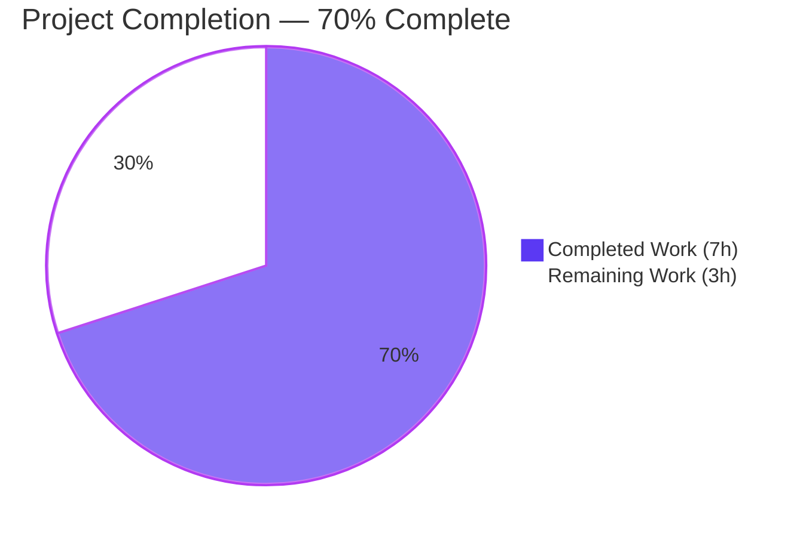
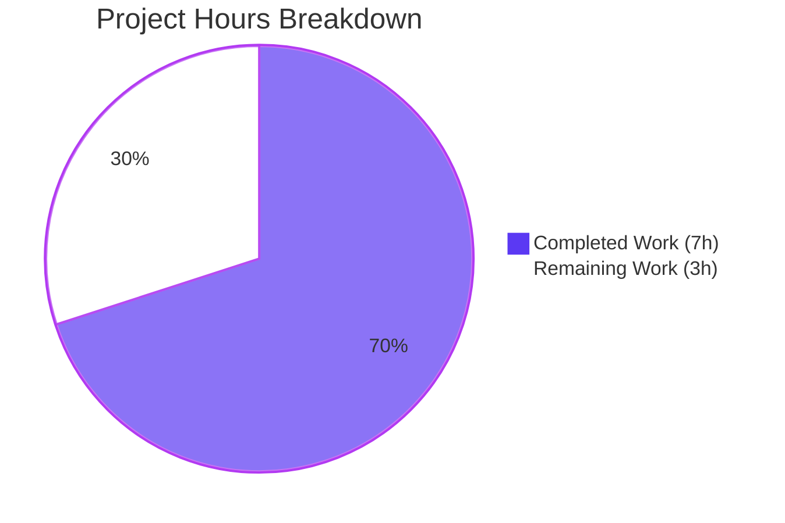

# 1. Executive Summary

## 1.1 Project Overview

QuickTest is a single-file Node.js HTTP server: one CommonJS statement that answers every request on TCP port 3000 with status 200 and the body `Hello, World!` plus a newline. It is a smoke-test fixture for deployment, proxy and monitoring checks, with no domain logic, routing, configuration or dependency beyond Node's built-in `http` module. This project restored the root README the repository had lost: an eleven-line operator and integrator reference covering what the program is, how to start it, what it depends on, what it prints on startup, and the HTTP contract it serves.

## 1.2 Completion Status



| Metric | Value |
|---|---|
| Total Hours | 10.0 |
| Completed Hours (Baseline: Human with agentic-assist) | 7.0 |
| Remaining Hours | 3.0 |

7.0 completed hours ÷ 10.0 total hours = **70.0%** across the scoped work universe. All seventeen scoped requirements are met; the 3.0 remaining hours are path-to-production steps — review and merge, confirmation on the target Node.js runtime, and release-checklist wiring — not unfinished deliverable.

## 1.3 Key Accomplishments

- [x] `README.md` at the repository root — 11 lines, 694 bytes, one H1 `# QuickTest`, LF endings.
- [x] Five required fact groups, each stated once on one unwrapped line.
- [x] Every documented value reproduced from the running program.
- [x] `server.js` untouched — blob `2886290f…` identical at the base commit, at `HEAD` and in the worktree.
- [x] One path added; no manifest, test, CI job, licence or directory introduced.
- [x] The repository's earlier title preserved, not reinvented.
- [x] 38 verification checks executed against the delivered state, all passing.
- [x] No citation, no runtime version, no placeholder, no claim the code cannot support.

## 1.4 Critical Unresolved Issues

Four of the seventeen scoped requirements carry an open item; none blocks validation of the document.

| Issue | Impact | Owner | ETA |
|---|---|---|---|
| Change not yet merged to the default branch | Documentation is live only on the working branch until reviewed and merged | Human reviewer | 1.0 hour |
| Behaviour confirmed on one runtime only (Node.js v22.23.5; the project pins no version) | Behaviour on other Node.js lines is unconfirmed | Engineering | 1.5 hours |
| No in-repository check ties the document's facts to `server.js` | A future change to the port, body or startup line can silently stale five statements | Engineering | 0.5 hour |
| Accepted caveat: no exposure warning for the all-interface plaintext bind, a loopback URL in the startup line, and a 200 guarantee that covers HTTP-valid requests only | An operator reading only the startup line may under-read reachability | Document owner | Decision only |

## 1.5 Access Issues

No access issues identified. The repository is readable and writable, Node.js 22 is on `PATH`, port 3000 was free for every start and released after every stop, and no credentials, secrets or third-party API access are required.

## 1.6 Recommended Next Steps

1. **[High]** Review the document against `server.js:1` and merge the change into the default branch.
2. **[Medium]** Run the Section 9 verification sequence on the deployment runtime.
3. **[Low]** Add that sequence to the release checklist so a `server.js` change re-triggers it.
4. **[Medium]** Settle the accepted caveat: add an exposure note, or record the bind in the service runbook.

# 2. Project Hours Breakdown

## 2.1 Completed Work Detail

| Component | Hours | Description |
|---|---|---|
| Root README authored to the fixed specification | 2.0 | The 11-line document created at the repository root, title carried from the repository's earlier README (AAP §0.3.1, §0.4.1, §0.1.1) |
| Five fact groups grounded in the source | 1.0 | Identity, launch, dependencies, startup behaviour and HTTP contract each read off `server.js:1` and stated once, on one unwrapped line (AAP §0.1.2, §0.3.2) |
| Markdown shape and prohibited-element compliance | 1.0 | One H1, LF endings, single blank separators, inline code for the enumerated literals, and absence of fences, tables, images, HTML, links, diagrams and excluded sections (AAP §0.3.3, §0.3.4, §0.6.2) |
| Claim-level verification against the source and a live run | 2.0 | All thirteen registered statements reproduced from `server.js:1` and from the running program (AAP §0.5.2, §0.5.4) |
| Source-preservation and change-set proof | 1.0 | Hash equality, no-diff gate, excluded-artefact sweep and title-precedent check (AAP §0.5.5, §0.6.1–§0.6.3) |
| **Total** | **7.0** | |

## 2.2 Remaining Work Detail

| Category | Hours | Priority |
|---|---|---|
| Review the document against `server.js:1` and merge the change into the default branch | 1.0 | High |
| Confirm the five documented fact groups on the target Node.js runtime, including the bind probe in the form native to that host | 1.5 | Medium |
| Add the claim-verification steps to the release checklist so a change to `server.js` re-triggers them (AAP §0.5.1 coverage maintained in operation) | 0.5 | Low |
| **Total** | **3.0** | |

The two tables account for the whole 10.0-hour work universe: 7.0 completed hours plus 3.0 remaining hours. The remaining work is path-to-production only — no scoped requirement is unfinished.

# 3. Test Results

The repository ships no test suite, test runner, coverage tool or CI job, and the scoped change set forbids adding one, so verification is command-based. Thirty-eight checks were executed against the delivered state; every one passed.

| Area / Category | Framework | Tests | Passed | Failed | Coverage | What This Proves |
|---|---|---|---|---|---|---|
| Repository static gate | `node --check` (Node.js 22) | 1 | 1 | 0 | Not measurable — no coverage tooling exists | `server.js` parses and compiles as a single CommonJS statement on the runtime the project runs on |
| Change-set and source preservation | git plumbing plus pattern sweeps | 8 | 8 | 0 | Not measurable | `server.js` is byte-identical to its pre-change blob, the tracked tree gained exactly one path, and thirteen candidate paths for excluded artefacts — manifest, lockfile, two licence names, changelog, contributing guide, documentation directory, CI configuration, version pin, two site-config files, format config and dependencies — are all absent |
| Document shape and byte identity | PowerShell byte/line measurement and pattern sweeps | 10 | 10 | 0 | Not measurable | The document is 11 lines, 110 words, 694 bytes, longest line 210, LF-only with one trailing newline, exactly one H1 `# QuickTest`, and carries none of eighteen prohibited elements |
| Startup and bind behaviour | `node server.js` with captured streams; `Get-NetTCPConnection` | 7 | 7 | 0 | Not measurable | The startup line is printed once (41 bytes) with empty stderr, the listener takes port 3000 on every interface, and neither `PORT=4000` nor a `4000` argument moves it |
| HTTP contract | `curl.exe` and a raw socket | 8 | 8 | 0 | Not measurable | Every documented method and path — GET, POST, PUT, DELETE, HEAD, a nonexistent path, a query string — returns 200 with the 14-byte body, the four documented headers and no `Content-Type` |
| Raw protocol and lifecycle | Raw socket plus port checks | 4 | 4 | 0 | Not measurable | A non-HTTP request line is answered by Node's parser with 400 while the process survives with empty stderr, and port 3000 is released after every stop |
| **Total** | | **38** | **38** | **0** | | |

**Not Covered**

- **No automated guard.** Nothing in the repository runs any of these checks, and nothing links the document's statements to `server.js`. A future change to the port, body or startup line will not fail any test; only a re-run of the Section 9 sequence detects a stale claim.
- **Runtimes other than Node.js v22.23.5.** The project pins no version and the document states none, so other Node.js lines are unexercised.
- **Concurrency and sustained load.** Only sequential request pairs, connection reuse and short single-request probes were exercised; no throughput, latency or long-running measurement exists.
- **Damaged or oversized protocol input.** One malformed request line was exercised; oversized headers, truncated bodies and slow clients were not.
- **The document as rendered output.** Shape was measured at byte level; the Markdown was not rendered in a viewer, so presentation (heading rendering, inline-code styling) was not visually checked.
- **The server's own error paths.** Bind conflicts, signals and shutdown behaviour are outside the documented contract and were not exercised.

A human should re-run the Section 9 sequence after any change to `server.js` and once on the target deployment runtime before release.

# 4. Runtime Validation & UI Verification

Every flow below was driven against the delivered tree on Node.js v22.23.5 from the repository root.

- ✅ **Startup** — `node server.js` prints `Server running at http://127.0.0.1:3000/` exactly once (41 bytes) and writes nothing to stderr.
- ✅ **Listener** — one listening socket on TCP port 3000 at the unspecified address, owned by the started process.
- ✅ **Loopback request** — `GET /` returns `HTTP/1.1 200 OK` with `Date`, `Connection: keep-alive`, `Keep-Alive: timeout=5`, `Content-Length: 14` and the body `Hello, World!` plus LF.
- ✅ **Interface reachability** — the same response is served on the host's 10.10.1.7 and 192.168.112.1 addresses, which a loopback-only bind could not answer.
- ✅ **Method coverage** — POST, PUT, DELETE and HEAD each answered 200; HEAD carries no body.
- ✅ **Path coverage** — `/nonexistent/foo` and `/?x=1` answered 200 with the byte-identical body; no 404 path exists.
- ✅ **Port invariance** — `PORT=4000` and `node server.js 4000` both leave the bind on 3000, and port 4000 refuses connections.
- ✅ **Connection reuse** — two requests served over one keep-alive connection.
- ⚠ **Non-HTTP input** — a `GARBAGE LINE` request line is answered `HTTP/1.1 400 Bad Request` by Node's parser before the handler runs; the process survives and writes nothing to stderr.
- ✅ **Shutdown** — the process was stopped by the pid owning port 3000; no listener remained and a follow-up connection was refused.

No user interface exists to verify: the program serves one constant text body, never serves `README.md`, and produces no HTML, so there is no screen, asset or client-side flow to drive.

**Never exercised at runtime:** TLS/HTTPS, HTTP/2, signal handling and graceful shutdown, startup on an occupied port, sustained concurrency or load, any Node.js version other than v22.23.5, and the document itself served or rendered by a Markdown viewer. Each is outside the documented contract or outside the project's scope; none is claimed anywhere in the document.

# 5. Compliance & Quality Review

## 5.1 Compliance Matrix

| # | Deliverable / Requirement | Status | Progress | Verified By |
|---|---|---|---|---|
| 1 | Root `README.md` created with the specified content | ✅ Pass | 100% | Blob `54e9ea4` at commit `2893008`; content matches the fixed text line for line |
| 2 | Five fact groups present, each exactly once | ✅ Pass | 100% | Lines 3, 5, 7, 9, 11 — one occurrence per group marker |
| 3 | Shape budget: 11 lines, 110 words, 694 bytes, longest line 210, one H1, LF, single trailing newline | ✅ Pass | 100% | Measured on the committed blob and the worktree |
| 4 | CommonMark dialect, one unwrapped line per fact, no fences, tables, lists, HTML, links or second heading | ✅ Pass | 100% | Eighteen pattern sweeps at zero; seven balanced inline-code spans |
| 5 | Excluded sections absent — table of contents, badges, per-endpoint, contribution, licence, changelog, troubleshooting, roadmap, support | ✅ Pass | 100% | Zero matches for that vocabulary |
| 6 | No diagram, screenshot, image or diagram tooling | ✅ Pass | 100% | Zero image, fence and diagram patterns; no tooling file in the tree |
| 7 | No citation, file path, line number or runtime version inside the document | ✅ Pass | 100% | Zero matches for `file:line`, `line N`, version, `nvm` or `engines` patterns |
| 8 | No unsupported claim — no production, performance, security, support, test or CI assertion | ✅ Pass | 100% | Zero matches for that vocabulary |
| 9 | `server.js` byte-identical; read-only boundary intact | ✅ Pass | 100% | Blob `2886290f…` at the base commit, at `HEAD` and in the worktree; `git diff --exit-code` exits 0 |
| 10 | Change set limited to one added path, no tracked file modified | ✅ Pass | 100% | `git diff --name-status 3d00f47..HEAD` → `A README.md`; diffstat 1 file, 11 insertions |
| 11 | Excluded artefacts absent — manifest, lockfile, tests, CI, licence, changelog, contribution guide, documentation directory, version pin, format config, dependencies | ✅ Pass | 100% | Thirteen-path absence sweep silent; tracked tree holds two files |
| 12 | Every documented value reproduced from the running program | ✅ Pass | 100% | Startup line, port, body bytes, header set, `Content-Type` absence, port invariance |

## 5.2 AAP & Rule Divergences and Gaps

No user-specified rules were provided for this work, so the only sources a delivery could depart from are the plan's own instructions. Four departures exist; none blocks release and none requires code work.

| What the AAP/Rule Required | What Was Delivered Instead | Why It Diverged | Impact | Remediation |
|---|---|---|---|---|
| The change-set proof expects the new document to be present as an untracked path (`?? README.md`) before delivery (AAP §0.5.5) | The document is committed at `2893008`, so the working tree is clean and that status line prints nothing | Delivery publishes by commit — the plan treats committing as publication (AAP §0.7.2) — and a document bound for the default branch cannot stay untracked | None to the document; a script that greps for the literal `?? README.md` returns nothing | None needed: confirm with `git diff --name-status 3d00f47..HEAD`, which returns `A README.md`. **Sanctioned** by AAP §0.7.2 |
| Verification commands written for a POSIX host — a system-installed `node`, the bind probed from the kernel socket table with `grep ':0BB8'`, byte output through `od -c` and `wc` (AAP §0.5.4, §0.7.1) | Executed as host-native equivalents: `node --version` from `PATH`, `Get-NetTCPConnection -LocalPort 3000 -State Listen` cross-checked with `netstat -ano`, and PowerShell byte measurement | The delivery host is Windows Server 2025 with PowerShell 5.1, where the kernel socket table, `ss` and `lsof` do not exist, so the named commands cannot run while the facts they assert can | None to the asserted facts — a single listening socket on port 3000 at the unspecified address was confirmed; a maintainer pasting the POSIX text on Windows finds nothing to run it against | Use the tested forms in Section 9; on a POSIX host use `ss -ltn`, `wc -c` and `od -c` |
| Inline code for every literal taken from the system (AAP §0.3.3) | The six enumerated literals are code spans, but the port `3000` and the header name `Content-Type` appear as plain text | The fixed text is authoritative and must be reproduced character for character within a 694-byte, 110-word budget (AAP §0.3.1, §0.5.5); the inline-code rule enumerates only the six literals used | Cosmetic only; both tokens read unambiguously and neither is a string the program emits apart from `3000` inside the quoted startup line | None needed — adding spans would break the fixed text and needs a scope amendment, not an edit |
| A pre-commit lint pass over the new document | Read-only Markdown shape checks: line, word, byte and longest-line counts, single H1, LF-only, absence of fences, lists, tables, images, HTML and links, no trailing whitespace | The repository ships no package manifest and no lint configuration, and the scoped change set forbids creating one (AAP §0.6.2, §0.7.2) | No style-rule enforcement beyond the shape rules that were checked, so no linter record exists for the document | None for this deliverable; a linter needs the manifest the scope excludes — the release-checklist step covers the same ground operationally |

The verification-command departure is the one a maintainer will meet first. The delivered facts are confirmed on this host, but the plan's command text names a POSIX installation layout and the kernel socket table, neither of which exists on Windows. `server.js` binds the same way on both platforms (`server.js:1`, `.listen(3000,` with no host argument), and the Section 9 sequence reproduces the assertion natively — a listening socket on port 3000 owned by the started process, answering 200 with 14 bytes on two non-loopback interface addresses. Run that sequence, or its `ss -ltn` equivalent, rather than the POSIX text.

The committed-state departure changes only how a reviewer proves the change set. Because the document lives in commit `2893008` rather than in the working tree, `git status` shows nothing at all for it; the proof is `git diff --name-status 3d00f47..HEAD`, which returns exactly `A README.md` with 11 insertions and 0 deletions, and `git hash-object server.js` still matching `git rev-parse HEAD:server.js`. Any release gate that greps for an untracked-path marker should be pointed at that diff instead.

# 6. Risk Assessment

| Risk | Category | Severity | Probability | Mitigation | Status |
|---|---|---|---|---|---|
| The document's five statements and thirteen claims slowly diverge from the code: nothing in the repository fails when `server.js` changes its port, body or startup line | Technical | Medium | High | Run the Section 9 sequence after any change to `server.js`; the release-checklist step puts it on the change path | Open |
| Byte-exact shape gates are checkout-sensitive: `server.js` already presents 143 bytes on disk against its 142-byte blob, so a `wc -c`-style check on a converted checkout can read a compliant 694-byte document as 705 | Technical | Low | Medium | Measure the committed artifact — `git cat-file -s HEAD:README.md` and `git hash-object README.md` — rather than the working-tree file | Open — no `.gitattributes` may be added within this change set |
| Documented behaviour is confirmed on Node.js v22.23.5 only, while the project pins no runtime | Technical | Low | Medium | Confirm the five fact groups on the deployment runtime before release | Open |
| Port 3000 is a hardcoded literal with no environment override or fallback, so a second instance or any other listener on that port fails at startup with an unhandled error event and a stack trace on stderr | Operational | Medium | Medium | Check the port first; run one instance per host and stop only the pid that owns the port | Open |
| Liveness is only observable through the HTTP response — there is no health endpoint, no logging beyond the single startup line and no metrics | Operational | Low | High | Probe the documented contract for liveness: status 200 and a 14-byte body | Open — by design |
| The listener takes every interface in plaintext and the document carries no exposure warning, while the startup line names a loopback URL; an operator reading only that line may under-read reachability | Security | Medium | Medium | Record the all-interface plaintext bind in the service runbook; restrict port 3000 at the network boundary | Open — accepted within the fixed text |
| HEAD responses carry neither body nor `Content-Length`, so a client using HEAD to learn the body size learns nothing | Integration | Low | Medium | Use GET where body metadata matters; do not rely on HEAD for content length | Open — behaviour of the documented handler |
| "Every request … gets HTTP 200" reads as universal, but Node's parser answers 400 for a malformed request line and 431 for oversized headers before the handler runs | Integration | Low | Low | Read the statement as covering HTTP-valid requests; a monitor should send well-formed requests | Open — accepted within the fixed text |

No credential, input-parsing, storage or injection surface exists in either file: the handler never reads the request, the program reads no environment variable or argument, and neither file contains a secret, token or external endpoint.

# 7. Visual Project Status



| Measure | Value |
|---|---|
| Scoped requirements met | 17 of 17 |
| Delivered paths | 1 added (`README.md`), 0 modified, 0 deleted |
| Verification checks passed | 38 of 38 |
| Hours completed | 7.0 of 10.0 |
| Hours remaining | 3.0 |
| Percent complete | 70.0% |

**Remaining hours by priority**

| Priority | Hours | Share of Remaining | Work |
|---|---|---|---|
| High | 1.0 | 33% | Review and merge the change into the default branch |
| Medium | 1.5 | 50% | Confirm the documented fact groups on the target Node.js runtime |
| Low | 0.5 | 17% | Add the claim-verification steps to the release checklist |
| **Total** | **3.0** | **100%** | |

# 8. Summary & Recommendations

The project set out to give QuickTest the root README its history had lost, and that document is delivered and verified. `README.md` sits at the repository root at eleven lines and 694 bytes: one H1 `# QuickTest`, then one unwrapped line each for what the program is, how to start it, what it depends on, what it prints on startup, and the exact HTTP contract it serves. Every value in it was reproduced from the running program — the 41-byte startup line, the all-interface bind on port 3000, the 14-byte body, the four-header response and the absent `Content-Type` — and `server.js` is byte-identical to the blob it had before the work began (`2886290f56dfe2483a8f29f7dfcb89796a6fca00`).

Against the scoped work universe the project stands at **70.0% complete: 7.0 of 10.0 hours**. All seventeen requirements are met; the 3.0 remaining hours are path-to-production steps rather than unfinished deliverable. Thirty-eight verification checks executed against the delivered state passed, covering the compile gate, change-set and source preservation, the document's byte-level shape, startup and bind behaviour, the HTTP contract across methods and paths, and the process lifecycle.

The critical path to production is short and human-shaped: review the eleven lines against `server.js:1`, merge the change, then re-run the Section 9 sequence once on the runtime the service will be deployed on. The two gaps worth carrying forward are not defects in the document but properties of the project — nothing in the repository ties prose to code, so a future change to the port, body or startup line will not fail anything; and the project pins no runtime, so only Node.js v22.23.5 is confirmed. The release checklist closes the first operationally; the runtime confirmation closes the second.

Success is measurable without a test suite: the document's figures are reproducible from the committed artifact (`11` lines, `110` words, `694` bytes, `210` longest line, one H1, LF-only), the code hash is unchanged, the tracked tree holds exactly two files, and the program answers every documented request with status 200 and a 14-byte body. Those five measurements are the acceptance criteria a reviewer can run in a couple of minutes.

Production readiness: **ready, once merged.** The deliverable is complete, accurate against the shipped code, free of placeholder or unfinished content, consistent with the repository's own title precedent, and needs no build, install, manifest or toolchain — `node server.js` remains the only entry point. The residual risks are operational and documented in Section 6: a host-global hardcoded port, no automated guard against claim staleness, an all-interface plaintext bind with no permitted exposure caveat, and a confirmation limited to one Node.js release.

# 9. Development Guide

## System Prerequisites

- **Node.js 22** on `PATH` — version verified here: v22.23.5. The project pins no version; the code needs only CommonJS `require`, arrow functions and `http.createServer`, all longstanding core APIs.
- **PowerShell 5.1** (Windows) or any POSIX shell for the verification commands below. PowerShell 5.1 has no `&&` or `||`; chain with `; if ($LASTEXITCODE -eq 0) { ... }`. Use `curl.exe`, never `curl`, which is an alias for `Invoke-WebRequest` in that shell.
- **git** only for the tree checks. There is no package manager step, no database, no cache, no container and no build system.
- **TCP port 3000 free.** The port is a hardcoded literal in `server.js` with no environment variable and no argument, so nothing can move it.

## Environment Setup

None. The program reads no environment variable, no argument and no configuration file, so there is no `.env`, no virtual environment and no secret to provide. `server.js` loads Node's built-in `http` module and nothing else.

## Dependency Installation

There is nothing to install and no manifest to install from. `npm install`, `npm test`, `npm run *` and `npm start` are all undefined because the repository has no `package.json`; `npm start` failing with `ENOENT … Could not read package.json` is the expected, documented behaviour rather than a defect. Do not add a manifest, a lockfile or a runtime pin — the scoped change set excludes them.

## Application Startup

```powershell
# 1. Confirm the runtime and that the entry point compiles (this is the whole build gate)
node --version
node --check server.js

# 2. Confirm the port is free before starting
Get-NetTCPConnection -LocalPort 3000 -State Listen -ErrorAction SilentlyContinue

# 3. Start the server in its own window, or detached with captured output
node server.js
```

A successful start prints exactly one line and nothing else:

```text
Server running at http://127.0.0.1:3000/
```

## Verification Steps

```powershell
# Full response — expect HTTP/1.1 200 OK, Date, Connection: keep-alive,
# Keep-Alive: timeout=5, Content-Length: 14, then Hello, World!
curl.exe -sS -i http://127.0.0.1:3000/

# Status and body size — expect status=200 bytes=14
curl.exe -sS -o NUL -w "status=%{http_code} bytes=%{size_download}`n" http://127.0.0.1:3000/

# A path that does not exist — expect status=200 with an empty content_type
curl.exe -sS -o NUL -w "status=%{http_code} content_type=[%{content_type}]`n" -X POST http://127.0.0.1:3000/nonexistent/foo

# Stop the process that owns the port — never stop a process by image name
$owner = (Get-NetTCPConnection -LocalPort 3000 -State Listen).OwningProcess
Stop-Process -Id $owner -Force
Get-NetTCPConnection -LocalPort 3000 -State Listen -ErrorAction SilentlyContinue
```

Document-integrity checks, run from the repository root after any edit to `README.md`:

```powershell
git cat-file -s HEAD:README.md          # 694
(Get-Content README.md).Count           # 11
(Get-Content README.md)[0]              # # QuickTest
git hash-object server.js               # must equal: git rev-parse HEAD:server.js
git diff --exit-code -- server.js       # exit 0, no output
git diff --name-status 3d00f47..HEAD    # A README.md, and nothing else
```

Measure the **committed artifact** rather than the working-tree file: on a checkout with line-ending conversion enabled the working copy of `server.js` already presents 143 bytes against its 142-byte blob, so a raw byte count can read a correct 694-byte document as 705.

## Example Usage

```powershell
# Identity check for a proxy or monitoring probe: 200 plus the constant body
curl.exe -sS http://127.0.0.1:3000/
# Hello, World!

# Any method, any path — the same answer, because the handler never reads the request
curl.exe -sS -o NUL -w "%{http_code}`n" -X PUT http://127.0.0.1:3000/anything/at/all
curl.exe -sS -o NUL -w "%{http_code}`n" -I http://127.0.0.1:3000/
curl.exe -sS -o NUL -w "%{http_code}`n" "http://127.0.0.1:3000/?probe=1"
```

Reachability from another host confirms the bind covers every interface, not loopback only:

```powershell
curl.exe -sS -m 5 -o NUL -w "%{http_code} %{size_download}`n" http://<this-host-address>:3000/
```

On a POSIX host the same checks are:

```bash
node --check server.js
node server.js &                     # prints the startup line once
curl -s -i http://127.0.0.1:3000/
ss -ltn | grep ':3000'               # one LISTEN socket at the unspecified address
kill %1
```

## Troubleshooting

| Symptom | Cause | Resolution |
|---|---|---|
| `Error: listen EADDRINUSE … :::3000` and a non-zero exit | Another process — often a second instance — already owns port 3000; the program has no fallback and no signal handling, so it exits with a stack trace | Find the owner with `Get-NetTCPConnection -LocalPort 3000 -State Listen`, stop that pid, then start again. Never stop a process by image name |
| `npm start` fails with `ENOENT … package.json` | No manifest exists in this repository, by design | Run `node server.js`; the failure is the documented absence, not a broken install |
| A byte count of `README.md` gives 705, or `11 110 705` from `wc` | Line-ending conversion on checkout | Measure the committed blob: `git cat-file -s HEAD:README.md` must be 694 |
| `server.js` reports 143 bytes while `git cat-file -s HEAD:server.js` says 142 | The same checkout conversion, applied to the source file | Nothing to fix: the committed blob is what ships and `git hash-object server.js` still equals `git rev-parse HEAD:server.js` |
| A raw malformed request line returns `HTTP/1.1 400 Bad Request` | Node's HTTP parser rejects it before the handler runs; the documented contract covers well-formed requests | Send a well-formed request; the 400 is the runtime's behaviour, not the program's |
| A client renders the body as preformatted text and sees no media type | The handler declares no `Content-Type` — documented behaviour | Expected; do not add a header, `server.js` is outside this change set |
| Port 3000 stays busy after a stopped job | A shell background job can outlive its wrapper | Re-check the port and stop the pid that owns it; confirm with `curl.exe -sS -m 2 -o NUL http://127.0.0.1:3000/`, which should fail to connect |

# 10. Appendices

## A. Command Reference

| Purpose | Command |
|---|---|
| Compile gate (the whole build) | `node --check server.js` |
| Start the server | `node server.js` |
| Full response with headers | `curl.exe -sS -i http://127.0.0.1:3000/` |
| Status and body size | `curl.exe -sS -o NUL -w "status=%{http_code} bytes=%{size_download}`n" http://127.0.0.1:3000/` |
| Media-type check | `curl.exe -sS -o NUL -w "content_type=[%{content_type}]`n" http://127.0.0.1:3000/` |
| Port owner | `(Get-NetTCPConnection -LocalPort 3000 -State Listen).OwningProcess` |
| Stop the server | `Stop-Process -Id <owner pid> -Force` |
| Document byte count | `git cat-file -s HEAD:README.md` |
| Source integrity | `git hash-object server.js` ; `git rev-parse HEAD:server.js` |
| Change-set proof | `git diff --name-status 3d00f47..HEAD` |

## B. Port Reference

| Port | Protocol | Bound By | Notes |
|---|---|---|---|
| 3000 | TCP (HTTP/1.1) | `server.js:1`, numeric literal in `.listen(3000, …)` | Listens on every interface (unspecified address); no environment variable or argument changes it; no other port is opened; no outbound connection is made |

## C. Key File Locations

| Path | Role |
|---|---|
| `README.md` | The project's deliverable — operator and integrator quick reference, 11 lines, 694 bytes |
| `server.js` | The whole program: one CommonJS statement creating and starting the HTTP server; unchanged by this work |

No other path is tracked. There is no manifest, no test directory, no documentation tree and no configuration file.

## D. Technology Versions

| Component | Version | Source |
|---|---|---|
| Node.js | v22.23.5 (verified); unpinned by the project | `node --version` |
| npm | 10.9.9 (installed with Node.js, unused) | `npm --version` |
| Node core `http` module | Ships with the Node.js runtime | `server.js:1` |
| PowerShell | 5.1 (verification shell on Windows) | `$PSVersionTable.PSVersion` |
| git | 2.56.1 (tree checks only) | `git --version` |

No third-party package is used at any version — the repository declares no dependency at all.

## E. Environment Variable Reference

The program reads **no** environment variable and **no** command-line argument; `server.js` contains no `process.env` or `process.argv`. Setting `PORT` (or passing a port argument) has no effect: the bind stays on 3000, which was verified both ways. No secret, token or credential is required by the project.

## F. Developer Tools Guide

| Task | Tool |
|---|---|
| Edit the document or the source | Any text editor; the document must stay LF with a single trailing newline |
| Check Markdown shape | Line, word and byte counts plus a single-H1 check; the repository ships no linter and adding one is outside the change set |
| Exercise the HTTP contract | `curl.exe` on Windows, `curl` on POSIX |
| Inspect the listener | `Get-NetTCPConnection` / `netstat -ano` on Windows, `ss -ltn` on POSIX |
| Inspect the tree and hashes | `git` plumbing (`hash-object`, `cat-file`, `diff`, `ls-tree`) |

## G. Glossary

| Term | Meaning |
|---|---|
| QuickTest | The single-file Node.js HTTP smoke-test fixture documented by this project |
| Smoke-test fixture | A deliberately trivial service used to prove a deployment, proxy or monitoring path works end to end |
| Fixed text | The eleven-line document content that must be reproduced character for character within its measured budget |
| Claim register | The list of thirteen factual statements the document makes, each tied to the source line or a reproducible command |
| Unspecified address | The wildcard bind Node.js uses when `listen(port)` is given no host — every interface on the host |
| Blob | The committed, line-ending-normalised content of a file in git, which is the artifact that ships |
| Path-to-production | Work that stands between a delivered change and its release: review, merge, runtime confirmation, release-checklist wiring |
