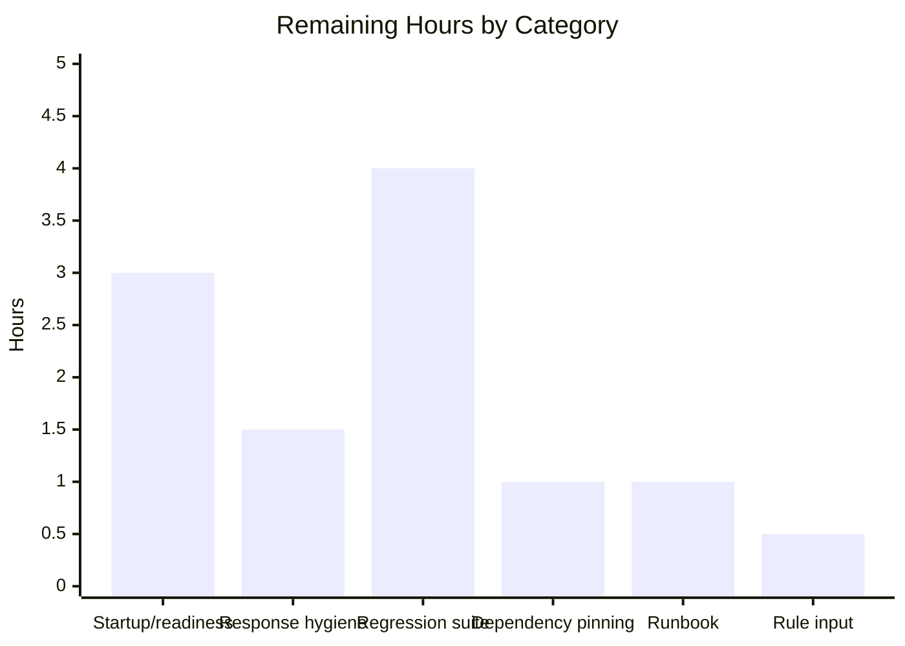

# 1. Executive Summary

## 1.1 Project Overview

A single-file Node.js service gained a second HTTP route. One chained CommonJS statement in `server.js`, backed by `express`, its only dependency, answers `GET /` with `Hello, World!\n` exactly as before and now answers `GET /good-evening` with `Good evening\n` at status 200 as `text/plain`. The dependency is declared in a three-field `package.json` created for the purpose; the port literal `3000`, the bind and the startup line are untouched. There is no user interface, no data store, no authentication and no configuration; the audience is the developer or operator who runs and supervises the service.

## 1.2 Completion Status


Centre label: **35% complete** (Completed = #5B39F3; Remaining = #FFFFFF).

| Metric | Hours |
|---|---|
| Total Hours | 17.0 |
| Completed Hours (AI + Manual) | 6.0 |
| Remaining Hours | 11.0 |

Calculation: 6.0 ÷ (6.0 + 11.0) = 35.3%. Both requested deliverables are 100% delivered and verified; the remaining hours are production-readiness work outside that scope.

## 1.3 Key Accomplishments

- `GET /good-evening` serves 200 with the exact 13-byte body `Good evening\n` as `text/plain`.
- `GET /` is preserved byte for byte: 200 and the exact 14-byte body `Hello, World!\n`.
- `express` is declared once, imported once and installs with no known vulnerabilities.
- One Express application serves both routes on the literal port 3000 with the original startup line.
- Startup, restarts, concurrency and malformed traffic hold without a 5xx, a crash or a leak.
- Exactly two paths differ from the base tree, with no lockfile, config, documentation, test or extra handler.

## 1.4 Critical Unresolved Issues

Nine items remain open; all four requested requirements are delivered, so **0 of 4 remain open**. Five need work (Sections 2.2 and 6), three are accepted postures for the runbook, and one is the placeholder rule input.

| Issue | Impact | Owner | ETA |
|---|---|---|---|
| A failed start is indistinguishable from a healthy one: on an occupied port the process prints the startup line, writes nothing to stderr and exits 0 while serving nothing | An operator or supervisor believes the service is up; readiness cannot be trusted | Service owner | Before first production deploy |
| No health, readiness, metrics or request logging surface | A supervisor has no readiness signal and hostile traffic leaves no audit trail | Service owner / platform | Before first production deploy |
| No automated regression suite, npm scripts or CI gate; no coverage measured | A future change to either route cannot be validated automatically | Developer | First release window |
| `express: ^5` is unpinned with no committed lockfile | Installs are not reproducible by content hash; a later patch can drift in unnoticed | Developer | First release window |
| The 200 responses declare no media type on `GET /`, carry no protective headers and disclose the framework name, while the 404 page is hardened | Consumers must sniff the body and the reachable routes are the weaker surface | Developer | First release window |
| The project's rule input carries a single placeholder entry that names no standard | Nothing is enforceable as a rule; intent is unrecorded | Project owner | Housekeeping |
| The listener takes the wildcard address while the startup line advertises `127.0.0.1` | Both routes are reachable off-loopback on a shared host | Platform / network | Accepted; record in runbook |
| No rate limiting and no request-body size limit on the public routes | A peer on the same network can consume connections and memory at will | Platform | Accepted; front with an edge proxy |
| The whole application is one 230-character line with no stated comment convention | Any stack trace points at `server.js:1`; new code has no style anchor | Developer | Accepted; mandated shape |

## 1.5 Access Issues

No access issues identified. No credentials, tokens, API keys or database accounts are required, and the single dependency installs from the public npm registry without authentication.

## 1.6 Recommended Next Steps

1. **[High]** Make a failed start loud and add a readiness check (3 h).
2. **[High]** Harden the served responses: declare the media type for `GET /`, add the headers the 404 page carries, stop disclosing the framework name (1.5 h).
3. **[Medium]** Add an automated regression suite for both route contracts and the process gates, with CI wiring (4 h).
4. **[Medium]** Pin the dependency or commit a lockfile so installs are reproducible (1 h).
5. **[Low]** Write the operator runbook and confirm the intended rule set (1.5 h).

# 2. Project Hours Breakdown

## 2.1 Completed Work Detail

Every component below traces to a requirement the work was scoped against.

| Component | Hours | Description |
|---|---|---|
| `server.js` — Express application carrying both route registrations | 2.0 | The bare HTTP server was replaced by one Express application (`require('express')()`); the existing handler was carried over verbatim for `GET /` and the new handler registered for `GET /good-evening`; the `.listen(3000, cb)` tail kept its port literal and startup text (`server.js:1`). |
| `package.json` — three-field manifest and dependency resolution | 1.0 | Root manifest created with `name`, `version` and `dependencies.express` only; the dependency is declared once, imported once, and installs to express 5.3.0. |
| Scope confinement and file discipline | 1.0 | Smallest diff, single-statement one-line style, no new module, no lockfile, documentation, configuration or test file, no 404 or error handler, no environment configuration, no unrelated change. |
| Verification of both route contracts and the preserved behaviour | 2.0 | 200 with `text/plain` and the exact 13-byte body for the new route; byte-identity of the preserved route against the pre-change build; the startup line, the single listener, restarts, concurrency and the routing edges. |
| **Total** | **6.0** | |

## 2.2 Remaining Work Detail

Every category traces to a production-readiness need for the delivered service.

| Category | Hours | Priority |
|---|---|---|
| Startup failure signalling and readiness surface — bind-error handling plus a health/readiness check | 3.0 | High |
| Response hygiene for the served routes — media type on `/`, protective headers on the 200s, suppress the framework disclosure | 1.5 | High |
| Automated regression suite — both route contracts, the preserved behaviour and the process gates, wired into npm scripts and CI | 4.0 | Medium |
| Reproducible dependency resolution — commit a lockfile or pin an exact version | 1.0 | Medium |
| Operator runbook — run and verify steps, the logging caveat, port contention, the accepted bind-scope and rate-limit posture | 1.0 | Low |
| Confirm the intended rule set — the current rule input names no coding standard | 0.5 | Low |
| **Total** | **11.0** | — |

Section 2.1 (6.0 h completed) + Section 2.2 (11.0 h remaining) = 17.0 total hours, matching Section 1.2. Completion is 6.0 ÷ 17.0 = 35%.

# 3. Test Results

The checks below were executed against the running service on this host, with the results recorded as observed. The project ships no test runner, so each row names the method used and the number of checks run in that category.

| Area / Category | Framework | Tests | Passed | Failed | Coverage | What This Proves |
|---|---|---|---|---|---|---|
| `GET /good-evening` response contract | HTTP checks — curl with byte comparison | 9 | 9 | 0 | Not measured; no instrumentation configured | The new route returns 200 with `text/plain` and the exact 13-byte body, unchanged under query strings, path casing, trailing slashes and 50-way concurrency |
| `GET /` preserved contract | HTTP checks — curl with byte comparison against the pre-change build | 7 | 7 | 0 | Not measured; no instrumentation configured | The original route is byte-identical to its pre-change response — 200, 14 bytes, no media type declared, as before |
| Startup, bind and process hygiene | Process checks — listener ownership, stdout/stderr byte comparison, restart | 8 | 8 | 0 | Not measured; no instrumentation configured | The service binds the literal port 3000 as the only listener, prints the exact startup line, stays silent on stderr and restarts deterministically |
| Routing edges and framework defaults | HTTP checks — curl across paths and methods | 6 | 6 | 0 | Not measured; no instrumentation configured | Unmatched paths and non-GET methods return 404, `OPTIONS` advertises `GET, HEAD`, `HEAD` returns no body, and source paths and traversals are not served |
| Error-response disclosure | HTTP checks — response body and header inspection | 1 | 1 | 0 | Not measured; no instrumentation configured | No response exposes a stack trace, filesystem path, framework internals or version string |
| Dependency resolution and security audit | npm install and npm audit | 3 | 3 | 0 | Not measured; no instrumentation configured | The single declaration resolves to express 5.3.0 and the installed tree shows zero vulnerabilities |
| Browser end-to-end | Headless Chrome navigation with in-page probes | 6 | 6 | 0 | Not measured; no instrumentation configured | Both routes render and transfer byte-exact bodies over HTTP with no JavaScript errors and no reflected payloads |
| Syntax gate | `node --check` | 1 | 1 | 0 | Not measured; no instrumentation configured | The delivered line is valid CommonJS and loads without error |
| **Total** | — | **41** | **41** | **0** | — | — |

### Not Covered

- **No automated test suite exists.** The project ships no test runner, no npm scripts and no lint configuration, so every check above is run by hand, none is wired into a pipeline, and no coverage figure can be produced. A regression introduced later would not be caught automatically.
- **Framework-internal paths are observed only from outside the process** — route matching, the default 404 rendering and the default `OPTIONS` handling are asserted through their HTTP effects, not exercised directly.
- **Deployment behaviour is untested.** No service manager, container, orchestrator or health probe configuration exists in the project, so start-up under supervision, port arbitration on a shared host and restart-on-failure have never been exercised.
- **The framework debug channel is untested under a deployment policy.** Setting `DEBUG` is the only path that would echo request lines and query strings to stderr; it is inactive by default and its output has not been asserted against any logging standard.
- **Load and hostile-input limits are unmeasured beyond the sampled envelope** — 50 parallel requests per route, multi-megabyte request bodies, oversized headers and a fixed payload set were exercised; sustained traffic, connection exhaustion and fuzzing were not.
- **The installed dependency tree is not reproducible by content hash**, so the exact bytes of a future install cannot be asserted from the repository alone.

# 4. Runtime Validation &amp; UI Verification

Runtime validation was performed against the service started from `server.js` on this host, with HTTP responses captured at byte level and the two routes additionally loaded in a real browser.

- ✅ **Startup and bind** — `node server.js` prints `Server running at http://127.0.0.1:3000/` (41 bytes, byte-exact), binds the literal port 3000 as the only listener, and writes nothing to stderr.
- ✅ **`GET /`** — status 200, `Content-Length: 14`, body byte-identical to `Hello, World!\n` and to the response of the pre-change build run alongside it.
- ✅ **`GET /good-evening`** — status 200, `Content-Type: text/plain; charset=utf-8`, `Content-Length: 13`, body byte-identical to `Good evening\n`; the response is unchanged under query strings, trailing slashes, path casing and accepted media types.
- ✅ **Restart determinism** — after a stop and a fresh start, the startup line is byte-identical and both bodies still compare byte-clean.
- ✅ **Concurrency** — 50 parallel requests to each route returned only 200s with the exact 13- and 14-byte bodies; stdout stayed at one 41-byte line and stderr at 0 bytes.
- ✅ **Error-response hygiene** — unmatched paths and unsupported methods returned 404 pages containing only the method and path, with no stack trace, filesystem path, dependency reference or exception class.
- ✅ **Browser end-to-end** — both routes loaded in a headless browser and rendered exactly `Hello, World!` and `Good evening`; the bytes received in-page hex-matched the curl captures; a navigation to an unmatched path showed only `Cannot GET /nope`; no JavaScript errors were logged and an injected `<script>` payload in the query was neither reflected nor executed.
- ⚠ **Routing edges and method handling** — framework defaults govern: 404 rather than 405 for wrong methods, case-insensitive and trailing-slash-tolerant matching, and `OPTIONS` answering 200 with `Allow: GET, HEAD`. No custom handling exists to exercise.
- ⚠ **Media type on `GET /`** — no `Content-Type` header is sent for that route (unchanged from before), so a browser sniffs the body as plain text rather than reading a declared type.
- ⚠ **Bind failure** — starting a second process while the port is occupied prints the normal startup line, writes nothing to stderr and exits 0 while serving nothing, so the log line cannot be trusted as a readiness signal.

**Never exercised at runtime.** There is no user interface, session or static-asset surface in this service to verify, and no external integration to drive: it makes no outbound call, reads no data store and holds no state beyond two string constants. Nothing was run under a service manager, container or orchestrator, so start-up under supervision, restart-on-failure and port arbitration have not been exercised; the readiness path does not exist to test. The framework debug channel (`DEBUG`) was not exercised as a deployment configuration. No performance or load profile beyond 50 concurrent requests per route was measured.

# 5. Compliance &amp; Quality Review

## 5.1 Compliance Matrix

| # | Deliverable | Benchmark | Status | Evidence |
|---|---|---|---|---|
| 1 | `GET /good-evening` response contract — status 200, media type `text/plain`, exact body | Contract fidelity | ✅ Pass | `server.js:1`; observed 200 / `text/plain; charset=utf-8` / 13-byte body in curl and in a browser |
| 2 | `GET /` preserved — status 200, exact body, byte-identical to before | Regression / continuity | ✅ Pass | `server.js:1`; body compares byte-clean against the pre-change build, handler expression character-identical |
| 3 | Dependency declared once in the manifest and imported once | Declaration ↔ import closure | ✅ Pass | `package.json:5`, `server.js:1`; install resolves express 5.3.0, no other reference in the tree |
| 4 | Manifest field discipline — only the fields the feature requires | Minimal-surface configuration | ✅ Pass | `package.json:1-7`; keys exactly `name`, `version`, `dependencies`, no `type`, `engines`, `license` or `scripts` |
| 5 | Scope confinement — one application file changed, single-statement style, no new module | Smallest-diff discipline | ✅ Pass | Exactly two paths differ from the base tree; `server.js` is 1 line, 1 semicolon, no declarations |
| 6 | Preserved runtime values — port literal, bind and startup wording | Behaviour preservation | ✅ Pass | `.listen(3000, …)` tail byte-identical; startup line byte-exact at 41 bytes; no environment override read |
| 7 | Exclusions honoured — no lockfile, documentation, configuration, test file, 404 or error handler, hardening | Scope compliance | ✅ Pass | Tree holds only `server.js` and `package.json`; no such artefact exists and no middleware is registered |
| 8 | Security baseline — no secrets, no request-input sink, no advisory intersecting the declared range | Secure-by-construction baseline | ✅ Pass | Neither handler dereferences the request; both bodies are constants; an audit finds zero vulnerabilities |
| 9 | Error handling and readiness signalling | Operational readiness | ⚠ Partial | A failed start is indistinguishable from a healthy one; no health, readiness, metrics or request-logging surface exists |
| 10 | Test automation and coverage | Repeatable verification | ❌ Absent | No test runner, no npm scripts, no CI gate, no coverage instrumentation anywhere in the project |
| 11 | Reproducible installs | Supply-chain reproducibility | ⚠ Partial | `express: ^5` is unpinned and no lockfile is committed, so the resolved tree is not fixed by hash |
| 12 | Documentation | Operator handover | ❌ Absent | The repository ships no README or runbook describing install, run, verification or the port behaviour |

## 5.2 AAP & Rule Divergences and Gaps

| What the AAP/Rule Required | What Was Delivered Instead | Why It Diverged | Impact | Remediation |
|---|---|---|---|---|
| The project's rule input is a rule (titled "3", body "vhgvhg") that the work must follow | No coding standard, prohibition or required component is drawn from it; the delivered files are shaped by the specified requirements alone | The rule's own text names no standard, forbids no file and requires no component, so nothing enforceable can be derived from it; the scope record treats the project as carrying no rules, which does not match the document's content | None on the delivered code; the project has no stated rule for future changes | The owner supplies the intended rules or records that none applies — 0.5 h (Section 2.2) |
| Only the two named routes form the contract, with framework defaults governing anything the request left unspecified, and no 404 or error handler added | `server.js:1` registers exactly two routes, so unmatched paths and non-GET methods now receive Express's default 404 page, where the pre-change program answered every path with `Hello, World!\n` | Sanctioned: it is the direct consequence of introducing the required router, and the decision recorded for unspecified input is that framework defaults govern while a custom 404 handler stays out of scope | External callers relying on the old catch-all now receive 404, and unspecified-input responses are HTML rather than text | None required; record the change for consumers in the operator runbook — Section 2.2 |
| The port literal, the bind and the startup log wording stay unchanged, and no error handler is added | The `.listen(3000, cb)` tail is preserved verbatim; with the dependency in place, a start on an occupied port prints `Server running at http://127.0.0.1:3000/`, writes nothing to stderr and exits 0 without listening — where the pre-change program terminated with the bind error | The required framework hands the retained startup callback to the server's one-time error listener, which consumes the bind error; the requirements froze the callback text and excluded an error handler, so no in-scope change could correct it | Readiness cannot be inferred from the log line or the exit status, and a failed start looks identical to a healthy one | Handle the bind error explicitly and expose a readiness check — 3 h (Section 2.2) |

**Placeholder rule input (row 1).** The project's rule document contains a single entry, labelled `3`, whose body is `vhgvhg`. No coding standard, language rule, forbidden file or required component can be read from it, so no delivered artefact can be judged against it and nothing in `server.js` or `package.json` was shaped by it. The record of the work states the project carries no user rules, which disagrees with what the document contains; the divergence is therefore between the project's stated rule basis and its rule input, not between the code and a rule. The practical consequence is that the repository has no enforceable standard for the next change, and the owner should either supply the intended rules or record that none applies.

**Unmatched paths now return 404 (row 2).** Before this work the single handler answered every request with `Hello, World!\n`, so any path or method returned 200. `server.js:1` now registers `GET /` and `GET /good-evening` on one Express application, and everything else falls through to the framework's default 404 page, which echoes only the method and path (`Cannot GET /nope`) with `Content-Security-Policy: default-src 'none'` and `X-Content-Type-Options: nosniff`. This is the sanctioned consequence of the recorded decision that framework defaults govern behaviour the request left unspecified, with a custom 404 handler explicitly out of scope; the preserved route is unaffected and still answers byte-for-byte as before. A consumer that relied on the catch-all must be told, which is why the runbook task in Section 2.2 covers it.

**A failed start looks successful (row 3).** A second process started while port 3000 is occupied prints the normal startup line, writes 0 bytes to stderr and exits 0 while serving nothing — observed directly, including against a port deliberately held open by another process. The mechanism is in the framework: `app.listen` wraps the callback passed to it in `once()` and registers it as the server's one-time `error` listener, so the bind error is delivered to the callback, which ignores its argument and logs the success message. The requirements freeze that callback's text and exclude an error handler, which is why no in-scope change could correct it. The impact is operational, not functional: on a host where the port is free the service starts and serves exactly as specified, but a supervisor that trusts the log line or the exit status can be misled, so readiness should be asserted by checking the listener and a health check should be added.

# 6. Risk Assessment

| Risk | Category | Severity | Probability | Mitigation | Status |
|---|---|---|---|---|---|
| A failed start looks successful — on an occupied port the process prints the startup line, writes nothing to stderr and exits 0 while serving nothing | Operational | High | Medium | Handle the bind error explicitly and assert the listener externally (check the bound port) rather than trusting the log line; add a readiness check | Open — Section 2.2, 3 h |
| No automated regression suite, no npm scripts and no coverage instrumentation, so a later change to either route cannot be validated in a pipeline | Technical | Medium | High | Add a suite covering both route contracts and the process gates and wire it into CI | Open — Section 2.2, 4 h |
| `express: ^5` is unpinned and no lockfile is committed, so an install is not reproducible by hash and a future patch can drift in | Technical / supply chain | Medium | Medium | Commit a lockfile or pin an exact version, and re-run the advisory check on upgrade | Open — Section 2.2, 1 h |
| No health, readiness, metrics or request logging surface, so a supervisor has no readiness signal and hostile traffic leaves no audit trail | Operational | Medium | High | Add a readiness endpoint and access logging, or front the service with a proxy that supplies both | Open — Section 2.2, 3 h |
| The listener takes the wildcard address while the startup line advertises `127.0.0.1`, so both routes are reachable off-loopback on a shared host | Security | Medium | Medium | Bind an explicit host if loopback-only is intended, or accept and record the exposure; restrict with host firewall or network policy | Open — accepted, recorded in the runbook |
| The 200 responses carry no `nosniff` or security headers and disclose `X-Powered-By`, while the framework 404 page does carry `Content-Security-Policy` and `nosniff` | Security | Low | High | Apply the same protective headers to the served routes and suppress the framework disclosure | Open — Section 2.2, 1.5 h |
| No rate limiting and no request-body size limit on the public routes, so a peer on the same network can consume connections and memory at will | Security / operational | Medium | Low | Apply connection and body-size limits at an edge proxy in front of the service | Open — accepted posture for this scope |
| The whole application is one 230-character line and the repository states no comment convention, so stack traces point at `server.js:1` and new code has no style anchor | Technical / maintainability | Low | Medium | Record the style and comment convention, and split the statement only if the route set grows | Open — accepted; mandated shape |

No risk above is a defect in delivered behaviour: both route contracts are met exactly, and each item is forward-looking — what can still go wrong once the service is deployed and operated.

# 7. Visual Project Status


Completed Work = 6.0 h (Dark Blue #5B39F3); Remaining Work = 11.0 h (White #FFFFFF). These are the same figures as Sections 1.2 and 2.2, and the chart's percentage is 35% complete.

Remaining hours by category:



Priority distribution of the remaining work: **High 4.5 h** (startup failure signalling and readiness surface; response hygiene), **Medium 5.0 h** (regression suite and CI wiring; reproducible dependency resolution), **Low 1.5 h** (operator runbook; rule-input confirmation).

# 8. Summary &amp; Recommendations

The service now answers two routes instead of one. `GET /` returns `Hello, World!\n` byte for byte as it always did, and `GET /good-evening` returns `Good evening\n` at status 200 as `text/plain`, both served by one Express application on the literal port 3000 with the original startup line. The dependency that makes the routing possible is declared once in `package.json` and imported once in `server.js`, installs cleanly against the public registry, and introduces no advisory that intersects its declared range. Verified by 41 recorded checks — all passing — covering both route contracts, startup and bind, restart determinism, 50-way concurrency, routing edges, error-response hygiene, the dependency audit, the syntax gate and a browser end-to-end pass. Against the hours basis, the project stands at **35% complete**: 6.0 hours of delivered work against 17.0 hours of total scope, because the requested change is small and deliberate while the operational work a production release needs sits outside it.

| Metric | Value |
|---|---|
| Requested deliverables delivered | 2 of 2 (100%) |
| Route contracts verified | 2 of 2 |
| Recorded checks passed | 41 of 41 |
| Dependency advisories in range | 0 |
| Open production-readiness items | 9 (5 need work, 3 accepted postures, 1 rule-input confirmation) |
| Remaining hours | 11.0 |

What remains is not unfinished functionality. It is the work of making a two-route service operable and repeatable: a start that fails loudly and a readiness signal (3 h), response hygiene on the served routes (1.5 h), an automated regression suite wired into CI (4 h), reproducible dependency resolution (1 h), and an operator runbook that also records the accepted postures — the wildcard bind against a loopback log line, the absence of rate and body limits, and the mandatory single-line shape of the application (1 h, plus 0.5 h to confirm the intended rule set). Three of the nine open items are accepted postures rather than work: the bind scope is a preserved value, the rate-limit gap belongs at an edge proxy, and the one-line application is the shape the change was specified to keep.

The critical path to a safe first deployment is the first three items in that list: a failed start must stop masquerading as a healthy one, the served responses should not be the least-protected surface the service emits, and an install must resolve the same bytes every time. Those three total roughly 6.5 hours and remove the failure modes that would otherwise be discovered in production — an operator trusting a log line from a process that is listening to nothing, a consumer sniffing a body whose type is undeclared, and an unreproducible dependency tree. The regression suite and the runbook can follow in the first release window; they raise confidence and hand the service over cleanly rather than blocking it.

**Production readiness: conditionally ready.** Both routes are correct, deterministic and byte-exact; the service survives concurrency, malformed framing and hostile payloads without a 5xx, a crash or a leak; error responses disclose nothing internal; and the dependency audit is clean. It is ready to deploy to a host where port 3000 is free and where supervision asserts the bound listener rather than the startup message. It is not hardened, and by the scope it was built to it was not meant to be: no readiness endpoint, no request logging, no security headers on the successful responses, no rate limiting, no configuration escape hatch and no lockfile. Every one of those is recorded above with its owner and its estimated cost, so the decision to close them is a scheduling choice rather than a discovery.

# 9. Development Guide

This guide documents how to build, run, verify and troubleshoot the service. Every command below was executed on this host and returned the result shown. There is no build step: the application is one CommonJS file that Node loads directly.

### 9.1 System Prerequisites

- **Node.js 22.23.3** (Homebrew `node@22`) and **npm 10.9.9**, both on `PATH`. Supported runtimes are Node 20.x from 20.20.2 or Node 22.x from 22.12.0; the development host runs 22.23.3.
- **No virtual environment and no second Node install** are required: the clone's `node_modules` directory *is* the environment.
- **Network access to the public npm registry** (`https://registry.npmjs.org/`) for installation. No token, credential or private registry is needed.
- Nothing else: no database, message broker, container runtime or system package.

### 9.2 Environment Setup and Dependency Installation

```bash
cd <repository root>
CI=true npm install --no-fund
```

Expected output (warm cache): `up to date, audited 66 packages in <1s`, `found 0 vulnerabilities`, exit 0. A cold install shows `added 65 packages`. The result is a `node_modules` directory of about 3.7 MB containing `express` 5.3.0, satisfying the declared `^5`.

Two cautions that matter in this repository:

- **The install writes a `package-lock.json` locally, and the branch does not carry one.** There is no `.gitignore`, so never run `git add -A` or `git add .` here — stage files explicitly. `node_modules/` and any locally generated lockfile must stay out of commits.
- **No environment variables are read.** The port is a literal in `server.js`; setting `PORT`, `HOST` or similarly named variables changes nothing.

### 9.3 Application Startup

```bash
RUNDIR=/path/of/your/choosing          # a directory of your own, outside the repository
node server.js > "$RUNDIR/server.log" 2>&1 & echo $!
```

Expected output in `server.log`: `Server running at http://127.0.0.1:3000/` — one line, 41 bytes, nothing on stderr. The process binds the literal port 3000.

**Before starting, check whether the port is free**, because this service fails silently when it is not:

```bash
lsof -nP -iTCP:3000 -sTCP:LISTEN
```

An empty result means the port is free. If another process holds it, do not kill it — see 9.5 for running your own copy on a different port.

Stop the service by its recorded process id:

```bash
kill <pid>
```

### 9.4 Verification Steps

Run the syntax gate and the route gate. With the service listening on port 3000:

```bash
node --check server.js                                  # expect exit 0

printf 'Hello, World!\n' | cmp - <(curl -s "http://127.0.0.1:3000/") \
  && echo "PASS GET / body"
printf 'Good evening\n'  | cmp - <(curl -s "http://127.0.0.1:3000/good-evening") \
  && echo "PASS GET /good-evening body"
curl -sI "http://127.0.0.1:3000/good-evening" | grep -qi '^content-type: text/plain' \
  && echo "PASS content-type"

CI=true npm audit --audit-level=high                    # expect "found 0 vulnerabilities"
```

`cmp - <(curl …)` is used rather than comparing shell strings, because command substitution strips the trailing newline — and the trailing newline is part of the contract.

Expected results: `node --check` exits 0; both body comparisons print `PASS`; the header check prints `PASS`; the audit finds no vulnerabilities. A clean tree with no lockfile makes `npm audit` fail with `ENOLOCK`; in that case run `CI=true npm audit --audit-level=high --package-lock=false`, which returns the same clean result.

To inspect the contract by hand:

```bash
curl -si "http://127.0.0.1:3000/"              # 200, Content-Length: 14, body Hello, World!
curl -si "http://127.0.0.1:3000/good-evening"  # 200, text/plain; charset=utf-8, Content-Length: 13
curl -s -o /dev/null -w '%{http_code}\n' "http://127.0.0.1:3000/nope"   # 404, framework default
```

### 9.5 Running on a Different Port

The port literal must stay as it is in the source. When port 3000 is already held on a shared host, run a copy of the file with only the listen target substituted, keeping it outside the repository:

```bash
RUNDIR=/path/of/your/choosing
PORT=30197
sed -E "s/listen\(3000,/listen($PORT,/" server.js > "$RUNDIR/server.local.js"
NODE_PATH="$PWD/node_modules" node "$RUNDIR/server.local.js" > "$RUNDIR/local.log" 2>&1 & echo $!
curl -s -o /dev/null -w '%{http_code}\n' "http://127.0.0.1:$PORT/good-evening"   # expect 200
```

**`NODE_PATH` is required** when the copy lives outside the checkout: Node resolves `require('express')` relative to the script's own directory, so a relocated copy without it exits immediately with `Error: Cannot find module 'express'`. The startup line still reads `http://127.0.0.1:3000/` because that text is fixed in the source; read the actual port from the substitution, not the log.

### 9.6 Example Usage

```bash
$ curl -s "http://127.0.0.1:3000/"
Hello, World!

$ curl -s "http://127.0.0.1:3000/good-evening"
Good evening

$ curl -si "http://127.0.0.1:3000/good-evening" | head -4
HTTP/1.1 200 OK
Content-Type: text/plain; charset=utf-8
Content-Length: 13
X-Powered-By: Express
```

Only `GET` is routed. `HEAD` returns headers with no body, `OPTIONS` returns 200 with `Allow: GET, HEAD`, and every other path or method returns the framework's 404 page.

### 9.7 Troubleshooting

| Symptom | Cause | Resolution |
|---|---|---|
| The startup line prints, nothing is on stderr, the process exits 0, and requests are refused | The port was already bound. The framework hands the startup callback to the server's one-time error listener, so the bind error is swallowed and the success line is printed | Check the listener with `lsof -nP -iTCP:3000 -sTCP:LISTEN` before starting; never treat the log line or the exit status as a readiness signal |
| `Error: Cannot find module 'express'` | Dependencies were not installed in this clone, or a relocated copy cannot see the checkout's `node_modules` | Run `CI=true npm install --no-fund` in the repository root; for a relocated copy, set `NODE_PATH` to the clone's `node_modules` (9.5) |
| `npm error code ENOLOCK … This command requires an existing lockfile` from `npm audit` | The repository deliberately carries no lockfile | Use `CI=true npm audit --audit-level=high --package-lock=false` |
| Requests are refused although the log says the service is running | Another process owns port 3000 and this process is listening to nothing | Identify the owner with `lsof`; run your own copy on a free port (9.5) |
| A browser shows `Cannot GET /path` | The path is not one of the two registered routes | Use `/` or `/good-evening`; unmatched paths are the framework 404 by design |
| Request lines, including query strings, appear on stderr | `DEBUG` is set in the environment, which enables the framework's debug channel | Leave `DEBUG` unset; the service logs nothing per request by default |
| `git status` shows unexpected files to commit | `node_modules/` and a locally generated `package-lock.json` are untracked, and there is no `.gitignore` | Stage files by name; never use `git add -A` or `git add .` in this repository |

### 9.8 Tooling Notes

There is no build, no bundler and no transpile step. The repository defines no npm `scripts`, so there is no `npm test`, `npm run lint` or `npm run build`; `node --check server.js` is the syntax gate and the route commands in 9.4 are the functional gate. There is no lint or formatting configuration of any kind and no test framework installed, which is why the remaining-work plan in Section 2.2 budgets for adding a suite and CI wiring.

# 10. Appendices

## A. Command Reference

| Purpose | Command |
|---|---|
| Install dependencies | `CI=true npm install --no-fund` |
| Syntax gate | `node --check server.js` |
| Start the service | `node server.js` |
| Start in the background, capturing output | `node server.js > "$RUNDIR/server.log" 2>&1 & echo $!` |
| Check whether the port is free | `lsof -nP -iTCP:3000 -sTCP:LISTEN` |
| Stop the service | `kill <pid>` |
| Verify the preserved route | `printf 'Hello, World!\n' \| cmp - <(curl -s "http://127.0.0.1:3000/")` |
| Verify the new route | `printf 'Good evening\n' \| cmp - <(curl -s "http://127.0.0.1:3000/good-evening")` |
| Verify the media type | `curl -sI "http://127.0.0.1:3000/good-evening" \| grep -i '^content-type'` |
| Inspect body bytes | `curl -s "http://127.0.0.1:3000/good-evening" \| od -c` |
| Security audit | `CI=true npm audit --audit-level=high` (add `--package-lock=false` in a lockfile-free tree) |
| Run a copy on another port | `NODE_PATH="$PWD/node_modules" node "$RUNDIR/server.local.js"` after substituting the listen literal |
| Confirm the tree's shape | `git status --porcelain`, `git ls-files` |

## B. Port Reference

| Port | Service | Notes |
|---|---|---|
| 3000 | The service | Hard-coded in `server.js`; no environment override exists. On a shared host check with `lsof` before starting, and never kill a listener you did not start |
| Any free port | A relocated validation copy | Substitute the listen literal in a copy kept outside the repository and set `NODE_PATH` to the clone's `node_modules`; the startup line will still read 3000 because that text is fixed in the source |

## C. Key File Locations

| Path | Role |
|---|---|
| `server.js` | The whole application on line 1: `require('express')()`, the `GET /` registration carrying the original handler, the `GET /good-evening` registration, and `.listen(3000, cb)` with the startup log |
| `package.json` | The manifest: `name`, `version`, `dependencies.express` — no other field |
| `node_modules/` | Installed dependency tree (untracked; create it with `npm install`) |
| `package-lock.json` | Not part of the branch; generated locally by an install. Keep it out of commits |

## D. Technology Versions

| Component | Version | Notes |
|---|---|---|
| Node.js | 22.23.3 | Homebrew `node@22`; supported range is 20.x ≥ 20.20.2 or 22.x ≥ 22.12.0 |
| npm | 10.9.9 | Used for install, audit and manifest inspection |
| express | 5.3.0 | Declared as `^5`; 65 packages installed, about 3.7 MB |
| Module system | CommonJS | No `type` field in the manifest, so `require` stays available |
| Test framework | None | No runner, no npm scripts, no coverage instrumentation |
| Lint / formatter | None | `node --check` is the available syntax gate |

## E. Environment Variable Reference

| Variable | Effect |
|---|---|
| *(none)* | The application reads no environment variable. The port, the bind, the media types and both bodies are literals in `server.js` |
| `DEBUG` | Not read by the application. If set in the environment, the framework's own debug channel writes request lines — including query strings — to stderr. Leave it unset in deployments |
| `NODE_PATH` | A Node resolution aid, not an application setting. Required only when running a relocated copy outside the repository so that `require('express')` resolves |

## F. Developer Tools Guide

| Tool | Use here |
|---|---|
| `curl` | The primary interface: status, headers and byte-exact bodies for both routes |
| `cmp` | Byte comparison of a response against the expected literal; use `cmp - <(curl …)` so the trailing newline is preserved |
| `od -c` | Dump response bytes when a body must be inspected exactly |
| `lsof -nP -iTCP:<port> -sTCP:LISTEN` | The only reliable proof that the process owns its port |
| `node --check` | Syntax gate for the single source file |
| `npm audit` | Advisory check for the dependency and its transitive tree |
| Browser | Optional. Loading both routes verifies rendering, byte fidelity and console cleanliness; there is no UI, session or static asset to exercise |

## G. Glossary

| Term | Meaning |
|---|---|
| Route | A method-and-path pair the service answers; this project registers two `GET` routes |
| Media type | The `Content-Type` of a response; `text/plain` for the new route, undeclared for the preserved one |
| Framework default | Behaviour supplied by Express for anything the requirements did not specify — the 404 page, `OPTIONS` handling, `X-Powered-By`, case-insensitive and trailing-slash-tolerant matching |
| Preserved route | `GET /`, whose handler, body and header posture are unchanged from before this work |
| Relocated copy | A copy of `server.js` kept outside the repository with only the listen literal substituted, used to validate when port 3000 is taken |
