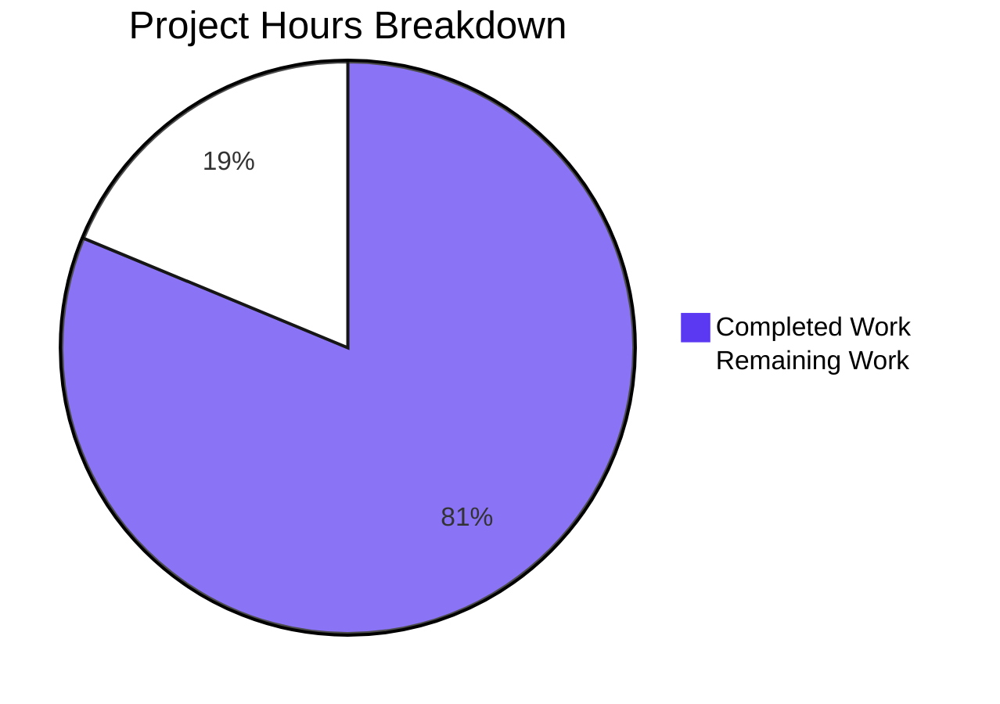

# 1. Executive Summary

QuickTest is a two-file repository: one Node.js server file, now with a front page and an inline description for its request handler.

## 1.1 Project Overview

QuickTest is a single-file Node.js service: `server.js` binds TCP 3000 and answers every request with the constant body `Hello, World!`. The repository had no front page — its history records the previous one deleted — and nothing described the request handler, so a reader could learn neither how to run it nor what the handler did. The change closes both gaps: a seven-line `README.md` stating the project name, that no install step is required, and the run command; and one JSDoc summary line above the handler, with the existing statement left byte-identical. Nothing else changed: no route, configuration, dependency, harness or hardening.

## 1.2 Completion Status

**81% complete** — 6.5 h of the 8.0 h this work is scoped to; the 1.5 h outstanding is human review, merge and post-merge confirmation.



| Metric | Hours |
|---|---|
| Total Hours | 8.0 |
| Completed Hours (AI + Manual) | 6.5 |
| Remaining Hours | 1.5 |

Completed hours render in Blitzy dark blue (#5B39F3); remaining hours in white (#FFFFFF). Figure: `6.5 / (6.5 + 1.5) × 100 = 81%`.

## 1.3 Key Accomplishments

- The repository has a front page: `README.md` states the project name, that no install is required, and the run command, in seven lines.
- The handler is documented in place: one JSDoc summary line above it, with the statement preserved byte-for-byte (`server.js:1-2`).
- The documented command works as written: `node server.js` binds TCP 3000 and serves every request.
- Behaviour is unchanged: responses, headers, startup line and shutdown match the pre-change file (`server.js:2`).
- The delivered pair matches the agreed contents byte-for-byte; the tree still holds two files, with no manifest, dependency, lockfile or tooling.

## 1.4 Critical Unresolved Issues

All five requested items are delivered and verified: **0 of 5 remain open**. Six accepted conditions carry into operation; none blocks release.

| Issue | Impact | Owner | ETA |
|---|---|---|---|
| No automated check covers the documentation — the only automated check in the repository is the syntax parser | A later edit to either file is unverified by tooling | Maintainer | Before the next edit to either file |
| TCP port 3000 is hard-coded, and a bind failure ends the process with an unhandled error | Only one instance can run per host | Operations | Before the first multi-instance deployment |
| No graceful shutdown: terminating the process drops in-flight requests | Restarts are abrupt | Operations | Before any availability requirement |
| Responses carry no `Content-Type`, so clients must sniff the payload type | Client-dependent interpretation of the reply | Consumers | Documented; no action required |
| The comment and the front page name the reply without its trailing newline | A byte-exact reader must read the code | Maintainer | Whenever either file is next edited |
| No runtime version floor is recorded anywhere in the repository | Readers have no stated minimum runtime | Maintainer | When a manifest is next added |

## 1.5 Access Issues

No access issues identified. The change needs no credentials, environment variables or external services, and installs nothing; the only permission it requires is write access to merge it.

## 1.6 Recommended Next Steps

1. [High] Review and merge the two-file change into the default branch — it exists only on the current branch.
2. [High] On the default branch, confirm the exact 14-byte reply on `/` and on an unknown path.
3. [Medium] Settle the deployment posture for the hard-coded port: one instance per host, or isolation per instance.
4. [Medium] Add one small automated check that boots the server and asserts the exact reply, using the runtime's built-in runner.
5. [Low] Record the runtime floor and the operational constraints the front page omits.

# 2. Project Hours Breakdown

Hours are estimated for the agreed scope only: the two documentation deliverables, the verification that proves them, and the production steps that remain. Total 8.0 h — 6.5 h completed, 1.5 h remaining.

## 2.1 Completed Work Detail

| Component | Hours | Description |
|---|---|---|
| Handler documentation line | 0.5 | The single JSDoc summary above the request handler, with confirmation that the statement it describes is untouched at byte level (`server.js:1-2`). |
| Repository front page | 2.0 | Settling the three content decisions — project name from the repository's own identity, the no-install statement, the run command — and writing the seven-line file within the fifteen-line ceiling (`README.md:1-7`). |
| Scope and dependency discipline | 0.5 | Holding the two-file boundary and confirming no manifest, lockfile, dependency or tooling entered the tree. |
| Static verification of the delivered pair | 1.5 | Syntax check; byte-exact comparison of both files against the agreed contents; heading, line-length, blank-line and trailing-newline structure; scope sweeps. |
| Runtime verification of the service | 1.5 | The documented boot gate; response contract; method and path invariance; concurrency; browser-driven end-to-end render. |
| Continuity verification | 0.5 | Pre-change versus delivered runtime behaviour, and tree integrity after all runs. |
| **Total** | **6.5** | |

## 2.2 Remaining Work Detail

| Category | Hours | Priority |
|---|---|---|
| Review and merge the change into the default branch | 1.0 | High |
| Confirm the documented run command and the exact reply on the default branch after the merge | 0.5 | High |
| **Total** | **1.5** | |

## 2.3 Completion Calculation

- Completed hours: 0.5 + 2.0 + 0.5 + 1.5 + 1.5 + 0.5 = **6.5 h** (Section 2.1)
- Remaining hours: 1.0 + 0.5 = **1.5 h** (Section 2.2)
- Total project hours: 6.5 + 1.5 = **8.0 h**
- Completion: `6.5 / 8.0 × 100 =` **81%**

Every remaining hour traces to the path to production: the delivered documentation reaches the default branch only when this branch is merged, and the documented behaviour is then confirmed there. The optional follow-ups in Section 1.6 — a configurable port with a graceful bind failure, a small automated check, and a note of the runtime floor and operational constraints — fall outside the agreed scope and deliberately carry no hours in this breakdown.

# 3. Test Results

The repository ships no test framework, and none was added. What follows is every check that was executed against the delivered files — 87 static and HTTP assertions plus 7 browser-driven requests, 94 in total, all passing. Each was run first-hand in this pass, on the delivered tree, against an isolated instance of the server.

| Area / Category | Framework | Tests | Passed | Failed | Coverage | What This Proves |
|---|---|---|---|---|---|---|
| Delivered-file syntax | Node.js parser (`node --check`) | 1 | 1 | 0 | No coverage tooling in the repository | `server.js` parses cleanly with the documentation line above the statement |
| Documented boot gate | shell + curl | 1 | 1 | 0 | No coverage tooling in the repository | The run command on the front page starts the server and it answers with the exact agreed body |
| Response contract | curl + od + md5sum | 7 | 7 | 0 | No coverage tooling in the repository | Status 200, exactly 14 bytes ending in a newline, no `Content-Type`, no server banner |
| Method invariance | curl | 44 | 44 | 0 | No coverage tooling in the repository | Every method in the sweep receives the identical reply; HEAD replies bodyless |
| Path invariance | curl (`--path-as-is`) | 30 | 30 | 0 | No coverage tooling in the repository | Unknown, nested, encoded and traversal-shaped paths receive the same 200 reply — no 404 path exists |
| Idempotence and concurrency | curl + cmp + xargs | 2 | 2 | 0 | No coverage tooling in the repository | Repeated replies are byte-identical and 50 simultaneous requests all succeed |
| Request-level edge behaviour | curl | 2 | 2 | 0 | No coverage tooling in the repository | An unregistered method token is rejected by the HTTP parser at 400; a request body is ignored |
| Browser-driven end-to-end | headless Chrome | 7 | 7 | 0 | 0 console messages, no request at or above 400 | The served bytes reach a real browser unmodified and render identically on an unknown path |

**Not Covered**

- The front page's presentation. No markdown renderer, linter or documentation pipeline exists in this repository, and none was added, so `README.md` was verified by byte and structure comparison — two well-formed headings, seven lines, exact contents — rather than rendered. A human should read it once in the repository host's rendering before release.
- The inline comment's use by documentation tooling. No generator consumes it anywhere in the repository, so nothing yet verifies how it is presented to a reader.
- Nothing else that ships is unexercised: the server's reply, headers, port binding, startup line, concurrency behaviour and shutdown were all driven directly.

# 4. Runtime Validation & UI Verification

- ✅ **Startup** — `node server.js` from the repository root binds TCP 3000 and writes its single startup line, exactly as the front page documents.
- ✅ **Primary endpoint** — `GET /` returns `HTTP/1.1 200 OK` with the 14-byte body `Hello, World!` and Node's default header set, with no `Content-Type`.
- ✅ **Unknown paths** — `/does-not-exist` returns the same 200 and the same bytes; no 404 path exists.
- ✅ **Method coverage** — GET, POST, PUT, PATCH, DELETE, OPTIONS and TRACE all return the identical reply; HEAD returns 200 with no body.
- ✅ **Concurrency** — 50 simultaneous requests all returned 200 with byte-identical bodies.
- ✅ **Browser client** — a headless Chrome session loaded `/` and `/does-not-exist`: both rendered exactly `Hello, World!` plus a newline (14 characters, last character the line feed), zero console messages, no dialog, no error page, and no request at or above 400.
- ✅ **Automatic companion request** — the browser's own `/favicon.ico` fetch was answered 200 with the same body.
- ✅ **Port lifecycle** — the listener is released when the process stops and a fresh start rebinds it.
- ⚠ **Partial — the front page itself** — nothing in this repository renders or lints `README.md`, so its presentation was verified by structure and byte comparison only; it has no runtime surface of its own.

**Never exercised at runtime:** there is no user interface, no data store, no cache, no session, no queue, no authentication and no outbound integration in this repository, so none could be driven; the only runtime surface it has is the HTTP endpoint above, exercised across every method, a broad path set, concurrency and a real browser. Nothing exercises the documentation after a later edit either — the only automated check in the repository remains the syntax parser.

# 5. Compliance & Quality Review

Each deliverable is mapped to the benchmark it is held to (5.1), followed by the one divergence recorded while the work was delivered and the basis for finding no others (5.2).

## 5.1 Compliance Matrix

Each deliverable is mapped to the benchmark it is held to, with its state as it stands now.

| Deliverable | Benchmark | Status | Evidence |
|---|---|---|---|
| Inline handler documentation | Documentation present, placed and accurate | ✅ PASS | `server.js:1-2` — one summary line above the statement it describes |
| Project name on the front page | Repository identity stated correctly | ✅ PASS | `README.md:1` — matches the repository's own pre-deletion front page |
| Install requirement | Setup instructions accurate for the tree | ✅ PASS | `README.md:3` — no manifest, lockfile or dependency exists; the command runs with nothing installed |
| Run command | Instructions executable as written | ✅ PASS | `README.md:7` — `node server.js` started the server in every run |
| Front-page length | Concision | ✅ PASS | 7 lines against a 15-line ceiling |
| Exact-content fidelity | Agreed contents delivered verbatim | ✅ PASS | Both files match the agreed contents byte-for-byte |
| Scope discipline | Two files, nothing else | ✅ PASS | Two tracked files; no manifest, lockfile, dependency or tooling |
| Minimum-diff discipline | One added line, no modified line | ✅ PASS | 8 insertions, 0 deletions; the existing statement hashes identically to the default branch |
| Behaviour preservation | No unintended behaviour change | ✅ PASS | Responses, headers, startup line and shutdown behaviour identical before and after |
| Documentation accuracy | Every claim true of the code | ✅ PASS | Each documented statement matched an observed behaviour; nothing is documented that the code does not do |
| Secret hygiene | No credentials in the delivered files | ✅ PASS | No secret-shaped content in either file |
| Automated verification availability | Repository checks | ✅ PASS — limited by scope | The syntax check and the boot gate are the repository's only automated checks, by design |

## 5.2 AAP & Rule Divergences and Gaps

One divergence was identified: the standard per-file test and lint steps were not carried out. Everything else follows the agreement — both delivered files match the agreed contents byte-for-byte, the diff is 8 insertions and 0 deletions, and all twenty requirements the work was scoped against were verified as met (Section 5.1), so no further divergence exists.

| What the Rule Required | What Was Delivered Instead | Why It Diverged | Impact | Remediation |
|---|---|---|---|---|
| For each changed file, a temporary test file beside it and a lint pass over it. | No test file was written, and no linter, markdown renderer or other tooling was installed or run. Verification used the runtime's syntax check, byte-exact comparison against the agreed contents, a structural reading of the front page and the repository's own boot gate. | Sanctioned. The rules agreed for this change bar adding any test file, lockfile, dependency or tooling for a two-file documentation change, and the repository carries no linter or markdown renderer to run. | None on the delivered files, which are byte-exact against the agreed contents and behaviourally identical to their predecessors. The residual is that no repeatable automated check protects either file from a later edit. | None required — the verification was complete without it. A human may optionally add a small check; see Section 1.6. |

Standard per-file steps assume a changed file with executable behaviour and tooling to check it. Neither holds here: `README.md` is prose and the added line in `server.js` is a comment, so no test can exercise behaviour, and the repository carries no linter, markdown renderer, test framework or manifest — adding one would breach the rules agreed for this change, which cap it at two files and forbid new dependencies or tooling. The replacement checks were not weaker: both files were compared byte-for-byte against the agreed contents, the existing statement was confirmed unchanged in behaviour (`server.js:2`), and the documented command was run and matched. Nothing needs closing; a small check later is optional (Section 1.6).

# 6. Risk Assessment

Risks are forward-looking: what could still go wrong once this service is exposed. None is a defect in the delivered work; several follow directly from the minimal design the change was required to preserve.

| Risk | Category | Severity | Probability | Mitigation | Status |
|---|---|---|---|---|---|
| A second instance cannot start: the port is hard-coded, and a bind failure ends the process with an unhandled error on stderr | Operational | Medium | High on any shared host | Run one instance per host, or isolate per instance in a container or a private network namespace | Accepted — by design |
| A later edit to either delivered file is unprotected: the only automated check is the syntax parser | Technical | Medium | High | Add a focused check that boots the server and asserts the exact reply, using the runtime's built-in test runner | Open — optional |
| A process terminated mid-request drops in-flight requests: there is no graceful shutdown or cleanup hook | Operational | Medium | Medium | Supervise the process externally, and drain at the load-balancer layer if it is ever placed behind one | Accepted — by design |
| Operational visibility is a single startup line: no health endpoint, metrics, tracing or per-request logging | Operational | Medium | High | Pair the process with external supervision and an out-of-band liveness probe | Accepted — by design |
| The listener accepts every method and path from any client: no authentication, rate limiting or request-size limit, and it binds all interfaces while the startup line names loopback | Security | Medium | High if exposed beyond a trusted interface | Keep it on a trusted interface: restrict exposure with host firewall rules, a container binding or a reverse proxy | Open — deployment decision |
| Responses carry no `Content-Type`, so the client decides how to interpret the payload | Integration | Low | Medium | Treat the payload as opaque text, as every client observed here did | Accepted — by design |
| The documentation states the reply without its trailing newline | Technical | Low | Medium | Read the byte count from the code when precision matters; state it if either file is next edited | Open — minor |
| No runtime version floor is recorded anywhere in the repository | Technical | Low | Medium | Record a floor when the repository next gains a manifest | Open — minor |

# 7. Visual Project Status


Completed work renders in Blitzy dark blue (#5B39F3) and remaining work in white (#FFFFFF). The remaining 1.5 h is the two production steps in Section 2.2 — review and merge of the change into the default branch (1.0 h, High) and post-merge confirmation of the documented behaviour (0.5 h, High). Section 1.2 states the same figures, and the completion figure they produce is **81%**.

# 8. Summary & Recommendations

**What was delivered and verified.** The repository now has the two things it was missing. A seven-line front page states the project name, that no install step is required and the command that runs it; and the request handler carries a one-line description directly above it, with the statement it describes left byte-for-byte as it was. Nothing else moved: the tree still holds exactly two files, with no manifest, dependency, lockfile or added tooling, and the diff is eight inserted lines and no deletions. The documented command was run from the repository root and serves the exact 14-byte reply on every method and every path, including paths that do not exist, through `curl` and through a real browser session that rendered the same bytes with no console output.

**What remains.** 1.5 h of human work, and no engineering work at all. The delivered documentation reaches the default branch only when this branch is merged — the default branch currently tracks `server.js` alone — and the documented behaviour should then be confirmed once on that branch with the two commands the front page gives. That is the whole critical path: no build step, no migration, no configuration change, no dependency to install and no environment to prepare.

**Production readiness.** Against the scope this work was set — a documentation change with the server's behaviour deliberately preserved — the delivery is complete: **81%** of the scoped hours are done, and every one of the twenty requirements the work was defined against was verified as met, with the eight lines that constitute it matching the agreed contents byte-for-byte. The remaining 19% is the human review and merge tail, not unfinished code. Readiness for wider exposure is a separate question, and the answer is in Section 6: the service has no authentication, no rate limiting, no security headers, no graceful shutdown and a hard-coded port, all of it by design for a sample server, so it should stay on a trusted interface until those gaps are deliberately closed.

**Success metrics.** All 94 executed checks passed: 87 static and HTTP assertions plus 7 browser-driven requests, with 0 failures and 0 browser console messages. The front page is 7 lines against a 15-line ceiling; the diff is 8 insertions and 0 deletions; the delivered `server.js` hashes identically to its predecessor on the line that carries the behaviour; and the reply is 14 bytes on every method and path observed.

**Recommendations.** Merge, then confirm once on the default branch — that closes the scope as agreed. Beyond it, three optional investments are worth weighing, in this order: a single small automated check that boots the server and asserts the exact reply, so a later edit to either file cannot pass unnoticed; a decision on the deployment posture for the hard-coded port and the absence of graceful shutdown; and a short note to readers recording the runtime floor and the operational constraints the front page deliberately leaves out.

# 9. Development Guide

**System prerequisites**

- A Node.js runtime. The one used throughout verification was **v22.23.4**; `server.js` is a CommonJS file that uses an arrow function, which any current Node.js runtime provides. No minimum version is recorded in the repository.
- No package manager is involved. There is no manifest, no lockfile and no installed package directory, and nothing is installed to run the project.
- Optional tools used during verification: `curl` (requests), `ss` or `lsof` (who holds the port), `od` or `md5sum` (byte-level checks), and `docker` if you want to run isolated from a host that already holds the port.
- Any operating system with a current Node.js runtime; the commands below are POSIX shell.

**Environment setup and dependency installation**

None. There is nothing to install, no virtual environment to create, no environment variable to set and no configuration file to add. The server reads no environment variable at all: exporting `PORT=9999` before starting it still binds 3000.

**Startup**

Run both commands from the repository root:

```bash
cd <repository root>
node --check server.js      # syntax check: prints nothing, exits 0
node server.js              # binds TCP 3000
```

Expected output from the second command, and nothing else:

```
Server running at http://127.0.0.1:3000/
```

To leave it running after the shell returns, and to stop it again:

```bash
nohup node server.js > server.log 2>&1 & echo $!   # prints the pid
kill <pid>                                          # or: kill "$(lsof -ti :3000)"
```

**Verification**

```bash
curl -sS -D - http://127.0.0.1:3000/                                    # full response with headers
curl -s http://127.0.0.1:3000/ | wc -c                                  # 14
curl -s -o /dev/null -w '%{http_code}\n' http://127.0.0.1:3000/does-not-exist   # 200
curl -s http://127.0.0.1:3000/does-not-exist | cat -A                   # Hello, World!$
```

The observed response to the first command:

```
HTTP/1.1 200 OK
Date: <timestamp>
Connection: keep-alive
Keep-Alive: timeout=5
Content-Length: 14

Hello, World!
```

One command that checks the syntax, boots the server, requests it, and stops it again:

```bash
node --check server.js && (node server.js > /dev/null 2>&1 & SRV=$!; sleep 1; curl -fsS http://127.0.0.1:3000/ | grep -qx 'Hello, World!'; RC=$?; kill $SRV; exit $RC); echo "gate exit=$?"
```

Expected: `gate exit=0`.

When port 3000 is already held on the host you are working on, run the same file isolated instead of changing it:

```bash
docker run -d --rm --name quicktest -p 31338:3000 -v "$PWD/server.js:/app/server.js:ro" -w /app node:22-alpine node server.js
curl -s -o /dev/null -w '%{http_code}\n' http://127.0.0.1:31338/   # 200
docker stop quicktest
```

The dependency-free equivalent uses a private network namespace:

```bash
unshare -rn sh -c 'ip link set lo up; node server.js & SRV=$!; sleep 1.5; curl -s http://127.0.0.1:3000/; kill $SRV'
```

**Example usage**

Every method and every path returns the same reply, so any client is a valid example:

```bash
curl -i http://127.0.0.1:3000/anything             # 200, Hello, World!
curl -i -X POST -d 'a=b' http://127.0.0.1:3000/    # 200, same body
curl -i -X DELETE http://127.0.0.1:3000/           # 200, same body
curl -I http://127.0.0.1:3000/                     # 200, no body
```

A browser pointed at `http://127.0.0.1:3000/` displays exactly `Hello, World!` followed by a newline — 14 characters in total. Because the reply carries no `Content-Type`, Chrome sniffs it as plain text and wraps it in a pre-formatted block; that is the intended and observed presentation. To review the front page itself, open `README.md` in your repository host's rendering — nothing in this repository renders or lints markdown.

**Troubleshooting**

| Symptom | Cause | Resolution |
|---|---|---|
| `node:events:497 throw er; // Unhandled 'error' event` with `EADDRINUSE` and exit 1 at startup | Another process already holds TCP 3000; the port is hard-coded in the file | Identify the owner (`ss -ltnp \| grep :3000` or `lsof -i :3000`) and stop your own instance, or run isolated with the container or namespace command above |
| `npm start` or `npm test` fails with `npm error code ENOENT … Could not read package.json` (exit 254) | There is no package manifest, by design | Expected — start the server with `node server.js` |
| `400 Bad Request` with an empty body | The HTTP parser rejected the request before it reached the handler: an unregistered method token, a malformed request line, a raw space in the target, or no `Host` header on HTTP/1.1 | Send a well-formed request; this happens upstream of the application and is not application routing |
| `431 Request Header Fields Too Large` | The request line or a header block exceeds the parser's 16 KB limit | Shorten the request line or headers |
| A client sees no `Content-Type`, and `HEAD` returns no `Content-Length` | The handler writes a bare body and leaves headers at Node's defaults | Expected; treat the payload as opaque text |
| A second instance exits immediately while the first keeps serving | Only one process can hold port 3000 | Run one instance per host, or isolate each instance |

# 10. Appendices

Everything below is reference material for the two files this project consists of.

## A. Command Reference

| Command | Purpose | Expected result |
|---|---|---|
| `node --check server.js` | Syntax check — the repository's only automated check | No output, exit status 0 |
| `node server.js` | Run the server from the repository root | Prints `Server running at http://127.0.0.1:3000/` and binds TCP 3000 |
| `nohup node server.js > server.log 2>&1 & echo $!` | Run it detached and print its pid | Prints the pid; output in `server.log` |
| `curl -sS -D - http://127.0.0.1:3000/` | Full response with headers | `HTTP/1.1 200 OK`, `Content-Length: 14`, body `Hello, World!` |
| `curl -s http://127.0.0.1:3000/ \| wc -c` | Body size | `14` |
| `curl -s -o /dev/null -w '%{http_code}\n' http://127.0.0.1:3000/does-not-exist` | Status of an unknown path | `200` |
| `node --check server.js && (node server.js > /dev/null 2>&1 & SRV=$!; sleep 1; curl -fsS http://127.0.0.1:3000/ \| grep -qx 'Hello, World!'; RC=$?; kill $SRV; exit $RC); echo "gate exit=$?"` | Syntax check, boot, request, stop — in one line | `gate exit=0` |
| `docker run -d --rm --name quicktest -p 31338:3000 -v "$PWD/server.js:/app/server.js:ro" -w /app node:22-alpine node server.js` | Run isolated when the host port is taken | Container answers `200` with 14 bytes on the published port |
| `unshare -rn sh -c 'ip link set lo up; node server.js & SRV=$!; sleep 1.5; curl -s http://127.0.0.1:3000/; kill $SRV'` | Docker-free isolated run | The 14-byte body |
| `ss -ltnp \| grep :3000` / `lsof -i :3000` | Identify what holds the port | The owning pid and command |
| `kill "$(lsof -ti :3000)"` | Stop the server | Port released |
| `git diff --numstat origin/main...HEAD` | Size of the delivered change | `7 0 README.md`, `1 0 server.js` |
| `git show origin/main:server.js \| sha256sum` | Confirm the documented statement is unchanged | Same digest as line 2 of the delivered `server.js` |

## B. Port Reference

| Port | Protocol | Set where | Notes |
|---|---|---|---|
| 3000 | TCP | Hard-coded in `server.js` (`.listen(3000, …)`) | Bound on all interfaces; no flag, argument or environment variable changes it. Only one instance can hold it per host, so isolated runs publish a different host port into container port 3000. |

## C. Key File Locations

| Path | Purpose | Notes |
|---|---|---|
| `README.md` | Front page: project name, the no-install statement and the run command | 7 lines / 134 bytes; two headings, no links, no badge, no fenced block |
| `server.js` | The entire application | 2 lines / 221 bytes: the JSDoc summary on line 1 and the single `http.createServer(...).listen(3000, ...)` statement on line 2 |
| `server.log` (created at runtime) | Captures the single startup line when the server runs detached | Not tracked; the process writes nothing else |

## D. Technology Versions

| Component | Version | Notes |
|---|---|---|
| Node.js runtime | v22.23.4 observed | Any current runtime that supports CommonJS `require` and arrow functions; no version is pinned or documented in the repository |
| Node.js built-in `http` module | Ships with the runtime | The only module the application loads |
| Project dependencies | None | No manifest, no lockfile, no installed package directory |
| Container image used for isolated runs | `node:22-alpine` (v22.23.4) | Used only to run the same file where the host port is taken; the repository carries no Dockerfile |
| Browser used for the end-to-end check | Chrome 156 | Used as an HTTP client only; the project has no user interface |

## E. Environment Variable Reference

The application reads no environment variable, and the repository defines none — there is no manifest, no `.env` file and no configuration file of any kind. Exporting a variable such as `PORT=9999` before starting the server has no effect: the process still binds 3000, which was verified directly.

| Variable | Used by the application | Notes |
|---|---|---|
| *(none)* | No | No environment variable is read anywhere in `server.js`; adding one would be a behaviour change the agreed scope excluded. |

## F. Developer Tools Guide

The repository deliberately ships no tooling. What is available, and what is not:

| Tool | Present | Use in this project |
|---|---|---|
| `node --check` | Yes (built into the runtime) | The only automated check: confirms `server.js` parses |
| `curl` | Yes (host tooling) | Requests, status codes, byte counts, header inspection |
| `ss` / `lsof` | Yes (host tooling) | Identifying what holds TCP 3000, and stopping it |
| `od` / `md5sum` / `wc` | Yes (host tooling) | Byte-level verification of the 14-byte reply |
| `docker` or `unshare` | Optional (host tooling) | Running the same file in isolation when the host port is taken |
| `git` | Yes | Inspecting the delivered diff and confirming the documented statement is unchanged |
| Test framework | No | None exists and none may be added for this change; the runtime's built-in `node:test` runner is the natural choice if a check is ever wanted |
| Linter, formatter, markdown renderer | No | None exists; markdown changes are reviewed by reading the rendered file in the repository host |
| Coverage tool, security scanner, CI configuration | No | None exists; the syntax check and the boot gate above are the full extent of automated checking available |

## G. Glossary

| Term | Meaning in this project |
|---|---|
| Request handler | The one function in `server.js` that produces each reply — the arrow function passed to `http.createServer` on line 2. |
| Constant body | The reply never varies: `Hello, World!` followed by one newline, 14 bytes, for every method and every path. |
| Startup line | The single log line `Server running at http://127.0.0.1:3000/` printed once when the process binds its port. |
| Method invariance | Every HTTP method observed — GET, POST, PUT, PATCH, DELETE, OPTIONS, TRACE — receives the identical body; HEAD receives 200 with none. |
| Path invariance | Every request target observed — root, unknown, nested, encoded, traversal-shaped, asterisk-form and absolute-form — receives the identical 200 reply. No 404 path exists. |
| `EADDRINUSE` | The error raised when TCP 3000 is already held by another process. The server has no error handler, so it terminates with exit status 1. |
| Byte-exact | Identical at the byte level, verified with a digest or a byte dump rather than by reading. |
| Isolated run | Running the same unmodified file where the host's port 3000 is taken — in a container with a published port, or in a private network namespace. |
| Port release | The listener disappears when the process stops, so the port is immediately available to the next start. |
| Completion percentage | Completed hours divided by total scoped hours, here 6.5 of 8.0 = 81%. |
