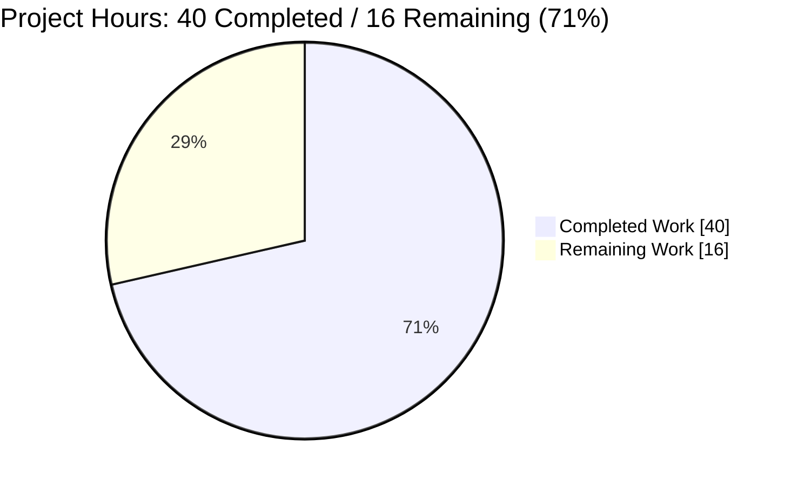
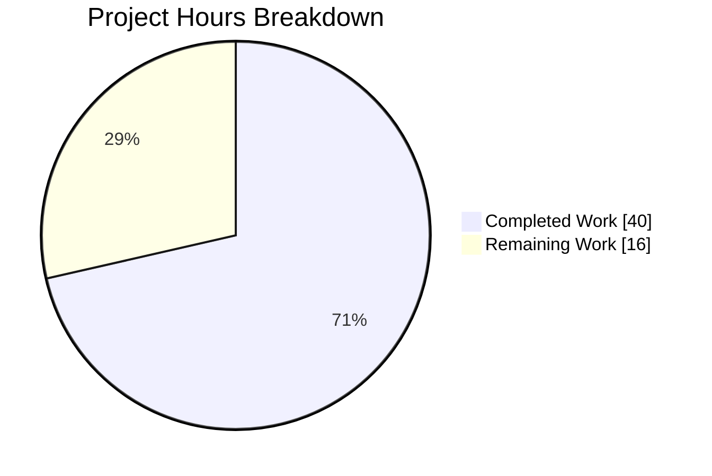
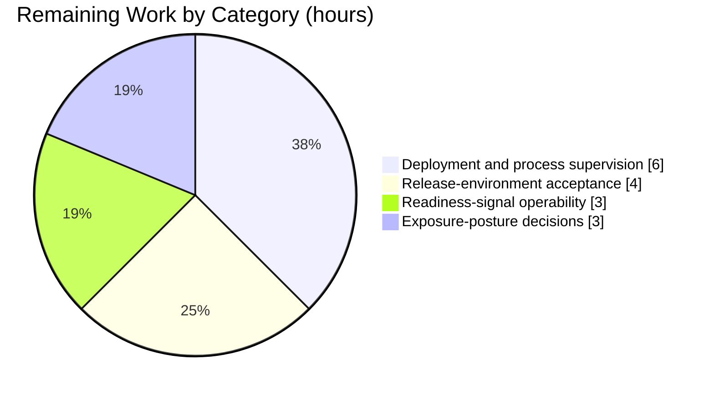

# 1. Executive Summary

## 1.1 Project Overview

The repository holds one statement: an HTTP listener on port 3000 that answers every request with a constant body. This project added a second, path-addressed response: `GET /good-evening` answers `200` with `Content-Type: text/plain` and the twelve bytes `Good evening`, while every other path keeps the bytes it already returned. The change is one branch inside the existing request callback — no new dependency, no refactoring, no change to start-up, port or existing responses — plus an acceptance suite and a request-flow document.

## 1.2 Completion Status

The project stands at 71% complete. Completed hours are Dark Blue (`#5B39F3`); remaining, White (`#FFFFFF`).



| Metric | Hours |
| --- | --- |
| Total Hours | 56 |
| Completed Hours (AI + Manual) | 40 |
| Remaining Hours | 16 |

Completion is completed hours divided by total hours: 40 / 56 = 71%.

## 1.3 Key Accomplishments

- `GET /good-evening` answers `200`, `Content-Type: text/plain`, `Content-Length: 12`, body exactly `Good evening`, no trailing newline.
- Every other path keeps `200`, no `Content-Type`, `Content-Length: 14` and `Hello, World!\n`, byte-identical to the previous build.
- Routing is exact string equality, so look-alike and encoded targets fall through to the preserved response.
- Four acceptance criteria run on the built-in test runner with no dependency or install step: `# tests 4 / # pass 4 / # fail 0`.
- The change is one callback in one file; import, port bind, readiness line and existing call are character-identical.
- `docs/request-flow.md` carries the flow diagram, the contract table, both examples and the measured responses.
- The server binds port 3000, prints its readiness line once and writes nothing to stderr.
- The zero-dependency property survives: three files, four built-in imports, no third-party package.

## 1.4 Critical Unresolved Issues

Open items: 4 of 4 path-to-production items, 0 of 3 scoped deliverables. None is a defect; all four concern running the service outside a developer machine.

| Issue | Impact | Owner | ETA |
| --- | --- | --- | --- |
| No deployment or process supervision exists for the listener | The endpoint only runs from a developer shell; there is no supervised start, stop or restart | Platform / release engineering | 6h |
| No acceptance run has been performed in the target environment | Release sign-off rests on local evidence; a host or proxy in the path is unverified | Release engineering | 4h |
| The single readiness line is not captured or alerted on | A failed bind exits with only the runtime's trace; a supervisor cannot tell "waiting to bind" from "readiness line already discarded" | Operations | 3h |
| The listener's exposure posture in the target environment is undecided | The service is plain HTTP on every interface with nothing in front of it | Security / platform | 3h |

## 1.5 Access Issues

No access issues identified. Repository, runtime and port were all reachable; no credential or third-party API is involved.

## 1.6 Recommended Next Steps

1. [High] Deploy the listener under a process supervisor and confirm it binds port 3000, serves both contracts and prints its readiness line (6h).
2. [High] Run the acceptance gate there — both syntax checks, the file-form suite and the two contract checks — and record it as release sign-off (4h).
3. [Medium] Capture the start-up line in the target's log store and alert when it is missing (3h).
4. [Medium] Decide and record the listener's exposure posture — network placement and whatever fronts it (3h).
5. [Low] Decide whether the fall-through assertions in test 3 stay; removing them reopens the coverage they close.

# 2. Project Hours Breakdown

## 2.1 Completed Work Detail

Every component below traces to a specific requirement of the agreed scope: one endpoint added to an existing dependency-free HTTP server, its automated coverage, its committed documentation, and the verification that proves each of them works.

| Component | Hours | Description |
| --- | --- | --- |
| `GET /good-evening` endpoint in `server.js` | 6 | The request's new path-addressed response: one branch inside the existing `createServer` callback, placed ahead of the terminal response call, setting `Content-Type: text/plain` and writing the twelve-byte body with a single `res.end`, with the preserved call left as the fallback for every other path. Includes establishing that matching is exact string equality, that the branch must precede a terminal call, and that the header must be set with `setHeader` rather than `writeHead` to keep the identity framing both responses share. |
| Automated acceptance suite `test/good-evening.test.js` | 9 | The project's only automated test: a black-box harness that spawns the server as a child process, synchronises on the exact readiness line with a bounded wait, fails loudly with the child's stderr when the server cannot bind, and tears the child down by signalling and awaiting its exit. Carries the four acceptance criteria — status and content type, exact body and byte count, the unchanged fallback response, and a single clean start-up serving both endpoints — plus the assertions that pin the exact-match fall-through. |
| Request-flow document `docs/request-flow.md` | 5 | The committed documentation artefact: a Mermaid flowchart tracing one request through the listener, the routing decision and both response shapes, an endpoint contract table, the two example commands reproduced with their run location, and the measured response blocks with the runtime-added headers accounted for. |
| Runtime and adversarial verification of both response contracts | 12 | The evidence behind every claim: live header and body capture for both paths, byte-level body checks, a byte-for-byte regression comparison against the build that predates the change, repeated-request idempotence, concurrency and pipelining, keep-alive reuse, the method matrix including `HEAD`, and probes for oversized, malformed, injection-shaped, encoded, NUL-bearing and dot-segment request targets, plus real-browser checks of both paths. |
| Whole-tree review and cross-file seam verification | 8 | Verification that the three files agree with each other and with the running server on every shared value — readiness text, port, the two body lengths, the two bodies, the endpoint contract — together with the scope audit confirming that no file, dependency, configuration, manifest or out-of-scope construct exists anywhere in the tree. |

**Total completed: 40 hours.**

## 2.2 Remaining Work Detail

Each row is path-to-production work for the delivered endpoint — the steps between a verified change on a developer machine and a running service — and each carries its priority. The hardening that a public listener needs in front of it (TLS termination, access control, response-header and rate-limit posture) is the target platform's responsibility rather than this change's and is carried in Section 6 as a risk, not as work owed here.

| Category | Hours | Priority |
| --- | --- | --- |
| Deployment and process supervision of the listener: choose the host, define the supervisor unit and its start/stop semantics, and fix the bind address so the endpoint runs outside a developer shell | 6 | High |
| Release-environment acceptance run: execute the syntax checks, the file-form suite expecting `# tests 4 / # pass 4 / # fail 0`, and the two contract checks against the deployed instance on a free port, and record the result as the release sign-off | 4 | High |
| Operability of the readiness signal: capture the start-up line in the target's log store and alert when it is absent, so a failed bind — which today writes only the runtime's own trace to stderr and exits — is visible | 3 | Medium |
| Exposure posture for the port-3000 listener in the target environment: decide its network placement and what fronts it, and record that decision | 3 | Medium |
| **Total remaining** | **16** | |

**Hours arithmetic:** completed 40 hours + remaining 16 hours = 56 total project hours; completion = 40 / 56 = 71%. Section 1.2 states the same total, the same completed figure and the same remaining figure, and Section 7 charts the same two numbers.

# 3. Test Results

All rows below were executed during this assessment against the delivered revision; the counts are the observed ones, not estimates. The project configures no coverage tooling — there is no manifest, no coverage dependency and no threshold anywhere in the repository — so the coverage column records that absence rather than a figure.

| Area / Category | Framework | Tests | Passed | Failed | Coverage | What This Proves |
| --- | --- | --- | --- | --- | --- | --- |
| `GET /good-evening` contract — status, content type, exact body and byte count (`test/good-evening.test.js`, tests 1–2) | Node.js built-in `node:test` + `node:assert/strict` | 2 | 2 | 0 | Not configured | The endpoint satisfies the agreed contract exactly: `200`, `Content-Type: text/plain`, body `Good evening` with `Content-Length: 12` and no trailing newline |
| Preserved response on every other path, including the exact-match fall-through (test 3, with its loop over `/good-evening/` and `/good-evening?x=1`) | Node.js built-in `node:test` + `node:assert/strict` | 1 | 1 | 0 | Not configured | `/hello-world` still returns `200`, no `Content-Type`, `Content-Length: 14` and `Hello, World!\n`, and a path that merely shares the route's prefix does not reach the route |
| Single clean start-up serving both endpoints (test 4) | Node.js built-in `node:test` + `node:assert/strict` | 1 | 1 | 0 | Not configured | One process binds port 3000, prints the readiness line once, and answers both paths correctly in that same run |
| Syntax gate over both JavaScript files | `node --check` | 2 checks | 2 | 0 | Not applicable | Both files parse without error, so the suite and the server load on the delivered revision |
| Live wire verification of both contracts — status line, full header set and body bytes | Scripted HTTP checks, no framework | 2 checks | 2 | 0 | Not applicable | The values the suite asserts are what the wire returns, including the runtime-added headers and the absence of `Content-Type` on the fallback |
| Regression comparison against the build that predates the change | Scripted, no framework | 1 check | 1 | 0 | Not applicable | The fallback response is byte-identical before and after, and `/good-evening` is the single intended delta |
| Fall-through, malformed-target and payload-shaped probes (look-alike and case-variant paths, encoded and NUL-bearing targets, source and secret paths, SQL/XSS/traversal payloads, a CRLF-injection path, a 20 KB target, `POST` and `HEAD`) | Scripted, no framework | 19 probes | 19 | 0 | Not applicable | Nothing is decoded, normalised, reflected or executed; look-alike paths reach the preserved response; the process stays up and keeps serving both contracts |

**Not Covered**

- No coverage, lint, format, type-check or dependency-scan tooling exists in this repository, so nothing measures line or branch coverage, enforces style, or audits the dependency surface. The suite is the only automated gate; a team whose release process requires those checks must supply them.
- The suite's own failure branches are not exercised: the five-second readiness timeout, the stderr accumulation across child output, and the early return in its teardown cannot be reached without deliberately breaking the build. A human should satisfy themselves in the target environment that a server which fails to bind fails the run loudly rather than hanging.
- Nothing asserts that the readiness line is printed exactly once; that property is established by inspection of the single call site and by every start observed here. Confirming it in a supervised deployment is worthwhile, because a supervisor keys on that line.
- Header-level assertions beyond content type and length are not covered: the runtime-added `Date`, `Connection` and `Keep-Alive` headers are not asserted, and the fallback's missing `Content-Type` is asserted only as absent.
- No deployment-shaped check exists anywhere: nothing exercises the endpoint behind a proxy, a DNS name, a TLS terminator or a container, and no load, soak or failure-injection test has been run.

# 4. Runtime Validation & UI Verification

Every line below was driven against the running server on the delivered revision. The application has no user interface, no client code and no styling of any kind — its entire surface is a plain-text HTTP response — so browser validation covers the two rendered documents rather than a UI, and no other UI verification applies.

- ✅ **Server start-up** — `node server.js` binds port 3000 and prints exactly `Server running at http://127.0.0.1:3000/` once, with nothing on stderr, across five controlled starts; each start's captured process was confirmed as the sole owner of the port, and each was stopped by that captured identifier with the port verified free afterwards.
- ✅ **`GET /good-evening`** — `200`, `Content-Type: text/plain`, `Content-Length: 12`, body exactly `Good evening` (12 bytes, no trailing newline; observed byte run `47 6F 6F 64 20 65 76 65 6E 69 6E 67`), stable across repeated requests.
- ✅ **Preserved fallback response** — `/hello-world` returns `200` with no `Content-Type` header and the 14-byte body `Hello, World!\n`; the body was compared byte-for-byte against the build that predates the change and is identical.
- ✅ **Fall-through routing** — `/`, `/good-evening/`, `/good-evening?x=1`, `/GOOD-EVENING`, `/good-evening-extra` and an unrelated path all reach the preserved response, confirming that matching is exact and that nothing is decoded, trimmed or normalised.
- ✅ **Method handling** — `POST /good-evening` returns the endpoint body, since no method gate exists; `HEAD /good-evening` returns `200` with the header set and no body, handled by the runtime from the same single write.
- ✅ **Malformed and hostile request targets** — source paths, secret paths, SQL, script, traversal, NUL-bearing, percent-encoded, CRLF-injection and 20 KB targets were all answered cleanly, with nothing reflected, executed or disclosed; the process stayed up and kept returning both contracts correctly afterwards.
- ✅ **Cross-file agreement at runtime** — the readiness text, the port, the two bodies and the two byte counts match across the server, the suite and the documentation on the running system, so the documented contract is the served contract.
- ⚠ **Browser verification** — both paths were loaded in a real browser: the correct bodies rendered, the response media type was plain text, and no console output of any level was produced. This covers the two documents only; there is no UI, no navigation and no client-side state to verify.
- ⚠ **Operability of the readiness signal** — the line is emitted on stdout alone: a consumer that closes its read end loses the signal silently, and a server that cannot bind writes only the runtime's own trace to stderr and exits. Neither is a defect of the endpoint, and neither has been exercised under a process supervisor — see Section 6.
- ❌ **Deployment runtime** — no host, proxy, DNS name, TLS terminator, container or process supervisor has ever been in front of this server. The endpoint has only ever run from a developer shell on loopback, which is the gap Section 2.2 quantifies.

**Never exercised at runtime.** Beyond the deployment gap above: no integration surface exists to drive (no database, no outbound call, no queue, no credential, no file access), and therefore none was exercised; the suite's own failure branches (the readiness timeout, the stderr accumulation and the teardown's early return) were never entered, since reaching them requires a deliberately broken build; no sustained load, soak or failure-injection run has been performed, so throughput and behaviour under prolonged pressure are unknown; and the port, the bind address and the readiness text are literals with no configuration path, so no configuration variation could be exercised even in principle.

# 5. Compliance & Quality Review

## 5.1 Compliance Matrix

Each row is a deliverable of the agreed scope, with its verified state on the delivered revision.

| # | Deliverable | Status | Progress | Evidence |
| --- | --- | --- | --- | --- |
| 1 | `GET /good-evening` endpoint contract — `200`, `Content-Type: text/plain`, body `Good evening`, 12 bytes, no trailing newline | ✅ Pass | Complete | `server.js:1`; asserted by suite tests 1–2; reproduced on the wire and in the body bytes |
| 2 | Preserved response on every non-matching path — `200`, no `Content-Type`, `Content-Length: 14`, `Hello, World!\n` | ✅ Pass | Complete | Untouched terminal `res.end` in `server.js:1`; suite test 3; byte-identical against the pre-change build |
| 3 | Exact-match routing boundary — no path parser, no query handling, no method gate | ✅ Pass | Complete | `req.url === '/good-evening'` only; 19 look-alike and malformed targets probed and all fell through |
| 4 | Unchanged start-up — binds port 3000, prints the readiness line once, no errors | ✅ Pass | Complete | Five controlled starts; stderr empty every time; captured process the sole owner of the port |
| 5 | Minimal-change discipline in `server.js` — one line, one statement, existing text character-identical | ✅ Pass | Complete | Single diff hunk inside the callback; prefix and suffix byte-identical to the previous revision |
| 6 | Automated acceptance suite — the four criteria on the runtime's built-in runner | ✅ Pass | Complete | `test/good-evening.test.js`; `node --test test/good-evening.test.js` exit 0, `# tests 4 / # pass 4 / # fail 0` |
| 7 | Zero-dependency property — no package, manifest, lockfile or install step | ✅ Pass | Complete | Four Node built-in imports plus global `fetch`; no `package.json`, lockfile or `node_modules` in the tree |
| 8 | Committed request-flow documentation — diagram, contract table, examples, measured evidence | ✅ Pass | Complete | `docs/request-flow.md`; every value it states reproduced on the running server |
| 9 | Scope boundary — no middleware, authentication, database, logging, error-handling refactor, configuration, router, metrics or packaging artefact | ✅ Pass | Complete | Construct sweep returns zero for each; three tracked files, no fourth |
| 10 | Code quality — no placeholder, stub, TODO, dead code or hardcoded credential | ✅ Pass | Complete | Marker sweep returns zero across all three files; the only child-process use is the suite's black-box spawn |
| 11 | Security of the delivered code — no secret, no injectable input path, no information disclosure | ✅ Pass | Complete | One request property read and only ever compared; both bodies are source literals; rejected requests carry no internal detail |
| 12 | Observability and operability of the running service | ⚠ Partial | Not started | One start-up line on stdout, not captured or alerted on; a failed bind surfaces only the runtime's own trace. Excluded by the agreed scope and carried in Sections 2.2 and 6 |

## 5.2 AAP & Rule Divergences and Gaps

Seven divergences were identified. None of them is a defect, and none was caused by a user rule: no user rules were provided for this project, so nothing was overridden on that basis.

| # | What the AAP/Rule Required | What Was Delivered Instead | Why It Diverged | Impact | Remediation |
| --- | --- | --- | --- | --- | --- |
| D1 | Each acceptance criterion carried by "one assertion set each" | The four criteria as required, plus a second assertion set inside test 3 pinning the fall-through for `/good-evening/` and `/good-evening?x=1` | The documented fall-through had no discriminating assertion, so a prefix match would have left the suite green; settled on the clauses that fix the count, titles and order | None on behaviour or interface; makes an already-correct documented behaviour observable | None required. If the clause must be read strictly, the loop at `test/good-evening.test.js:88-97` is the only code to remove |
| D2 | Byte arithmetic stated for the server file: a 144-character replacement in a 249-byte file | A 145-character replacement; the tracked blob is 250 bytes (251 in a worktree that normalises line endings) | The derived counts disagree with the scope's own quoted target text, which the delivered line reproduces character for character | None; no contract value, header or byte count depends on the figure | None. Do not use the stated counts for future comparisons against the file |
| D3 | The request's commands "reproduced as given", and the document confined to the diagram, the table and nothing else | The document keeps the POSIX `curl` form and carries no test-run command | The clauses that fix the document's contents outrank the convenience of annotating it | On a Windows host the examples must be run as `curl.exe`; the runner command is the project's gate, not the document's content | None inside the scope. A team wanting a shell note or a runner command should change the scope first |
| D4 | Routing infrastructure out of scope: no query parsing, no trailing-slash normalisation, no 404 handling, no method dispatch | Exact string equality only, so look-alike paths reach the preserved response and no path answers 404 | The scope excludes it explicitly and requires minimal change to an existing single-line server | A consumer expecting a typed error or a tolerant match receives `200` with the 14-byte fallback | None within scope; supporting those forms is a new requirement and a change to `server.js` |
| D5 | The request's example states that `/hello-world` returns `Hello world` | The existing behaviour is preserved untouched: `200`, `Content-Length: 14`, no `Content-Type`, body `Hello, World!\n`, with no route invented for that path | The request's stronger instruction that existing behaviour is unmodified governs its own imprecise paraphrase | The example line in the document reads imprecisely until the following line states the real bytes | None |
| D6 | Reliability, operations and packaging work excluded: no `'error'` listener, no port configurability, no request logging, no metrics, no manifest, CI or container | Exactly that absence, with the single start-up line as the only lifecycle signal | The exclusions are explicit and the server is public by design | A failed bind exits with only the runtime's trace, and port 3000 is a host-global literal that cannot be partitioned | The four path-to-production items in Section 2.2 |
| D7 | The readiness line preserved character-identical | Unchanged: it advertises `http://127.0.0.1:3000/` while the listener binds the unspecified address | The line is a contract — the suite synchronises on its exact text — so it cannot be reworded | The message is true but narrower than the bind; a reader may take the service for loopback-only | None inside the constraint; record the real exposure in the target environment per Section 2.2 |

**D1 — the fall-through assertions beyond one set per criterion.** The agreed scope describes each acceptance criterion as one assertion set, and test 3 carries a second: a loop that fetches `/good-evening/` and `/good-evening?x=1` and asserts the preserved response for each (`test/good-evening.test.js:88-97`). The reason is that the scope also records those paths as deliberately falling through to the preserved handler, and nothing observed that fact: `/hello-world` shares no prefix with the route, so a future edit matching on a prefix would have left all four tests green while those two paths silently changed. The count, the titles and the order are untouched and the suite still produces four tests. No action is required.

**D2 — the stated byte arithmetic for the server file.** The scope derives two figures for `server.js` — a 144-character replacement and a 249-byte file — which disagree with its own quoted target text by one: the replacement measures 145 characters, and the tracked blob is 250 bytes, 251 in a working tree that normalises line endings. The delivered line reproduces the scope's literal target text character for character, which is what the runtime contract depends on; no asserted value, header, byte count or body length is affected. The figures should simply not be reused for future comparisons against the file, and nothing about them is outstanding.

**D3 — the form of the documented commands.** The scope requires the request's two example commands reproduced as given and confines the document to the diagram, the contract table and those examples. The delivered document therefore keeps the POSIX `curl` form and carries no test-run command; the runner command belongs to the project's gate rather than to a file whose contents the scope fixes. On a Windows host `curl` resolves to a PowerShell alias rather than the binary, so a reader following the examples literally must invoke `curl.exe`. Adding an alias note or a runner command would depart from the scope that fixes the file's contents; no code or behaviour is affected either way.

**D4 — the deliberate strictness of the routing boundary.** The scope excludes routing infrastructure, so the endpoint matches the request path by exact string equality and nothing else. `/good-evening/`, `/good-evening?x=1`, `/GOOD-EVENING`, `/good-evening-extra`, and percent-encoded, NUL-bearing and dot-segment forms therefore reach the preserved response; no path answers 404, there is no query parsing and no trailing-slash normalisation (`server.js:1`). A consumer expecting a typed error or a tolerant match receives the 14-byte body with status `200` instead. The boundary is now asserted by the suite, so the behaviour is pinned rather than incidental. Supporting those forms is a new requirement, not a gap, and it would be a change to `server.js`.

**D5 — the paraphrase of the pre-existing response.** The request's second example states that `/hello-world` returns `Hello world`. The repository has never routed that path: before this change every path returned `Hello, World!\n`, so implementing the example literally would have altered existing behaviour, which the request's stronger instruction forbids. The delivered code leaves the existing call untouched, the document reproduces the example verbatim and then states the real bytes (`docs/request-flow.md:37-39`), and no `/hello-world` route was invented. The observed response is `200` with `Content-Length: 14`, no `Content-Type` and the body `Hello, World!` plus a line feed.

**D6 — the excluded operations and packaging surface.** The scope excludes reliability, operations and packaging, so the delivered service has no server `'error'` listener, no port override, no request logging, no metrics and no manifest, CI workflow or container definition. Two consequences matter operationally: a server that cannot bind exits with only the runtime's own trace on stderr, so a supervisor cannot distinguish a process waiting to bind from one whose readiness line was already discarded; and port 3000 is a literal shared by every process on the host, so a concurrent listener makes the automated suite fail before a request is sent. Both are pre-existing properties preserved deliberately, and both are addressed by the path-to-production work in Section 2.2.

**D7 — the address the readiness line advertises.** The readiness line advertises `http://127.0.0.1:3000/` while the listener binds the unspecified address, so the message is true but narrower than the bind: the service is reachable on every interface the host has, not only loopback. The scope preserves the line character-identical and the suite synchronises on its exact text, which makes the wording a contract rather than a cosmetic string — any future edit to it fails the fourth acceptance criterion. Nothing needs doing inside that constraint; the exposure decision in Section 2.2 is where the real front of the listener should be recorded.

# 6. Risk Assessment

Risks below are forward-looking: what could still go wrong once this service is deployed. Every one of them is a property of the environment or of the excluded scope, not an open defect in the delivered endpoint.

| Risk | Category | Severity | Probability | Mitigation | Status |
| --- | --- | --- | --- | --- | --- |
| Port 3000 is a hard-coded literal shared by every process on the host, so any concurrent listener fails the automated suite before a request is sent | Technical | Medium | High | Serialise the acceptance run on a free port, and never leave a listener behind between steps; if concurrency is required, the port must be made injectable at run time | Open |
| The listener is public by design and serves plain HTTP on every interface, with no TLS, authentication, rate limiting or security headers | Security | High | High | Terminate TLS and apply access control in front of it, or restrict the bind and the network; treat the port as internal until that is decided | Open — accepted by the agreed scope |
| No bind-failure handling and no lifecycle logging: a failed bind exits with only the runtime's own trace, and the readiness line is lost if its consumer closes early | Operational | Medium | Medium | Surface bind failures, capture the start-up line in the target's log store, and alert when it is absent | Open |
| No host, proxy, DNS name or TLS terminator has ever sat in the request path, so any rewriting, buffering or media-type handling they introduce is unverified | Integration | Medium | Medium | Run the acceptance gate against the deployed instance and confirm both contracts through whatever fronts it | Open |
| The repository carries no automated gate of its own — no CI workflow, linter, formatter, coverage tool or dependency scanner | Operational | Low | Medium | Wire the two commands into the target pipeline, or accept that the release gate is a manual step | Open |
| The suite's own failure branches — the readiness timeout, the stderr accumulation, the teardown's early return — cannot be reached without a deliberately broken build | Technical | Low | Low | Accepted as designed: the reachable failure path is exercised, and observed readiness latency sits far inside the timeout | Accepted |
| The two ordering rules the change depends on — the branch ahead of the terminal call, and the early return — are documented outside the source, which carries no comment by design | Technical | Low | Low | The suite fails if the branch moves or loses its return; keep the description in the request-flow document current | Mitigated |
| The working tree holds untracked browser evidence and the repository has no ignore file, so a bulk staging would commit those binaries | Operational | Low | Medium | Stage explicit paths; add an ignore file only if the agreed scope is reopened | Open |

# 7. Visual Project Status

Completed work is shown in Dark Blue (`#5B39F3`) and remaining work in White (`#FFFFFF`), in the same 40-hour and 16-hour split stated in Section 1.2 and itemised in Section 2.2.



The remaining 16 hours distribute across the four path-to-production categories of Section 2.2 — 6 hours of deployment and process supervision, 4 of release-environment acceptance, 3 of readiness-signal operability and 3 of exposure-posture decisions.



| Status | Hours | Share |
| --- | --- | --- |
| Completed Work | 40 | 71% |
| Remaining Work | 16 | 29% |
| **Total** | **56** | **100%** |

Scope status by deliverable: the `GET /good-evening` endpoint, its automated coverage and its committed documentation are complete; the only partial deliverable is observability and operability of the running service, which the agreed scope excludes and which therefore sits entirely in the remaining column.

# 8. Summary & Recommendations

**What was delivered and verified.** The project added a second path-addressed response to an existing dependency-free HTTP server: `GET /good-evening` answers `200` with `Content-Type: text/plain` and the twelve bytes `Good evening`, while every other path keeps the exact response it served before. The change is one branch inside the request callback of a single-line server (`server.js:1`), and the surrounding text — the `http` require, the parameter list, the existing response call, the port bind and the readiness line — is character-identical to the previous revision. Two artefacts were delivered with it: an acceptance suite covering the four criteria on the runtime's built-in runner (`test/good-evening.test.js`), and a committed request-flow document holding the Mermaid diagram, the endpoint contract table and the measured responses (`docs/request-flow.md`). Verification was direct rather than assumed: the suite runs green at `# tests 4 / # pass 4 / # fail 0`, both contracts were read off the wire and at byte level, and the fallback response was compared against the build that predates the change and is byte-identical, making `/good-evening` the single intended delta.

**Completion and the shape of what remains.** Completion stands at 71%, calculated from 40 completed hours against 56 total hours, with the remaining 16 hours being entirely path-to-production work: a supervised deployment for the listener, an acceptance run in the environment that will serve it, operability of the one readiness signal, and a recorded decision about what fronts the port. No requirement of the agreed scope is unbuilt, no test fails, and no in-scope defect is open. The percentage is therefore best read as a statement about operational readiness rather than about engineering completeness: the endpoint is finished and proven, and the service around it has not yet been started anywhere but a developer machine.

**The critical path to production.** Deploy the listener under a process supervisor and confirm the start-up contract there, then run the acceptance gate against that instance and record it as the release sign-off — those two steps are the gate, at ten of the sixteen remaining hours. Two conditions decide whether that gate can run at all: port 3000 is a literal shared by every process on the host, so the run must be serialised or the port made injectable; and nothing yet in front of the listener means the first environment to serve it is the first environment to exercise it. The remaining six hours — capturing the readiness line and deciding the exposure posture — can proceed in parallel with the deployment, since neither changes the endpoint.

**Success metrics.** The endpoint answers its contract on every request: `200`, `text/plain`, twelve bytes, no trailing newline, stable across repeats. The preserved path returns identical bytes to the pre-change build. Four automated tests pass with zero failures on a zero-dependency, install-free runner. The tree remains three files with no manifest, no lockfile and no third-party package, and the scope audit finds no out-of-scope artefact anywhere in it. Both code-running gates — the syntax check over every JavaScript file and the file-form suite — exit clean, and every server started during verification was stopped by the identifier it was started with, leaving the port free.

**Production readiness.** Ready for delivery at the scope this project defines, and ready for release as soon as the deployment steps in Section 2.2 are done. The endpoint is correct, its collateral is accurate, and its interface is stable; what it does not ship with is an operational envelope — no supervisor, no log capture, no TLS, no access control and no rate limiting, all of which the agreed scope excludes and all of which belong to the platform that will host it. A reader who treats this service as internet-facing without first settling the exposure posture in Section 6 should expect exactly the risk that table describes.

# 9. Development Guide

## Prerequisites

| Requirement | Value | Notes |
| --- | --- | --- |
| Runtime | Node.js v22.23.3 (`node`) | The only runtime dependency. The project uses no version switch and no virtual environment; Node has no equivalent, and none is created. |
| Package manager | None | The repository has no manifest, no lockfile and no `node_modules`. Do not run `npm install`, and do not create a `package.json` — the change is dependency-free by contract. |
| Build system | None | There is no compiler, bundler or Makefile. The syntax check is the build step. |
| Free TCP port | 3000 | The port is a literal in `server.js` with no override. Exactly one process may listen on it at a time. |
| Shell | Any | Commands below are shown for Windows PowerShell 5.1, where `curl` is an alias; use `curl.exe` for the real binary. |

## Environment Setup

There is nothing to install and nothing to configure. The application reads no environment variable, needs no credential, no database and no external service, and reaches no network resource other than the requests it serves.

1. Open a shell in the repository root — the directory containing `server.js` (`test/` and `docs/` sit beside it).
2. Confirm the runtime:

```powershell
node --version
# v22.23.3
```

3. Confirm that every import resolves from the runtime itself, so no install step exists:

```powershell
node -e "for (const m of ['node:test','node:assert/strict','node:child_process','node:path','http']) { require(m); } console.log('built-in imports resolve'); console.log('fetch is ' + typeof fetch);"
# built-in imports resolve
# fetch is function
```

## Starting the Application

Port 3000 is host-global and cannot be partitioned, so free it first, start the server detached, capture the process identifier, and confirm that identifier owns the port before you send any request.

```powershell
# 1. Wait, bounded, for the port to be free
$deadline = (Get-Date).AddSeconds(60)
while ((Get-NetTCPConnection -LocalPort 3000 -State Listen -ErrorAction SilentlyContinue) -and (Get-Date) -lt $deadline) { Start-Sleep -Milliseconds 500 }

# 2. Start the server detached, capturing its pid and its streams
$p = Start-Process -FilePath 'node' -ArgumentList 'server.js' -PassThru -NoNewWindow `
     -RedirectStandardOutput "$env:TEMP\srv.out" -RedirectStandardError "$env:TEMP\srv.err"
Start-Sleep -Milliseconds 900

# 3. Confirm the captured pid owns the port, and that the readiness line is present
(Get-NetTCPConnection -LocalPort 3000 -State Listen).OwningProcess -eq $p.Id   # True
Get-Content "$env:TEMP\srv.out"                                               # Server running at http://127.0.0.1:3000/
(Get-Item "$env:TEMP\srv.err").Length                                         # 0
```

The server prints exactly one line on stdout when it binds — `Server running at http://127.0.0.1:3000/` — and nothing on stderr. That line is the only readiness signal it emits, and the automated suite synchronises on its exact text.

```powershell
# Stop it when you are finished, by the pid you captured
Stop-Process -Id $p.Id
Start-Sleep -Milliseconds 700
(Get-NetTCPConnection -LocalPort 3000 -State Listen -ErrorAction SilentlyContinue) -eq $null   # True
```

Never stop a process by name or path — only a process identifier you captured, or the identifier that owns the port.

## Verification Steps

**Syntax gate** — every JavaScript file in the repository:

```powershell
node --check server.js                     # exit 0, no output
node --check test/good-evening.test.js     # exit 0, no output
```

**Automated acceptance suite** — run the file form from the repository root. Port 3000 must be free, and the suite must not run concurrently with a second copy of itself:

```powershell
node --test test/good-evening.test.js
# TAP version 13
# ok 1 - GET /good-evening returns 200 with Content-Type text/plain
# ok 2 - GET /good-evening body is exactly "Good evening"
# ok 3 - GET /hello-world is unchanged
# ok 4 - server starts without errors with both endpoints registered
# 1..4
# tests 4
# pass 4
# fail 0
```

The suite starts and stops its own server, so judge success from the counts (`# tests 4`, `# pass 4`, `# fail 0`) rather than from the exit status alone.

**Live contract check** — with the server started as above:

```powershell
curl.exe -s -i http://localhost:3000/good-evening
# HTTP/1.1 200 OK
# Content-Type: text/plain
# Date: ...
# Connection: keep-alive
# Keep-Alive: timeout=5
# Content-Length: 12
#
# Good evening
```

```powershell
curl.exe -s -i http://localhost:3000/hello-world
# HTTP/1.1 200 OK
# Date: ...
# Connection: keep-alive
# Keep-Alive: timeout=5
# Content-Length: 14
#
# Hello, World!
```

The second response carries no `Content-Type` header at all. That is the pre-existing behaviour, preserved deliberately.

## Example Usage

```powershell
# The two documented examples, run from the repository root
curl.exe -s http://localhost:3000/good-evening     # Good evening
curl.exe -s http://localhost:3000/hello-world      # Hello, World!

# Confirm the endpoint's body is twelve bytes with no trailing newline
cmd /c "curl.exe -s http://localhost:3000/good-evening | od -c"
# 0000000   G   o   o   d       e   v   e   n   i   n   g
# 0000014

# Byte-level check without a shell pipeline
curl.exe -s -o ge.bin http://localhost:3000/good-evening
Format-Hex ge.bin
# 47 6F 6F 64 20 65 76 65 6E 69 6E 67   Good evening     (12 bytes)
```

A request to any other path — `/`, `/good-evening/`, `/good-evening?x=1`, `/GOOD-EVENING`, `/good-evening-extra` — returns the preserved 14-byte body with status `200`. Matching is exact string equality, so neither a trailing slash nor a query string reaches the route, and no path answers `404`.

## Troubleshooting

| Symptom | Cause | Resolution |
| --- | --- | --- |
| `Error: listen EADDRINUSE: address already in use :::3000`, process exits with code 1 | Another process holds port 3000. The port is a hard-coded literal with no override, so it cannot be moved. | Free the port, or serialise your run. Use the bounded wait shown above before starting; never signal a process you did not start. |
| The suite fails all four tests at once with `failureType: 'hookFailed'` and the child's `EADDRINUSE` text | Same precondition: the suite could not start its own server. This is a precondition collision, not an assertion failure. | Free port 3000 and re-run. |
| `Error: Cannot find module '<repository>\test'`, exit 1, yet the output still shows `# tests 1` | The directory form of the runner (`node --test test`) does not work on this runtime. It also prints a green-looking count, so the exit status alone is misleading. | Use the file form: `node --test test/good-evening.test.js`. Judge success from `# tests 4 / # pass 4 / # fail 0`. |
| `curl` behaves unexpectedly, or returns an object rather than a response body | In PowerShell 5.1, `curl` resolves to an alias for `Invoke-WebRequest` rather than the binary. | Use `curl.exe` explicitly. |
| Byte-level output shows unexpected leading bytes or extra line endings | Piping a native command's output through the PowerShell pipeline re-encodes it. | Run the pipeline through `cmd /c "…"`, or redirect to a file with `curl.exe -s -o <file>` and inspect it with `Format-Hex`. |
| A request to `/good-evening/` or `/good-evening?x=1` returns `Hello, World!` and you expected the endpoint | Those forms do not match the route by design: matching is exact string equality, and no query parsing or trailing-slash normalisation exists. | Use the exact path `/good-evening`. Supporting the other forms would be a change to `server.js`, not a configuration step. |
| The suite cannot be run in parallel with another copy of itself | The port is a literal, and the suite hard-codes the same address. | Run it serially. Any parallel arrangement needs a step that serialises on the port. |

## Notes for the Target Environment

The commands above were executed and their output verified on the runtime listed in Section 10. Two properties of the running service carry into any environment it is deployed to: the readiness line is the only lifecycle signal it emits, and the port cannot be steered by configuration. Both are addressed by the path-to-production items in Section 2.2, and both are reasons to confirm the start-up contract where the service will actually run rather than assuming the local behaviour transfers unchanged.

# 10. Appendices

## A. Command Reference

Every command below was run from the repository root on the delivered revision.

| Purpose | Command | Expected result |
| --- | --- | --- |
| Check the runtime | `node --version` | `v22.23.3` |
| Confirm imports need no install | `node -e "for (const m of ['node:test','node:assert/strict','node:child_process','node:path','http']) { require(m); } console.log('ok');"` | `ok` |
| Syntax-check the server | `node --check server.js` | exit 0, no output |
| Syntax-check the suite | `node --check test/good-evening.test.js` | exit 0, no output |
| Run the acceptance suite | `node --test test/good-evening.test.js` | exit 0; `# tests 4`, `# pass 4`, `# fail 0` |
| Wait for the port to be free | `$deadline=(Get-Date).AddSeconds(60); while ((Get-NetTCPConnection -LocalPort 3000 -State Listen -ErrorAction SilentlyContinue) -and (Get-Date) -lt $deadline) { Start-Sleep -Milliseconds 500 }` | returns when nothing is listening |
| Start the server detached | `$p = Start-Process -FilePath 'node' -ArgumentList 'server.js' -PassThru -NoNewWindow -RedirectStandardOutput srv.out -RedirectStandardError srv.err` | prints the captured process identifier |
| Confirm the port's owner | `(Get-NetTCPConnection -LocalPort 3000 -State Listen).OwningProcess -eq $p.Id` | `True` |
| Read the readiness line | `Get-Content srv.out` | `Server running at http://127.0.0.1:3000/` |
| Exercise the endpoint | `curl.exe -s http://localhost:3000/good-evening` | `Good evening` |
| Exercise the preserved path | `curl.exe -s http://localhost:3000/hello-world` | `Hello, World!` |
| Inspect the endpoint's headers | `curl.exe -s -i http://localhost:3000/good-evening` | `200`, `Content-Type: text/plain`, `Content-Length: 12` |
| Inspect the fallback's headers | `curl.exe -s -i http://localhost:3000/hello-world` | `200`, no `Content-Type`, `Content-Length: 14` |
| Check the body bytes | `curl.exe -s -o ge.bin http://localhost:3000/good-evening; Format-Hex ge.bin` | `47 6F 6F 64 20 65 76 65 6E 69 6E 67`, 12 bytes |
| Stop the server | `Stop-Process -Id $p.Id` | process ends; port released |

## B. Port Reference

| Port | Purpose | Configuration | Notes |
| --- | --- | --- | --- |
| 3000 | The only listener the application creates, for both response paths | Hard-coded literal in `server.js`; no environment override and no configuration file | Binds the unspecified address, so it is reachable on every interface of the host. Exactly one process may listen at a time; the address `http://127.0.0.1:3000/` is also the text of the readiness line the suite synchronises on and the base address the suite hard-codes. |

No other port is opened, and the application makes no outbound connection.

## C. Key File Locations

| Path | Role |
| --- | --- |
| `server.js` | The whole application: one statement that creates the listener, holds both response paths in a single request callback, binds port 3000 and prints the readiness line. |
| `test/good-evening.test.js` | The only automated test: a black-box harness that spawns `server.js` as a child process, synchronises on the readiness line and carries the four acceptance criteria. |
| `docs/request-flow.md` | The request-flow document: the Mermaid diagram, the endpoint contract table, the two example commands and the measured responses. |

There is no source directory, no configuration file, no manifest and no other artefact in the repository.

## D. Technology Versions

| Component | Version | Notes |
| --- | --- | --- |
| Node.js | v22.23.3 | The runtime the work was built and verified on; the repository pins no version. |
| npm | Not used | No manifest and no packages, so no package-manager command is part of any workflow. |
| HTTP framework | Node.js built-in `http` | The application's only import besides the test's built-ins; no Express, Fastify or other framework is present or wanted. |
| Test runner | Node.js built-in `node:test` with `node:assert/strict` | Plus `node:child_process` and `node:path` for the harness and the global `fetch` client. |
| Third-party dependencies | None | Zero, and the property is part of the contract. |

## E. Environment Variable Reference

The application reads no environment variable, and the project defines none. No secret, credential, token or connection string is required or referenced by any file in the repository: both response bodies, the header value, the path literal, the port and the readiness text are constants, and the only credential involved anywhere in this work is the git push token embedded in the `origin` remote URL, which lives in the repository configuration rather than in any tracked file.

| Variable | Required | Purpose |
| --- | --- | --- |
| — | No | None is read, and none is defined. |

## F. Developer Tools Guide

The repository configures no linter, formatter, type checker, coverage tool, dependency scanner or CI workflow, and it carries no manifest from which such a tool could be invoked. The two code-running gates are therefore the whole of the automated discipline available today:

```powershell
node --check server.js ; node --check test/good-evening.test.js   # syntax
node --test test/good-evening.test.js                             # behaviour
```

Two options if a team wants more, both of which leave the tracked files untouched: `node --experimental-test-coverage --test test/good-evening.test.js` produces an informational coverage figure for the suite on this runtime, and any linter or scanner the target pipeline already runs can be pointed at the three files without adding a manifest to the repository. Neither is configured here, and no threshold exists to fail.

## G. Glossary

| Term | Meaning |
| --- | --- |
| Readiness line | The single line the server prints on stdout once it has bound the port: `Server running at http://127.0.0.1:3000/`. It is the only readiness signal the process emits, and the test harness synchronises on its exact text. |
| Fallback response | The pre-existing response that every non-matching path still receives: `200`, no `Content-Type`, `Content-Length: 14`, body `Hello, World!` plus a line feed. |
| Exact-match routing | Matching the request path by strict string equality against `/good-evening`, with no parsing, trimming, decoding, query handling or trailing-slash normalisation. |
| Identity framing | A response whose length is stated up front in `Content-Length` rather than streamed in chunks; it is what a single header set followed by one write produces, and what both paths use. |
| Acceptance criteria | The four behaviours the suite verifies: the endpoint's status and content type; its exact body and byte count; the preserved response for other paths; and a single clean start-up serving both. |
| Black-box process test | A test that treats the server as an opaque child process — spawning it and driving it over HTTP — rather than importing or inspecting its internals. |
| Path-to-production | Work between a verified change on a developer machine and a running, supervised service: deployment, environment acceptance, operability and exposure decisions. |
