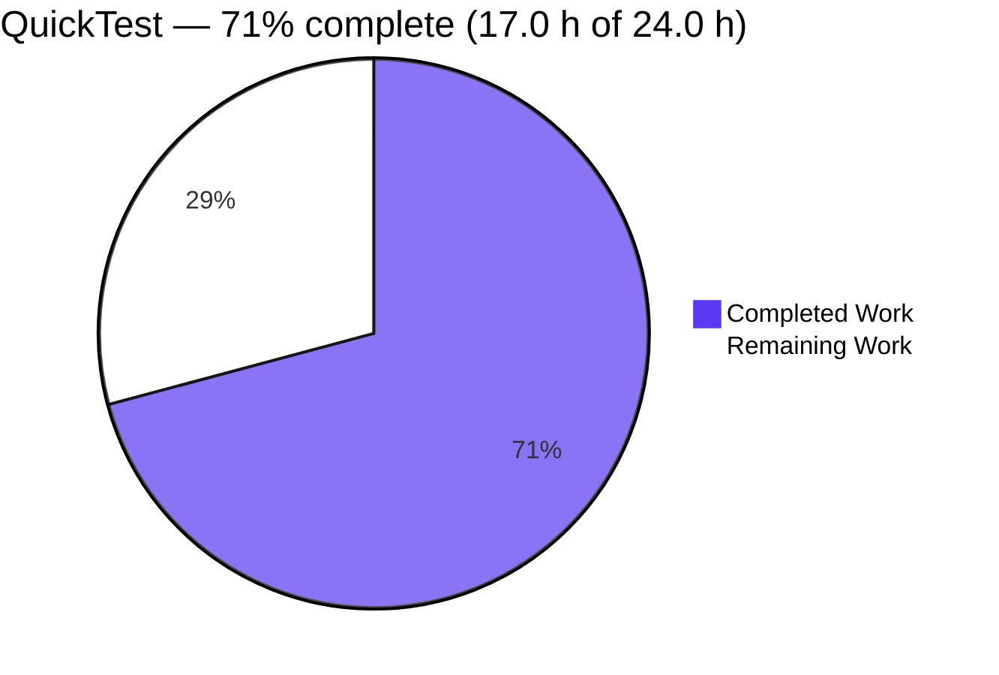
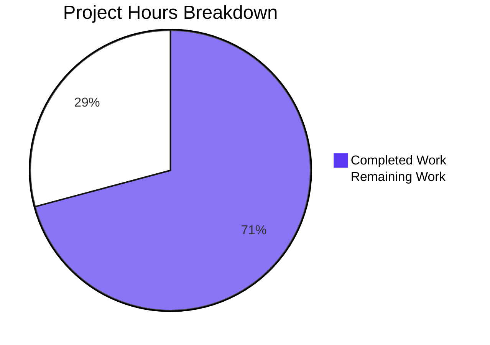

# 1. Executive Summary

QuickTest is a zero-dependency Node.js HTTP service: one server file and one verification suite. This release added a single endpoint, `GET /good-evening`, without disturbing anything the service already did. All 15 delivery requirements are complete and verified; the 7.0 hours outstanding are path-to-production work — a CI gate, a deployment definition and repository documentation.

## 1.1 Project Overview

QuickTest is a zero-dependency Node.js service built on the runtime's own `http` module. This release added one endpoint — `GET /good-evening`, answering 200 with the exact 12-byte body `Good evening` and `Content-Type: text/plain` — while every other request keeps the pre-existing `Hello, World!\n` response byte for byte. The endpoint lives inside the existing request handler; no framework, dependency, manifest, configuration file, module or build step was added. What follows states the endpoint's guarantees, what was exercised to prove them, what remains open, and how to run, test and troubleshoot the project.

## 1.2 Completion Status



| Metric | Hours |
| --- | --- |
| Total Hours | 24.0 |
| Completed Hours (AI + Manual) | 17.0 |
| Remaining Hours | 7.0 |
| Completion | 71% |

Completion is measured on hours over the work this release scoped plus the path-to-production work it implies: **17.0 ÷ (17.0 + 7.0) × 100 = 70.8%, reported as 71%**. Completed work is Dark Blue (#5B39F3) and remaining work is White (#FFFFFF). All 7.0 remaining hours are path-to-production (Section 2.2).

## 1.3 Key Accomplishments

- **New endpoint live** — 200, exact 12-byte body `Good evening`, `Content-Type: text/plain` (`server.js:2`).
- **Nothing else changed on the wire** — every other request gets 200, `Hello, World!\n`, `Content-Length: 14`, no content type (`server.js:3`).
- **Preservation proven differentially** — 7 of 8 probed targets byte-identical to the pre-change build.
- **Start-up unchanged** — one 41-byte stdout line, empty stderr, port released on shutdown.
- **Five automated cases cover both contracts** and pass in about 200 ms (`test/good-evening.test.js`).
- **The suite goes red when it should** — remove the branch, its header or either body.
- **Matching preserved** — case, near-miss and encoded forms fall through; no new status code.
- **Zero footprint** — no dependency, manifest, lock file, configuration file or build step.

## 1.4 Critical Unresolved Issues

**3 of 18 tracked items remain open.** The 15 delivery requirements are all complete; the 3 open items are path-to-production, and none blocks the endpoint itself.

| Issue | Impact | Owner | ETA |
| --- | --- | --- | --- |
| Path-to-production, 3 of 3 open: nothing runs the verification suite automatically (the repository holds no CI configuration) | A regression can land undetected; the suite is green only when a person runs it | Repository maintainer | 2.5 h |
| Path-to-production: no deployment or supervision definition — the process binds the hard-coded port 3000 on every interface and, when the port is taken, exits with an unhandled `EADDRINUSE` traceback | No defined runtime for the service; restarts are manual and a bind failure is awkward to diagnose | Operations owner | 3.0 h |
| Path-to-production: no run or test documentation in the repository | Anyone new must reconstruct the commands, the private-network-namespace requirement and the literal-coupling rule | Contributor on duty | 1.5 h |

## 1.5 Access Issues

No access issues identified. The service reads no environment variable, credential or secret and makes no outbound call; it needs no database, cache or registry authentication, and the `origin` remote is reachable. The hard-coded port is a setup constraint, not an access restriction (Section 9).

## 1.6 Recommended Next Steps

1. **[High]** Wire the suite into CI as a required check, run from the repository root in a private network namespace.
2. **[High]** Define deployment and supervision: the port and bind decision, restart on failure, and a diagnosable outcome for a bind failure.
3. **[Medium]** Document the run, test and namespace commands, and the literal-coupling rule between `server.js` and the suite.
4. **[Medium]** Decide whether the endpoint keeps answering every method on its path, or gains a method guard and a 405.
5. **[Low]** Decide whether measured coverage or a lint gate is wanted; both need tooling the repository does not have.

# 2. Project Hours Breakdown

Hours below cover the work this release scoped plus the path-to-production work that follows from it. Completed work is 17.0 hours and remaining work 7.0 hours; together they make the 24.0-hour total in Section 1.2. Nothing outside that scope is counted.

## 2.1 Completed Work Detail

| Component | Hours | Description |
| --- | --- | --- |
| New endpoint contract | 3.0 | The `/good-evening` branch and its four contract values — path, implicit 200, the exact 12-byte body and charset-free `text/plain` — implemented as one statement inside the existing handler, plus the wire evidence for each (`server.js:2`). |
| Preserved response | 2.0 | Keeping the pre-existing `res.end('Hello, World!\n')` statement as the handler's last statement, reconciling the assumption that `/hello-world` carries its own body, and proving preservation on both `/` and `/hello-world` (`server.js:3`). |
| Verification suite | 5.5 | Five cases over a real spawned process — two for the new contract, two for the preserved response and one for start-up with both routes registered — and the harness that starts the server, captures both streams and releases the port (`test/good-evening.test.js`). |
| Suite discrimination and bounded failure | 2.5 | Making the status case prove the new branch rather than the catch-all's 200, and bounding every wait so a server that stalls or never becomes ready produces a failed run instead of a hung one. |
| End-to-end runtime verification | 3.0 | The wire checks, the differential against the pre-change build, the near-miss and method batteries, and the load, keep-alive, lifecycle, hostile-input and port-conflict probes. |
| Integration, static gates and delivery | 1.0 | Syntax checks on both files, seam and literal checks, repeated suite runs on the frozen tree, commits and publication. |
| **Total completed** | **17.0** | |

## 2.2 Remaining Work Detail

| Category | Hours | Priority |
| --- | --- | --- |
| Automated gate for the suite in CI — a workflow that needs no install step, runs `node --test` from the repository root inside a private network namespace, and is a required check | 2.5 | High |
| Deployment and process-supervision definition — where the process runs, the port and bind decision, restart behaviour on a bind failure, and reconciling the start-up line's `127.0.0.1` claim with the all-interface bind | 3.0 | High |
| Repository documentation — prerequisites, the run and test commands with their expected output, the namespace requirement, and the literal-coupling rule between `server.js` and the suite | 1.5 | Medium |
| **Total remaining** | **7.0** | |

Every remaining hour is path-to-production; no delivery requirement contributes to this total, because all 15 are complete. The figure reconciles as **17.0 completed + 7.0 remaining = 24.0 total**, and **17.0 ÷ 24.0 × 100 = 70.8%, reported as 71%**.

# 3. Test Results

Every result below was produced by running the suite in this repository; the gate is `node --test` from the repository root.

| Area / Category | Framework | Tests | Passed | Failed | Coverage | What This Proves |
| --- | --- | --- | --- | --- | --- | --- |
| New endpoint contract | `node:test` (built-in runner) | 2 | 2 | 0 | Not measured — see below | `GET /good-evening` answers 200 with the exact 12-byte body `Good evening` and `Content-Type: text/plain` |
| Preserved response, `/` and `/hello-world` | `node:test` | 2 | 2 | 0 | Not measured | The pre-existing response is intact: 200, body `Hello, World!\n`, no `Content-Type`, `Content-Length: 14` |
| Start-up with both routes registered | `node:test` | 1 | 1 | 0 | Not measured | One process serves both paths and prints exactly the expected start-up line with an empty stderr |
| Whole suite as the gate | `node --test` from the repository root | 5 | 5 | 0 | Not measured | All five cases (`test/good-evening.test.js`, 20 assertions) pass together, repeatedly, in about 200 ms |

Repeated runs: 5 tests, 5 passed, 0 failed, 0 cancelled, 0 skipped — 203.9 ms, 201.6 ms and 211.8 ms. The same suite run against its own file (`node --test test/good-evening.test.js`) gives 5/5 in 196.2 ms. No coverage figure is quoted because no coverage tooling exists in this repository and none may be added; the runtime's own experimental coverage flag reports only the test file, since `server.js` runs as a spawned child process.

**Not covered by any test.** The suite asserts the two response contracts and start-up. Exercised on the wire but not asserted by a case: near-miss and arbitrary paths; the method matrix (including `HEAD` framing); hostile input (injection, traversal, CRLF, oversized targets and headers, forged credentials); HTTP/1.0 framing, keep-alive and pipelining. Deliberately not asserted: `Content-Length` on the new endpoint, and any 404/405 behaviour — the contract fixes status, body and content type only, and the service has no error surface. Structurally out of reach: measured coverage of `server.js` (the spawned-child harness cannot instrument it), and the suite's own failure paths (readiness deadline, early-exit detection, request timeout, teardown early return), which were exercised by hand rather than by a committed case. Before release, a human should run the gate from the repository root, re-check the near-miss and method behaviour if the matching rule is ever changed, and decide whether a 404/405 surface and coverage instrumentation are wanted at all.

# 4. Runtime Validation & UI Verification

✅ **Service start-up** — one process binds port 3000, stdout is exactly `Server running at http://127.0.0.1:3000/` (41 bytes) and stderr is empty.

✅ **New endpoint** — `GET /good-evening` returns 200, `Content-Type: text/plain` (no charset), `Content-Length: 12`, body `Good evening` with no trailing newline.

✅ **Preserved response** — `/`, `/hello-world` and arbitrary unknown paths return 200, no `Content-Type`, `Content-Length: 14`, body `Hello, World!\n`; `/` and `/hello-world` are header-identical once `Date` is normalised.

✅ **Matching semantics** — `/good-evening/`, `/good-evening?x=1`, case variants, doubled slashes, percent-encoded and null-byte forms, dot segments, absolute-form targets and 8000/9000-byte targets all fall through to the preserved response; 20000-byte targets answer the runtime's own 431.

✅ **Method handling** — POST, PUT, PATCH, DELETE, OPTIONS and TRACE on the exact path return the new response; `HEAD` returns 200 with `Content-Type: text/plain` and no body; no 405 exists anywhere.

✅ **Hostile input** — SQL-injection, cross-site-scripting, path-traversal, CRLF/header-injection, oversized and forged-credential payloads all return the plain catch-all: nothing reflected, no error detail, no crash, process healthy afterwards.

✅ **Load and connection handling** — 40 concurrent mixed requests answered byte-exactly (20 × 12 bytes, 20 × 14 bytes, zero anomalies); 100–300 request runs, pipelining and keep-alive reuse are all correctly framed.

✅ **Lifecycle** — SIGTERM and SIGINT end the process and release the port; a restart serves identical bytes; a second instance fails within about two seconds naming `EADDRINUSE`.

✅ **Differential against the pre-change build** — 87 of 103 hostile probes byte-identical, with the 16 differences being exactly the new endpoint; an independent eight-target sweep differs only at `/good-evening`.

✅ **User interface** — not applicable: the service has no markup, stylesheet or client asset; both responses are plain-text bodies.

**Never exercised at runtime:** TLS (none exists); authentication, authorization, CORS, rate limiting and security-response headers (none exist and none were in this scope); any 4xx/5xx error surface (the catch-all answers 200 to every path and method); deployment under a supervisor, container or process manager; and any client-side or downstream integration.

# 5. Compliance & Quality Review

The service is a two-file project: one server, one suite. What follows maps the released deliverables to the quality and compliance benchmarks they were held to, and records every place the delivery departed from the agreed scope or from the project's rules.

## 5.1 Compliance Matrix

| Deliverable / Benchmark | Status | Evidence |
| --- | --- | --- |
| New endpoint contract — path, status, body, content type | ✅ Pass | `server.js:2`; observed on the wire and asserted by two cases (`test/good-evening.test.js:91-103`) |
| Contract parity — same framework, same response call, same registration site | ✅ Pass | Built-in `http` module, `res.end(<string literal>)` on the same `res` object, inside the single `createServer` handler; no router, framework or separate route file |
| Preservation of the pre-existing response | ✅ Pass | `server.js:3` character-identical to the previous revision; asserted for both `/` and `/hello-world`; differential sweep against the pre-change build |
| Matching semantics — exact URL match, no new status codes | ✅ Pass | No `req.method` read anywhere; no 404 or 405 in either file; ~40 near-miss and boundary forms fall through |
| Automated tests — the four required assertions over a real process | ✅ Pass | Five cases, 20 assertions, spawn-and-teardown harness; 5/5 on repeated runs |
| Minimal change and no new dependency | ✅ Pass | `server.js` +4/−1 and one new test file; no manifest, lock file, dependency, configuration file or build step |
| Style conformance to the file's own conventions | ✅ Pass | Single quotes, `;`-terminated statements, no space around `=>` or after an argument comma, two-space block indentation, strict equality for the comparison |
| Static gates | ✅ Pass | `node --check` exits 0 with no output on both tracked files; no lint or type-check gate exists in the repository |
| Secret and credential hygiene | ✅ Pass | No secret-, token- or key-shaped literal in either file; no `process.env` read; requests carry no credentials |
| Injection and disclosure surface | ✅ Pass | The only request-derived value is compared by exact equality; no injection sink in the handler; disclosure probes (banners, stack traces, paths, personal data) matched nothing |
| Error-handling additions — must be none | ✅ Pass | No `'error'` listener, no `try`/`catch`, no new status code, no 404 behaviour |
| Automated gate and run documentation | ⚠ Gap | Nothing runs the suite automatically and the repository documents no run or test procedure — see Section 2.2, the 7.0 remaining hours |

## 5.2 AAP & Rule Divergences and Gaps

| What the Plan / Rule Required | What Was Delivered Instead | Why It Diverged | Impact | Remediation |
| --- | --- | --- | --- | --- |
| No change to the existing code's structure or signatures | The handler's expression body becomes a block body so the route can be a statement of it (`server.js:1-4`) | A conditional response path cannot be a statement inside a single-expression arrow function; the plan settles the conflict in favour of the route | Three lines of layout change; every existing statement keeps its text, order and call order | None — sanctioned by the plan, and the diff against the previous revision is exact |
| `GET /good-evening` | URL-only exact matching: every method on that path gets the new response, and no method is rejected (`server.js:2`) | Deliberate: the service never discriminated on method, and a 405 or 404 would add a status it does not otherwise produce | Anything that can reach the port can POST to the endpoint; proxies or clients that treat the method as significant see behaviour the route name does not advertise | Optional: add a method guard if the endpoint is ever exposed beyond a trusted network — a scope decision |
| `/hello-world` returns `Hello world`, unchanged | No such route exists; every other path keeps the catch-all response `Hello, World!\n`, 14 bytes, no `Content-Type` (`server.js:3`) | The premise was checked against the repository and the repository is the fact; creating a route would have added behaviour rather than preserved it | A client written to the paraphrase sees a different body — comma, exclamation mark and trailing newline included | None, unless the paraphrase is the real requirement: that is new work (a route and a body the service does not have) |
| Static analysis with a linter on every modified file | No lint run; `node --check` on both files plus style and diff review | The repository has no linter, no manifest, no `node_modules` and no configuration, and adding any was outside the agreed scope | No automated style gate; conformance rests on review and on the file's own conventions | None required. A lint gate is optional new work with its own configuration |
| No other departure | — | — | — | No further divergence from the agreed scope or the project's rules was found; no user-specified rules exist for this project, so no code departs from one |

The plan's minimal-change rule forbids altering the existing code's structure, and the route needs a statement the file's single-expression arrow function cannot hold. The handler's expression body therefore becomes a block body (`server.js:1-4`) — three lines of layout change and nothing else: the `require`/`createServer` chain, the `(req,res)` signature, the catch-all statement and the `.listen(3000, …)` call with its log literal are character-identical to the previous revision. The alternative, folding the condition into the existing `res.end` expression, would have buried the route inside the response call. No action is required; re-read that diff if the file's style is ever revisited.

The request named `GET /good-evening`; the delivered branch compares the request URL only, so POST, PUT, PATCH, DELETE, OPTIONS and TRACE on that exact path receive the same 200 response and no method rejection exists (`server.js:2`). That was deliberate: the service had never discriminated on method, and introducing a 405 or a 404 would have added a status it does not otherwise produce. The practical consequence is that anything able to reach port 3000 can POST to the endpoint and get `Good evening`, and a proxy or client that treats the method as significant will see behaviour the route name does not advertise. A method guard is a scope decision, not a defect.

The request's example states that `/hello-world` returns `Hello world` unchanged. The repository never had that route: its handler answers every path and method with one catch-all body. The premise was checked against the tree and the repository was treated as the fact, so nothing was created for `/hello-world` and the existing literal is preserved (`server.js:3`) — 200, `Hello, World!\n`, 14 bytes and no `Content-Type`. A client written to the paraphrase will see the comma, the exclamation mark and the trailing newline. If the paraphrase is the real requirement, it is new work: a route and a body the service does not have today.

No lint or type-check gate ran, because none can: the repository has no linter, no manifest, no `node_modules` and no configuration, and adding any of them was outside the agreed scope. In their place, both tracked files pass `node --check` with exit 0 and no output, and the change was reviewed against the file's own conventions — single-quoted literals, `;`-terminated statements, no space around `=>`, no space after an argument comma, two-space indentation for the new block. The gap is real but bounded: style conformance rests on review rather than on a tool, and a lint gate would be new work with its own configuration and its own effect on the suite's literal constants.

# 6. Risk Assessment

| Risk | Category | Severity | Probability | Mitigation | Status |
| --- | --- | --- | --- | --- | --- |
| Nothing runs the verification suite automatically, so a regression can land unnoticed | Operational | Medium | High | Wire the suite into CI as a required check, from the repository root (Section 2.2, 2.5 h) | Open |
| The literal port 3000 binds every interface with no supervision: a collision or crash has no automatic restart and surfaces as an unhandled traceback | Operational | Medium | Medium | Define deployment and supervision; decide the port and bind configuration (Section 2.2, 3.0 h) | Open |
| Only one start-up line is emitted and nothing per request, while every path answers 200 — an operational fault is diagnosable only from the client side | Operational | Medium | Medium | Add a per-request signal and a health probe in a future scope; today, monitor from outside | Accepted with a caveat |
| The gate is scoped to the directory it runs from, so a job that changes directory first collects a different tree's tests | Operational | Low | Medium | Run the gate from the repository root in CI, as the 2.5 h task specifies | Open |
| Plaintext HTTP on every interface with no TLS, authentication, rate limiting or security headers | Security | Medium | Low today | Network-level controls at deployment; revisit the moment a response carries anything data-derived — both bodies are compiled-in literals today | Accepted with a caveat |
| The suite repeats the server's literals by design, so a change to one side alone fails the gate against a correct server, and a coordinated change passes it | Technical | Low | Medium | Change both files in the same commit; treat the repeated constants as the executable contract | Accepted |
| `server.js` has no measurable coverage because it runs as a spawned child process | Technical | Low | Medium | Add an in-process harness only if a coverage threshold is ever required | Accepted |
| Exact-URL matching plus the catch-all 200 means every method on the path returns the new response and near-miss forms fall through, which proxies, WAFs and clients may not expect | Integration | Low | Medium | Decide whether a method guard is wanted, and document the matching semantics for consumers | Accepted with a caveat |

# 7. Visual Project Status



Remaining work by category, from Section 2.2:

| Category | Hours | Priority |
| --- | --- | --- |
| Automated gate for the suite in CI | 2.5 | High |
| Deployment and process-supervision definition | 3.0 | High |
| Repository documentation | 1.5 | Medium |
| **Total remaining** | **7.0** | |

Priority distribution of the remaining 7.0 hours: 5.5 hours High (79%), 1.5 hours Medium (21%), none Low. Completed work 17.0 hours; total 24.0 hours; completion 71%.

# 8. Summary & Recommendations

This release delivered one endpoint to a zero-dependency Node.js HTTP service and proved it without disturbing the response the service already gave. `GET /good-evening` answers 200 with the exact 12-byte body `Good evening` and `Content-Type: text/plain`, registered as a single statement inside the existing request handler; every other path and method keeps the pre-existing `Hello, World!\n` response, unchanged down to its length and its absent content type. No dependency, manifest, lock file, configuration file, module or build step was introduced, and the repository still holds two files: `server.js` and `test/good-evening.test.js`. The release is **71% complete** on the hours basis defined in Section 1.2: 17.0 hours delivered, 7.0 hours remaining, 24.0 in total.

What was exercised is the strength of this release. Five automated cases start the real server as a child process, assert both response contracts on the wire and confirm that the process prints exactly one start-up line with an empty stderr; repeated runs pass 5/5 in about 200 ms. The suite is also known to fail when it should — removing the route branch, dropping its header or altering either body turns it red — and every wait in it is bounded, so a server that stalls reports a failure instead of hanging the gate. Around that gate, the endpoint and its surroundings were driven on the wire: the method matrix, the near-miss and boundary URL forms, hostile input, concurrency, keep-alive and pipelining, start-up and shutdown, the port-conflict failure mode, and a differential against the previous build in which 7 of 8 probed targets are byte-identical and the only difference is the new endpoint. No secret material, no injection sink and no disclosure path exists to find: the handler reads nothing from the request but its URL, and compares it by exact equality.

The 7.0 hours remaining are all path-to-production, and none of them touches the endpoint: an automated gate that runs the suite in CI from the repository root inside a private network namespace (the port is a hard-coded literal, so two servers in one namespace collide); a deployment and supervision definition, including the port and bind decision and a diagnosable outcome for a bind failure; and repository documentation of the run, test and namespace commands plus the rule that a deliberate change to a literal in `server.js` must be mirrored in the suite's constants in the same commit. The critical path is therefore short: the first two items are the gate and the runtime, and both are hours, not days.

Two decisions belong to the owner rather than to this release. The first is whether the endpoint should keep answering every HTTP method on its path — today it does, by design, because the service never discriminated on method and no new status code was introduced. The second is whether the project wants tooling it does not have: a lint gate, measured coverage of `server.js` (the spawned-child harness cannot instrument it), or a 404/405 surface for unknown paths (the catch-all answers 200 to everything). Each would widen the agreed scope and each is priced nowhere in the 7.0 remaining hours.

Production readiness, within the scope agreed: the code is ready to run and has been verified where it runs. As a service on a network it is not yet production-grade, and by design rather than by omission — no TLS, authentication, authorization, rate limiting, security headers, per-request logging or error surface exists, and both bodies are compiled-in literals with no data behind them. Wire the gate, define the runtime, and put the listener behind network-level controls; those three steps turn a verified endpoint into a deployable service, and only the first two are in the remaining estimate.

# 9. Development Guide

**System prerequisites**

- Node.js 22.x (verified on v22.23.3) with npm 11.21.0 — npm is present but never used by this project.
- Bash, plus `curl` and `od` for the wire checks.
- `unshare` and `ip` (util-linux and iproute2) for the isolated run and test forms. On this host `ss`, `curl` and `od` are present; `netstat`, `lsof` and `xxd` are not.
- No compiler, database, cache, message broker, container runtime or service dependency.

**Environment setup**

`server.js` reads no environment variable, no file and no secret, and makes no outbound call, so there is nothing to configure. The one constraint is the port: `3000` is a hard-coded literal and the listener binds every interface, so two servers in one network namespace collide with `EADDRINUSE`. Give each run its own network namespace, which supplies its own loopback and its own free port 3000:

```bash
# from the repository root
unshare -n -- bash -c 'ip link set lo up; node --test'
unshare -n -- bash -c 'ip link set lo up; node server.js > server.log 2>&1 & echo "pid=$!"; sleep 1; curl -s -D - http://127.0.0.1:3000/good-evening; kill %1'
```

If `unshare` is unavailable in your environment, serialise the runs instead of isolating them, and check the port before you start:

```bash
node -e 'const s=require("net").createServer();s.on("error",e=>{console.log("busy",e.code);process.exit(0)});s.listen(3000,()=>{console.log("free");s.close()})'
```

Expected output: `free` (or `busy EADDRINUSE` if something already holds the port).

**Dependency installation**

There is none. The project has no `package.json`, no lock file and no `node_modules`, and the test suite uses only Node's built-ins plus the runtime's global `fetch`. Do not run `npm install` or `npm test`: with no manifest they fail with `npm error code ENOENT … path …/package.json` and exit 254. Adding a manifest would undo a deliberate property of this project.

**Application start-up**

```bash
node --check server.js          # exit 0, no output
node server.js                  # foreground; blocks until interrupted
```

Expected output on start, exactly one line:

```
Server running at http://127.0.0.1:3000/
```

To run it in the background and keep the process id for a clean shutdown:

```bash
node server.js > server.log 2>&1 & echo "pid=$!"     # prints e.g. pid=46704
sleep 1
curl -s -o /dev/null -w 'status=%{http_code}\n' http://127.0.0.1:3000/good-evening   # status=200
kill <pid>                                            # stop it by the pid you captured
```

`server.log` is an untracked run artefact; delete it or keep it outside the checkout. Stop the server only by the pid you started (or by the process holding the port) — never by process name, because `node` is shared with everything else on the host.

**Verification steps**

```bash
# 1. Static check — exit 0, no output, for both files
node --check server.js
node --check test/good-evening.test.js

# 2. The suite — the gate. Run it from the repository root.
unshare -n -- bash -c 'ip link set lo up; node --test'
# → # tests 5  # pass 5  # fail 0, about 200 ms
# Single file form:
unshare -n -- bash -c 'ip link set lo up; node --test test/good-evening.test.js'

# 3. Wire checks, with the server running in the same namespace
curl -s -D - http://127.0.0.1:3000/good-evening
# → HTTP/1.1 200 OK / Content-Type: text/plain / Content-Length: 12, then the body
curl -s http://127.0.0.1:3000/good-evening | wc -c            # → 12
curl -s -D - http://127.0.0.1:3000/hello-world
# → HTTP/1.1 200 OK / Content-Length: 14, no Content-Type line, body Hello, World!
curl -s -D - http://127.0.0.1:3000/                            # → identical header for header
```

To confirm preservation against the previous revision, serve that revision's file alongside and compare the two responses header for header (the two builds must not share a namespace):

```bash
git show <commit-before-this-change>:server.js > previous-server.js
# start each in its own namespace, then diff the responses with Date normalised
diff <(curl -s -D - http://127.0.0.1:3000/ | grep -vi '^date') \
     <(curl -s -D - http://127.0.0.1:3000/good-evening | grep -vi '^date')
```

**Example usage**

```bash
curl -s http://127.0.0.1:3000/good-evening ; echo
# Good evening            (12 bytes, no trailing newline — the response is exactly that text)

curl -s http://127.0.0.1:3000/ ; echo
# Hello, World!           (14 bytes including the newline)

curl -s http://127.0.0.1:3000/hello-world ; echo
# Hello, World!           (the same preserved response; /hello-world is not a route of its own)

curl -s -X POST http://127.0.0.1:3000/good-evening ; echo
# Good evening            (the path is matched, not the method)

curl -s http://127.0.0.1:3000/good-evening/ ; echo
# Hello, World!           (near misses fall through to the preserved response)

curl -sI http://127.0.0.1:3000/good-evening
# HTTP/1.1 200 OK / Content-Type: text/plain — no Content-Length on a HEAD response
```

**Troubleshooting**

- **`Error: listen EADDRINUSE: address already in use :::3000`** — the port is already held, possibly by another checkout on the same host. Use the namespace form above, or check with the port probe and stop your own server by its pid. The process exits non-zero with a traceback on stderr and nothing on stdout; that is the runtime's unhandled error, not application behaviour.
- **`Error: Cannot find module '<repository>/test'`** — `node --test test/` is invalid: positional arguments are glob patterns, not directories. Use `node --test` or `node --test test/good-evening.test.js`.
- **The gate reports no tests** — `node --test` discovers the suite under the current directory, so it must be run from the repository root. Run from elsewhere it collects whatever test files that tree holds and says nothing about this project.
- **`npm error code ENOENT … package.json`** — expected: this repository has no manifest. Use `node --test`, never `npm test`.
- **A `HEAD` response has no `Content-Length`**, and an HTTP/1.0 request answers with `Connection: close` and no length. That is the runtime's framing and it is identical on the preserved path; assert lengths with HTTP/1.1 requests, as the suite does.
- **A very long request target answers 431, and a malformed request line answers 400** — those come from the runtime's parser, not from the handler, and are unchanged by this release.
- **You changed a literal and the suite went red** — expected. The suite repeats `server.js`'s literals (port, both bodies, `text/plain`, the preserved length, the start-up line) on purpose, so a deliberate change must be mirrored in `test/good-evening.test.js` in the same commit.
- **`netstat`, `lsof` and `xxd` are absent on this host** — use `ss` for listeners, the Node port probe above for availability, and `od -An -c` for byte-level evidence.

# 10. Appendices

Reference material for running, testing and extending the service: the commands used, the port it binds, its files, its runtime versions, the environment variables it does (not) read, the tools available on this host, and the vocabulary used in this guide.

## Appendix A. Command Reference

| Purpose | Command | Expected result |
| --- | --- | --- |
| Static check | `node --check server.js` | exit 0, no output |
| Static check (suite) | `node --check test/good-evening.test.js` | exit 0, no output |
| Run the gate | `unshare -n -- bash -c 'ip link set lo up; node --test'` | 5 tests, 5 pass, 0 fail, ~200 ms |
| Run one file | `unshare -n -- bash -c 'ip link set lo up; node --test test/good-evening.test.js'` | 5 tests, 5 pass, 0 fail |
| Start the server | `node server.js` | `Server running at http://127.0.0.1:3000/` on stdout, nothing on stderr |
| Start detached and keep the pid | `node server.js > server.log 2>&1 & echo "pid=$!"` | prints the pid to stop it later |
| Stop the server | `kill <pid>` | process ends; the port is released |
| Probe the new endpoint | `curl -s -D - http://127.0.0.1:3000/good-evening` | 200, `Content-Type: text/plain`, `Content-Length: 12`, body `Good evening` |
| Probe the preserved response | `curl -s -D - http://127.0.0.1:3000/` | 200, no `Content-Type`, `Content-Length: 14`, body `Hello, World!` |
| Byte count of a body | `curl -s http://127.0.0.1:3000/good-evening \| wc -c` | `12` |
| Check the port is free | `node -e 'const s=require("net").createServer();s.on("error",e=>{console.log("busy",e.code);process.exit(0)});s.listen(3000,()=>{console.log("free");s.close()})'` | `free` or `busy EADDRINUSE` |

## Appendix B. Port Reference

| Port | Protocol | Bound by | Reachability | Notes |
| --- | --- | --- | --- | --- |
| 3000 | HTTP (plain) | `server.js:4` — `listen(3000, …)`, a hard-coded literal with no host argument | Every interface; the start-up line prints `127.0.0.1` and therefore understates the reach | No environment variable, flag or configuration file overrides it. Two servers in one network namespace collide with `EADDRINUSE`, so each run needs its own namespace or its own serialised turn. There is no second port, no management port and no health endpoint. |

## Appendix C. Key File Locations

| Path | Role | Notes |
| --- | --- | --- |
| `server.js` | The whole service | 4 lines: the `createServer` handler with the `/good-evening` branch (`:2`) and the preserved catch-all (`:3`), the listener, port literal and start-up line (`:4`) |
| `test/good-evening.test.js` | The verification suite and the gate | 5 cases, 20 assertions, a spawn-and-teardown harness; discovered by `node --test` from the repository root |
| `test/` | Container directory | Holds the one suite file; any further file placed here joins the gate automatically |

There is no other source, configuration, build, documentation or CI path in the repository.

## Appendix D. Technology Versions

| Technology | Version | Where it comes from |
| --- | --- | --- |
| Node.js | v22.23.3 | The runtime the service and the suite run on; also supplies the built-in test runner and the global `fetch` the suite uses |
| npm | 11.21.0 | Present on the host but not used — there is no manifest, so no install, script or audit step exists |
| `http` module | Bundled with the runtime | The only module `server.js` loads; no version is pinned anywhere because there is no manifest |
| Test runner | `node:test` with `node:assert` | Built-ins used by the suite; no test framework, runner configuration or dependency is installed |
| Dependencies | None | The project has no package, development dependency, lock file or transitive tree to audit |

## Appendix E. Environment Variable Reference

| Variable | Required | Effect |
| --- | --- | --- |
| *(none)* | No | `server.js` reads no environment variable at all — zero `process.env` references. Nothing must be exported before starting the service. |
| `PORT` | No — ignored | Setting it does not move the listener: the port is the literal `3000` (`server.js:4`). Verified by starting the server with `PORT`, `HOST` and `NODE_ENV` set to other values: it still served 3000, and the alternative port refused connections. |
| `HOST` | No — ignored | The listen call takes no host argument, so the listener always binds every interface. |
| `NODE_ENV` | No — ignored | The service does not branch on it. |

No secret, credential, API key, connection string or token is required, and none is read.

## Appendix F. Developer Tools Guide

| Tool | Availability | What it is for here |
| --- | --- | --- |
| `node` | Present (v22.23.3) | Runs the service, the test runner (`node --test`) and one-off probes such as the free-port check |
| `unshare` + `ip` | Present | Give a run its own network namespace and its own loopback, which is how the hard-coded port is kept private |
| `curl` | Present | Wire checks: `-D -` for response headers, `-s -o /dev/null -w` for status and size, `-X` for method checks |
| `od` | Present | Byte-level evidence — `od -An -c` shows that a 12-byte body carries no trailing newline |
| `ss` | Present | Lists listeners when you need to see what holds a port |
| `git` | Present | History and the differential against the previous revision (`git show <commit>:server.js`) |
| `netstat`, `lsof`, `xxd`, `nvm` | Absent | Use `ss`, the Node port probe and `od -An -c` instead. There is no version manager — the system `node` is the runtime. |
| `npm` | Present but unused | There is no manifest: `npm install` and `npm test` fail with `ENOENT`. Use `node --test`. |
| Chrome / a browser | Not applicable | The service has no user interface; every check is HTTP or CLI |

## Appendix G. Glossary

| Term | Meaning in this guide |
| --- | --- |
| Endpoint contract | The fixed behaviour of `GET /good-evening`: the path, status 200, the exact 12-byte body `Good evening`, and `Content-Type: text/plain` with no charset |
| Catch-all response | The single pre-existing response that answers every path and every method: 200, `Hello, World!\n`, `Content-Length: 14`, no `Content-Type` |
| Preserved behaviour | Anything the service did before this release and still does byte for byte; proved by assertions and by a differential against the previous revision |
| Exact-URL matching | The branch compares `req.url` to the literal `/good-evening` with no method test, decoding, normalisation or case folding, so near misses fall through to the catch-all |
| Computed `Content-Length` | Ending a response with a string before any header is committed lets the runtime set the length; an explicit `writeHead` would switch the response to chunked transfer encoding |
| HEAD framing | A `HEAD` response carries no body and, from the runtime, no `Content-Length` — on both the new path and the preserved one |
| Gate | The command that decides whether the change is acceptable: `node --test` from the repository root, discovering `test/**/*.js` |
| Network namespace isolation | Running a server or the suite under `unshare -n` so it gets a private loopback and its own port 3000, because the port is a host-global literal |
| Literal coupling | The suite repeats the server's literals by design, so a deliberate change to one must be mirrored in the other in the same commit |
| Path-to-production | Work required to run the delivered behaviour in production, as distinct from the delivered behaviour itself: the automated gate, the deployment and supervision definition, and the documentation |
| Completion (hours basis) | 17.0 completed hours ÷ 24.0 total hours = 70.8%, reported as 71% |
