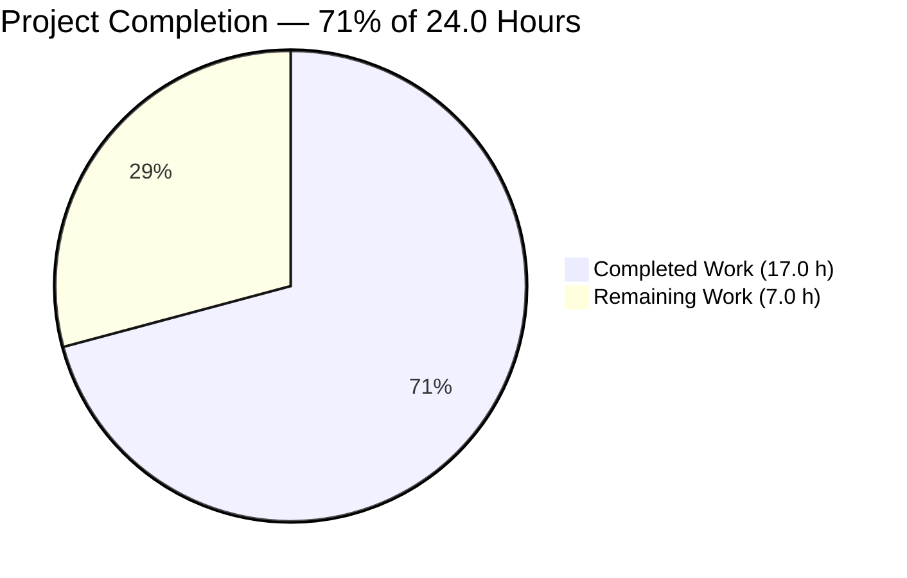
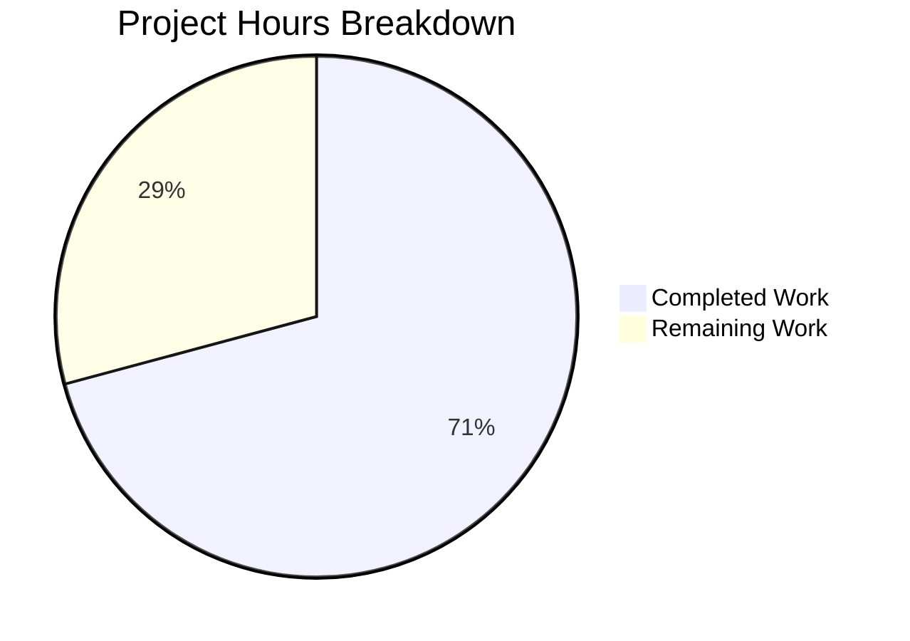
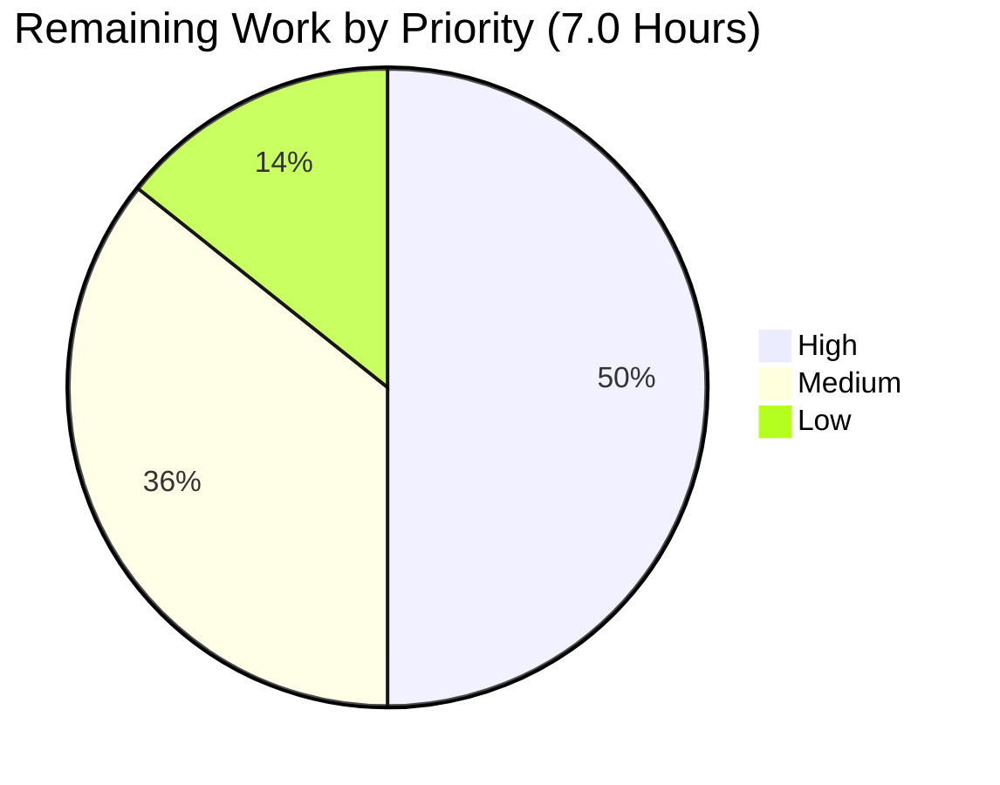

# 1. Executive Summary

## 1.1 Project Overview

QuickTest is a minimal Node.js HTTP service whose entire application is one file. This change adds a second endpoint and serves both through Express: `GET /good-evening` answers 200 with media type `text/plain` and the exact body `Good evening\n`, beside the existing `GET /`, whose 200 and exact body `Hello, World!\n` are unchanged. Express is the sole dependency, declared in a new three-field manifest that makes the import resolvable, and the process keeps its hardcoded port 3000, its startup line and its one-statement CommonJS style. Every path, status, media type and body byte was verified against the running server.

## 1.2 Completion Status

| Metric | Value |
| --- | --- |
| Total Hours | 24.0 |
| Completed Hours (AI + Manual) | 17.0 |
| Remaining Hours | 7.0 |
| Percent Complete | 71% |

Calculation: (17.0 completed ÷ 24.0 total) × 100 = 70.83% — **71%**.



All four requested deliverables are complete and verified byte-for-byte. The 7.0 remaining hours are deployment-time work: the change leaves environment configuration, hardening and automated tests outside the application.

## 1.3 Key Accomplishments

- `GET /good-evening` — 200, `text/plain; charset=utf-8`, exact 13-byte body `Good evening\n`
- `GET /` — 200, exact 14-byte body `Hello, World!\n`, automatic `Content-Length: 14`, no application `Content-Type`
- Express carries the traffic; unregistered paths now receive the framework's own 404 — the one intended behaviour change
- `express` is the sole dependency, installing lockfile-free and resolving 5.3.0 inside `^5.1.0`
- The port literal 3000, the readiness line and the one-statement CommonJS style are preserved byte-for-byte
- Every mandated absence holds: no lockfile, test suite, documentation file, configuration or extra manifest field
- 1,103 runtime checks executed against the running server, all passing, with the end-to-end gate green

## 1.4 Critical Unresolved Issues

All 4 requested deliverables are complete and verified byte-for-byte: 0 of 4 carry an open defect. Eight residual items remain — 8 of 8 are deployment or operational conditions, and none blocks the specified contract.

| Issue | Impact | Owner | ETA |
| --- | --- | --- | --- |
| A failed bind is indistinguishable from a successful start (readiness line printed, stderr empty, exit 0, nothing listening) | False-positive readiness on a busy port | Deployment owner | At deployment |
| The listener binds every interface while the readiness line advertises loopback | Reachable if the host is exposed beyond loopback | Deployment owner / operator | At deployment |
| Port 3000 is a hardcoded literal with no configuration layer | One instance per host; port contention | Deployment owner | At deployment |
| The dependency is not pinned (`^5.1.0`, no lockfile permitted) | A later install may resolve a newer 5.x than the verified 5.3.0 | Maintainer | Next release |
| No automated regression guard ships (no suite, runner or CI gate exists) | Later edits to the two routes are unguarded | Maintainer | Next change |
| `/` declares no `Content-Type`, so clients sniff the media type and charset | A future non-ASCII body could misdecode | Maintainer | Before any body change |
| `X-Powered-By: Express` discloses the framework on every response | Low-value technology disclosure | Operator / proxy edge | At deployment |
| No health, metrics or tracing endpoint and no per-request logging | Liveness and post-mortem rely on the readiness line and the responses alone | Deployment owner | At deployment |

## 1.5 Access Issues

No access issues identified. No credential, third-party service, database or external network access is involved.

## 1.6 Recommended Next Steps

1. [High] Install the dependency lockfile-free at the deployment checkout, confirm the resolved version, and supervise one `node server.js` process.
2. [High] Fix the port policy: one instance per host on the literal 3000, confirming the listener rather than the readiness line.
3. [Medium] Decide the exposure posture for the all-interface bind; supply TLS, security headers and rate limiting at the edge if it is reachable.
4. [Medium] Add liveness detection outside the process: a failed bind exits 0 silently and no health endpoint may be added.
5. [Low] Record the end-to-end gate as the check every later change to these routes must pass.

# 2. Project Hours Breakdown

## 2.1 Completed Work Detail

Every component below traces to the requested scope: build the new endpoint and serve both endpoints through Express, declare the single new dependency, and verify the preserved behaviour.

| Component | Hours | Description |
| --- | --- | --- |
| Express server layer and the two-route chain (`server.js`) | 3.0 | Replaced the built-in `http` server with the Express app factory called inline, registered `GET /` with the pre-existing handler byte-for-byte, added `GET /good-evening` with an explicit media type, and kept one chained statement, the port literal and the readiness callback. |
| Dependency manifest (`package.json`) | 1.5 | Created the three-field manifest that makes `require('express')` resolvable — no `type`, no `scripts`, no lockfile — and confirmed that a lockfile-free install leaves none. |
| Runtime verification of both route contracts | 4.0 | Byte-exact status, header and body verification of both routes through curl, raw sockets and a real browser, including framing, repeated requests, concurrency and both protocol framings. |
| Framework and runtime default behaviour verification | 3.0 | Unregistered paths, unmatched methods, HEAD and OPTIONS, malformed, oversized, slow and truncated requests, pipelining and restarts — asserting no 5xx, no crash and no hang. |
| Security verification | 3.0 | Injection, template and command payload classes, CRLF and header injection, traversal and source-path probes, reflected-payload rendering in a real browser, plus the anonymity and header-absence audits. |
| Process lifecycle, dependency resolution and mandated-absence verification | 2.5 | Clean install and boot, listener binding, readiness-line byte-exactness, signal handling with port release, the resolved version, and confirmed absences of lockfile, documentation, tests, handlers and configuration. |
| **Total** | **17.0** | |

## 2.2 Remaining Work Detail

Every category below is path-to-production work for the delivered change: the request forbids environment configuration, hardening, a lockfile and a test suite inside the application, so each item is settled at the deployment or maintainer layer instead.

| Category | Hours | Priority |
| --- | --- | --- |
| Dependency install and supervised start at the deployment checkout [Path-to-production] | 2.0 | High |
| Port and binding policy for the hardcoded literal port [Path-to-production] | 1.5 | High |
| Edge exposure posture for a listener bound on every interface [Path-to-production] | 1.5 | Medium |
| Failed-bind detection outside the process [Path-to-production] | 1.0 | Medium |
| Dependency reproducibility decision [Path-to-production] | 0.5 | Low |
| Root-route media-type review before a non-ASCII body is introduced [Path-to-production] | 0.5 | Low |
| **Total** | **7.0** | |

## 2.3 Completion Calculation

- Total Project Hours = Completed 17.0 + Remaining 7.0 = **24.0 hours**
- Completion % = (17.0 ÷ 24.0) × 100 = 70.83% — **71%**

Completed hours are the six components in Section 2.1, each mapped to the requested work: the endpoint and the Express server layer, the manifest, and the verification of both route contracts, the framework defaults, the security posture and the process lifecycle. Remaining hours are the six path-to-production categories in Section 2.2, each arising from a condition the delivered change leaves open for the deployment or maintainer layer. No hour is counted for work the request excludes, such as a test suite, documentation or in-application hardening.

# 3. Test Results

The counts below are runtime checks executed against the running server and observed, not a count of test files: the repository ships no test suite, and `CI=true npm test` exits 1 with `Missing script: "test"` by design. Checks were driven through curl, raw sockets, real headless Chrome and the runtime's own output streams.

| Area / Category | Framework | Tests | Passed | Failed | Coverage | What This Proves |
| --- | --- | --- | --- | --- | --- | --- |
| HTTP route contracts and response headers | Live HTTP via curl, raw sockets and headless Chrome (no test framework in the repository) | 195 | 195 | 0 | Not measurable — no coverage tooling exists | Both endpoints answer with the specified status, media type and byte-exact bodies, and the two header sets differ exactly at `Content-Type` |
| Process lifecycle, dependency resolution and manifest consequences | Node.js, npm and lsof against live HTTP | 43 | 43 | 0 | Not measurable | The manifest installs lockfile-free, the process boots, binds port 3000, prints one readiness line, serves traffic and releases the port on a signal |
| Process output surface and observability absences | stdout/stderr capture with live HTTP | 79 | 79 | 0 | Not measurable | The readiness line is emitted once, byte-exact, on stdout with an empty stderr, and no further output is produced under any traffic |
| Injection, reflection, traversal, disclosure and malformed-input sweeps | curl, raw sockets and headless Chrome | 638 | 638 | 0 | Not measurable | No request-derived value reaches any output unescaped, no payload executes, no local file or internal detail is disclosed, and malformed or oversized input produces no 5xx, crash or hang |
| Whole-project acceptance from a clean tree | npm install, the project's end-to-end gate and headless Chrome | 148 | 148 | 0 | Not measurable | From a clean tree the project installs, boots, passes the end-to-end gate on all four byte-level assertions, and renders both routes in a browser with no script errors |
| **Total** | — | **1,103** | **1,103** | **0** | — | — |

The end-to-end gate was also run directly against the current tree: `node --check server.js` exits 0, the server binds `TCP *:3000`, and the gate prints ROOT-200-OK, ROOT-BODY-OK, EVE-CT-OK and EVE-BODY-OK. Independently observed: `GET /` returns `Content-Length: 14` with no `Content-Type` and `GET /good-evening` returns `Content-Type: text/plain; charset=utf-8` with `Content-Length: 13`; an unregistered path returns the framework's 404 page and `POST /good-evening` returns 404.

## Not Covered

- **No automated regression guard.** No unit, integration or regression suite exists and none may be created, so a later edit to either route is caught only by re-running the end-to-end gate manually.
- **No coverage measurement.** There is no test framework and no coverage tooling in the repository, and none may be added, so no coverage percentage is produced for any file.
- **Dependency advisories.** The declared `^5.1.0` range was never checked against a registry or advisory database, and no dependency-scanning configuration exists; the choice of the Express 5 line rests on the declared range alone.
- **Deployment environment.** Everything was exercised on a plain Node.js host. No container, process supervisor, reverse proxy or TLS-terminated deployment was exercised.
- **Liveness and monitoring.** No health, metrics or tracing endpoint exists and none may be added, so failure detection was not exercised end to end; the readiness line is the only signal the process emits.
- **Multi-instance operation.** The hardcoded port permits one instance per host, so no co-hosted, load-balanced or multi-instance scenario was exercised.
- **Non-ASCII response bodies.** Only the two ASCII literals were exercised. Byte-level behaviour and client charset handling for any other body are untested, which matters most on `/`, where no media type is declared.

# 4. Runtime Validation & UI Verification

- ✅ **Startup and binding** — `node server.js` binds `TCP *:3000` and writes exactly one 41-byte readiness line to stdout, with stderr empty.
- ✅ **`GET /`** — 200, `Content-Length: 14`, no application-set `Content-Type`, body exactly `Hello, World!\n`, stable across repeats, concurrency and both protocol framings.
- ✅ **`GET /good-evening`** — 200, `Content-Type: text/plain; charset=utf-8`, `Content-Length: 13`, body exactly `Good evening\n`, byte-identical across curl, a raw socket and a real browser.
- ✅ **Express as the server layer** — every response carries `X-Powered-By: Express`, and an unregistered path returns the framework's own 404 page rather than the old catch-all body.
- ✅ **Framework defaults for unspecified input** — 404 for unregistered paths and unmatched methods, `OPTIONS` 200 with `Allow: GET, HEAD`, `HEAD` with no body, 400 for malformed requests, 431 for oversized headers and a timed 408 for slow or truncated requests, with no 5xx, crash or hang.
- ✅ **Shutdown and re-entry** — SIGTERM and SIGINT end the process with the port released; a second instance started against the busy port prints the readiness line, writes nothing to stderr and exits 0 while the first instance keeps serving both routes.
- ✅ **Browser integration** — both routes render as plain text in a real browser with no script elements and no JavaScript errors; payload-bearing query and path variants return the same bytes.
- ✅ **Dependency install** — the declared manifest installs lockfile-free (65 packages) and resolves 5.3.0 inside `^5.1.0`, leaving no lockfile behind.
- ⚠️ **No user interface exists** — there are no screens, styles, layout, navigation, responsive or accessibility surfaces to verify; both responses are plain text and the only markup in the system belongs to the framework's own 404.
- ❌ **Never exercised at runtime** — a deployed environment (process supervisor, reverse proxy, TLS termination, host firewall), multi-instance operation, and liveness detection from outside the process. The project makes no outbound call, reads no request data and has no external integration, so none was available to exercise.

# 5. Compliance & Quality Review

## 5.1 Compliance Matrix

| Deliverable | Benchmark | Status | Progress |
| --- | --- | --- | --- |
| `GET /good-evening` endpoint | Feature completeness — path, method, status, media type and byte-exact body | ✅ PASS | Complete |
| `GET /` preserved contract | Behaviour preservation — status, body bytes and framing unchanged by the framework swap | ✅ PASS | Complete |
| Express as the server layer | Architecture requirement — the built-in `http` server replaced and the dependency actually carrying traffic | ✅ PASS | Complete |
| Dependency manifest | Dependency hygiene — exactly one dependency, three fields, no lockfile, CommonJS load retained | ✅ PASS | Complete |
| Change scope (2 files, 8 insertions, 1 deletion) | Change hygiene — smallest diff, no unrelated refactor or rename, no new module or directory | ✅ PASS | Complete |
| Code quality and style | One chained statement, no dead or commented-out code, no placeholder or TODO marker, no unearned comment | ✅ PASS | Complete |
| Error and edge handling | Framework and runtime defaults govern unspecified input; no 5xx, crash or hang | ✅ PASS | Complete |
| Input handling and injection resistance | No request-derived value reaches any output; reflected payloads escaped; no local file reachable | ✅ PASS | Complete |
| Secret and credential hygiene | No credential, key, token or connection string in either file | ✅ PASS | Complete |
| Dependency safety | Advisory and CVE position of the declared range | ⚠️ NOT ASSESSED | Pending — no registry lookup is permitted and no dependency scanning is configured |
| Automated tests | Unit, integration and regression coverage | ⚠️ NOT APPLICABLE BY REQUIREMENT | Runtime verification stands in for a suite, which the request excludes |
| Build, packaging and documentation gates | Build, lint, type-check and documentation presence | ⚠️ NOT APPLICABLE BY REQUIREMENT | The parse check is the only compile step; the request excludes the rest |

## 5.2 AAP & Rule Divergences and Gaps

| What the AAP/Rule Required | What Was Delivered Instead | Why It Diverged | Impact | Remediation |
| --- | --- | --- | --- | --- |
| **Sanctioned.** No independent research into or verification of dependency versions or framework behaviour: assume the latest stable major, and carry the framework's header behaviour as an assumption rather than re-deriving it through a registry lookup, a verification install or a measured request (§0.1.2 constraint 9; §0.8 row 9). | The manifest holds the assumed `^5.1.0` (`package.json:5`) and the code inherits both framework behaviours rather than deriving them. The branch's verification, however, used measured requests that confirmed `Content-Type: text/plain; charset=utf-8` on `GET /good-evening` and `X-Powered-By: Express` on every response, and read the resolved version 5.3.0 from the installed package. | The project's own environment instructions outrank the plan on environment matters: they require the per-checkout lockfile-free install and define the project's end-to-end gate as starting the server and byte-asserting both routes. The measurement was therefore required of the deployment verification rather than chosen during implementation. | None on the code — `server.js` is byte-identical to the stated after-form and `package.json` to the stated manifest. It retires the two behaviours the plan carried as assumptions and replaces them with measured facts. | None required. A human need only know the assumptions are now confirmed rather than outstanding. |

This is the only divergence from the agreed plan, and it is sanctioned by a source that outranks it — the project's own environment instructions, which mandate the install and the end-to-end gate. It blocks nothing and needs no human work, so it appears in neither Section 1.4 nor Section 2.2. No user-specified rules exist for this repository, so no rule divergence is possible: the rules document the plan consulted holds no rules for this codebase, and no file in the delivered set is governed by one. No other requirement was implemented differently, skipped or deferred — the diff against the base commit is exactly `A package.json` and `M server.js` with 8 insertions and 1 deletion, the delivered `server.js` matches the specified after-form byte-for-byte at 219 bytes, and the one behaviour change beyond the new endpoint — unregistered paths no longer receiving `Hello, World!\n` — is the narrowing the plan states as intended.

# 6. Risk Assessment

| Risk | Category | Severity | Probability | Mitigation | Status |
| --- | --- | --- | --- | --- | --- |
| A failed bind is indistinguishable from a successful start — the readiness line is printed, stderr stays empty and the process exits 0 with nothing listening | Operational | Medium | Medium | Confirm the listener (`lsof -nP -iTCP:3000 -sTCP:LISTEN`) before asserting on a route, and detect liveness from outside the process | Open |
| The listener binds every interface while the readiness line advertises loopback | Security | Medium | Medium | Restrict the port at the host or front the process with a proxy, exposing it only where intended | Open |
| Multi-instance deployment is impossible against the hardcoded literal port, which cannot be made configurable | Integration | Medium | High | Place one instance per host and serialise deployments that share the host | Open — port preserved by requirement |
| Dependency resolution is not reproducible: a caret range with no lockfile permits a later install to resolve a newer 5.x than the verified 5.3.0 | Technical | Medium | Medium | Pin the resolved version in the manifest, or re-verify both routes after every install | Open |
| No automated regression guard ships, so a later edit to either route is caught only by manual verification | Technical | Medium | High | Re-run the end-to-end gate on every change to those routes and treat it as the project's acceptance check | Open — a suite is excluded by requirement |
| `/` declares no `Content-Type`, so clients sniff the media type and charset for that route | Technical | Low | Low | Keep the root body pure ASCII, or declare a media type at the edge before introducing other bytes | Accepted — framing is preserved by requirement |
| `X-Powered-By: Express` discloses the framework on every response | Security | Low | Certain | Suppress the header at the proxy if disclosure matters; the application must neither add nor suppress it | Accepted |
| No health, metrics or tracing surface and no per-request logging exist, and slow or truncated requests are bounded only by runtime defaults (about 60 s for headers, 300 s for the request) | Operational | Low | Medium | Detect liveness at the supervisor or edge, and set idle-connection limits there for any directly exposed deployment | Open — observability is excluded by requirement |

One integration behaviour is worth passing to any existing consumer: unregistered paths no longer return `Hello, World!\n` — they now receive the framework's own 404, which is the intended effect of registering two explicit routes in place of the previous catch-all. Clients that only call `/` and `/good-evening` are unaffected.

# 7. Visual Project Status



Brand colour key for the chart above: **Completed work — Blitzy dark blue (#5B39F3)**; **Remaining work — white (#FFFFFF)**. Headings and accents use violet-black (#B23AF2), highlights mint (#A8FDD9).

Completion: **71%** of the 24.0 scoped hours are complete (17.0 completed, 7.0 remaining), matching Sections 1.2, 2.1, 2.2 and 8.



| Remaining category | Hours | Priority |
| --- | --- | --- |
| Dependency install and supervised start at the deployment checkout | 2.0 | High |
| Port and binding policy for the hardcoded literal port | 1.5 | High |
| Edge exposure posture for a listener bound on every interface | 1.5 | Medium |
| Failed-bind detection outside the process | 1.0 | Medium |
| Dependency reproducibility decision | 0.5 | Low |
| Root-route media-type review before a non-ASCII body is introduced | 0.5 | Low |
| **Total** | **7.0** | — |

# 8. Summary & Recommendations

**What was delivered and verified.** QuickTest now serves two endpoints through Express instead of one catch-all through the built-in `http` server. The one application file holds the entire feature in a single chained statement (`server.js:1`, commit `c89fab3`): `GET /` registered with its handler copied byte-for-byte, and `GET /good-evening` registering an explicit `text/plain` media type before ending with the 13-byte body `Good evening\n`. The dependency is declared in a new three-field manifest (`package.json:5`, commit `a09773e`), which installs lockfile-free and resolves express 5.3.0 inside the declared `^5.1.0`. Verification was exercised against the running server: 1,103 runtime checks, all passing, with the project's end-to-end gate green on all four byte-level assertions, both routes confirmed byte-exact through curl, raw sockets and a real browser, and no 5xx, crash or hang under malformed, oversized or slow traffic.

| Metric | Value |
| --- | --- |
| Completion (AAP-scoped, hours-based) | 71% — 17.0 of 24.0 hours |
| Requested deliverables complete | 4 of 4, verified byte-for-byte |
| Files changed | 2 — one created, one modified |
| Diff size | 8 insertions, 1 deletion |
| Runtime checks executed | 1,103, all passing |
| End-to-end gate | PASS — 4 of 4 byte-level assertions |
| Open residual items | 8 of 8, all deployment or operational |

**Completion.** Completion stands at 71%: 17.0 of the 24.0 scoped hours are delivered, and every one of the four requested deliverables is complete and verified. The 7.0 remaining hours are not unfinished features — they are the deployment-time work the request deliberately leaves outside the application, because it excludes environment configuration, hardening, a lockfile and a test suite. The delivered code is exactly what was agreed: `server.js` matches the specified after-form byte-for-byte at 219 bytes, and the manifest matches the specified three-field block at 97 bytes.

**Critical path to production.** Four steps in order: run the lockfile-free install at the deployment checkout and confirm the resolved version satisfies `^5.1.0`; place one supervised `node server.js` instance on the hardcoded port 3000 and verify the listener rather than the readiness line; add liveness detection outside the process, since a failed bind exits 0 silently and no health endpoint may be added; and settle the exposure posture for a listener bound on every interface, supplying TLS, security headers and rate limiting at the edge if the port is reachable beyond loopback.

**Production readiness.** The delivered change is ready for its specified contract under the request's own constraint set, and every residual is outside the application: a failed bind is indistinguishable from success, the listener binds every interface while advertising loopback, the port is a non-partitionable literal, the dependency is unpinned, no automated regression guard ships, `/` declares no media type, and the framework's disclosure header is emitted on every response. None of these admits an in-scope fix — each would require an edit the request forbids — so they are deployment and maintenance decisions rather than defects. Two should be settled before any further change to these routes: re-run the end-to-end gate after every edit, and decide whether the dependency stays on a floating range.

**How to confirm the state of the deployment.** From the checkout, `node --check server.js` must exit 0; `lsof -nP -iTCP:3000 -sTCP:LISTEN` must show the process bound; and the end-to-end gate must print ROOT-200-OK, ROOT-BODY-OK, EVE-CT-OK and EVE-BODY-OK. Anything less — in particular a readiness line with no listener — indicates a second instance that never bound the port.

# 9. Development Guide

### System Prerequisites

| Requirement | Version used and verified | Notes |
| --- | --- | --- |
| Node.js | v22.23.4 | The platform floor is `>=20.20.2` on 20.x and `>=22.12.0` on 22.x |
| npm | 10.9.9 | Ships with the Node.js runtime |
| git-lfs | 3.8.1 | Required: the repository tracks live git-lfs hooks that fail if it is missing |
| Shell tooling for verification | `curl`, `lsof` | Used by every command below; no other tool is required |

No compiler, bundler, database, cache, message queue or container runtime is needed. The project has no build system, no linter, no type checker and no CI configuration.

### Environment Setup

There is nothing to configure. The application reads no environment variable, has no `.env` file and no configuration layer — the port is a literal in the source. Work from the repository root:

```bash
cd <checkout>
node --version && npm --version
```

### Dependency Installation

Once per checkout. `node_modules` is deliberately not committed and the repository must never carry a lockfile, so `--no-package-lock` is mandatory:

```bash
CI=true npm install --no-package-lock --no-audit --no-fund
```

Expected: exit 0, `added 65 packages`, and no `package-lock.json`, `npm-shrinkwrap.json`, `yarn.lock` or `pnpm-lock.yaml` afterwards. Confirm the resolution:

```bash
node -e "console.log(require('express/package.json').version)"   # 5.3.0, inside the declared ^5.1.0
```

`node_modules/` shows as untracked because the repository deliberately has no `.gitignore`. Never stage it, and never use a blanket `git add -A`.

### Build

There is no build step. The only compile check is the parse check, which must pass:

```bash
node --check server.js        # exit 0, no output
```

### Application Startup

```bash
node server.js
```

- Binds the hardcoded literal port **3000** on every interface and prints exactly one line on stdout: `Server running at http://127.0.0.1:3000/` (41 bytes). stderr stays empty.
- Do not run it in the foreground of an automated shell — it never returns. Start it in the background and capture the streams:

```bash
node server.js > server.out 2> server.err &
SRV=$!
sleep 1
lsof -nP -iTCP:3000 -sTCP:LISTEN     # must show the process bound to TCP *:3000 (LISTEN)
```

### Verification

Status alone is not sufficient evidence here: the previous catch-all answered 200 on every path, so the contract is asserted on the **bytes**.

```bash
test "$(curl -sS http://127.0.0.1:3000/)" = "Hello, World!" && echo ROOT-OK
curl -sS http://127.0.0.1:3000/ | cmp - <(printf 'Hello, World!\n') && echo ROOT-BODY-OK
curl -sS -D - -o /dev/null http://127.0.0.1:3000/good-evening | grep -i '^content-type: text/plain' && echo EVE-CT-OK
curl -sS http://127.0.0.1:3000/good-evening | cmp - <(printf 'Good evening\n') && echo EVE-BODY-OK
```

The full end-to-end gate, which starts its own server and asserts both contracts:

```bash
set -e
node --check server.js
D=$(mktemp -d); node server.js & SRV=$!; sleep 1
curl -sS -D "$D/h1" -o "$D/b1" http://127.0.0.1:3000/
curl -sS -D "$D/h2" -o "$D/b2" http://127.0.0.1:3000/good-evening
kill $SRV
grep -qi '^HTTP/1.1 200' "$D/h1" && echo ROOT-200-OK
cmp -s "$D/b1" <(printf 'Hello, World!\n') && echo ROOT-BODY-OK
grep -qi '^content-type: text/plain' "$D/h2" && echo EVE-CT-OK
cmp -s "$D/b2" <(printf 'Good evening\n') && echo EVE-BODY-OK
```

Expected output: `ROOT-200-OK`, `ROOT-BODY-OK`, `EVE-CT-OK`, `EVE-BODY-OK`. Then stop the server by the pid that owns the port:

```bash
kill $SRV
lsof -nP -iTCP:3000 -sTCP:LISTEN     # prints nothing: the port is released
```

### Example Usage

```bash
curl -si http://127.0.0.1:3000/
```
```
HTTP/1.1 200 OK
X-Powered-By: Express
Date: ...
Connection: keep-alive
Keep-Alive: timeout=5
Content-Length: 14

Hello, World!
```

```bash
curl -si http://127.0.0.1:3000/good-evening
```
```
HTTP/1.1 200 OK
X-Powered-By: Express
Content-Type: text/plain; charset=utf-8
Date: ...
Connection: keep-alive
Keep-Alive: timeout=5
Content-Length: 13

Good evening
```

Any other path returns the framework's own 404 page, for example `Cannot GET /missing`. `HEAD` is answered by the `GET` registration, and `OPTIONS` on a registered path returns 200 with `Allow: GET, HEAD`.

### Troubleshooting

| Symptom | Cause | Resolution |
| --- | --- | --- |
| `Error: Cannot find module 'express'` | Dependencies are not installed in this checkout | Run the lockfile-free install above; `node_modules` is never committed |
| The readiness line prints but nothing answers on 3000 | A second instance started while the port was already held. The framework's `listen` callback is registered as the socket's error handler, so a failed bind calls it, prints the line, writes nothing to stderr and exits 0 | Confirm the listener with `lsof -nP -iTCP:3000 -sTCP:LISTEN` before trusting the line, and stop the instance that actually holds the port |
| `npm error Missing script: "test"` on `npm test` | The project deliberately has no test suite, no runner and no `scripts` block | Expected. Verify with the commands in **Verification** instead of adding a runner |
| A lockfile appears after installing | `npm install` was run without `--no-package-lock` | Delete it and reinstall with the flag; a lockfile must never be committed |
| `npm start` works even though there is no `scripts` block | npm supplies its own implicit default `start` script that runs `node server.js` | Harmless; `node server.js` remains the launch command. Do not add a `scripts` field |
| `node_modules/` appears in `git status` | The repository deliberately has no `.gitignore` | Leave it untracked. Never stage it, and never add a `.gitignore` |
| A change to a route looks fine by status alone | The old catch-all returned 200 on every path, so a status check proves nothing | Assert the status, the media type and the body bytes, as in **Verification** |
| `curl: (7) Failed to connect` after starting in the background | The server was started in a job whose shell ended, or it was never bound | Check `lsof -nP -iTCP:3000 -sTCP:LISTEN`, and keep the server in a job that stays alive |

# 10. Appendices

## A. Command Reference

| Purpose | Command |
| --- | --- |
| Install dependencies (once per checkout) | `CI=true npm install --no-package-lock --no-audit --no-fund` |
| Confirm the resolved dependency | `node -e "console.log(require('express/package.json').version)"` |
| Parse check (the only build step) | `node --check server.js` |
| Start the server | `node server.js` |
| Confirm the listener | `lsof -nP -iTCP:3000 -sTCP:LISTEN` |
| Assert the root contract | `curl -sS http://127.0.0.1:3000/ \| cmp - <(printf 'Hello, World!\n')` |
| Assert the new route contract | `curl -sS http://127.0.0.1:3000/good-evening \| cmp - <(printf 'Good evening\n')` |
| Inspect the response headers | `curl -sS -D - -o /dev/null http://127.0.0.1:3000/good-evening` |
| Observe an unregistered path | `curl -si http://127.0.0.1:3000/missing` |
| Confirm no lockfile was created | `ls package-lock.json npm-shrinkwrap.json yarn.lock pnpm-lock.yaml` |
| Confirm the tracked file set | `git ls-files` |
| Stop a server you started | `kill <pid>` — the pid from the listener check, never a name-matched pattern |

## B. Port Reference

| Port | Owner | Notes |
| --- | --- | --- |
| 3000 | The application | A hardcoded literal in `server.js`; not configurable and preserved deliberately. One instance per host |
| 33000 + n | Scratch copies used for verification only | When port 3000 is held by another checkout, copy `server.js` and substitute the port in the copy; the committed file stays on 3000 |
| — | No other port | The application opens no second listener and no outbound connection |

## C. Key File Locations

| Path | Role |
| --- | --- |
| `server.js` | The entire application: the Express factory, the `GET /` registration, the `GET /good-evening` registration and the listener with its readiness line — one chained statement at line 1 |
| `package.json` | The dependency manifest: `name`, `version` and `dependencies` only |
| `blitzy/screenshots/` | Browser evidence captured during verification; never committed |

## D. Technology Versions

| Component | Version | Notes |
| --- | --- | --- |
| Node.js | v22.23.4 | Satisfies the platform floor for 22.x and Express 5 |
| npm | 10.9.9 | Used with `--no-package-lock` exclusively |
| express | ^5.1.0 declared, 5.3.0 resolved | The sole dependency; no lockfile pins the resolution |
| git-lfs | 3.8.1 | Required by the repository's tracked hooks |
| Module system | CommonJS | Retained: the manifest carries no `type` field |

## E. Environment Variable Reference

None. The application reads no environment variable and has no configuration layer: the port is the literal `3000` in `server.js`, so setting `PORT`, `NODE_ENV` or similar changes neither the bind nor the readiness line. Verification may use environment variables on the command line without affecting the application, with the single exception that `CI=true` is passed to npm to keep installs non-interactive.

## F. Developer Tools Guide

| Tool | Used for |
| --- | --- |
| `node` | Parse check, running the server, reading the resolved dependency version |
| `npm` | The lockfile-free dependency install; there is no test or start target |
| `curl` | Byte-level assertions and header inspection for both routes |
| `cmp` | Byte-exact body comparison against the expected literal — status alone is not sufficient evidence |
| `lsof` | Confirming the listener, because a failed bind still prints the readiness line |
| `od` / `xxd` | Inspecting a response body byte by byte when a `cmp` mismatch needs explaining |
| A headless browser | Confirming that both routes reach a real client as plain text with no script execution and no console errors |

## G. Glossary

| Term | Meaning |
| --- | --- |
| Express | The HTTP framework the project now uses as its server layer, replacing the Node.js built-in `http` server |
| CommonJS | The module system in use: `require(...)` rather than ES module `import`. Preserved by omitting a `type` field from the manifest |
| Media type | The declared content type of a response. `GET /good-evening` declares `text/plain`, which Express emits as `text/plain; charset=utf-8` |
| Catch-all | The previous behaviour of answering every path with one constant body. Replaced by two explicit routes, so unregistered paths now receive a 404 |
| Readiness line | The single startup message `Server running at http://127.0.0.1:3000/` written to stdout. It is the process's only output |
| Framework default | Behaviour supplied by Express or by Node.js for inputs the request does not specify, such as a 404 for an unregistered path. No application code implements it |
| Lockfile | The pinned dependency record (`package-lock.json` and its equivalents). Deliberately absent: resolution is the declared range's, not a lockfile's |
| Byte-exact assertion | Comparing a response body against the expected literal byte for byte, which is the only evidence that distinguishes the two routes' contracts |
