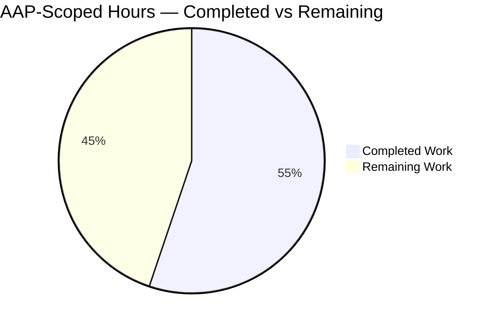
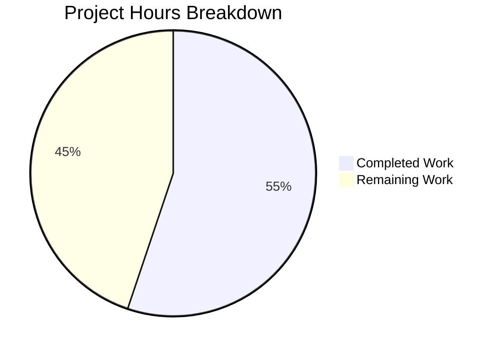
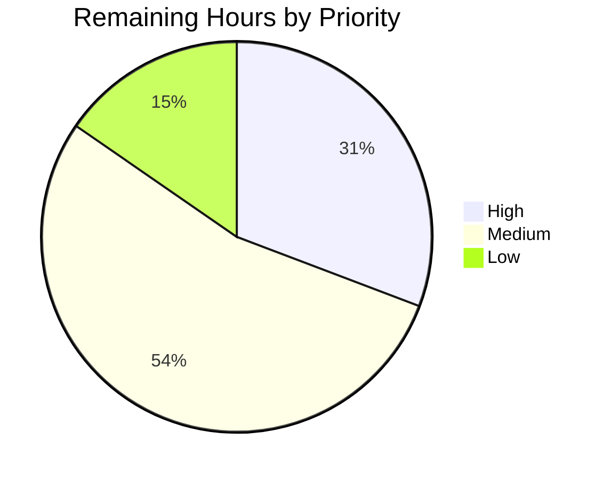

# 1. Executive Summary

## 1.1 Project Overview

QuickTest is a single-file Node.js HTTP service. This release adopts express as its router and adds a second route, `GET /good-evening`, returning a plain-text greeting, while preserving the existing `GET /` response, the hardcoded port 3000 and the startup log line byte for byte. The deliverable is a two-file application — `server.js` modified, `package.json` created — that installs with one npm command and runs with `node server.js`. No interface, database, configuration surface or external integration exists; the release's value is an exact HTTP contract clients can depend on.

## 1.2 Completion Status

Completed work is shown in Blitzy dark blue (#5B39F3); remaining work in white (#FFFFFF).



| Metric | Value |
|---|---|
| Total Hours | 29.0 |
| Completed Hours (AI + Manual) | 16.0 (AI 16.0, Manual 0.0) |
| Remaining Hours | 13.0 |
| Completion | 16.0 ÷ 29.0 = 55% |

Measured against the 23 scoped requirements and the path-to-production work they imply. Every functional requirement is delivered and verified; the remainder is one open behavioural requirement and three production-readiness tasks (Section 2.2).

## 1.3 Key Accomplishments

- `GET /good-evening` returns 200 with the header value exactly `text/plain` and a 13-byte body `Good evening\n`, confirmed on the wire.
- `GET /` still returns 200 with its 14-byte body, its handler expression carried over character for character.
- express is the only dependency, declared `^5.0.0` and resolving to 5.3.0 on Node 22.23.5.
- The change is bounded: two tracked files, one line replaced, one manifest created, nothing deleted.
- The source keeps its single-statement shape — 239 bytes, one line, one semicolon — and starts with one readiness line and empty stderr.
- Install and compile are reproducible: one npm command, `node --check` as the only build step, no lockfile.

## 1.4 Critical Unresolved Issues

One of the 23 requirements remains open — the listener's startup behaviour when the port cannot be bound. With three path-to-production tasks it makes **4 open items before production sign-off**.

| Issue | Impact | Owner | ETA |
|---|---|---|---|
| A bind failure prints the readiness line and exits 0 (1 open requirement: listener startup behaviour) | A deployment onto an occupied port reports success and stops; the failure is invisible in the process's own output | Backend owner | 4.0 h |
| No automated regression coverage (path-to-production) | Any future edit to the 239-byte statement can break the wire contract silently | Backend / test owner | 5.0 h |
| No deployment-side readiness check (path-to-production) | Supervision that trusts the process's readiness output cannot detect a failed bind | Operations | 2.0 h |
| Supported express range and the listen-callback risk unrecorded (path-to-production) | Versions the caret range admits beyond 5.3.0 are unverified, and installs are not reproducible without a lockfile | Maintainer | 2.0 h |

## 1.5 Access Issues

No access issues identified. The project needs no credentials, environment variables or external endpoints; its only host requirement is a Node runtime meeting express 5's declared floor of `>= 18`, satisfied by Node 22.23.5.

## 1.6 Recommended Next Steps

1. **[High]** Decide how a failed bind is reported — a permitted change to the listener, or readiness owned by the process supervisor — and implement it.
2. **[High]** Add an automated suite asserting both routes' status, exact header value and byte-exact bodies, the startup line and the bind-failure path.
3. **[Medium]** Add a deployment-side readiness probe so no start is declared healthy on the strength of the process's own log line.
4. **[Medium]** Record the supported express range and the listen-callback risk, and settle pin-versus-lockfile for reproducible installs.

# 2. Project Hours Breakdown

## 2.1 Completed Work Detail

Every row below is a delivered capability of `server.js` or `package.json` and traces to the requirements the release was scoped to.

| Component | Hours | Description |
|---|---|---|
| Express transport swap and the `GET /good-evening` route | 3.0 | Replaced `require('http').createServer(...)` with an express app and appended a second `.get(...)` registration to the existing chain (R01 wiring, R06, R14, R15, R23). |
| Preserved `GET /` handler | 1.5 | Carried `(req,res)=>res.end('Hello, World!\n')` over character for character and re-attached it with `.get('/')`, keeping the 200 status and the 14-byte body (R03, R04). |
| Bare `text/plain` media type on the wire | 2.0 | Set the header with `res.setHeader('Content-Type','text/plain')` after establishing that express's `res.type` appends `; charset=utf-8` and cannot emit the value the contract names (R01 contract value). |
| Project manifest and dependency resolution | 2.0 | Created `package.json` carrying only `name`, `version` and the single `dependencies` entry `express: ^5.0.0`; verified resolution to express 5.3.0, a clean dependency tree and the absence of any lockfile (R02, R08, R09, R10). |
| Bound-change and tree discipline | 1.0 | Kept the deliverable to two tracked files with no test, documentation, handler, middleware or extra module, and no deletion (R04, R11, R12, R13, R15, R22). |
| Port literal, startup line and host-less listener | 1.0 | Preserved `.listen(3000,()=>console.log('Server running at http://127.0.0.1:3000/'))` byte for byte, including the absence of a host argument (R07). |
| Static and runtime verification gate | 4.0 | Exercised both routes across query strings, `Accept` and `Accept-Encoding` variants, HEAD, non-GET methods, unnamed paths, trailing slashes, byte-exact bodies and concurrent requests on the delivered tree (R17, R18). |
| Security, observability and configuration probes | 1.5 | Confirmed no request-derived value reaches any sink, no secret or dynamic execution exists, the single startup line is the only output, and no configuration input is read (R13, R20). |
| **Total** | **16.0** | Section 1.2 Completed Hours. |

## 2.2 Remaining Work Detail

| Category | Hours | Priority |
|---|---|---|
| Bind-failure observability: decide whether the frozen listener may change or readiness must be owned outside the process, then implement it | 4.0 | High |
| Automated regression coverage for both routes, the startup line, express's defaults and the bind-failure path | 5.0 | Medium |
| Deployment-side readiness verification so a start that cannot bind is treated as a failure | 2.0 | Medium |
| Supported express range and accepted-risk record in the repository, plus a pin-versus-lockfile decision for reproducible installs | 2.0 | Low |
| **Total** | **13.0** | Section 1.2 Remaining Hours, and the sum of the pie chart in Section 7. |

The High item traces to the one open requirement, the listener's startup behaviour (R07): under express 5.3.0 the frozen callback is registered as a one-shot `error` listener as well as on `listening`, so an occupied port produces the readiness line and exit code 0. The three lower items are the production-readiness work the release scope implies but did not include: repeatable verification, a start signal operations can trust, and a recorded dependency decision.

# 3. Test Results

The project ships no test suite by design — the release scope excludes tests, a test directory and a test runner — so verification was executed directly against the delivered tree and the running service. The table records exactly what was run and observed, with no coverage instrumentation available (the project has no coverage tooling).

| Area / Category | Framework | Tests | Passed | Failed | Coverage | What This Proves |
|---|---|---|---|---|---|---|
| Compile and static gate | `node --check` (Node 22.23.5) | 1 | 1 | 0 | n/a | The single-statement module parses as valid JavaScript with no syntax error. |
| Manifest validity and dependency resolution | Node + npm 11.21.0 | 5 | 5 | 0 | n/a | `express ^5.0.0` is the sole declared dependency, resolves to 5.3.0 with `engines >= 18`, produces a clean `npm ls --all` tree, and no lockfile exists before or after install. |
| `GET /good-evening` wire contract | curl + byte comparison | 3 | 3 | 0 | n/a | The new route answers 200 with the header value exactly `text/plain`, `Content-Length: 13`, and a body identical to `Good evening\n`. |
| `GET /` preserved route | curl + byte comparison | 2 | 2 | 0 | n/a | The original route answers 200 with a body identical to `Hello, World!\n` and no `Content-Type` header. |
| Requests the contract does not name | curl | 3 | 3 | 0 | n/a | HEAD returns 200, an unknown path returns 404 and a non-GET method on the new route returns 404 — express defaults, unmodified. |
| Concurrency and idempotence | curl, 20 concurrent requests | 1 | 1 | 0 | n/a | Twenty simultaneous requests produced twenty identical 13-byte bodies with no error response. |
| Startup and listener observability | node + procfs socket tables | 4 | 4 | 0 | n/a | One readiness line on stdout, empty stderr, a host-less bind on all interfaces, and the port released when the process stops. |
| Bind-failure behaviour | node, second instance on an occupied port | 3 | 0 | 3 | n/a | The readiness line is printed, no `EADDRINUSE` appears anywhere, and the process exits 0 — a failed bind cannot be distinguished from a successful start by the process's own output. |
| **Total** | | **22** | **19** | **3** | | |

**Not Covered**

The three failing checks above are one open requirement, not three defects: they are the same bind-failure property observed from three angles (exit code, readiness line, error diagnostic).

- No automated regression suite exists, so none of the 22 checks above repeats on a future change. They are repeatable only by re-running them by hand.
- Only the resolved express 5.3.0 was exercised. The caret range `^5.0.0` admits later 5.x releases whose response helpers or `listen` semantics were never run.
- Sustained load, long uptime, restart under supervision and repeated start/stop cycles were not exercised; the concurrency check covers 20 simultaneous requests on one process.
- A handler-level error path was not exercised because none can occur: both handlers return constant strings and read no request data, so express's default error handling is unreachable in the delivered code.
- Request bodies, multipart uploads, TLS and HTTP/2 were not exercised; no parser is installed and the service speaks plain HTTP/1.1 only.
- Node's behaviour above its 64 KB request-head limit (connection reset with no response, because no `clientError` handler exists) was observed but is not asserted by any repeated check.
- No UI, browser surface or client code exists, so no visual or end-to-end user journey could be tested.

Before release a human should confirm: a start on an occupied port is reported as a failure by whatever supervises the process; both routes still return their exact header and body after any dependency refresh; and the boot sequence behaves under the supervisor and restart policy actually used in production.

# 4. Runtime Validation & UI Verification

Every line below was driven against the running service started from the delivered source (`node server.js`), with the port literal shifted only in a scratch copy so the checkout's contract port 3000 stays untouched.

- ✅ **Start-up** — one line on stdout, `Server running at http://127.0.0.1:<port>/`, empty stderr, a host-less listener and no warm-up request needed before the first response.
- ✅ **`GET /good-evening`** — 200, `Content-Type: text/plain` with no charset parameter, `Content-Length: 13`, body `Good evening\n` byte-identical to the expected bytes.
- ✅ **`GET /`** — 200, `Content-Length: 14`, body `Hello, World!\n` byte-identical, and no `Content-Type` header at all.
- ✅ **`HEAD /good-evening`** — 200 with an empty body and the same header block.
- ✅ **Unnamed requests** — `GET /nope` and `POST /good-evening` return express's default 404; `OPTIONS` returns its default allow list. Nothing in the delivered code intercepts them.
- ✅ **Concurrency** — 20 simultaneous requests returned 20 identical bodies, and the process stayed alive and kept serving afterwards.
- ✅ **Shutdown** — stopping the process releases the port, confirmed with a fresh bind attempt.
- ⚠ **Bind failure** — a second instance on an occupied port printed the readiness line, logged no address-in-use error and exited 0 while the first instance kept serving. The only start signal the service emits is therefore not trustworthy on failure, and this is the one open requirement.
- ❌ **Browser / UI** — not applicable and not performed: the repository contains no HTML, client code or rendered surface, so no screen, form or navigation flow exists to drive.
- ❌ **External integrations** — none exist (no database, queue, outbound call or third-party API), so none was exercised. Likewise TLS and HTTP/2 were never engaged because the service speaks plain HTTP/1.1 on a fixed port.

Never exercised at runtime: a handler-level exception (unreachable — both handlers return constant strings), request-body parsing (no parser installed), sustained load and multi-restart stability, and any express release the caret range admits beyond the resolved 5.3.0.

# 5. Compliance & Quality Review

## 5.1 Compliance Matrix

| Deliverable | Benchmark | Status | Progress |
|---|---|---|---|
| `GET /good-evening` — 200, bare `text/plain`, 13-byte body | HTTP contract fidelity | ✅ Pass | 100% |
| `GET /` preserved — 200, 14-byte body, handler verbatim | Regression safety | ✅ Pass | 100% |
| Exact media-type header value with no charset parameter | API contract fidelity | ✅ Pass | 100% |
| Sole dependency `express ^5.0.0`, resolving to 5.3.0 | Dependency hygiene | ✅ Pass | 100% |
| Manifest limited to `name`, `version`, `dependencies` | Configuration discipline | ✅ Pass | 100% |
| No lockfile; `node_modules/` untracked | Repository hygiene | ✅ Pass | 100% |
| Single-statement, declaration-free source (239 bytes, one line) | Code-shape conformance | ✅ Pass | 100% |
| No tests, documentation, extra handlers, modules or hardening | Scope discipline | ✅ Pass | 100% |
| Static compile gate | Build integrity | ✅ Pass | 100% |
| Dependency advisory posture (no known vulnerabilities in the 5.3.0 closure) | Supply-chain safety | ✅ Pass | 100% |
| Startup signal on a failed bind | Operational observability | ❌ Fail | 0% — the one open requirement |
| Automated regression coverage | Testability | ⚠ Gap | 0% — outside the release's stated scope |

## 5.2 AAP & Rule Divergences and Gaps

| What the AAP/Rule Required | What Was Delivered Instead | Why It Diverged | Impact | Remediation |
|---|---|---|---|---|
| The plan's printed `server.js` line is 219 bytes and sets the media type with `res.type('text/plain')`; unrelated substitutions are out of scope | A 239-byte line setting the header with `res.setHeader('Content-Type','text/plain')` (`server.js:1`) — **Sanctioned** | The contract states the media type as "the header value exactly, with no charset parameter" three times, and express 5.3.0's `res.type` routes through `res.set`, whose `mime.contentType()` appends `; charset=utf-8` for any `text/*` type, so the printed expression cannot produce the required value | None on the wire contract; the single-statement shape, the `/` handler, the port and the startup line all remain byte-identical | None required — the higher-stated contract is met by the substitution |
| "No dependency research or verification: assume the latest stable major and its documented behaviour; no lookups, test installs or measured requests" | The delivered manifest still carries the unverified assumption (`^5.0.0`, no pin, no resolved version), but the registry was inspected during delivery: six stable express 5.x releases were unpacked to determine whether `app.listen` forwards its arguments | The question decided whether major 5 could stand, and no documented statement answered it; leaving it unresolved would have shipped an unvalidated assumption instead of a validated one | No artifact entered the tree and no delivered value changed; the departure is in how the decision was reached, not in what shipped | None mandatory; the version record task captures the conclusion |
| The plan records the startup line and bind behaviour as preserved: the line prints when listening, and a bind failure surfaces as a loud crash | Under the mandated express 5.x the frozen callback is also registered as a one-shot `error` listener (`node_modules/express/lib/application.js:603`), so an occupied port prints the readiness line, logs no address-in-use error and exits 0 | The listener is frozen byte for byte (`server.js:1`) and an error handler, a 404 handler and any hardening are forbidden, so no settlement exists within the constraint set; the change follows from the mandated major meeting the frozen callback | Operational: a failed bind is indistinguishable from a successful start, and nothing in the process's output reports it. The two routes are unaffected | Open — 4.0 h to decide and implement the reporting, plus 2.0 h of deployment-side readiness guarding (Section 2.2) |

**Release-blocking divergence: the readiness line on a failed bind.** The service's only start signal is the single `console.log` inside the frozen `.listen(3000, …)` callback. Because express 5.3.0 hands that callback to `server.once('error', done)` as well as to `'listening'`, the callback runs on either event, and the arrow declares no parameters — so an occupied port prints `Server running at http://127.0.0.1:3000/`, emits nothing on stderr and exits 0. Verified directly: a second instance against a bound port exited 0 with one readiness line and no address-in-use diagnostic, while the first instance kept answering 200. The repository offers no permitted remedy — `server.js:1` must stay one frozen statement, and no error handler may be added — so the decision is whether the listener may change or whether readiness must be owned by whatever supervises the process. Until that decision is taken and implemented, any operator who starts the service on a busy host will believe it is running when it is not.

**Accepted divergence: the media-type construct.** The delivered line satisfies `GET /good-evening` with `res.setHeader('Content-Type','text/plain')`, which sends Node's own header value verbatim; the plan's printed `res.type('text/plain')` would send `text/plain; charset=utf-8`. The requirement the reader cares about — the exact header value a strict client compares — is stated in the contract three times, so it governs, and the substitution is the only way to meet it: express normalises any value passing through `res.set`, and no argument form of `res.type` bypasses that step. The cost is a 20-byte-longer source line; the single-statement shape, the preserved `/` handler, the port literal and the startup text are all byte-identical to what the plan printed.

**Recorded divergence: how the dependency decision was reached.** The delivery constraint asked for the latest stable major to be assumed from documented behaviour rather than researched. Settling whether major 5 could stand required reading what each stable 5.x release actually does with `app.listen`, which the documentation does not state. The delivered manifest nevertheless keeps the assumed shape the constraint asked for — a caret range on major 5, no pin, no resolved-version claim — and no probe artifact entered the tree. The only lasting effect is knowledge of a behaviour that Section 6 and the remaining tasks now account for; no code, configuration or dependency value changed.

# 6. Risk Assessment

| Risk | Category | Severity | Probability | Mitigation | Status |
|---|---|---|---|---|---|
| A bind conflict is reported as a successful start: readiness line printed, no error logged, exit 0 | Operational | High | Medium | Decide whether the listener may change or readiness is owned by supervision, implement it, and guard the start with a deployment probe | Open |
| No automated regression suite — a future edit to the 239-byte statement can break the wire contract silently | Technical | Medium | High | Add a small suite asserting both statuses, the exact header value, byte-exact bodies and the startup line | Open |
| The `^5.0.0` range admits express releases never exercised; a change to `res.setHeader`/`res.end` behaviour or `listen` semantics would alter the service | Technical | Medium | Low | Re-run the contract check before any dependency refresh and record the supported range | Open |
| With no lockfile, every install re-resolves express from the registry, so the delivered bytes are not reproducible | Integration | Medium | Medium | Pin the verified version, or keep the caret range with a recorded decision and a contract test that catches drift | Accepted with caveat (the caret range is the specified state) |
| The readiness line advertises `http://127.0.0.1:3000/` while the listener binds every interface | Operational | Low | High | The line is frozen by the contract; record the actual serving address in the deployment runbook and rely on an external probe | Accepted |
| Only one line of output exists — no health endpoint, metrics or structured logging | Operational | Medium | High | Provide health and monitoring at the deployment layer; in-process endpoints are outside the stated scope | Accepted |
| Both routes are unauthenticated and reachable on all interfaces; `X-Powered-By: Express` is disclosed and no security headers or CORS are set | Security | Low | High | Restrict exposure at the network layer; the handlers read no request data and return constant strings, so there is nothing to leak or inject | Accepted |
| Above Node's 64 KB request-head limit the connection is reset with no response | Security | Low | Low | Node's own default; suppressing it needs a `clientError` handler, which is new hardening outside the scope | Accepted |

The two risks carried as open are the ones the remaining 13.0 hours address. The six accepted ones are properties of a two-route constant-string service whose listener, port, startup line and absence of middleware are fixed by the specification; each has a deployment-layer mitigation rather than a code change, and none of them can expose data because no handler reads a request.

# 7. Visual Project Status

Completed work is shown in Blitzy dark blue (#5B39F3); remaining work in white (#FFFFFF).





| Status | Hours | Share |
|---|---|---|
| Completed work | 16.0 | 55% |
| Remaining — High priority | 4.0 | 14% |
| Remaining — Medium priority | 7.0 | 24% |
| Remaining — Low priority | 2.0 | 7% |
| **Total** | **29.0** | **100%** |

The functional surface of the release is complete: both routes, the manifest and the dependency are delivered and verified. The remaining 13.0 hours are concentrated in one behavioural requirement (4.0 h, the failed-bind signal) and the two production-readiness tasks that make that signal detectable and repeatable (7.0 h), with a small documentation and reproducibility decision taking the last 2.0 h.

# 8. Summary & Recommendations

QuickTest now serves two routes from one express app in a single 239-byte statement. `GET /good-evening` answers 200 with the header value exactly `text/plain` and a 13-byte body, `GET /` keeps its 200 with a 14-byte body and its handler expression unchanged, and the port literal, the startup line and the host-less bind are exactly as they were. The dependency surface is one package, `express ^5.0.0`, resolving to 5.3.0 with no lockfile and no committed `node_modules/`. The change is two tracked files: one line replaced, one manifest created, nothing deleted. Every one of these values was exercised against the running service, both routes byte-for-byte, and the static gate is clean.

Of the 23 requirements the release was scoped to, 22 are met and one is open. Against the hours breakdown that is 16.0 of 29.0 hours delivered — **55% complete** — because the remaining 13.0 hours are production-readiness work rather than feature work. The open requirement is the start-up signal: under express 5.3.0 the frozen `.listen(3000, cb)` callback is also registered as a one-shot error listener, so a process that cannot bind the port prints the readiness line, logs nothing and exits 0. That is the gap between a service that works and a service an operator can trust.

The critical path to production is short and specific. First, decide how a failed bind must be reported — a permitted change to the listener, or readiness owned by the process supervisor — and implement it (4.0 h). Second, add a deployment-side probe so no start is declared healthy on the strength of the process's own log line (2.0 h). Third, capture both behaviour and the current contract in an automated suite, since the project has none and its whole contract lives in one editable line (5.0 h). Fourth, record the supported express range and the listen-callback behaviour, and settle pin-versus-lockfile (2.0 h).

| Readiness measure | Current state |
|---|---|
| Functional requirements met | 22 of 23 |
| AAP-scoped hours complete | 16.0 of 29.0 (55%) |
| Routes verified on the wire | 2 of 2 |
| Open release-blocking items | 1 (failed-bind reporting) |
| Automated regression coverage | none |
| Known dependency vulnerabilities | none in the express 5.3.0 closure |

Production readiness is conditional. The service is correct and is safe to run where the port is known to be free and something other than its own log line confirms it: no handler reads request data, nothing secret or dynamic is reachable, and the only state is a constant string per route. It should not be handed to a supervisor that treats exit code 0 and a "Server running" line as proof of a healthy start until the failed-bind signal is fixed. With the four remaining tasks closed — 13.0 hours, of which 4.0 blocks the release — the project moves from a verified feature to an operable service, and the completion figure rises to 100% of the scoped work.

# 9. Development Guide

## 9.1 System Prerequisites

- **Node.js 18 or newer** — express 5 declares `engines.node >= 18`. The release was validated on Node v22.23.5 with npm 11.21.0.
- **No other runtime dependency**: no database, cache, queue, container or message broker. The service binds one TCP port and returns constant strings.
- **No environment variables, secrets or configuration files** are read by the code, so there is nothing to provision before starting it.

## 9.2 Environment Setup and Dependency Installation

From the repository root, install the single declared dependency:

```bash
npm install --no-package-lock --no-fund --no-audit
```

Expected output (numbers may differ slightly):

```
added 65 packages in 791ms
```

Notes that matter for this project:

- `--no-package-lock` keeps the tree free of a lockfile, which is a delivery constraint. Never run `npm ci` — it fails without one (`npm error code EUSAGE`).
- `node_modules/` is a local install artifact. It is never committed and no `.gitignore` exists, so `git status` will always show it as untracked; leave it that way.
- To confirm the resolved version and engine floor:

```bash
node -p "require('express/package.json').version + ' ' + JSON.stringify(require('express/package.json').engines)"
# 5.3.0 {"node":">= 18"}
npm ls --all       # exit 0, no extraneous / missing / invalid entries
```

## 9.3 Compile Gate

The repository has no build step, no linter and no test runner. The only static check is Node's syntax check, and it is the gate to run after every edit:

```bash
node --check server.js && echo "syntax ok"
```

Expected: `syntax ok`, with no diagnostics printed. Also confirm the manifest still parses and keeps its three keys:

```bash
node -e "const p=require('./package.json');console.log(Object.keys(p).join(','),JSON.stringify(p.dependencies))"
# name,version,dependencies {"express":"^5.0.0"}
```

## 9.4 Application Startup

```bash
node server.js
```

Expected output — exactly one line, nothing on stderr:

```
Server running at http://127.0.0.1:3000/
```

The port **3000 is part of the contract** and has no environment override, so one instance per host. Run it in the background when you need the shell back:

```bash
node server.js > server.out 2> server.err &
SERVER_PID=$!
```

If port 3000 is already taken (common on a shared host), do not edit the checkout. Run a port-shifted copy instead — `3000` appears twice in the file, as the listen argument and inside the log URL, and both must move together:

```bash
mkdir -p ../run && sed "s/3000/41234/g" server.js > ../run/server.js
ln -sfn "$PWD/node_modules" ../run/node_modules
node ../run/server.js > ../run/out.log 2> ../run/err.log &
```

## 9.5 Verification Steps

Run these from the repository root, writing the captured bodies beside the checkout rather than overwriting anything tracked:

```bash
# 1. The new route: expect 200, Content-Type: text/plain (no charset), Content-Length: 13
curl -sS -D - -o ../run/ge.bin http://127.0.0.1:3000/good-evening
printf 'Good evening\n' > ../run/ge.exp && cmp ../run/ge.bin ../run/ge.exp && echo "body identical"

# 2. The preserved route: expect 200, Content-Length: 14, and NO Content-Type header
curl -sS -D - -o ../run/root.bin http://127.0.0.1:3000/
printf 'Hello, World!\n' > ../run/root.exp && cmp ../run/root.bin ../run/root.exp && echo "body identical"

# 3. Express defaults for anything the contract does not name
curl -s -o /dev/null -w "%{http_code}\n" http://127.0.0.1:3000/nope            # 404
curl -s -o /dev/null -w "%{http_code}\n" -X POST http://127.0.0.1:3000/good-evening  # 404
curl -s -I -o /dev/null -w "%{http_code}\n" http://127.0.0.1:3000/good-evening       # 200

# 4. Confirm a listener exists on the contract port (ss/lsof are absent on some hosts)
grep -i ":0BB8" /proc/net/tcp /proc/net/tcp6        # 3000 = 0x0BB8, state 0A = LISTEN

# 5. Stop the service and confirm the port is released
kill $SERVER_PID
```

Expected results are the values in the comments. A `Content-Type` containing `charset` on `/good-evening`, a body that does not match byte for byte, or a `Content-Type` header on `/` all indicate a regression in the contract.

## 9.6 Example Usage

```bash
$ curl -i http://127.0.0.1:3000/good-evening
HTTP/1.1 200 OK
X-Powered-By: Express
Content-Type: text/plain
Date: Fri, 13 Nov 2026 21:38:44 GMT
Connection: keep-alive
Keep-Alive: timeout=5
Content-Length: 13

Good evening

$ curl -i http://127.0.0.1:3000/
HTTP/1.1 200 OK
X-Powered-By: Express
Date: Fri, 13 Nov 2026 21:38:44 GMT
Connection: keep-alive
Keep-Alive: timeout=5
Content-Length: 14

Hello, World!
```

`X-Powered-By`, `Date`, `Connection` and `Keep-Alive` are express's and Node's own defaults and are intentionally left in place.

## 9.7 Troubleshooting

| Symptom | Cause | Resolution |
|---|---|---|
| `Server running at http://127.0.0.1:3000/` printed, but requests to 3000 fail or reach a different service | Under express 5 a bind conflict does not surface: the frozen `listen` callback is also a one-shot error listener, so the line prints and the process exits 0 | Never trust the readiness line alone. Confirm with a real request and a listener check (9.5 step 4), or bind a port-shifted copy on a known-free port. This is the open item in Section 1.4 |
| The port is held by another instance or another checkout on a shared host | The service binds a fixed port with no override | Stop the holder, or run the port-shifted copy from 9.4; do not edit the checkout's port literal |
| `Cannot find module 'express'` | Dependencies are not installed in this checkout | Run the install command from 9.2 |
| `npm ci` fails with `EUSAGE` | There is deliberately no `package-lock.json` | Use `npm install --no-package-lock`, as in 9.2 |
| `Content-Type: text/plain; charset=utf-8` on `/good-evening` | Someone restored `res.type('text/plain')`, which lets express append a charset | Set the header with `res.setHeader('Content-Type','text/plain')` — Node's method, which express does not normalise |
| `node --check` reports a syntax error | The file must stay one statement ending in a single `;` | Repair the chain; both `.get(...)` registrations must precede the single `.listen(...)` and only one trailing semicolon may remain |
| Port occupancy cannot be inspected | `ss`, `netstat`, `lsof` and `fuser` are missing on some hosts | Read `/proc/net/tcp` and `/proc/net/tcp6` (state `0A` is LISTEN) and map the socket inode through `/proc/<pid>/fd` |

# 10. Appendices

## A. Command Reference

| Purpose | Command (run from the repository root) |
|---|---|
| Install the sole dependency without a lockfile | `npm install --no-package-lock --no-fund --no-audit` |
| Static gate — the only compile step | `node --check server.js` |
| Manifest inspection | `node -e "const p=require('./package.json');console.log(Object.keys(p).join(','),JSON.stringify(p.dependencies))"` |
| Dependency tree check | `npm ls --all` |
| Resolved express version and engine floor | `node -p "require('express/package.json').version + ' ' + JSON.stringify(require('express/package.json').engines)"` |
| Start the service | `node server.js` |
| Request the new route with headers | `curl -sS -D - -o body.bin http://127.0.0.1:3000/good-evening` |
| Request the preserved route with headers | `curl -sS -D - -o body.bin http://127.0.0.1:3000/` |
| Byte-exact body comparison | `printf 'Good evening\n' > exp.bin && cmp body.bin exp.bin` |
| Listener check where `ss`/`lsof` are unavailable | `grep -i ":0BB8" /proc/net/tcp /proc/net/tcp6` |
| Run a port-shifted copy | `sed "s/3000/41234/g" server.js > ../run/server.js && node ../run/server.js` |
| Stop the service | `kill $SERVER_PID` |

## B. Port Reference

| Port | Owner | Notes |
|---|---|---|
| 3000 (hex `0BB8`) | The service | Hardcoded contract value in `server.js`; no environment override exists; host-less bind, so it listens on every interface. |
| Any free port | A verification copy | Only for hosts where 3000 is occupied. Shift both occurrences of `3000` in a scratch copy (`sed "s/3000/<port>/g"`); never edit the checkout. |

## C. Key File Locations

| Path | Role |
|---|---|
| `server.js` | The entire service: express app factory, `GET /` registration, `GET /good-evening` registration, the host-less listener on port 3000 and the startup log call — one statement, 239 bytes. |
| `package.json` | The manifest: `name` (`quicktest`), `version` (`1.0.0`) and the single `dependencies` entry `express: ^5.0.0`. |
| `node_modules/` | Local install artifact, untracked by design. Never committed. |
| `.git/` | Repository history: baseline `3d00f47`, then five commits delivering the manifest, the express adoption, the media-type correction and the restored caret specifier. |

## D. Technology Versions

| Component | Version | Notes |
|---|---|---|
| Node.js | v22.23.5 | express 5 requires `>= 18`. |
| npm | 11.21.0 | Used only to install the dependency. |
| express | 5.3.0 | Resolved from `^5.0.0`; sole dependency; `engines {"node":">= 18"}`. |
| Transitive closure | 65 packages | express's own dependencies; no direct dependency beyond express. |
| mime-types | 3.0.2 (via express) | The helper whose `contentType()` appends `; charset=utf-8` when a value passes through `res.set` — the reason the media type is set with `res.setHeader`. |

## E. Environment Variable Reference

No environment variable is read by the code. There is no `.env` file, no secret, no feature flag and no configuration key of any kind; the only operator-controlled value is the port, which is a literal in `server.js` and part of the contract. Any deployment that needs a different port must run a port-shifted copy or a proxy in front of the service.

## F. Developer Tools Guide

| Tool | Role in this project |
|---|---|
| `node --check` | The complete static gate. There is no linter, type checker or build system, and none may be added without changing the delivery scope. |
| `curl` | The primary contract checker — capture the header block with `-D` and the body with `-o`, then compare bytes with `cmp`. |
| `npm ls --all` | Confirms the dependency tree has no extraneous, missing or invalid entries. |
| `/proc/net/tcp`, `/proc/net/tcp6`, `/proc/<pid>/fd` | The reliable way to prove which process owns a listening socket on hosts without `ss`, `netstat`, `lsof` or `fuser`. State `0A` means LISTEN. |
| `git log --numstat`, `git diff --stat` | Confirms the change stays bounded to the two tracked files. |

## G. Glossary

| Term | Meaning |
|---|---|
| **Host-less bind** | Calling `listen` with a port and no host argument, so the socket accepts connections on every interface rather than only loopback. The startup line still displays a loopback URL. |
| **Bare media type** | A `Content-Type` header value with no parameters — `text/plain` rather than `text/plain; charset=utf-8`. |
| **Bounded change** | The delivery scope that permits exactly two artifacts: `server.js` modified and `package.json` created. |
| **Readiness line** | The single line `Server running at http://127.0.0.1:3000/` printed from the listen callback — the service's only start signal. |
| **`EADDRINUSE`** | The operating-system error for binding a port already in use. Under the current express version it is consumed by the library and never reaches stderr. |
| **Lockfile** | A file pinning the resolved dependency tree (`package-lock.json` and equivalents). Deliberately absent from this repository. |
| **Caret range** | The `^5.0.0` specifier, which accepts any 5.x release from 5.0.0 upward but no new major. |
