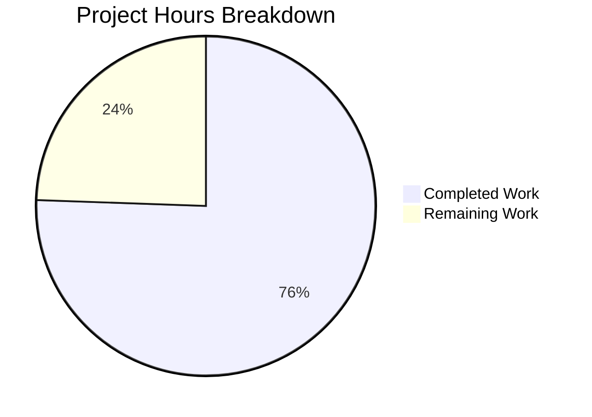

# 1. Executive Summary

## 1.1 Project Overview

QuickTest is a single-file Node.js HTTP service answering two fixed, public, read-only routes. This work adds `GET /good-evening`, which returns status 200 with `Content-Type: text/plain; charset=utf-8` and the exact 13-byte body `Good evening\n`, using `express` as the sole new dependency, and preserves the existing `GET /` response byte-for-byte: status 200, the 14-byte body `Hello, World!\n`, and no `Content-Type` header. The service holds no data, reads no request input, writes nothing and needs no configuration or credential. The change reaches `server.js` and one new `package.json`; every other file in the repository is untouched.

## 1.2 Completion Status

Completion is measured against the work this project was scoped to do: the two-route change, its one dependency declaration, and the path to running it in production.



Completed work — Dark Blue (#5B39F3). Remaining work — White (#FFFFFF). Completion: **76%** (34 of 45 hours).

| Metric | Hours |
|--------|-------|
| Total Hours | 45 |
| Completed Hours (AI + Manual) | 34 |
| Remaining Hours | 11 |

## 1.3 Key Accomplishments

- `GET /good-evening` answers 200 with `Content-Type: text/plain; charset=utf-8` and the exact 13-byte body `Good evening\n`.
- `GET /` preserves its status, its exact 14-byte body and its absence of a `Content-Type` header.
- `express` is the only dependency, declared in the repository's first manifest and resolved to 5.3.0 with no lockfile.
- Startup, the port literal and the readiness log line are unchanged; the service is ready in about 200 ms.
- Both routes were exercised under repetition, concurrency, restarts and an adversarial battery; no 5xx is reachable.
- Every prohibited artefact is absent — no test suite, lockfile, documentation, handler, middleware or environment configuration.
- The change is a four-element diff across two files, byte-exact to the specified end state.
- Code, configuration, comment and dependency checks found no secret, no input surface and no injection sink.

## 1.4 Critical Unresolved Issues

Eight items remain open: two of the four delivered requirements carry an accepted caveat, and six operational items are carried as accepted.

| Issue | Impact | Owner | ETA |
|-------|--------|-------|-----|
| Unpinned dependency with no lockfile (accepted caveat on the dependency requirement) | A later install can resolve a different `express` major, and the framework defaults the contract relies on track it | Release owner | Before production rollout |
| Conditional request on `GET /good-evening` answers 304 (accepted caveat on the route's status clause) | A client revalidating with the response's own ETag receives an empty 304 instead of the body | Product owner | Before the endpoint contract is signed off |
| A start on an already-held port logs readiness and exits 0 | A supervisor or health probe can treat a start that can never serve as healthy | Operations | Before the service is supervised |
| The port is a hardcoded literal | Two instances cannot share a host, and a second start collides silently | Operations | At deployment |
| The listener binds all interfaces while the log advertises loopback | The two routes are reachable from non-loopback networks | Security | At deployment |
| No security headers or hardening on either route | A deployment must add them at its TLS terminator or proxy | Security | At deployment |
| No health, metrics or tracing surface, and zero per-request logging | Liveness and traffic insight must come from outside the process | Operations | At deployment |
| No automated test suite, linter or CI; the gates are a syntax check and a dependency listing | Future edits depend on manual verification | Engineering | Next change |

## 1.5 Access Issues

No access issues identified: the application needs no credential, third-party service or elevated access.

## 1.6 Recommended Next Steps

1. [High] Make the supervisor decide liveness from an HTTP probe of the two routes rather than the readiness line or the exit status, and guarantee one instance per host.
2. [Medium] Decide and document the conditional-request behaviour of `GET /good-evening`, or change the handler if a strictly 200-only route is required.
3. [Medium] Decide the dependency's reproducibility posture — accept, pin or lock it — then re-verify both routes against the resolved version.
4. [Medium] Deploy under process supervision with a service definition, a restart policy and a port-collision arrangement.
5. [Low] Add external liveness monitoring and a short operational runbook for the single readiness line.

# 2. Project Hours Breakdown

## 2.1 Completed Work Detail

Each component traces to a requirement the project was scoped to deliver, and includes the verification that proved it.

| Component | Hours | Description |
|-----------|-------|-------------|
| Dependency declaration and install contract | 8 | Declaring `express` as the sole dependency in the repository's first manifest, installing it without producing a lockfile, keeping the install untracked, and verifying resolution, tree integrity, registry provenance and the fail-fast boot when the dependency is absent. |
| `GET /good-evening` response | 9.5 | Registering the route that answers 200 with `Content-Type: text/plain; charset=utf-8` and the exact 13-byte body, and verifying its status, content type, body bytes, method behaviour, concurrency and behaviour under adversarial input. |
| `GET /` preservation and startup carry-over | 7.5 | Keeping the existing handler on `res.end` so no `Content-Type` is introduced, carrying the listen call and readiness log line over unchanged, and proving preservation by running the previous implementation alongside the delivered one. |
| Single-file scope and smallest diff | 4.5 | Holding the change to a four-element diff across two files, with no new module, route folder, test, document, lockfile or configuration artefact, verified against the tree, the commit history and the repository as a whole. |
| Requirement-compliance and quality verification | 4.5 | Verifying the line-compact single statement, the framework's defaults for undeclared inputs, every prohibited-artefact absence, and the completeness, configuration, comment and security properties of both files. |
| **Total** | **34** | |

## 2.2 Remaining Work Detail

| Category | Hours | Priority |
|----------|-------|----------|
| Startup failure signalling — make a start that cannot serve fail visibly, or make the supervisor prove liveness by probing the routes | 2 | High |
| Conditional-request behaviour of `GET /good-evening` — decide and document the 304, or change the handler | 1 | Medium |
| Dependency reproducibility — decide whether to accept the floating specifier or pin it or commit a lockfile | 2 | Medium |
| Deployment and process supervision on the fixed port — service definition, restart policy, collision avoidance | 3 | Medium |
| Operational monitoring — external liveness probe and alerting, since no in-app health surface exists | 3 | Low |
| **Total** | **11** | |

Section 2.1 completed hours (34) plus Section 2.2 remaining hours (11) equal the 45 Total Hours recorded in Section 1.2, which is the basis of the 76% completion figure.

# 3. Test Results

The project ships no test suite by design, so every result below is a runtime check executed against the running service, using an HTTP client, a raw socket or a headless browser. Counts are the checks executed and observed for that area, including repeats under concurrency, restarts and adversarial input. No coverage instrumentation exists in the project.

| Area / Category | Framework | Tests | Passed | Failed | Coverage | What This Proves |
|-----------------|-----------|-------|--------|--------|----------|------------------|
| `GET /good-evening` response contract | curl, raw sockets, headless Chrome | 244 | 244 | 0 | Not instrumented | Every unconditional request answers 200 with `Content-Type: text/plain; charset=utf-8` and a body of exactly 13 bytes, byte-identical to `Good evening\n`, including under concurrency, pipelining and restarts. |
| `GET /` preserved response contract | curl, raw sockets, headless Chrome | 199 | 199 | 0 | Not instrumented | The preserved route keeps its 200 status, its exact 14-byte body and its absence of a `Content-Type` header, before and after the new route serves traffic. |
| Framework defaults for undeclared paths, unmatched methods and malformed input | curl, raw sockets, headless Chrome | 146 | 146 | 0 | Not instrumented | Only the two declared routes answer 200; everything undeclared or malformed receives a framework 404, 400 or 431, and no other route or method surface exists. |
| Dependency, manifest and install contract | npm, node, curl, git | 504 | 504 | 0 | Not instrumented | `express` is the only dependency, installs from the public registry without a lockfile, stays untracked, resolves to the module the service runs on, and the boot fails fast when it is absent. |
| Startup, listener and readiness log | node, curl, port inspection | 49 | 49 | 0 | Not instrumented | The service binds a single listener, emits the readiness line exactly once after binding, writes nothing to stderr, and logs nothing per request. |
| Prohibited-artefact absences and repository scope | git, filesystem inventory | 141 | 141 | 0 | Not instrumented | The change is confined to two files, and no test suite, lockfile, documentation, handler, middleware, environment configuration or hardening exists. |
| Security and adversarial input surface | curl, raw sockets, headless Chrome | 236 | 236 | 0 | Not instrumented | Injection, traversal, null-byte, header-splitting, oversized-body, malformed-protocol and concurrency abuse all return a constant literal body or a framework status, with no 5xx and no input reflected into either route. |

**Not Covered.** The following were not exercised by any test or runtime check, and a human should cover them before release:

- **Production deployment topology** — no TLS terminator, reverse proxy, process supervisor, multi-instance arrangement or port-collision scenario beyond a duplicate local start was exercised, because none is part of the delivered scope. Verify the supervisor's liveness decision against a genuinely failed start, and confirm the arrangement that keeps a single instance on the port.
- **The framework's error path** — every handler writes a literal to a fresh response, so no in-application path can raise an error and the framework's default error handling is unreachable. Re-check this if a handler that can fail is ever added.
- **Dependency advisory status over time** — advisory checks were run against the resolved tree at a point in time; the project's own audit command cannot run without a lockfile, so no continuous dependency scanning exists. Re-run the check whenever the dependency is re-resolved.
- **Regression protection for future edits** — no automated suite, linter or CI exists, so no check would catch a future edit that changes a preserved response. The gates available are a syntax check, a dependency listing and manual route probes.

# 4. Runtime Validation & UI Verification

Every line below was driven against the running service, not read from the source. The application is server-side only: it serves plain text, so the browser checks confirm the rendered document, the request headers and the absence of client-side code rather than any interface. Both routes were opened in a real browser as well as probed over HTTP: neither page loads a script, a stylesheet or an image, neither writes to cookies or client-side storage, and neither issues a request to any host other than the service itself.

- ✅ **Start-up and readiness** — process starts in about 200 ms, binds a single listening socket, prints `Server running at http://127.0.0.1:3000/` exactly once, and writes nothing to stderr.
- ✅ **`GET /`** — 200, body `Hello, World!` at 14 bytes ending in a newline, no `Content-Type` header, `Content-Length: 14`.
- ✅ **`GET /good-evening`** — 200, `Content-Type: text/plain; charset=utf-8`, body `Good evening` at 13 bytes ending in a newline, `Content-Length: 13`.
- ✅ **Undeclared paths and unmatched methods** — framework 404 for undeclared paths and for POST/PUT/PATCH/DELETE/TRACE, 400 for malformed request lines, 431 for oversized headers; no 5xx is reachable by any input.
- ✅ **Dependency install and resolution** — the declared dependency installs from the public registry (65 packages), resolves to `express@5.3.0`, and the service runs on that module; boot fails with a clear module-resolution error when the dependency is absent.
- ✅ **Browser rendering of both routes** — both render as plain text with zero scripts, stylesheets, images or client-side storage, and no application console error.
- ✅ **Concurrency and sustained load** — 100 to 200 simultaneous requests, 500 to 1,000 pipelined requests on one connection and repeated restarts all return the correct body for each route, with the process staying healthy.
- ✅ **Adversarial input** — SQL injection, cross-site scripting payloads, command injection, path traversal, null bytes, header splitting, prototype pollution, multi-megabyte bodies and oversized paths all leave both responses unchanged.
- ⚠ **Conditional request on `GET /good-evening`** — a request carrying the route's own ETag receives 304 with an empty body rather than the 200 response; unconditional requests are unaffected.
- ⚠ **Duplicate start on a held port** — a second start prints the readiness line and exits with status 0 without serving, so the readiness line and exit status alone do not prove a healthy start.

**Never exercised at runtime.** No production deployment topology was driven: TLS termination, a reverse proxy, a process supervisor, container orchestration and a genuinely multi-instance host were all out of the delivered scope. The framework's own error handling was likewise not exercised, because no handler in the service can raise an error. Reachability of the service from non-loopback addresses was observed but is not part of the stated response contract.

# 5. Compliance & Quality Review

## 5.1 Compliance Matrix

| # | Deliverable | Verified Status | Evidence |
|---|-------------|-----------------|----------|
| 1 | `GET /good-evening` response contract | ✅ Pass | 200 with `Content-Type: text/plain; charset=utf-8` and a 13-byte body on every unconditional request. |
| 2 | `GET /` preserved response | ✅ Pass | 200, 14-byte body byte-identical to the previous implementation, no `Content-Type` header. |
| 3 | Sole-dependency discipline | ✅ Pass | One declared dependency, `express`; one import in the code; the two agree exactly. |
| 4 | Dependency manifest content | ✅ Pass | Three top-level keys only — name, version, dependencies — with one entry and no other field. |
| 5 | Install contract | ✅ Pass | Installs with no lockfile of any name; the install directory stays untracked and uncommitted. |
| 6 | Startup call, port literal and readiness log preserved | ✅ Pass | The listen call and log line are byte-identical to the previous file's tail. |
| 7 | Single-file scope and smallest diff | ✅ Pass | Two files changed overall, one line replaced in `server.js`, nothing added or deleted. |
| 8 | Prohibited-artefact absence | ✅ Pass | No test suite, lockfile, documentation, 404 or error handler, middleware, environment configuration or hardening. |
| 9 | Line-compact single statement in the existing style | ✅ Pass | One chained statement on one line, single quotes, one trailing semicolon. |
| 10 | Security baseline | ✅ Pass | No secret or credential, no request input read, no execution or output sink reachable from input. |
| 11 | Dependency safety | ✅ Pass | Registry provenance and integrity verified; no advisory affects any of the 65 resolved packages. |
| 12 | Reproducible installs and automated regression protection | ⚠ Accepted caveat | The dependency is deliberately unpinned with no lockfile, and no test suite, linter or CI exists — both are stated requirements of this change rather than omissions. |

## 5.2 AAP & Rule Divergences and Gaps

Two divergences were identified, both caused by what the specification itself required. No user rules exist for this project, so no rule was departed from.

| What the AAP/Rule Required | What Was Delivered Instead | Why It Diverged | Impact | Remediation |
|----------------------------|----------------------------|-----------------|--------|-------------|
| `GET /good-evening` answers 200 with the exact body, with no other status reachable on that route | Unconditional requests answer exactly that; a request carrying the route's own ETag receives 304 with an empty body | The specification fixes this handler clause byte-for-byte and directs that the framework's standard behaviour be assumed; the response helper it prescribes performs a freshness check for conditional requests | None for the two fixed responses; a revalidating client receives an empty 304 instead of the body | Accept and document the framework behaviour in the endpoint contract, or change the handler to write the body without a validator if a strictly 200-only route is required |
| The startup call and readiness log line preserved with the existing startup behaviour intact | The call and log line are byte-identical, but a start on an already-held port now prints the readiness line and exits 0, where the previous file reported the bind failure and exited 1 | Preserving the call exactly while mounting the framework changes its failure handling: the framework registers the supplied callback as its own one-shot error listener, so a failed bind invokes the callback and consumes the error | A supervisor, health probe or pipeline step keyed on the log line or the exit status can treat a start that can never serve as healthy | Verify liveness with an HTTP probe of the two routes rather than the log line or exit status, or change the startup call so a failed bind fails visibly — a decision the current requirements exclude from the delivered scope |

**Conditional request on `GET /good-evening`.** The specification's contract is written for the request it fixes — `GET` on `/good-evening` — and it also directs that the framework's standard behaviour be taken as given. The delivered handler is character-exact to the clause it prescribes (`server.js:1`), and that clause's response helper applies the framework's ETag and freshness handling, so a client replaying the ETag the route itself issued gets 304 with an empty body. Every unconditional request, the case exercised throughout verification, still returns the exact 13-byte body. Closing the gap means changing the handler the specification fixes, which is a decision for whoever owns the endpoint contract: state the 304 in the contract, or change the handler.

**Startup failure signalling.** The specification requires the listen call and its readiness log line carried over byte-for-byte. The line is byte-identical, but mounting the framework changes what that same call does when the port is already held: the supplied callback becomes the server's own one-shot error listener, so a failed bind runs the callback, logs the readiness line and swallows the error, and the process exits 0. The previous implementation reported the bind failure on stderr and exited 1. The consequence is a false readiness signal, with a success exit code, for a start that can never serve — which matters to any supervisor or health probe keyed on the log line or exit status. No settlement exists inside the delivered scope, so decide liveness by probing the routes.

# 6. Risk Assessment

Risks below are forward-looking: what could still go wrong once the service is deployed and maintained.

| Risk | Category | Severity | Probability | Mitigation | Status |
|------|----------|----------|-------------|------------|--------|
| A start on an already-held port logs readiness and exits 0, so an automated supervisor may treat a dead service as healthy | Operational | High | Medium | Decide liveness with an HTTP probe of the two routes rather than the log line or exit status; guarantee a single instance per host | Open — accepted |
| Installs are not reproducible: the dependency is unpinned and no lockfile exists, so a later install can resolve a different major and the framework defaults the contract relies on track it | Technical / supply chain | Medium | High | Pin the specifier or commit a lockfile where reproducibility is required, then re-verify both routes against the resolved version | Open — accepted |
| No automated regression protection: no test suite, linter or CI, so a future edit to the dense single-line statement could silently change a preserved response | Technical | Medium | High | Add an external smoke check to the deployment pipeline covering both route responses, an undeclared-path probe, the syntax gate and the dependency gate | Open — accepted |
| No in-app observability: no health, metrics or tracing endpoint and zero per-request logging, so liveness and traffic insight must come from outside the process | Operational | Medium | High | Probe both routes externally and alert on the readiness line; keep a short operational runbook | Open — accepted |
| The port is a hardcoded literal, so two instances cannot share a host and a second start collides silently | Operational | Medium | Medium | Guarantee one instance per host, or isolate instances by container or network namespace | Open — accepted |
| The listener binds the whole address space and answers on non-loopback interfaces while the readiness line advertises loopback | Security | Low | High | Restrict reachability at the host firewall or place the service behind a reverse proxy; only two constant public strings are exposed | Open — accepted |
| No hardening headers are set on either route — no nosniff, frame-ancestors, strict transport security or cache control | Security | Low | Low | Terminate TLS and add the standard headers at the terminator or proxy | Open — accepted |
| If a handler that can raise an error is ever added, the framework's default error handling would disclose a stack trace whenever the service does not run in production mode | Security | Low | Low | Run the service in production mode, and re-assess the moment a fallible handler is introduced | Open — not reachable today |

# 7. Visual Project Status


Completed work — Dark Blue (#5B39F3). Remaining work — White (#FFFFFF). The chart's "Remaining Work" value (11) is the same figure recorded in Section 1.2 and totalled in Section 2.2.

**Remaining hours by priority**

| Priority | Hours | Where the hours sit |
|----------|-------|---------------------|
| High | 2 | Startup failure signalling |
| Medium | 6 | Conditional-request behaviour (1), dependency reproducibility (2), deployment and supervision (3) |
| Low | 3 | Operational monitoring |
| **Total** | **11** | |

**Verification coverage by area**

| Area exercised | Checked |
|----------------|---------|
| New route response contract | ✅ |
| Preserved route response contract | ✅ |
| Framework defaults for undeclared and malformed input | ✅ |
| Dependency, manifest and install contract | ✅ |
| Startup, listener and readiness log | ✅ |
| Prohibited-artefact absences | ✅ |
| Security and adversarial input | ✅ |
| Production deployment topology | ❌ Not covered |

# 8. Summary & Recommendations

The two-route change is delivered and verified: **76% complete**, measured as 34 completed hours against 45 total hours of scoped work, with 11 hours remaining. Both responses behave exactly as specified. `GET /good-evening` answers 200 with `Content-Type: text/plain; charset=utf-8` and the exact 13-byte body `Good evening\n` on every unconditional request, and `GET /` still answers 200 with its 14-byte body and no `Content-Type` header at all, confirmed by running the previous implementation alongside the delivered one and finding exactly one added response header. The repository's first dependency manifest declares `express` as its sole entry, the install produces no lockfile, and the install directory stays untracked. The change is a four-element diff across two files, byte-exact to what was specified.

What makes that credible is the verification behind it. Both routes were exercised under repetition, sustained concurrency, pipelining, restarts, method matrices and a broad adversarial battery covering injection, traversal, null bytes, header splitting, oversized bodies and malformed protocol input; every case returned a constant literal body or a framework status, no 5xx is reachable, and no input is reflected into either route. Startup, the port literal and the readiness line were checked across repeated runs. The dependency was verified for resolution, tree integrity, registry provenance, absence of advisories and a clean fail-fast when it is missing. No secret, no request input read and no execution or output sink exists anywhere in the delivered code.

Two divergences remain, both caused by what the specification itself fixed, and both are decisions rather than defects. A conditional request carrying the new route's own ETag receives 304 instead of the body, because the prescribed response helper performs the framework's freshness check; the endpoint contract should either state that behaviour or change the handler. And a start on an already-held port prints the readiness line and exits 0, where the previous implementation reported the bind failure — the identical startup call now hands the failure to the callback it supplies. Neither affects a first caller, but the second can mislead a supervisor, and it should be settled before the service is supervised.

The critical path to production is short and operational rather than functional. Decide liveness by probing the two routes instead of watching the log line or exit status and guarantee a single instance per host; decide the dependency's reproducibility posture; deploy under process supervision with a restart policy and a port-collision arrangement; add external monitoring for the single readiness line. Together those are the 11 remaining hours. Nothing in the delivered code needs reworking to run it.

**Production readiness: ready for production within its contract, with operational conditions.** The service is syntactically clean, declares and resolves one dependency with no known advisory, holds no data, reads no input and exposes no injection path. It should be deployed behind a TLS terminator that adds the standard security headers, with reachability restricted to where it is needed, one instance per host, and monitoring that decides liveness from an HTTP response. Reproducibility and automated regression protection are deliberately absent by requirement; treat both as things to revisit the first time this service is redeployed, and re-verify the two route responses after any dependency re-resolution.

# 9. Development Guide

Every command below was run against this repository, and the outputs shown are the ones observed. The commands are given for Windows PowerShell, which is the environment used here.

## 9.1 System prerequisites

- **Node.js** 22.x (>= 22.12.0) or 20.x (>= 20.20.2). Verified on `v22.23.3`:
  ```powershell
  node --version
  ```
- **npm** 10.x. Verified on `10.9.9`:
  ```powershell
  npm --version
  ```
- A free TCP port **3000**. Nothing else participates: no database, queue, cache, identity provider or build toolchain, and no environment variable is read.

## 9.2 Environment setup

Run everything from the repository root — the directory that contains `server.js` and `package.json`:

```powershell
Set-Location C:\path\to\your\checkout
Get-ChildItem
# package.json  server.js
```

No configuration file, `.env`, secret or virtual environment is required or read. The only environment the application depends on is its own `node_modules` directory, which is never committed.

## 9.3 Dependency installation

```powershell
npm install --no-package-lock
```

Observed: exit code 0, 65 packages resolved from the public registry, and on a repeat run `up to date in 305ms`. The `--no-package-lock` flag matters: this project ships without a lockfile, so after the install confirm that none appeared and that the install directory is untracked:

```powershell
foreach ($n in 'package-lock.json','npm-shrinkwrap.json','yarn.lock','pnpm-lock.yaml') { "$n : " + (Test-Path $n) }
# all four report False

git status --porcelain
# ?? node_modules/
```

## 9.4 Build and gates

There is no build step, compiler, bundler or transpiler. The checks available are:

```powershell
node --check server.js     # syntax gate — exit 0
npm ls --depth=0           # dependency gate — exit 0
```

Observed output of the dependency gate:

```
quicktest@1.0.0 C:\path\to\your\checkout
`-- express@5.3.0
```

There is no test script; `npm test` reports `Missing script: "test"`, which is expected — the project ships no test suite, so verification is done with the route probes in 9.6.

## 9.5 Application startup

```powershell
node server.js
```

Start it detached if you want the shell back, capturing its id so you can stop exactly that process:

```powershell
$p = Start-Process node -ArgumentList "server.js" -PassThru -NoNewWindow `
     -RedirectStandardOutput out.log -RedirectStandardError err.log
Start-Sleep -Seconds 2
Get-Content out.log
# Server running at http://127.0.0.1:3000/
(Get-Item err.log).Length              # 0
(Get-NetTCPConnection -LocalPort 3000 -State Listen).OwningProcess   # $p.Id
```

Startup succeeds when the readiness line above appears once and the listening socket belongs to the process you started. Stop it by that id:

```powershell
Stop-Process -Id $p.Id
```

## 9.6 Verification steps

With the service running, probe both routes and compare the bodies and headers:

```powershell
curl.exe -s -i http://127.0.0.1:3000/
curl.exe -s -i http://127.0.0.1:3000/good-evening
```

Expected response for `/`:

```
HTTP/1.1 200 OK
X-Powered-By: Express
Content-Length: 14
                            <- no Content-Type header
Hello, World!
```

Expected response for `/good-evening`:

```
HTTP/1.1 200 OK
X-Powered-By: Express
Content-Type: text/plain; charset=utf-8
Content-Length: 13
                            <- an ETag line also appears here
Good evening
```

Confirm the byte counts and the absence of a content type mechanically:

```powershell
curl.exe -s http://127.0.0.1:3000/ -o body-root.bin
curl.exe -s http://127.0.0.1:3000/good-evening -o body-eve.bin
(Get-Item body-root.bin).Length        # 14
(Get-Item body-eve.bin).Length         # 13
Select-String -Path (curl.exe -s -i http://127.0.0.1:3000/) -Pattern 'Content-Type' -Quiet   # no match on /
```

A path that is not declared, and a method that is not declared, must not answer 200:

```powershell
curl.exe -s -o NUL -w "%{http_code}" http://127.0.0.1:3000/nope            # 404
curl.exe -s -o NUL -w "%{http_code}" -X POST http://127.0.0.1:3000/good-evening   # 404
curl.exe -s -o NUL -w "%{http_code}" -I http://127.0.0.1:3000/good-evening        # 200
```

## 9.7 Example usage

The service answers two fixed, public strings and reads nothing from the request — no query string, header, cookie or body changes either response.

```powershell
# the greeting route
curl.exe -s http://127.0.0.1:3000/good-evening
# Good evening

# the preserved route
curl.exe -s http://127.0.0.1:3000/
# Hello, World!
```

## 9.8 Troubleshooting

| Symptom | Cause | Resolution |
|---------|-------|------------|
| `Error: Cannot find module 'express'` and the process exits 1 | The dependency is not installed in this checkout | Run `npm install --no-package-lock` from the repository root, then start again. |
| `npm ls --depth=0` reports an unmet dependency | `node_modules` is absent; the manifest is fine | Install as above. This is a per-checkout precondition, not a defect in the manifest. |
| `npm audit` exits with `ENOLOCK` | The project ships without a lockfile, and audit needs one | Expected. Check advisories for the resolved tree outside the repository, or accept the point-in-time check already recorded. |
| The port is already in use | Another instance already holds the port | Run one instance per host. Note that a second start may print the readiness line and exit 0 without serving, so verify by requesting the routes rather than trusting the log line or the exit status. |
| The readiness line appears but the routes do not answer | The process did not obtain the port | Check what holds the port, stop that process, and start again — the failure is not reported as an error by the process itself. |
| `server.js` looks longer on disk than in the commit | The working tree uses Windows line endings while the committed file uses Unix ones | Cosmetic; the content is identical. |

**Do not** edit the port literal, add a lockfile, add a 404 or error handler, or introduce environment-variable configuration in this repository: each of those is excluded by the requirements this change was built against. Change the port only in a copy used for local experiments.

# 10. Appendices

## Appendix A — Command Reference

| Purpose | Command | Expected result |
|---------|---------|-----------------|
| Check the runtime | `node --version` | `v22.23.3` or another supported 22.x/20.x |
| Check the package manager | `npm --version` | `10.9.9` or another 10.x |
| Install the dependency | `npm install --no-package-lock` | Exit 0; no lockfile created |
| Confirm no lockfile appeared | `Test-Path package-lock.json` | `False` |
| Syntax gate | `node --check server.js` | Exit 0 |
| Dependency gate | `npm ls --depth=0` | Exit 0; `quicktest@1.0.0` → `express@5.3.0` |
| Start the service | `node server.js` | One readiness line on stdout |
| New route probe | `curl.exe -s -i http://127.0.0.1:3000/good-evening` | 200, `text/plain; charset=utf-8`, 13 bytes |
| Preserved route probe | `curl.exe -s -i http://127.0.0.1:3000/` | 200, no `Content-Type`, 14 bytes |
| Undeclared path probe | `curl.exe -s -o NUL -w "%{http_code}" http://127.0.0.1:3000/nope` | `404` |
| Declared method probe | `curl.exe -s -o NUL -w "%{http_code}" -I http://127.0.0.1:3000/good-evening` | `200` |
| Stop the service | `Stop-Process -Id <spawned pid>` | Port released |

## Appendix B — Port Reference

| Port | Used by | Notes |
|------|---------|-------|
| 3000 | The application | Hardcoded literal in `server.js`; the readiness line advertises `http://127.0.0.1:3000/`. The listener binds the whole address space, so the service also answers on non-loopback interfaces. |
| Any other | Nothing | The application binds exactly one port and opens no outbound connection. |

## Appendix C — Key File Locations

| Path | Role |
|------|------|
| `server.js` | The entire application: one chained statement mounting the framework, registering `GET /` and `GET /good-evening`, and starting the listener. |
| `package.json` | The repository's only manifest: name, version and the single `express` dependency. |
| `node_modules/` | The untracked dependency install (65 packages). Never committed; no lockfile accompanies it. |

## Appendix D — Technology Versions

| Component | Version | Notes |
|-----------|---------|-------|
| Node.js | 22.23.3 | Verified runtime; the supported floor is 22.12.0 on the 22.x line or 20.20.2 on the 20.x line. |
| npm | 10.9.9 | Used for the install and the dependency gate. |
| express | 5.3.0 | Resolved at install time from the floating `"*"` specifier; 65 packages in total, all from the public registry. |

## Appendix E — Environment Variable Reference

The application reads **no** environment variable. Setting `PORT`, `HOST`, `NODE_ENV`, `APP_PORT` or `SERVER_PORT` has no effect: the port is a literal in the source and the service binds the same port regardless. There is no `.env` file, no configuration file and no secret to configure.

## Appendix F — Developer Tools Guide

| Tool | Purpose here |
|------|--------------|
| `node --check server.js` | The only static check available; validates syntax. It cannot detect an unresolved dependency, so pair it with an actual start. |
| `npm ls --depth=0` | Confirms the dependency is installed and resolves to one entry. |
| `curl.exe` | Exercises the routes. In PowerShell use `curl.exe`, not `curl`, which is an alias for a different cmdlet. |
| `Get-NetTCPConnection -LocalPort 3000 -State Listen` | Shows which process owns the port, so a start can be attributed and stopped by id. |
| A browser | Confirms the rendered plain-text document and that no client-side code runs. |

## Appendix G — Glossary

| Term | Meaning |
|------|---------|
| **Readiness line** | The single line the service writes on start: `Server running at http://127.0.0.1:3000/`. |
| **Preserved route** | `GET /`, whose response is required to stay exactly as it was before this change. |
| **Framework defaults** | The behaviour the framework itself supplies for inputs the specification does not name — undeclared paths and unmatched methods. |
| **Conditional request** | A request that replays a validator (here the route's ETag) and may be answered with 304 rather than a body. |
| **Prohibited artefacts** | Files and features the requirements exclude: lockfile, test suite, documentation, 404/error handler, environment configuration and hardening. |
