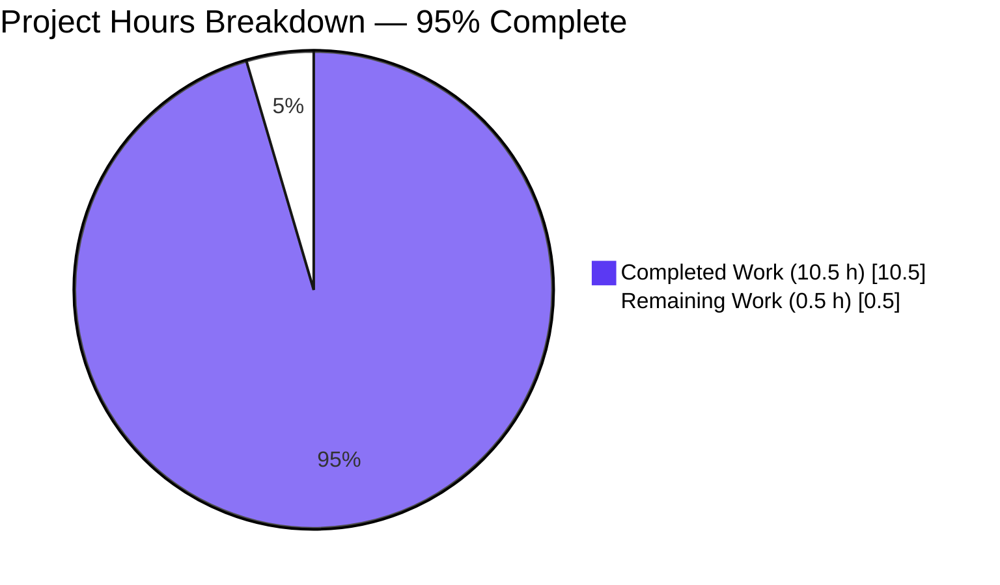
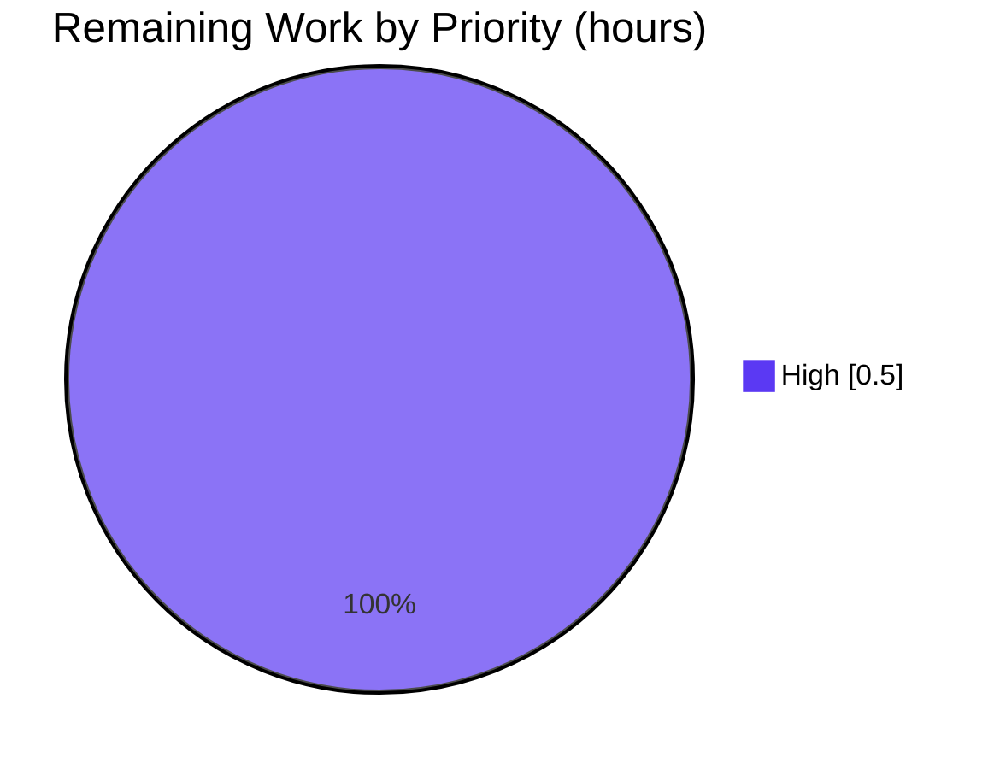
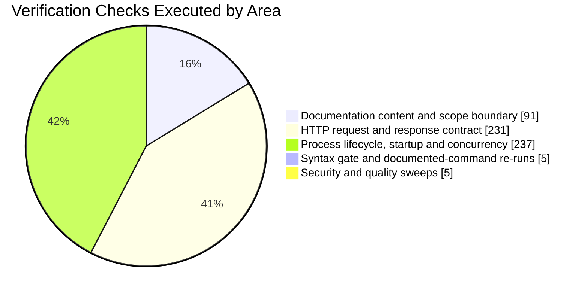

# 1. Executive Summary

## 1.1 Project Overview

QuickTest is a one-file Node.js HTTP service: `server.js` holds a single statement that answers every request with the body `Hello, World!` plus a newline, and the repository contains nothing else. This change makes two undiscoverable facts discoverable: what the handler does and how to start it. It adds one summary comment line above the handler and a five-line `README.md` naming the project, recording that no install applies and giving the run command. The change is documentation-only.

## 1.2 Completion Status

**95% complete** — 10.5 of the 11.0 hours scoped by this work, with 0.5 hours remaining for the release step.



Completed work is Blitzy dark blue (#5B39F3), remaining work white (#FFFFFF), as in Section 7; the outstanding half hour is the release step.

| Metric | Hours |
|---|---|
| Total Hours | 11.0 |
| Completed Hours (AI + Manual) | 10.5 |
| Remaining Hours | 0.5 |

## 1.3 Key Accomplishments

- [x] The request handler has a one-line summary comment above it; the original statement is unchanged.
- [x] A `README.md` names the project, records that no install applies and gives the run command.
- [x] Only two files changed: 6 added lines, 0 deletions, no dependency.
- [x] The documented command binds TCP 3000 and prints its single startup line.
- [x] Every request exercised returned 200 with the byte-exact 14-byte body.
- [x] Unknown paths and hostile inputs return the same body.
- [x] SIGINT and SIGTERM release the port; concurrency and restarts stay clean.
- [x] Every documented claim was confirmed against the repository.

## 1.4 Critical Unresolved Issues

**0 of the 2 requested deliverables remain open.** Both are complete and verified. The limits the scope fixes — an open unhardened endpoint, no media type, a fixed port — are its accepted contract, assessed as risks in Section 6.

| Issue | Impact | Owner | ETA |
|---|---|---|---|
| None — no unresolved issues identified | — | — | — |

## 1.5 Access Issues

No access issues identified: the work needed no repository permission beyond committing to its own branch, and no credential, key, database, broker, licence or environment variable.

| System/Resource | Type of Access | Issue Description | Resolution Status | Owner |
|---|---|---|---|---|
| None | — | No access issues identified | n/a | — |

## 1.6 Recommended Next Steps

1. [High] Release the change: review and merge the two commits, then re-run the documented gate on the merged tree.
2. [High] Keep the service on loopback or inside a trusted network: it answers every path and method with 200 and has no authentication or rate limiting.
3. [Medium] Publish the response contract: 200 everywhere, a 14-byte body, no `Content-Type`, no body or length on HEAD.
4. [Low] Bring a test runner and coverage gate with any change that first adds handler logic.

# 2. Project Hours Breakdown

## 2.1 Completed Work Detail

Hours are attributed to the deliverables this work was scoped against; each row traces to a specific agreed requirement.

| Component | Hours | Description |
|---|---|---|
| Handler documentation in `server.js` | 1.0 | Authoring the one-line summary comment, placing it as the new first line directly above the handler, and preserving the pre-existing statement byte for byte (`server.js:1-2`). |
| Repository `README.md` | 1.0 | Creating the five-line document that names the project, records that no install step applies, and gives the run command; confirming the name and the launch command against the repository. |
| Content fidelity and scope-boundary verification | 2.0 | Byte comparison of both files against the agreed wording, blob-level proof that the pre-existing statement is untouched, diff-shape and line-count checks, comment-form checks, and the probes that show no third artifact and no forbidden file exists. |
| Documented run path and response-contract verification | 3.0 | Starting the service with the documented command and exercising the path set, the method set, encoded and 2,000-character paths, 1 MB to 10 MB request bodies in plain, chunked and `Expect: 100-continue` forms, the returned headers, keep-alive and pipelining, side-effect freedom, an environment-cleared start, and adversarial payloads. |
| Process lifecycle, startup and concurrency verification | 2.0 | Startup-line exactness and ordering, residency, SIGINT and SIGTERM shutdown with port release, rapid restart cycles, 20- and 100-request concurrency, mid-flight shutdown, descriptor and memory sweeps, and log cleanliness. |
| Quality and security sweeps over the change | 1.0 | Syntax gate, whitespace and encoding hygiene, placeholder scan, and the baseline secret, input-path, injection and path-traversal sweeps. |
| Cross-file and whole-tree integration verification | 0.5 | Confirming the run command resolves to the only entry point, that nothing imports either file, that no documentation reference dangles, and that the tree holds exactly the two files. |
| **Total** | **10.5** | |

## 2.2 Remaining Work Detail

| Category | Hours | Priority |
|---|---|---|
| Release the change: review and merge the two commits, then re-run the documented gate on the merged tree (`node --check server.js`; start with `node server.js` from the repository root; `curl -s -i http://127.0.0.1:3000/` → 200 with a 14-byte body) | 0.5 | High |
| **Total** | **0.5** | |

No functional work remains: both deliverables are complete and every requirement of the agreed scope is satisfied. The single outstanding step is putting the change into production.

## 2.3 How the Numbers Add Up

- Completed hours (Section 2.1): 1.0 + 1.0 + 2.0 + 3.0 + 2.0 + 1.0 + 0.5 = **10.5**
- Remaining hours (Section 2.2): **0.5**
- Total project hours: 10.5 + 0.5 = **11.0** (Section 1.2)
- Completion: 10.5 / 11.0 = 95.5%, reported as **95%**

Confidence is high for the completed hours, which rest on byte-level and behavioural checks of a two-file change, and high for the remaining estimate, which is a single well-understood release step. The 0.5 remaining hours are path-to-production work only; work that this scope deliberately excludes (a test framework, hardening, additional documentation) is not part of the total and does not affect the percentage.

# 3. Test Results

Verification of this change is direct execution and byte-level inspection; the repository carries no test framework, so no coverage instrument is configured and every figure below comes from a check that was run and whose result was seen.

| Area / Category | Framework | Tests | Passed | Failed | Coverage | What This Proves |
|---|---|---|---|---|---|---|
| Documentation content and scope boundary | Static verification (byte comparison, blob and diff inspection, artifact-absence probes) | 91 | 91 | 0 | n/a — no coverage instrument | The handler comment and the README match the agreed wording exactly, the pre-existing statement is byte-identical, and no third artifact was added anywhere in the tree. |
| HTTP request and response contract | Direct execution (curl and raw sockets against the running service) | 231 | 231 | 0 | n/a — no coverage instrument | Every accepted request returns 200 with the byte-exact 14-byte body across all paths, methods, encodings and request sizes exercised, headers are as documented, and hostile payloads are never reflected. |
| Process lifecycle, startup and concurrency | Direct execution (process, port and log probes) | 237 | 237 | 0 | n/a — no coverage instrument | The documented command starts the listener on port 3000 with exactly one startup line, serves concurrent and mixed traffic, shuts down cleanly on SIGINT and SIGTERM, restarts without leaking the port, and leaves no file-system side effects. |
| Syntax gate | Node.js syntax check (`node --check server.js`) | 1 | 1 | 0 | n/a — no coverage instrument | The only source file parses without error — the one automated gate this repository defines. |
| Documented commands re-executed on the delivered tree | Direct execution (documented run plus smoke checks) | 4 | 4 | 0 | n/a — no coverage instrument | The README's install and run statements hold as behaviour: no install is needed and the documented command answers with the documented 200 / 14-byte response. |
| Security and quality sweeps | Static scans (credential and secret, input path, injection sink, placeholder, whitespace) | 5 | 5 | 0 | n/a — no coverage instrument | The change introduces no secret, no input path and no injection sink, and leaves no placeholder, deferred or commented-out code. |
| Automated test suite | Node.js built-in runner (`node --test`) | 0 | 0 | 0 | none | The repository contains no tests and the runner collects none — no coverage percentage exists to report. |
| **Total** | | **569** | **569** | **0** | | |

## Not Covered

- **Automated regression coverage.** The repository ships no test suite, runner, configuration or CI gate, and this scope deliberately adds none. The syntax check plus a start-and-curl smoke check are the entire automated gate, so nothing catches a behavioural regression automatically: any change that adds handler logic should bring a test runner with it.
- **HEAD response framing.** HEAD answers 200 with no body and no `Content-Length`; this is recorded behaviour, asserted by no check.
- **Requests the runtime rejects before the handler runs.** A malformed request line returns 400, an oversized target or header block returns 431, and `CONNECT` is closed with no response. These are protocol-layer outcomes the application never sees and no handler-level check covers them.
- **The port-conflict failure mode.** A second instance on a held port exits with an unhandled error event rather than a handled message; no check covers a graceful failure path because none exists.
- **IPv6 loopback reachability.** It could not be confirmed on this host, where IPv6 is disabled; the dual-stack bind was exercised inside a network namespace only.
- **Anything beyond the single HTTP boundary.** There is no rendered page, form, client application, database or deployment path, so no user interface, navigation, integration or deploy-time behaviour exists to test, and nothing is built, previewed or deployed by this change.

# 4. Runtime Validation & UI Verification

Every line below was exercised against the running service, started with the documented command from the repository root.

- ✅ **Startup and listener** — `node server.js` binds TCP 3000 (`LISTEN 0 511 *:3000`), prints exactly `Server running at http://127.0.0.1:3000/` as its single 41-byte startup line, and answers the first request immediately afterwards.
- ✅ **Primary request journey** — `curl -s -i http://127.0.0.1:3000/` returns `HTTP/1.1 200 OK`, `Content-Length: 14`, and the body `Hello, World!` with no `Content-Type` header.
- ✅ **Path handling** — `/`, unknown, nested, case-variant, percent-encoded, 2,000-character and 8,000-character paths all return the same 200 / 14-byte response; an unknown path never returns a 404 page.
- ✅ **Method handling** — GET, HEAD, POST, PUT, PATCH, DELETE, OPTIONS and TRACE are all accepted; HEAD answers 200 with a suppressed body and no `Content-Length`.
- ✅ **Request bodies** — 1 MB, 5 MB and 10 MB payloads, plain, chunked and with `Expect: 100-continue`, all return the same 200 / 14-byte response with the process still resident.
- ✅ **Concurrency and keep-alive** — 20 concurrent and 100 concurrent requests returned 200 with a single identical body, pipelined and reused connections answered correctly, and open descriptors held constant at 22 across 500 requests.
- ✅ **Shutdown and restart** — SIGINT exits 130 and SIGTERM exits 143, each releasing the port; five rapid restart cycles re-bound port 3000 with the identical startup line and response.
- ✅ **Environment independence and side effects** — a start under an emptied environment behaves identically, requests change no file in the repository, and the session log stays at exactly one line with no stack trace or error text.
- ✅ **Adversarial input** — path traversal, script payloads, SQL- and command-injection shapes, header injection, foreign hosts and duplicate headers all return the constant body with nothing reflected and no file read.
- ⚠ **Second instance on a held port** — a second copy exits immediately with an unhandled `EADDRINUSE` error event and a stack trace rather than a handled message; the running instance keeps serving.
- ⚠ **Inputs the protocol layer rejects** — a malformed request line returns 400, an oversized target or header block returns 431, and `CONNECT` is closed with no response; these are runtime-layer outcomes, not application output.

**Never exercised at runtime.** No browser-rendered surface exists: the service emits a fixed plain-text body, so no screen, form, client flow or visual state was driven or captured. Nothing was deployed, and no continuous-integration pipeline, container, process supervisor, reverse proxy or TLS termination was exercised, because none exists in this repository. The service is also never exercised over a public network, and IPv6 loopback could not be reached on this host.

# 5. Compliance & Quality Review

## 5.1 Compliance Matrix

Each row is a deliverable or quality benchmark for this change, with its verified status as it stands now.

| Deliverable / Benchmark | Status | Evidence |
|---|---|---|
| Request handler documented by one one-line summary comment placed directly above it | ✅ Pass | `server.js:1`, immediately above the handler, column 1, no declaration introduced |
| Comment form: a single self-closing `/** ... */` line with no parameter, return, description or example tags | ✅ Pass | 90-character single line; `grep -c '@' server.js` = 0; file remains 2 lines |
| Pre-existing handler statement preserved byte for byte (comment-only change) | ✅ Pass | Line 2 identical to the pre-change blob `2886290f…` (142 bytes), including the two-character `\n` escape; one added line, 0 removals |
| `README.md` carries the project name, the install statement and the run command only | ✅ Pass | Three non-blank lines: `# QuickTest`, `Install: none (no dependencies)`, `Run: node server.js` |
| README length and structure limits (< 15 lines; no contributing, license, testing, deployment, architecture or contents sections) | ✅ Pass | 5 lines, exactly 1 heading, no sub-heading, link, badge, image or code fence |
| Scope boundary: exactly two files changed, 6 insertions, 0 deletions | ✅ Pass | `A README.md`, `M server.js`; `--stat` = 2 files changed, 6 insertions(+); `git ls-files` = 2 |
| No third file, no test suite or test file, no lockfile, no dependency | ✅ Pass | 18-path and 45-path artifact probes all absent; sole import is Node's built-in `http`; `node --test` collects 0 tests |
| No 404 handler, error handler, environment-variable configuration or hardening added | ✅ Pass | 0 added executable lines; `process.env`, `404`, `setHeader`, `writeHead`, `try`, `catch`, `throw` all 0 hits in `server.js` |
| No unrelated refactoring, reformatting or renaming of existing code | ✅ Pass | One hunk of a single added line; `git diff --check` clean; no rename; line 2 untouched |
| Install and run instructions accurate as behaviour | ✅ Pass | No manifest or lockfile exists, so no install step applies; `node server.js` from the repository root starts the service, including under an emptied environment |
| Running behaviour matches the documented contract | ✅ Pass | 200 with the byte-exact 14-byte `Hello, World!` body for every path and valid method exercised; startup line exactly `Server running at http://127.0.0.1:3000/`; port 3000 bound |
| Baseline security and hygiene of the change | ✅ Pass | No credential, secret or high-entropy literal; no input path or injection sink introduced; no placeholder, TODO, stub, deferred or commented-out code; ASCII/LF-only with no trailing whitespace |

## 5.2 AAP & Rule Divergences and Gaps

**No divergences from the Agent Action Plan or user rules were identified.**

| What the AAP/Rule Required | What Was Delivered Instead | Why It Diverged | Impact | Remediation |
|---|---|---|---|---|
| Nothing diverged — every agreed requirement was met as written | The two deliverables exist byte-exact against the agreed wording, with every mandated absence in place | n/a | None | None |

Basis for that conclusion: both delivered files were compared byte for byte against the agreed contents and match exactly (`server.js` line 1 as the 90-character summary, line 2 identical to the pre-change statement; `README.md` as the five fixed lines with a terminating newline); the change touches only those two files, adding 6 lines and deleting none; each of the thirteen directives that govern this work was checked against the artifacts it binds (nine) or against the plan's own text (four), and all thirteen are satisfied; the recorded delivery decisions contain no unoverridden rule departure; and no user rule exists beyond the directives quoted for this work, so there was nothing else to depart from. Every design characteristic a reader might read as a gap — the unhardened endpoint, the absent media type, the fixed host-global port, the absent test suite — is a state this scope expressly requires rather than a departure from it.

# 6. Risk Assessment

| Risk | Category | Severity | Probability | Mitigation | Status |
|---|---|---|---|---|---|
| No automated regression gate exists: the repository has no test suite, runner, configuration or CI, so only a syntax check plus a start-and-curl smoke check stand between a future edit and a behavioural regression | Technical | Medium | High | Keep the syntax check and smoke check as the per-change gate, and add a test runner in any change that introduces handler logic | Open — accepted, the scope forbids adding one |
| The endpoint is completely open and unhardened: every path and valid method returns 200 with the same body, with no authentication, authorisation, rate limiting, path validation or 404 handling | Security | High if exposed | Low inside a trusted boundary | Keep the service on loopback or inside a trusted network or namespace; front it with a reverse proxy if it must be reachable | Open — accepted, the scope forbids hardening |
| The listener binds the wildcard address while the startup line advertises `127.0.0.1`, so the log understates reachability on a host with an open firewall | Security | Medium | Medium | Restrict exposure with a host firewall or network namespace; treat the startup line as informational rather than as a description of the bind | Open — pre-existing behaviour, outside the agreed change |
| Port 3000 is hardcoded and host-global, and a second instance dies on an unhandled `EADDRINUSE` error event with a stack trace and exit 1 | Operational | Medium | Medium | Free the port before starting another copy, or isolate instances in network namespaces | Open — accepted, a graceful failure is out of scope |
| No process supervision, health endpoint, CI or monitoring exists; the service is started and checked by hand | Operational | Low | Low | Start it under your own supervisor and confirm with a request after each start | Accepted for this deliverable |
| Responses carry no `Content-Type`, so consumers must treat the body as opaque or sniff the media type | Integration | Medium | Medium | Document the contract for consumers and decide whether a future change adds the media type | Open — accepted, adding it is out of scope |
| HEAD responses carry neither a body nor `Content-Length`, so a client cannot learn the entity length with HEAD | Integration | Low | Medium | Use GET when the entity length matters; do not build consumers that depend on a HEAD length | Open — accepted, RFC-permitted behaviour |
| Malformed or oversized requests are framed by the protocol layer (bare 400, bare 431, `CONNECT` closed with no response), and IPv6 loopback depends on the host | Integration | Low | Low | Ensure clients send well-formed HTTP and use IPv4 loopback where IPv6 is disabled | Accepted — unchanged from the pre-existing entry point |

# 7. Visual Project Status





- **Completed work (dark blue #5B39F3): 10.5 hours.** **Remaining work (white #FFFFFF): 0.5 hours** — a single High-priority release step, so the priority distribution below carries one bar.
- **569 verification checks were executed, all passing, 0 failing**, plus the repository's own runner, which collects 0 tests because none exist.
- **Deliverables: 2 of 2 complete** — the handler comment and the minimal README — with no functional work outstanding.

| Remaining Work Category | Hours |
|---|---|
| Release the change (review, merge, re-run the documented gate on the merged tree) | 0.5 |
| **Total** | **0.5** |

# 8. Summary & Recommendations

QuickTest's two undocumented facts are now documented and proven. `server.js` carries a single one-line summary comment immediately above the request handler, with the handler statement itself preserved byte for byte, and the repository carries a five-line `README.md` that names the project, records that no install step applies, and gives the run command. The change is exactly that: two files, 6 added lines, 0 deletions, no dependency, no lockfile, no test or CI scaffolding, and nothing else in the tree touched. Both files were compared byte for byte against the agreed wording and match it exactly.

What the verification established is that the documentation is true of the running code. The documented command starts the service from the repository root, binds TCP 3000 and prints `Server running at http://127.0.0.1:3000/` as its only startup line; every request accepted over that socket — on any path, with any valid method, with bodies up to 10 MB — returns HTTP 200 with the byte-exact 14-byte `Hello, World!` body, including for unknown paths and adversarial inputs that are never reflected; concurrent traffic, clean SIGINT and SIGTERM shutdown, port release and repeated restarts were all exercised; and the sweeps found no secret, no input path, no injection sink and no placeholder or deferred code. In total 569 checks were executed across static inspection and live execution, all passing, with 0 failures.

Nothing functional is outstanding, and the completion figure is **95% (10.5 of 11.0 hours)**. The remaining half hour is the release step: review and merge the change, then re-run the documented gate on the merged tree. That step is the entire critical path to production — there is no other work item between the delivered state and a released one.

The open risks are the contract of the service rather than defects of this change: an unhardened endpoint that answers everything with 200, responses without a media type, HEAD without a body or length, a fixed host-global port whose second instance fails ungracefully, and no automated gate to catch a future regression. Each is accepted by the scope this work was asked to honour, and each becomes material only if the service is exposed beyond a trusted boundary or extended with new logic.

**Production readiness: ready for release within the agreed scope.** The deliverable is a documentation-only change whose runtime surface is byte-identical to the entry point that already shipped; every documented claim was confirmed against the repository; and the only automated gate the project defines passes. Treat the service as a loopback or trusted-network component, and bring a test runner with any change that adds handler logic.

| Metric | Value |
|---|---|
| Completion (scoped to the agreed work) | 95% — 10.5 of 11.0 hours |
| Deliverables complete | 2 of 2 (handler comment, `README.md`) |
| Verification checks executed / passed / failed | 569 / 569 / 0 |
| Automated tests in the repository | 0 (none exist, by design) |
| Files changed | 2 (6 insertions, 0 deletions) |
| Divergences from the agreed scope | 0 |

## Prioritized Human Task List

Only the release step carries hours in the total above; the advisory items are mitigations for accepted design limits and add nothing to the completion calculation.

| # | Priority | Task | Hours |
|---|---|---|---|
| 1 | High | Review and merge the two commits, then re-run the documented gate on the merged tree: `node --check server.js`, start with `node server.js` from the repository root, and confirm `curl -s -i http://127.0.0.1:3000/` returns 200 with a 14-byte body | 0.5 |
| 2 | High | Decide and enforce the exposure boundary before the service runs beyond a development machine: keep it on loopback or inside a trusted network or namespace | not counted |
| 3 | Medium | Publish the response contract to consumers: 200 for every path and valid method, a 14-byte body, no `Content-Type`, and no body or `Content-Length` on HEAD | not counted |
| 4 | Medium | Keep one instance per namespace, or stop the process holding port 3000 first, since a second instance exits with an unhandled `EADDRINUSE` error | not counted |
| 5 | Low | Add an automated test runner and coverage gate in the same change that first adds handler logic | not counted |
| 6 | Low | Confirm the documented gate in each environment where the service will run, since no CI exists to run it automatically | not counted |
| | | **Counted total** | **0.5** |

# 9. Development Guide

## System Prerequisites

- **Node.js 20.20.2 or later in the 20.x line, or 22.12.0 or later** — verified here on **v22.23.4**. The code needs nothing version-specific beyond `require` and an arrow function.
- **git** (verified on 2.56.0) to clone the repository.
- **curl** (verified on 8.18.0) to verify responses.
- Optional: **`ss`** from iproute2 to inspect the listener, and **`unshare`** plus **`ip`** to run an instance in its own network namespace. `lsof` is not required and may not be installed.
- No database, message broker, cache, reverse proxy, licence, credential or environment variable is needed. The project has no runtime dependencies.

## Environment Setup

1. Clone the repository and enter it. The repository root **is** the project — there is no subdirectory to descend into.
   ```bash
   git clone <repository-url> QuickTest
   cd QuickTest
   ```
2. Nothing else to prepare: no virtual environment, no `.env` file, no configuration, no secrets. The one module the code loads is Node's built-in `http`.

## Installing Dependencies

There are none, and no install step applies.

- The repository contains no `package.json`, no lockfile and no `node_modules`, and `server.js` imports only Node's built-in `http` module.
- Do **not** run `npm install`. With no manifest present it fails (`npm error code ENOENT … package.json`), and it would create a manifest this project does not have.

## Starting the Service

1. From the repository root, start it in the foreground:
   ```bash
   node server.js
   ```
   Expected output — exactly one line, and no prompt returns because the process keeps running:
   ```
   Server running at http://127.0.0.1:3000/
   ```
2. Stop it with `Ctrl-C` (SIGINT, exit status 130) or `kill <pid>` (SIGTERM, exit status 143). Both release port 3000.
3. To keep your shell free, start it in the background and keep its output:
   ```bash
   node server.js > server.log 2>&1 &
   ```
4. To run an isolated instance — useful when another process already holds port 3000, or when several copies must run side by side:
   ```bash
   unshare -rn sh -c 'ip link set lo up; node server.js & sleep 2; curl -s -i http://127.0.0.1:3000/; kill $!'
   ```
   Use `kill $!`; `kill %1` is a silent no-op in non-interactive `sh`.

## Verifying the Running Service

1. Syntax gate — the repository's only automated check:
   ```bash
   node --check server.js
   ```
   Expect exit status 0 and no output.
2. Confirm the listener (the `users:` field shows the pid that owns the socket):
   ```bash
   ss -ltnp | grep 3000
   ```
3. Confirm the response:
   ```bash
   curl -s -i http://127.0.0.1:3000/
   ```
   Expected response:
   ```
   HTTP/1.1 200 OK
   Date: <current date>
   Connection: keep-alive
   Keep-Alive: timeout=5
   Content-Length: 14

   Hello, World!
   ```
4. Confirm the contract on an unknown path and on a non-GET method:
   ```bash
   curl -s -o /dev/null -w 'unknown_path %{http_code} %{size_download}\n' http://127.0.0.1:3000/this/path/does/not/exist
   curl -s -o /dev/null -X POST -d a=1 -w 'post %{http_code} %{size_download}\n' http://127.0.0.1:3000/
   ```
   Both print `200 14`.
5. There is no test suite to run. `node --test` reports `1..0` with `# tests 0`, and adding one is outside this project's scope. Per-change validation is the syntax gate plus the start-and-curl checks above, followed by stopping the server.

## Example Usage

```bash
# Start the service (leave it running in its own terminal, or use & as above)
node server.js

# The root path
curl -s -i http://127.0.0.1:3000/
# HTTP/1.1 200 OK ... Content-Length: 14 ... Hello, World!

# Any other path returns the same body; there is no routing and no 404
curl -s -i http://127.0.0.1:3000/does/not/matter

# Every valid method is accepted; HEAD carries no body and no Content-Length
curl -s -I  http://127.0.0.1:3000/
curl -s -X POST -d 'a=1' http://127.0.0.1:3000/

# Just the status and body size
curl -s -o /dev/null -w '%{http_code} %{size_download}\n' http://127.0.0.1:3000/
```

## Troubleshooting

| Symptom | Cause | Resolution |
|---|---|---|
| `Error: listen EADDRINUSE: address already in use :::3000` with a stack trace, exit status 1 | Another process already holds port 3000; only one instance can bind it | Find the owner with `ss -ltnp \| grep :3000`, stop that process, or run in a private network namespace (see above) |
| `Error: Cannot find module '/path/server.js'` or `MODULE_NOT_FOUND` | The command was run outside the repository root | `cd` into the repository root first, then run `node server.js` |
| `npm error code ENOENT … package.json` | An npm command was run; the project has no manifest and needs no install | Skip the install step and run `node server.js` |
| Every path returns 200 and there is no `Content-Type` header | The documented contract: the handler answers every request with the same body, with no routing, no 404 page and no media type | No action required; do not add routing or headers unless the contract is being changed deliberately |
| The start appears to do nothing | The only output is the single startup line; the process stays in the foreground | Confirm with `curl`, and remember that a background start needs its own terminal or a log redirect |
| Port 3000 still held after a crash | The listening socket outlived the shell that started it | `ss -ltnp \| grep :3000`, then stop the pid shown in the `users:` field |
| IPv6 loopback `http://[::1]:3000/` refuses the connection | The host has IPv6 disabled, while the listener binds dual-stack | Use `http://127.0.0.1:3000/`, or run the instance inside a namespace where `lo` has IPv6 enabled |

# 10. Appendices

## A. Command Reference

| Purpose | Command | Expected result |
|---|---|---|
| Syntax gate (the only automated check) | `node --check server.js` | Exit status 0, no output |
| Start the service | `node server.js` | Prints `Server running at http://127.0.0.1:3000/` and keeps running |
| Start in the background | `node server.js > server.log 2>&1 &` | Same startup line written to `server.log` |
| Start isolated in a network namespace | `unshare -rn sh -c 'ip link set lo up; node server.js & sleep 2; curl -s -i http://127.0.0.1:3000/; kill $!'` | Startup line, the 200 / 14-byte response, then clean shutdown |
| Stop the service | `Ctrl-C`, or `kill <pid>` | SIGINT exit 130 / SIGTERM exit 143, port released |
| Inspect the listener | `ss -ltnp \| grep 3000` | `LISTEN 0 511 *:3000 … users:(("node",pid=…))` |
| Verify the response | `curl -s -i http://127.0.0.1:3000/` | `HTTP/1.1 200 OK`, `Content-Length: 14`, body `Hello, World!` |
| Status and body size only | `curl -s -o /dev/null -w '%{http_code} %{size_download}\n' http://127.0.0.1:3000/` | `200 14` |
| Confirm no tests exist | `node --test` | TAP `1..0`, `# tests 0` |
| Runtime version | `node --version` | `v22.23.4` |
| Change inventory against the pre-change revision | `git diff --name-status 3d00f47 HEAD` | `A README.md`, `M server.js` |
| File digests | `sha256sum server.js README.md` | `server.js` `dbfd3bee…0bbb`; `README.md` `dde675e3…1392` |

## B. Port Reference

| Port | Protocol | Bind | Configuration | Notes |
|---|---|---|---|---|
| 3000 | TCP (HTTP) | Wildcard `*:3000`, dual-stack, chosen by `listen(3000)` | Hardcoded in `server.js`; not configurable | Only one instance can bind it per network namespace. Nothing else in the project opens a port, and no other service is required. |

## C. Key File Locations

| Path | Role |
|---|---|
| `server.js` | The entire application: a one-line summary comment followed by a single statement that creates the HTTP server and listens on port 3000. |
| `README.md` | The project name, the install statement (`none`) and the run command (`node server.js`). |
| `.git/config` | Repository metadata, including the origin remote the project name is taken from. |

## D. Technology Versions

| Component | Version used | Notes |
|---|---|---|
| Node.js | v22.23.4 | Requires 20.x ≥ 20.20.2 or 22.x ≥ 22.12.0; CommonJS, runs the file directly |
| npm | 11.21.0 | Present but unused — the project has no manifest and no scripts |
| git | 2.56.0 | Cloning and change inspection |
| curl | 8.18.0 | Verifying responses |
| iproute2 (`ss`, `ip`), util-linux (`unshare`) | Distribution versions | Listener inspection and isolated runs |
| Runtime dependencies | none | The sole import is Node's built-in `http` module |

## E. Environment Variable Reference

| Variable | Required | Notes |
|---|---|---|
| None | No | The process reads no environment variable. It starts and behaves identically when launched with the environment emptied, so no configuration file, secret or variable has to be supplied. |

## F. Developer Tools Guide

- **Node.js runtime and gate**: `node server.js` runs the application; `node --check server.js` parses it without executing (use it before every commit); `node --test` is the built-in runner and collects nothing here.
- **curl**: the primary way to confirm behaviour — `-i` for headers plus body, `-o /dev/null -w '%{http_code} %{size_download}'` for status and size, `-I` for HEAD, `-X` to choose a method, `--path-as-is` to send traversal-shaped paths unchanged.
- **`ss`**: `ss -ltnp | grep 3000` shows the listener, its bind address and the owning pid — the way to find what holds the port before stopping it.
- **Network namespaces** (`unshare -rn` plus `ip link set lo up`): give an instance a private loopback so port 3000 is never contended, which is the recommended pattern for tests or for running several copies.
- **git**: `git status --porcelain` to confirm the tree is clean, `git diff --stat 3d00f47 HEAD` for the change shape, `git show 3d00f47:server.js` to read the pre-change entry point.
- **No linter, formatter, type checker or coverage tool is configured.** If one is added, do it deliberately: the project's style is plain single-line JavaScript with a single summary comment.

## G. Glossary

| Term | Meaning |
|---|---|
| Handler | The inline arrow function passed to `createServer` in `server.js`; it ends every response with the constant body. |
| Response contract | 200 for every path and every valid method, a 14-byte `Hello, World!` body (13 characters plus a newline), `Content-Length: 14`, and no `Content-Type`. |
| Startup line | The single line the process prints once the listener is up: `Server running at http://127.0.0.1:3000/`. |
| Summary comment | The one-line `/** … */` comment above the handler, describing what it does without parameters, returns or examples. |
| Wildcard bind | `listen(3000)` with no host argument, so the socket is bound on all interfaces and dual-stack rather than on loopback only. |
| HEAD suppression | Node's HTTP layer drops the body — and the length — from a HEAD response even though the handler passes the same body for every method. |
| `EADDRINUSE` | The error raised when a second instance tries to bind port 3000 while it is held; the process exits with an unhandled error event. |
| Network namespace | An isolated network stack (`unshare -rn`) in which an instance can bind port 3000 without contending for the host's port. |
