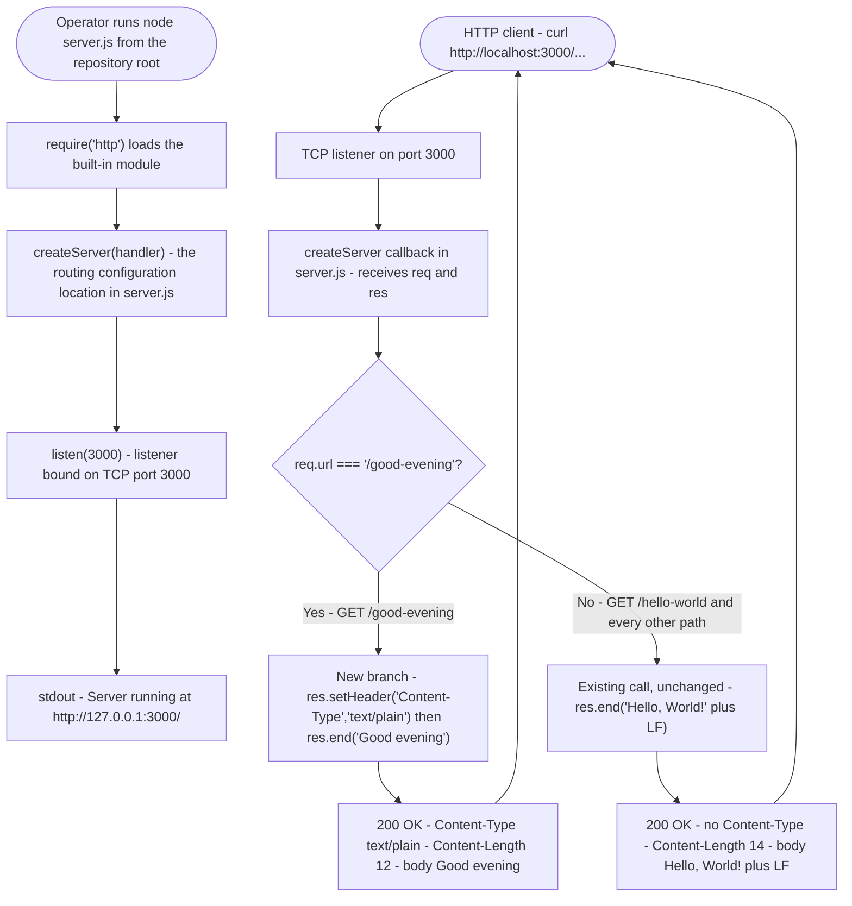

# Request flow through `server.js` — the `/good-evening` branch beside the unchanged fallback



## Endpoint contract

| Element | Value |
| --- | --- |
| Method | `GET` |
| Path | `/good-evening` |
| Response status | `200` |
| Response body | `"Good evening"` (plain text, 12 bytes, no trailing newline) |
| Content-Type | `text/plain` |

Both branches live in the one routing location the server has — the `createServer` callback in `server.js` — as siblings: the new `if` block first, the existing call after it as the fallback for every non-matching path.

## The request's two examples

Run from the repository root, with the server started by `node server.js` and listening on port 3000:

- `curl http://localhost:3000/good-evening` returns `Good evening`
- `curl http://localhost:3000/hello-world` returns `Hello world` (unchanged)

The second example paraphrases the body. `/hello-world` has no route of its own: it falls through to the existing call, which returns exactly `Hello, World!` plus LF — status `200`, `Content-Length: 14`, and no `Content-Type` header. The stronger instruction that existing endpoint behaviour is not modified governs, and the bytes that path returns today are the bytes it returns after the change.

## Measured evidence (Node.js v22.23.3)

`GET /good-evening`:

```text
HTTP/1.1 200 OK
Content-Type: text/plain
Content-Length: 12

Good evening
```

`curl -s http://localhost:3000/good-evening | od -c` shows twelve characters and no trailing newline (end offset `0000014`).

`GET /hello-world`, and every other non-matching path, unchanged:

```text
HTTP/1.1 200 OK
Content-Length: 14

Hello, World!
```

No `Content-Type` header accompanies that response.

The diagram above labels the existing call's body as `plus LF` rather than an escape sequence so it renders identically in every Mermaid renderer; the body in the code remains `'Hello, World!\n'`.
